# Misadventures

> *Working title.* Jogo de cartas colecionáveis (TCG) para web, com frontend e backend, que mistura **TCG**, **RPG**, **jogo de tabuleiro**, **grind** e **interatividade em tempo real**.

> **Atenção**: muitos conceitos estão sujeitos a mudar com o tempo devido a novas ideias ou à descoberta de problemas. Este documento apresenta as ideias básicas. Valores marcados como "ajustáveis no laboratório" são pontos de partida para testes (veja o [Laboratório de testes](#laboratório-de-testes) e o [Apêndice A](#apêndice-a--valores-ajustáveis)).

---

## Sumário

**Parte I — Manual de regras**

*Começo: o que é o jogo*
1. [O jogo em uma página](#1-o-jogo-em-uma-página)
2. [Glossário](#2-glossário)

*O mundo: onde se joga*

3. [Dimensões, zonas e mapa](#3-dimensões-zonas-e-mapa)

*O personagem: o que o jogador tem*

4. [Atributos e o deck de atributos](#4-atributos-e-o-deck-de-atributos)
5. [Recursos](#5-recursos)
6. [Onde ficam as cartas](#6-onde-ficam-as-cartas)
7. [Modificadores e Energia](#7-modificadores-e-energia)
8. [Classes e especializações](#8-classes-e-especializações)
9. [O jogador](#9-o-jogador)

*A partida: como se joga*

10. [Preparação da partida](#10-preparação-da-partida)
11. [A vez do jogador](#11-a-vez-do-jogador)
12. [Ações de zona](#12-ações-de-zona)

*Efeitos e desafios: como as coisas interagem*

13. [Efeitos](#13-efeitos)
14. [Eventos](#14-eventos)
15. [Teste de fuga](#15-teste-de-fuga)
16. [Elementos](#16-elementos)
17. [Habilidades](#17-habilidades)
18. [Inimigos](#18-inimigos)
19. [Sistema de combate](#19-sistema-de-combate)
20. [Nocaute, spawn e respawn](#20-nocaute-spawn-e-respawn)

*Conteúdo e economia: o que fazer no mundo*

21. [Missões](#21-missões)
22. [Raides](#22-raides)
23. [Negociação](#23-negociação)
24. [Mercado](#24-mercado)
25. [Ferreiro](#25-ferreiro)
26. [Montarias](#26-montarias)
27. [Coleções](#27-coleções)

*Modos*

28. [Modos de jogo](#28-modos-de-jogo)

*Apêndice*

- [Apêndice A — Valores ajustáveis](#apêndice-a--valores-ajustáveis)

**[Parte II — Requisitos técnicos](#parte-ii--requisitos-técnicos)**

**[Parte III — Etapas de desenvolvimento](#parte-iii--etapas-de-desenvolvimento)**

---

# Parte I — Manual de regras

## 1. O jogo em uma página

### 1.1 Sinopse

Um ou mais aventureiros chegam a uma **dimensão** para conquistar o **prêmio máximo** daquele lugar (um artefato, um prêmio em moedas de ouro, equipamentos muito fortes, etc.) ou para **derrotar o chefe final** dela.

Dependendo do modo de jogo, os jogadores devem:
- se ajudar (Campanha e Clássico), ou
- ser o primeiro a cumprir os objetivos, cada um por si, podendo atacar os outros (Desbravadores).

### 1.2 Como se joga, em resumo

- O jogo é **baseado em turnos** e combina conceitos de TCG, mecânicas de jogo de tabuleiro e interatividade em tempo real: um jogador joga a sua vez de cada vez, e todos veem **ao vivo** o que acontece na vez dos outros.
- Cada jogador tem um **deck de atributos**, que usa para resolver desafios e pagar custos, e **recursos** (equipamentos e itens) que o fortalecem.
- Os jogadores **exploram o mapa** e resolvem **encontros** (eventos aleatórios) e **confrontos** (contra outros jogadores, junto com outros jogadores ou contra inimigos do próprio mundo).
- A partida termina quando a **condição de vitória do modo** é cumprida (veja [Modos de jogo](#28-modos-de-jogo)).

**O ciclo do jogo:**

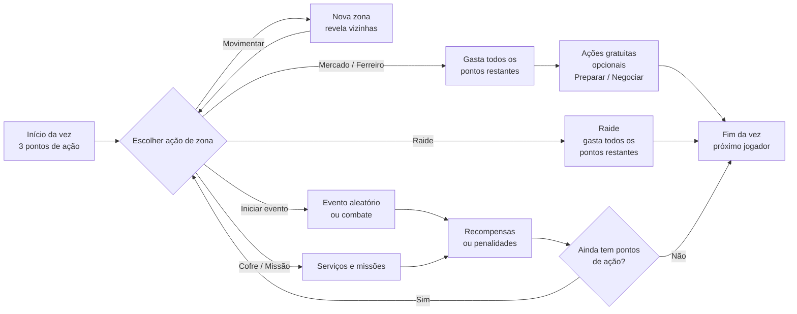

### 1.3 Número de jogadores

O jogo é **modular** na quantidade de jogadores. No **MVP**, cada partida comporta de **1 a 6 jogadores** (limite prático, ajustável no laboratório). A arquitetura não deve impedir aumentar esse limite no futuro. Para reduzir a espera em partidas grandes, cada vez tem tempo limitado (veja [11.3](#113-tempo-da-vez)). Vezes simultâneas não existem.

### 1.4 Modos de jogo (resumo)

| Modo | Tipo | Progresso levado para outras dimensões? |
|---|---|---|
| **Campanha** | Cooperativo | Sim |
| **Desbravadores** | Competitivo (sempre cada um por si, sem alianças), em formato de *runs* | Não. A progressão acontece apenas dentro da run. |
| **Clássico** | Desbravadores cooperativo, run curta | Não |
| **Enfrentamento (PVP)** | Apenas combate com outros jogadores, para testar builds | Não |

Os capítulos 3 a 27 descrevem o **modo campanha**; as diferenças dos outros modos estão no capítulo [28](#28-modos-de-jogo).

---

## 2. Glossário

Este capítulo apresenta o vocabulário usado no resto do manual. Cada termo é detalhado no seu capítulo.

### 2.1 Tempo

| Termo | Significado |
|---|---|
| **Vez** | O momento em que **um** jogador joga (move-se, executa ações, etc.). |
| **Rodada** | Termina quando **todos** os jogadores jogaram sua vez uma vez. |
| **Turno de combate** | Dentro de um combate, o momento em que uma das partes (jogador ou inimigo) age e ataca. |
| **Ciclo de combate** | Termina quando **todas** as partes do combate jogaram seu turno de combate uma vez. |

```
Fora do combate:   Rodada  = [ vez A ] → [ vez B ] → [ vez C ]
Dentro do combate: Ciclo   = [ turno jogador ] → [ turno inimigo 1 ] → [ turno inimigo 2 ]
```

**Exemplo de rodada:** três jogadores (A, B e C). O jogador A joga sua vez, depois o B, depois o C. A rodada termina e começa a próxima, sempre na mesma ordem (veja [11.2](#112-ordem-dos-jogadores)).

As palavras "turno" e "ciclo de combate" são usadas **só** dentro do combate. Fora dele, fala-se em **vez** e **rodada**.

### 2.2 Vocabulário básico

| Termo | Em uma frase | Capítulo |
|---|---|---|
| **Dimensão** | O mundo de uma partida, formado por cartas de zona. | [3](#3-dimensões-zonas-e-mapa) |
| **Zona** | Carta de lugar que compõe o mapa e oferece ações. | [3](#3-dimensões-zonas-e-mapa) |
| **Carta de atributo** | Carta do deck do jogador, usada para resolver eventos e pagar custos. | [4](#4-atributos-e-o-deck-de-atributos) |
| **Recurso** | Equipamento, item ou montaria que o jogador possui. | [5](#5-recursos) |
| **Inventário / pasta de TCG / cofre / montaria** | Os lugares onde o jogador guarda suas coisas (a montaria tem inventário e pasta extras). | [6](#6-onde-ficam-as-cartas) |
| **Limbo** | Pilha de descarte comum a todos os jogadores; o que vai para lá é perdido para sempre. | [6](#6-onde-ficam-as-cartas) |
| **Modificador** | Número do jogador usado em cálculos (Ataque, Defesa, etc.). | [7](#7-modificadores-e-energia) |
| **Energia** | Mecânica formada pelo **Pico** (o "nível") e pelo **Vigor** (o que é gasto). | [7](#7-modificadores-e-energia) |
| **Pico** | Energia máxima do jogador; substitui o "nível" e fortalece os modificadores. | [7](#7-modificadores-e-energia) |
| **Vigor** | Energia atual do jogador; é gasto em habilidades, efeitos e recursos. | [7](#7-modificadores-e-energia) |
| **Classe** | Identidade do personagem; define a composição mínima do deck. | [8](#8-classes-e-especializações) |
| **Trava** | Quantidade mínima de cartas de certos atributos que o deck precisa ter para ativar uma classe/especialização. | [8.2](#82-a-trava-do-deck) |
| **Ponto de ação** | O que o jogador gasta para executar ações de zona na sua vez. | [11](#11-a-vez-do-jogador) |
| **Efeito** | Qualquer regra escrita numa carta: gatilho → custo → ativação → duração. | [13](#13-efeitos) |
| **Evento** | Carta de desafio comprada do deck da zona. | [14](#14-eventos) |
| **Habilidade** | Ação ativa ligada a um equipamento (ou impressa no inimigo de uma carta de evento de combate), paga com Vigor. | [17](#17-habilidades) |
| **Booster** | Pacote fechado de cartas novas; é um recurso que fica no inventário até ser aberto. | [24.3](#243-boosters) |

---

## 3. Dimensões, zonas e mapa

Antes de conhecer o personagem, é preciso conhecer o palco: **onde** a partida acontece.

### 3.1 Dimensões

- Uma **dimensão** é o mundo onde a partida acontece. Ela é composta por um conjunto de **cartas de zona** (por exemplo, 12, 16 ou 20 cartas; valores especulativos, sujeitos a análise).
- A dimensão pode ter **nenhum, um ou vários efeitos** padrão. Exemplos:
  - jogadores dentro dela não podem usar efeitos do equipamento de cabeça;
  - jogadores precisam pagar 1 moeda de ouro para usar uma ação;
  - durante eventos de combate, não é possível usar poções.
- Uma dimensão sem efeitos pode significar que seus eventos são muito difíceis.

### 3.2 Conclusão de uma dimensão

Cada dimensão tem uma **Carta de Dimensão** que define:
- a **condição de conclusão** (ex.: derrotar o chefe final na *Raide Final*, ou levar o artefato X até a zona Y);
- o **requisito para liberar** a condição (ex.: reunir 3 *Fragmentos* obtidos em missões e raides);
- o **prêmio máximo**.

Na campanha, quando a condição é cumprida, **todos os jogadores da partida** concluem a dimensão e cada um recebe o prêmio máximo. Depois disso, o grupo pode **continuar explorando** a dimensão (com o decaimento de recompensas abaixo) até decidir ir para a próxima (veja [Ir para nova dimensão](#ir-para-nova-dimensão)). Nos modos de run, a Carta de Dimensão, a Raide Final e o prêmio máximo são **ignorados**: a vitória é por pontos de objetivo (veja [28](#28-modos-de-jogo)).

**Repetir a dimensão (campanha):** depois de concluir a dimensão mais recente já lançada, o grupo pode jogá-la **de novo** enquanto a próxima não é lançada (veja [28.1](#281-campanha)). Cada repetição gera um **mapa novo** e funciona como uma "nova" dimensão, mas com **decaimento de recompensas**:

| Vez que a dimensão é jogada | Recompensas (ouro, Pico, compras do deck de recompensas, prêmio máximo) |
|---|---|
| 1ª (original) | 100% |
| 2ª | 80% |
| 3ª | 60% |
| 4ª em diante | 40% (piso) |

Os percentuais são aplicados arredondando para baixo, com mínimo de 1 quando a recompensa original for 1 ou mais (ajustáveis no laboratório).

**Depois da conclusão:** se o grupo continuar explorando a mesma jogada depois de concluir a dimensão, as recompensas **já usam o percentual da próxima repetição** (ex.: concluiu a 1ª jogada → passa a receber 80%). A **Raide Final** fica **bloqueada** depois de vencida e não pode ser feita de novo nessa jogada.

**Pico da conclusão:** ao concluir a dimensão, **todos os jogadores da partida** recebem o Pico de conclusão (+25 por padrão, veja o [Apêndice A](#pico-por-fonte)), assim como o prêmio máximo.

### 3.3 Zonas


**Zonas** são cartas de lugares que compõem o mapa de uma dimensão. Cada zona tem um **tipo** e um **local**. Outras dimensões podem ter zonas específicas e diferentes.

| Tipo de zona | Possíveis locais |
|---|---|
| **Montanhosa** | Montanhas, colinas, vales, picos, cordilheiras, etc. |
| **Florestal** | Florestas, bosques, matas, selvas, etc. |
| **Costeira** | Praias, falésias, enseadas, litoral, portos, docas, ancoradouros, etc. |
| **Lacustre** | Lagos, lagoas, margens, áreas alagadas, etc. |
| **Pantanosa** | Pântanos, brejos, manguezais, charcos, etc. |
| **Campestre** | Campos, pradarias, pastagens, planícies, etc. |
| **Desértica** | Desertos, dunas, oásis, terrenos áridos, etc. |
| **Vulcânica** | Vulcões, crateras, campos de lava, etc. |
| **Fluvial** | Rios, riachos, cachoeiras, corredeiras, etc. |
| **Subterrânea** | Cavernas, grutas, túneis, minas, abismos, etc. |
| **Urbana** | Cidades, metrópoles, etc. |
| **Rural** | Fazendas, plantações, etc. |
| **Habitada** | Vilas, aldeias, povoados, assentamentos, acampamentos, etc. |
| **Fortificada** | Castelos, fortalezas, cidadelas, muralhas, etc. |
| **Religiosa** | Templos, santuários, monastérios, etc. |
| **Industrial** | Fábricas, oficinas, complexos industriais. |

### 3.4 O que uma carta de zona contém

```
┌──────────────── ▲ ────────────────┐
│  [Tipo: Florestal]  [Local: Bosque]│
│                                    │
◄   Ações: Iniciar evento, Vasculhar │   ▲ ◄ ►  = setas de conexão
│   Efeito: (opcional)               │           (1 a 4)
│   Decks: eventos | recompensas |   │
│          missões (se houver)       │
└────────────────────────────────────┘
```

- **Setas de conexão:** de uma a quatro setas, cada uma apontando para uma aresta da carta. **Toda zona tem pelo menos 1 seta.** **Toda zona Urbana tem obrigatoriamente as quatro setas.** A **maioria** das cartas tem **2 setas** (veja [3.5](#35-montagem-do-mapa)).
- **Ações:** cada zona tem as suas próprias [ações de zona](#12-ações-de-zona). Uma zona pode ter 5 ações e outra apenas 1. Algumas ações são exclusivas de certas zonas; outras aparecem em várias. Exemplo: uma cidade pode ter "Iniciar evento", "Ir ao Ferreiro", "Ir ao Mercado" e "Usar cofre"; outra cidade pode ter só "Iniciar evento" e "Ir ao Mercado". Isso obriga o jogador a pensar para onde ir para cumprir seus objetivos ou conseguir algum item ou serviço.
- **Efeitos:** nenhum, um ou vários. Exemplos: na zona X, a classe Mago causa mais dano em combate; na zona Y, quem for nocauteado em evento ou combate perde todas as moedas de ouro; na zona Z, equipamentos do tipo armadura têm seus efeitos anulados.
- **Decks por tipo de zona:** zonas do **mesmo tipo** compartilham os mesmos decks (ex.: todas as zonas Florestais da dimensão usam o mesmo deck de eventos):
  - **deck de eventos** (cerca de 30 cartas de eventos aleatórios por tipo de zona; número especulativo, sujeito a análise);
  - **deck de recompensas**, que contém cartas de recursos (equipamentos e itens, inclusive boosters) e cartas de atributo. Não existe deck de recursos separado;
  - **deck de missões**, nas zonas que têm missões (veja [Missões](#21-missões)).

  Tipos de zona diferentes podem ter a mesma carta nesses decks.
- **Zonas Urbanas:** toda zona Urbana tem a ação **Salvar ponto de respawn**. **Só** zonas Urbanas têm essa ação, em todos os modos. Toda zona Urbana também tem a ação **Usar cofre** (outras zonas podem ter cofre, se a carta indicar).
- **Iniciar evento:** **toda** zona tem a ação Iniciar evento.

**Como o deck de recompensas é usado:**
- **Comprar do topo:** quando a "coisa boa" de um evento, uma missão, uma raide ou um inimigo diz "compre N recompensas da zona".
- **Buscar uma carta específica:** quando um evento, missão ou raide diz, por exemplo, "busque o item X no deck de recompensas, coloque-o no seu inventário (se tiver espaço) e embaralhe o deck de recompensas". Toda carta que manda **buscar** no deck de recompensas deve dizer também para **embaralhá-lo** depois.
- **Ação Vasculhar** (veja [12.6](#126-vasculhar)).

O destino das cartas compradas do deck de recompensas está em [6.6](#66-recompensas-e-falta-de-espaço).

### 3.5 Montagem do mapa


1. **Embaralhe** as cartas de zona da dimensão.
2. Selecione **aleatoriamente uma zona Urbana** (cidade, metrópole ou outro local Urbano) e posicione-a na mesa como **primeira carta** (a **cidade inicial**).
3. Compre cartas do **topo** do deck de zonas.
4. Posicione cada nova carta **onde uma seta de conexão livre de uma carta já posicionada aponta**, girada de forma que uma **seta de conexão dela aponte para essa carta** (veja as regras de encaixe).
5. Repita até montar o mapa. **Todas as cartas de zona da dimensão devem entrar no mapa.**

Assim, **cada vez que a dimensão é jogada, um mapa diferente é construído**, o que dá rejogabilidade e permite estratégias e planos diferentes. Como todas as zonas sempre entram no mapa, **todos os grupos têm acesso ao mesmo conteúdo** (recursos, atributos, missões, raides, mercados); só muda a disposição e o caminho até cada coisa.

**Regras de encaixe:**

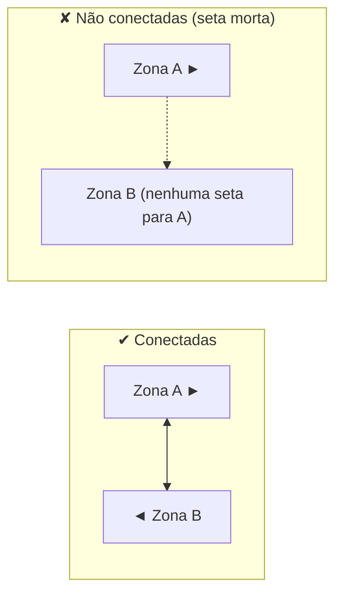

1. **Conexão (travessia):** quando uma **seta de conexão** de uma zona e uma **seta de conexão** de outra zona **apontam uma para a outra**, existe ali uma **travessia** entre as duas zonas. O jogador pode atravessar **nos dois sentidos**.
2. Cartas vizinhas na mesa sem setas de conexão apontando uma para a outra **não** têm travessia entre elas.
3. **Setas mortas:** uma seta de conexão que não encontra outra seta apontando para ela não forma travessia. Isso é permitido e cria becos naturais no mapa.
4. Quando há várias setas livres, o gerador **sorteia** em qual delas a nova carta entra.
5. **Sem orientação:** cartas de zona **não têm** "topo", "baixo", "esquerda" nem "direita". Elas podem ser posicionadas **em qualquer rotação**. O gerador escolhe a rotação.

**Gerador de mapa:**
1. **Gerador com garantia:** o mapa é montado por um algoritmo que **refaz a montagem** (outro sorteio) sempre que alguma carta não couber, até todas entrarem. O mapa continua aleatório a cada partida.
2. **Regras de composição da dimensão** (para o designer da coleção): soma de setas suficiente para ligar todas as cartas: 2 setas na maioria, 4 nas Urbanas, poucas com 1 seta ("becos") e poucas com 3 ("encruzilhadas"). Assim o gerador quase sempre acerta de primeira.
3. **Tamanho:** começar os testes com **16 zonas** por dimensão (ex.: 2–3 Urbanas, ~9 com 2 setas, ~2 com 3 setas, ~2 com 1 seta). Meta de distância: nenhuma zona a mais de **5 movimentos** da cidade inicial, para um jogador com 3 pontos de ação chegar a qualquer lugar em 2 vezes. O laboratório deve permitir testar 12, 16 e 20 zonas.
4. **Equilíbrio entre grupos:** como todas as zonas sempre entram, o conteúdo é igual para todos. O gerador também evita mapas "injustos" (ex.: todos os mercados encostados num só canto) com regras de distância mínima entre zonas importantes.

### 3.6 Exploração

- As zonas são posicionadas **viradas para baixo**, exceto a **cidade inicial**, as **zonas de spawn** e, na campanha, as **zonas Urbanas**.
- Uma zona virada para baixo é **revelada** quando um jogador chega a uma zona **conectada** a ela. Revelada, ela fica virada para cima para todos até o fim da partida.
- Antes de ser revelada, ninguém vê o tipo, o local, as ações nem os efeitos dela. As **setas** de uma zona virada para baixo ficam **visíveis**.

---

## 4. Atributos e o deck de atributos


O deck de atributos é a peça central do jogador: é com ele que o jogador resolve desafios e paga custos.

### 4.1 Os 9 atributos

Os atributos se organizam em três categorias.

```
FÍSICOS              MENTAIS/SOCIAIS        METAFÍSICOS
Força                Inteligência           Espírito
Destreza             Sabedoria              Sanidade
Resistência          Carisma                Sorte
```

#### Atributos físicos

| Atributo | Representa | Relacionado a |
|---|---|---|
| **Força** | Potência física e capacidade de exercer força muscular. | Levantar, empurrar, carregar, quebrar objetos e causar impacto físico. |
| **Destreza** | Agilidade, coordenação motora e precisão dos movimentos. | Movimentos rápidos, esquiva, equilíbrio, manipular objetos com precisão e usar armas que exigem técnica. |
| **Resistência** | Capacidade física de suportar esforços, danos e condições adversas. | Vitalidade, tolerância à dor, fôlego e continuar lutando sob desgaste físico. |

#### Atributos mentais/sociais

| Atributo | Representa | Relacionado a |
|---|---|---|
| **Inteligência** | Raciocínio, aprendizado e compreensão lógica. | Conhecimento, memória, resolução de problemas, investigação, planejamento e domínio de assuntos complexos. |
| **Sabedoria** | Percepção, intuição e capacidade de interpretar situações. | Discernimento, experiência, leitura do ambiente, reconhecimento de padrões e decisões sensatas. |
| **Carisma** | Personalidade e capacidade de influenciar outras pessoas. | Persuasão, liderança, negociação, intimidação, eloquência e conquistar confiança ou respeito. |

#### Atributos metafísicos

| Atributo | Representa | Relacionado a |
|---|---|---|
| **Espírito** | Força interior, determinação e capacidade de exercer ou resistir a influências sobrenaturais. | Força de vontade, concentração, energia espiritual, resistência a possessões e domínio de poderes místicos. |
| **Sanidade** | Estabilidade mental e capacidade de preservar a lucidez diante de experiências psicologicamente perturbadoras. | Resistência ao horror, ao desconhecido, a entidades incompreensíveis e a fenômenos que desafiam a percepção da realidade. |
| **Sorte** | Influência do acaso sobre o que envolve o personagem. | Encontrar oportunidades, evitar situações desfavoráveis, obter resultados inesperados e se beneficiar de circunstâncias imprevisíveis. |

### 4.2 Distinções entre atributos parecidos

| Par | Diferença |
|---|---|
| **Força × Resistência** | Força: exercer potência física. Resistência: suportar esforço e danos. |
| **Inteligência × Sabedoria** | Inteligência: adquirir e processar conhecimento. Sabedoria: interpretar situações e aplicar discernimento. |
| **Espírito × Sanidade** | Espírito: força interior para resistir a influências externas e sobrenaturais. Sanidade: preservar a lucidez diante de experiências perturbadoras. |
| **Carisma × Espírito** | Carisma: influenciar outras pessoas. Espírito: sustentar a própria vontade diante de influências externas. |

Espírito e Sanidade **não são exclusivos de personagens mágicos**. Um guerreiro pode ter Espírito elevado pela determinação; um explorador pode ter Sanidade elevada por lidar com situações extremas. Assim, todos os atributos são relevantes para diferentes classes, mesmo que algumas tenham mais afinidade com certos atributos.

### 4.3 Tipos de carta de atributo

| Tipo | Descrição | Cópias permitidas no deck |
|---|---|---|
| **Básico** | Vale **1** do atributo da carta. | Ilimitadas |
| **Sinérgico** | Vale por **2 a 4 atributos diferentes**. Ex.: 1 Carisma + 1 Sabedoria; ou 1 Resistência + 1 Destreza + 1 Sorte. | Máximo 4 da mesma carta (número especulativo, sujeito a análise) |
| **Aprimorado** | Igual ao Básico, mas possui um **efeito**. | Máximo 4 da mesma carta (número especulativo, sujeito a análise) |

O limite de cópias vale **dentro do deck**; na pasta de TCG e no cofre, não há limite de cópias.

**Como a carta sinérgica paga requisitos:**
- A carta sinérgica fornece **todos** os seus atributos ao mesmo tempo, mas **só num único pagamento** (não dá para usar o Carisma num evento e a Sabedoria noutro).
- Ela paga "N atributos quaisquer" contando cada atributo dela (a carta "1 Carisma + 1 Sabedoria" paga 2).
- Em requisitos que contam **cartas** ("descarte 3 cartas", "tenha 2 cartas na mão"), ela conta como **1 carta**.
- Em gatilhos de atributo ("se tiver uma carta de Carisma na mão"), ela conta como carta de **cada** atributo que possui.
- Ela conta para a **trava** de cada atributo que possui (veja [8.2](#82-a-trava-do-deck)).

### 4.4 O deck de atributos

- Cada jogador tem o **seu próprio deck de atributos** com **no mínimo 60 cartas** (número especulativo, sujeito a análise). O deck **pode ter mais de 60 cartas**, sem limite máximo. O limite de cópias de cartas sinérgicas e aprimoradas ([4.3](#43-tipos-de-carta-de-atributo)) vale para qualquer tamanho de deck.
- O **deck building** deste jogo consiste em construir o deck de atributos.
- As cartas de atributo são usadas principalmente para **resolver eventos**, **ativar efeitos/habilidades/recursos** e **pagar custos** de efeitos.
- **Deck pré-pronto:** cada classe primária tem um **deck básico pré-pronto** de 60 cartas que já cumpre a trava da classe (veja [8.2](#82-a-trava-do-deck)). Ao iniciar uma partida sem progresso, o jogador escolhe a classe e o deck pré-pronto dela.
  - Na campanha, o pré-pronto é dado **uma única vez**, no início do save. As cartas passam a ser do jogador (como qualquer outra carta) e o deck ocupa um slot de decks do cofre. Ganhar uma nova classe (mentor) **não** dá o pré-pronto dela.
  - Nos modos de run, cada run começa com o pré-pronto da classe escolhida.

**Build e cartas em jogo.** Chama-se **build** a lista de cartas do deck salva pelo jogador. Durante a partida, as cartas da build estão sempre em um destes três lugares: **deck de atributos**, **mão** ou **pilha de descarte de atributos**. Juntos, eles formam as **cartas em jogo**.

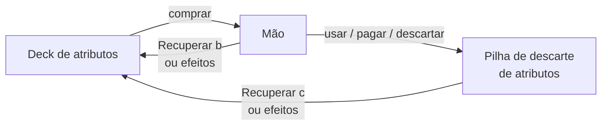

- **O total de cartas em jogo é fixo** e igual ao tamanho da build. Ele **só muda** quando o jogador salva uma nova build (ação **Ajustar deck** ou **Usar cofre**).

**Mexer na build** (vale para Ajustar deck e Usar cofre):

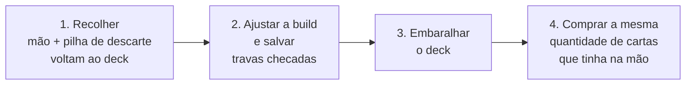

1. **Recolher:** todas as cartas da **mão** e da **pilha de descarte de atributos** voltam para o deck.
2. **Ajustar e salvar:** o jogador troca, coloca ou tira cartas da build (respeitando o mínimo de 60) e salva. As travas são checadas nesse momento ([8.2](#82-a-trava-do-deck)).
3. **Embaralhar:** o deck é embaralhado.
4. **Comprar:** o jogador compra **a mesma quantidade de cartas que tinha na mão** antes de recolher.

Isso tudo faz parte da mesma ação; recolher não é uma ação separada. Se o jogador abrir o ajuste e não mudar nada, os passos 1, 3 e 4 acontecem do mesmo jeito.
- Cartas em jogo **nunca** vão para o limbo nem saem do jogador: **nenhum** efeito, habilidade ou regra pode mudar isso. Cartas que digam "limbo" para cartas de atributo em jogo devem ser escritas com "pilha de descarte de atributos".
- Cartas de atributo **guardadas** (pasta de TCG, pasta extra da montaria, cofre) seguem outra regra: veja [6.5](#65-pilhas-de-descarte-e-limbo).

---

## 5. Recursos

**Recursos** são equipamentos, itens e [montarias](#26-montarias) (mais tipos podem ser adicionados no futuro). Eles possuem efeitos e ajudam o jogador. Enquanto as cartas de atributo são "consumidas" e voltam ao deck, os recursos ficam com o jogador até serem perdidos, vendidos ou trocados.

### 5.1 Equipamentos

- São recursos que o jogador usa **o tempo todo**. As cartas ficam posicionadas **na frente do jogador**, mostrando que estão equipadas.
- Equipamentos **não vão para a mão**. Podem ser guardados no **inventário** e trocados pelos que estão em uso, por estratégia (veja a ação [Preparar](#12-ações-de-zona)).
- O jogador pode usar **1 equipamento de cada categoria**:

| Categoria | Exemplos |
|---|---|
| **Cabeça** | Capacetes, tiaras mágicas, capuzes, coroas, etc. |
| **Tronco** | Peitorais de metal, cotas de malha, túnicas de tecido, corpetes de couro, etc. |
| **Inferior** | Calças, grevas de armadura, saias de combate, etc. |
| **Calçado** | Botas de ferro, sapatos leves de couro, sandálias encantadas, etc. |
| **Capa** | Capa, manto, etc. |
| **Arma** | Adagas, punhais, facas, espadas curtas, espadas longas, sabres, cimitarras, katanas, clavas, maças, martelos de guerra, manguais, porretes, lanças, alabardas, tridentes, foices, espadas de duas mãos (montantes), machados de batalha grandes, martelos pesados, manoplas reforçadas, garras, soco-inglês, arcos, bestas, facas de arremesso, machadinhas, azagaias, shurikens, dardos, pistolas, mosquetes, rifles, bacamartes, cajados, varinhas, tomos, grimórios, cruzes, amuletos e talismãs usados como **foco mágico**, orbes mágicos, etc. |
| **Escudo** | Escudo leve de madeira ou metal (pequeno), escudo pesado, escudo de corpo/pavês, escudos especiais (ornamental, concha, táurico), etc. |
| **Acessório** | Cintos, pochetes, anéis, colares, amuletos e talismãs **com efeito passivo**, etc. |

> Algumas armas **não permitem usar escudo**. Nesse caso, o jogador fica com um slot a menos.

> **Sem arma:** o ataque básico de quem não tem arma equipada usa **só o modificador base de Ataque** (com o Pico e os percentuais do pipeline de [7.4](#74-escala-fórmulas-e-valores-iniciais)). Equipamentos, recursos e efeitos podem aumentar esse ataque (ex.: efeitos do Monge ou de manoplas).

- **Amuletos e talismãs** podem ser **Arma** (foco mágico), **Acessório** (efeito passivo) ou **Relíquia** (item de inventário que não se equipa). A carta mostra a categoria com **ícone, imagem e label** próprios, para o jogador saber qual é qual.
- Equipamentos **não têm elemento**, mas podem dar **bônus de elemento** (veja [Elementos](#16-elementos)).
- Equipamentos e armas podem ter **[habilidades](#17-habilidades)**, que podem causar dano ao oponente ou ativar efeitos. Armas e equipamentos de categorias diferentes podem ter as mesmas habilidades.

**Anatomia da carta de equipamento:**

| Campo | Descrição | Exemplo |
|---|---|---|
| **Nome** | Nome do equipamento | *Espada Rúnica* |
| **Categoria** | Uma das categorias acima (ícone + label) | Arma |
| **Raridade** | Comum a Lendária (símbolo no canto, veja [24.3](#243-boosters)) | Rara |
| **Modificadores** | Bônus que dá enquanto equipado; o primeiro listado é o **modificador principal** (usado pelo refino) | +12 Ataque, +5 Precisão |
| **Requisito de Pico** | Opcional. Pico mínimo para equipar e usar (veja [7.3](#73-regras-da-energia)) | Pico 30 |
| **Restrição de classe** | Opcional (veja [17.3](#173-restrições-de-classe)) | Só Guerreiro, Monge |
| **Bloqueia escudo** | Só armas; se ocupa o slot de escudo | Não |
| **Habilidades** | 0 ou mais (veja [17.1](#171-anatomia-de-uma-habilidade)) | *Corte Flamejante* |
| **Efeitos** | 0 ou mais (capítulo [13](#13-efeitos)) | +5% de Defesa enquanto sem marca de reparo |
| **Refino** | Se pode ser refinado, o nível máximo (até +10) e os **materiais de refino** (obrigatório em todo equipamento refinável; veja [25.2](#252-refinar)) | Refinável, máx. +10; materiais: 1 minério de ferro + 1 gema bruta por nível |
| **Encantamentos** | Se pode ser encantado, quantos, de que tipo e com qual refino mínimo | 1 elemental a partir de +3 |
| **Ajuste de preço** | ×0,8 a ×1,5, definido pelo designer (veja [24.4](#244-singles)) | ×1,2 |
| **Estado** | Quebrado ou não; marca "Reparado ×N" | Reparado ×1 |

**Quebra de equipamentos:** efeitos, habilidades e outros fatores podem quebrar equipamentos. Para repará-los, é preciso levá-los ao [ferreiro](#25-ferreiro) ou usar um efeito/habilidade/recurso de reparo. Um equipamento **quebrado**:
- **continua no slot** (ou no inventário) e ainda ocupa o slot;
- não dá bônus de modificadores, suas habilidades não podem ser usadas e seus efeitos ficam anulados;
- vale **0 moedas de ouro** na venda (o jogador provavelmente vai preferir consertá-lo) e pode ser oferecido/abdicado normalmente.

**Marca de reparo:** cada conserto deixa no equipamento uma marca **"Reparado ×N"** (N = quantas vezes ele foi consertado), visível na carta. Cada reparo reduz o preço de venda em **12%**, de forma acumulada sobre o preço original (ex.: ×1 → −12%; ×3 → −36%; ajustável no laboratório). O preço de venda tem **piso 0** (a partir do 9º reparo o equipamento vale 0). A marca também pode ser usada por efeitos (ex.: "equipamentos sem marca de reparo dão +5% de Defesa").

### 5.2 Itens

Podem existir mais categorias no futuro, inclusive categorias exclusivas de uma dimensão.

| Categoria | Finalidade | Exemplos |
|---|---|---|
| **Consumíveis** | Recuperar vida, remover status negativos, obter status positivos e ganhar efeitos. | Poções, elixires, alimentos, bebidas, pergaminhos, bombas, remédios, munição, etc. |
| **Materiais** | Fabricação, aprimoramento ou outras atividades. | Minérios, gemas, ervas, tecidos, couros, componentes, peças, etc. |
| **Relíquias** | Objetos especiais, geralmente raros, mágicos ou com propriedades extraordinárias. Não se equipam. | Artefatos, amuletos, talismãs, objetos amaldiçoados, objetos lendários, etc. |
| **Ferramentas** | Executar atividades específicas, interagir com o ambiente ou superar obstáculos. | Ferramentas de mineração e de coleta, instrumentos, utensílios, equipamentos de exploração, dispositivos. |
| **Tesouros** | Representar valor econômico ou servir de recompensa. | Moedas antigas ou estrangeiras, joias, pedras preciosas, objetos valiosos, antiguidades, etc. |
| **Documentos** | Carregar informações, registros ou conhecimentos. | Mapas, livros, cartas, manuscritos, registros, contratos, receitas, etc. |
| **Boosters** | Pacotes fechados de cartas novas, comprados no mercado ou recebidos como recompensa. | Booster da coleção X. Veja [Boosters](#243-boosters). |
| **Objetos especiais** | Relacionados a eventos, progressão ou situações específicas do jogo. | Qualquer coisa, inclusive itens das outras categorias. |

Todo item é uma **carta**, inclusive os vendidos no estoque do mercado (poções, munição, etc.).

### 5.3 Dinheiro

O dinheiro do jogo são as **moedas de ouro**, um **contador** que não ocupa slot. Tesouros são objetos de valor que ocupam slot e precisam ser **vendidos** no mercado (ou usados em efeitos) para virar ouro.

**Bolsa de ouro:** em todos os modos, cada jogador carrega o ouro numa **bolsa** com capacidade máxima. Por padrão, a bolsa comporta **300 moedas de ouro** (ajustável no laboratório). O ouro recebido acima da capacidade é **perdido** (não há escolha, como acontece com cartas). O mercado oferece um serviço de **expansão da bolsa** (veja [24.5](#245-serviços-do-mercado)).

**Ouro no cofre:** o jogador pode guardar ouro no [cofre](#64-cofre), que comporta **2.000 moedas** por padrão (não ocupa slot). A capacidade também pode ser expandida no mercado.

**Expansões são permanentes na campanha:** as capacidades expandidas da bolsa, do cofre (slots, slots de decks e ouro) acompanham o jogador por todas as dimensões do save. Nos modos de run, valem só até o fim da partida.

---

## 6. Onde ficam as cartas

Agora que as cartas de atributo e os recursos foram apresentados, é preciso saber onde cada um fica e para onde vai depois de usado.

### 6.1 Visão geral

| Onde | O que guarda | Capacidade padrão | Quando acessa |
|---|---|---|---|
| **Mão** | Cartas de atributo compradas | Sem limite | Sempre |
| **Deck de atributos** | Cartas de atributo a comprar | Mínimo 60 cartas (build) | Por compra e efeitos |
| **Pilha de descarte de atributos** | Cartas de atributo usadas (de cada jogador) | Sem limite | Por efeitos e **Recuperar** |
| **Equipamentos em uso** | 1 equipamento por categoria | 1 por categoria | Sempre (troca via **Preparar**) |
| **Bolsa de ouro** | Moedas de ouro | 300 moedas | Sempre |
| **Inventário** | Recursos que o jogador carrega (inclusive boosters fechados) | 10 slots (varia por classe) | Sempre |
| **Pasta de TCG** | Cartas de atributo guardadas para ajustar o deck; singles de atributo comprados | 30 cartas no total | Ação **Ajustar deck** |
| **Montaria** | Inventário extra e pasta extra | +4 slots e 10 cartas | Como o inventário e a pasta |
| **Cofre** | Tudo do jogador | 30 slots + 10 slots de decks + 2.000 moedas de ouro | Ação **Usar cofre** |
| **Limbo** | O que foi destruído (recursos e cartas de atributo guardadas) | Sem limite | Nunca (nada volta do limbo) |

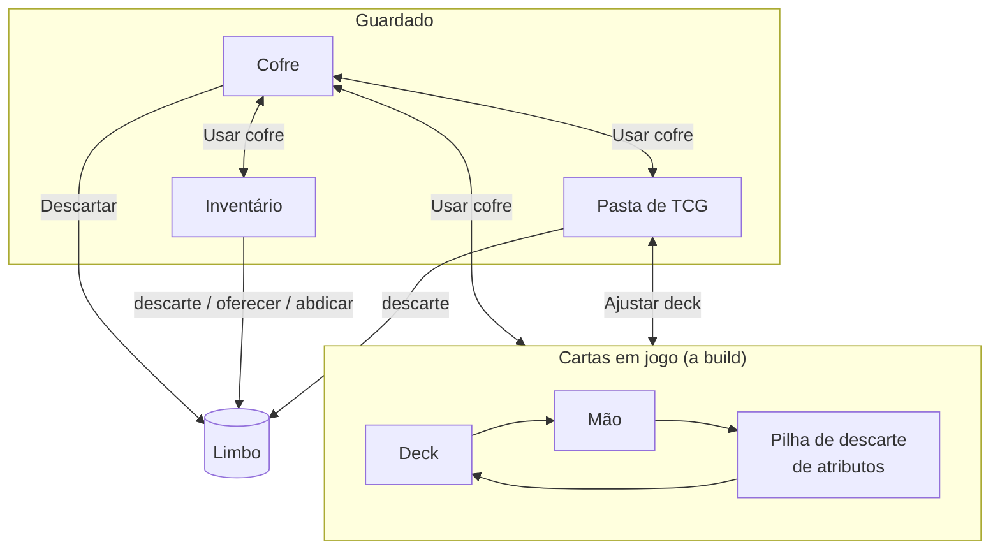

### 6.2 Inventário

- Funciona como uma **"segunda mão"**.
- A quantidade de slots depende da **classe**: classes cujo conceito envolve carregar mais coisas (como Alquimista e Artífice) têm mais slots. **Por padrão, a maioria das classes tem 10 slots** (veja a tabela em [8.7](#87-perfil-das-classes)).
- Durante eventos, raides, etc., o jogador pode usar o que está no inventário, desde que o conteúdo do slot permita.
- Buffs, efeitos, itens e equipamentos podem **aumentar** ou **diminuir** o tamanho do inventário. Quando o inventário diminui, o jogador escolhe quais slots ficam **desabilitados**: os recursos neles **continuam com o jogador**, mas não podem ser usados, negociados nem receber novas cartas até a capacidade voltar. Nada vai para o limbo por isso. (A perda da montaria é diferente: veja [26](#26-montarias).)

**Empilhamento:**

| Empilham sem limite num mesmo slot | Não empilham |
|---|---|
| Consumíveis (inclusive munição), materiais, tesouros e boosters iguais | Equipamentos, relíquias, documentos, ferramentas e objetos especiais |

### 6.3 Pasta de TCG

- Todo jogador carrega uma pasta de TCG com até **30 cartas** no total (ajustável no laboratório).
- Ela permite mexer na build do deck **sem precisar do cofre**, por meio da ação **Ajustar deck** (1 ponto de ação), seguindo os passos de [4.4](#44-o-deck-de-atributos).
- A pasta **não ocupa slot do inventário**: ela tem um slot exclusivo.
- A pasta guarda **apenas cartas de atributo**. Com Ajustar deck, o jogador pode **trocar, colocar ou tirar** cartas entre a pasta e a build, desde que a build continue com **no mínimo 60 cartas**.
- **Singles de atributo** comprados no mercado vão **direto para a pasta**. Se a pasta estiver cheia, o jogador não pode comprá-los (veja [Singles](#244-singles)).
- No começo da **primeira aventura** do jogador, a pasta começa **vazia**.

### 6.4 Cofre

- Guarda **todas as coisas** do jogador: recursos, itens, cartas de atributo, boosters, etc.
- O cofre está **atrelado ao jogador dentro do grupo** (veja [Campanha](#281-campanha)): os mesmos itens podem ser acessados de qualquer zona que tenha cofre, inclusive em **dimensões diferentes**, mas não por outro grupo (outro "save") do mesmo jogador.
- No cofre, o jogador faz **todo o deck building**: gerencia decks, monta builds diferentes e move cartas, itens e recursos entre o inventário, a pasta e o cofre. Mexer na build em uso segue os passos de [4.4](#44-o-deck-de-atributos) (recolher, ajustar, embaralhar, comprar).
- **Slots do cofre:**
  - **10 slots de decks** por padrão (builds diferentes). Slots de decks são exclusivos e separados dos demais. Cada slot guarda um deck de qualquer tamanho; o limite é só a quantidade de decks.
  - **Cópias físicas:** cada deck salvo usa cartas **reais**, como num TCG físico. Uma carta que está num deck não está em outro nem na pasta: para ter a mesma carta em 3 decks, o jogador precisa de 3 cópias.
  - A **build em uso** é um dos slots de decks.
  - **30 slots** por padrão para cartas, boosters, recursos, itens, etc.
  - Cópias repetidas **se empilham** sem limite; cada carta/item/recurso **diferente** ocupa um slot diferente.
- **Ouro:** o cofre guarda até **2.000 moedas de ouro** por padrão, separadas dos slots. O jogador move ouro entre a bolsa e o cofre livremente dentro de Usar cofre, respeitando a capacidade dos dois.
- **Descartar:** dentro do cofre, o jogador pode usar a ação **Descartar**, que manda o recurso ou a carta de atributo escolhida para o **limbo**.

**Expansão do cofre:** o mercado oferece um serviço de expansão do cofre. Cada compra dá **+5 slots**, e o preço cresce a cada expansão (valores ajustáveis no laboratório):

| Expansão | Slots totais | Preço (ouro) |
|---|---|---|
| 1ª | 35 | 50 |
| 2ª | 40 | 100 |
| 3ª | 45 | 200 |
| 4ª em diante | +5 cada | dobra a cada compra |

Os **slots de decks** também podem ser expandidos no mercado: **+1 slot de deck por 100 ouro**, e o preço **dobra** a cada compra (valores ajustáveis no laboratório).

### 6.5 Pilhas de descarte e limbo

**Esta é a única fonte da regra de destino das cartas.** Os outros capítulos apontam para cá.

| Origem | Destino |
|---|---|
| **Cartas de atributo em jogo** (mão, deck, pilha de descarte) usadas como requisito, pagas como custo, descartadas por efeito/habilidade, manipuladas ou descartadas em **qualquer** outra situação, inclusive o excesso de cartas na mão | **Sempre** a **pilha de descarte de atributos** do próprio jogador |
| **Cartas de atributo guardadas** (pasta de TCG, pasta extra da montaria, cofre) que são descartadas | **Limbo** |
| **Recurso** do inventário (ou do inventário extra da montaria) descartado | **Limbo** |
| **Equipamento abdicado** | **Limbo** |
| **Recurso oferecido** | **Limbo** |
| **Cartas que não são de atributo** usadas para resolver um evento | **Limbo** |
| **Carta de evento**, resolvida ou não | **Pilha de descarte de eventos** do tipo daquela zona |
| Cartas **saqueadas** ou **negociadas** | Passam para o outro jogador |

- O **limbo** é uma **pilha de descarte comum a todos os jogadores**.
- **Nada volta do limbo:** o que vai para o limbo é **perdido para sempre**. Nenhum efeito, habilidade, classe ou especialização pode recuperar coisas do limbo, e o limbo não é acessível nem guardado. Na prática, mandar algo para o limbo é **destruí-lo**.
- Quando o deck de eventos de um tipo de zona acaba, a pilha de descarte de eventos **daquele tipo** é reembaralhada para formar um novo deck.
- **IMPORTANTE:** se uma carta não diz explicitamente para embaralhar um deck, o deck **NÃO** deve ser embaralhado.

### 6.6 Recompensas e falta de espaço

**Nada vai direto para o cofre:** o que o jogador ganha ou compra nunca é "teleportado" para o cofre.

| O que chega | Para onde vai |
|---|---|
| **Recursos e boosters** | **Inventário** |
| **Cartas de atributo** | **Pasta de TCG** |
| **Ouro** | **Bolsa** (o excesso é perdido) |

**Sem espaço**, o jogador escolhe entre:
- **descartar** algo do inventário ou da pasta para abrir espaço (vai para o **limbo**, veja [6.5](#65-pilhas-de-descarte-e-limbo)); ou
- **deixar a recompensa**: se ela veio do deck de recompensas, vai para o **fundo** desse deck; se não veio (recompensa fixa de inimigo, missão, raide, etc.), vai para o **limbo**.

Exceção: abrir um booster **dentro** do cofre manda as cartas para o cofre (veja [24.3](#243-boosters)).

---

## 7. Modificadores e Energia

Os modificadores dizem **quão forte** o jogador é; a Energia diz **quanto ele ainda pode gastar** e é o que mais pesa nos modificadores.

### 7.1 Modificadores

**Modificadores** são pontos do jogador que afetam cálculos e interações durante toda a partida. Recursos, efeitos e habilidades podem **aumentar ou diminuir** um ou mais modificadores. Mais modificadores podem surgir no futuro.

Todos os modificadores são usados **principalmente em combate**, mas também podem aparecer como requisito em eventos aleatórios e em outras ocasiões. O cálculo de cada um combina o próprio modificador com equipamentos, efeitos ativos, outros fatores (como cartas de atributo específicas na mão) e, **principalmente, o Pico** (veja [7.4](#74-escala-fórmulas-e-valores-iniciais)).

| Modificador | O que o resultado do cálculo define |
|---|---|
| **Ataque** | O valor do ataque desferido no oponente (usa a força dos equipamentos). |
| **Defesa** | Quanto o jogador resiste ao ataque inimigo (usa a defesa dos equipamentos). Se o ataque for **maior** que a defesa, o defensor toma a diferença como dano; se for **igual** (ou menor), não toma dano. |
| **Precisão** | Se o ataque **acerta**. Se acertar, o valor de ataque é usado. |
| **Esquiva** | Se o alvo **escapa** do ataque. Se escapar, não sofre dano. |
| **Celeridade** | A **ordem de ação** no combate: quanto maior, mais cedo a parte age. (Não afeta a ordem dos jogadores na rodada, que é fixa; veja [11.2](#112-ordem-dos-jogadores).) |
| **Perfuração** | Quantos pontos da **defesa** do oponente são ignorados no cálculo de dano (valor fixo). |
| **Reflexão** | Quantos pontos do dano recebido são **devolvidos** ao atacante (valor fixo). O valor devolvido é subtraído do dano ao defensor. Se o ataque não causar dano (Ataque ≤ Defesa), a Reflexão **não** devolve nada. O dano refletido vai **direto na vida** do atacante (não passa pela Defesa dele) e **pode nocauteá-lo** (jogador ou inimigo). |

**Escala:** os modificadores e a vida máxima **não têm limite** e **ambos escalam com o Pico** (a vida atual é limitada pela vida máxima, veja [9.1](#91-valores-iniciais)); o ouro é limitado só pela capacidade da [bolsa](#53-dinheiro) e do cofre. Eles começam pequenos e podem chegar às **centenas e aos milhares**.

### 7.2 Energia: Pico e Vigor

**Não existe nível no jogo.** No lugar dele existe a **Energia**, formada por dois valores:

```
Pico  (máximo) ████████████████████  100
Vigor (atual)  ███████████░░░░░░░░░   55   ← gasto em habilidades, efeitos, fugas
               └── nunca passa do Pico ──┘
```

| Valor | O que é | Como muda |
|---|---|---|
| **Pico** | A energia máxima do jogador; funciona como o "nível". É o que mais pesa no cálculo de **todos** os modificadores. | Sobe e desce com quase tudo que acontece no jogo (tabela abaixo). |
| **Vigor** | A energia atual; é o que o jogador **gasta** para usar efeitos, habilidades, recursos, etc. **Nunca** passa do Pico. | Diminui quando é gasto. **Não** volta ao Pico sozinho, nem no início de um combate. Só é restaurado por **recursos, efeitos, habilidades e a ação Recuperar**. |

**O que altera o Pico:**

| Aumentam o Pico | Diminuem o Pico |
|---|---|
| Cumprir missões | Fugir de combates |
| Usar itens pontuais | Usar algumas habilidades de equipamentos |
| Habilidades de equipamentos | Não conseguir resolver eventos |
| Resolver eventos com sucesso | Perder combates (= ser nocauteado) |
| Ganhar combates | |
| Derrotar inimigos | Perder uma raide |
| Efeitos positivos (buffs) | Efeitos negativos (debuffs) |
| Etc. | Etc. |

Os valores padrão de cada fonte estão no [Apêndice A](#apêndice-a--valores-ajustáveis) (tabela "Pico por fonte") e são ajustáveis no laboratório. Quando uma carta diz um valor próprio, vale o da carta.

O **Vigor** é o **custo padrão** para usar [habilidades](#17-habilidades) e também pode ser custo de efeitos e recursos. Pico e Vigor podem ser usados como **critérios, requisitos, custos, gatilhos** e em qualquer outro tipo de interação.

### 7.3 Regras da Energia

1. **Teto absoluto:** o Vigor **nunca** passa do valor do Pico, de nenhuma forma e em nenhuma hipótese. Não existe "sobrecarga": nenhum efeito, habilidade ou recurso pode colocar o Vigor acima do Pico. Qualquer restauração que passaria do Pico para no Pico.
2. **Piso:** o Pico e o Vigor **nunca ficam negativos**. O Pico **pode chegar a 0**; nesse caso o Vigor também fica em 0 e o jogador fica Exausto. A Exaustão só acaba quando o **Vigor** ficar maior que 0 (regra 5); o Pico subir não basta (regra 4).
3. **Pico caindo:** se o Pico ficar abaixo do Vigor atual, o Vigor cai junto, até o valor do Pico.
4. **Pico subindo:** quando o Pico sobe, o Vigor **não** sobe junto (o jogador ganha "espaço" para recuperar mais).
5. **Exaustão:** com Vigor 0, o jogador fica **Exausto**: não pode pagar custos de Vigor e tem **−10% em todos os modificadores** até recuperar Vigor.
6. **Recuperar:** além da vida, a ação Recuperar restaura em **Vigor** o equivalente a **5% do Pico** (arredondado para baixo, mínimo 1, respeitando o teto do Pico). O Pico não muda.
7. **Nocaute:** o jogador perde Pico (padrão: **−10% do Pico**, veja o Apêndice A) e volta ao respawn com Vigor igual ao **menor** valor entre o **Vigor que tinha** e **50% do novo Pico**. Assim, ser nocauteado nunca recarrega o Vigor.
8. **Requisito de Pico:** equipamentos fortes podem ter um **Requisito de Pico** (ex.: "Requer Pico 150"). É **um único requisito** que vale para **equipar** e para **usar** o equipamento e as habilidades dele. Isso cria uma progressão natural de equipamentos sem ter "nível".
   - Com Pico abaixo do requisito, o jogador **não pode equipar** o item.
   - Se o Pico cair abaixo do requisito com o item já equipado, ele **continua no slot**, mas suas **habilidades e efeitos não podem ser ativados**, os efeitos já ativos são **desligados** e ele **não dá bônus de modificadores** até o Pico voltar ao requisito.

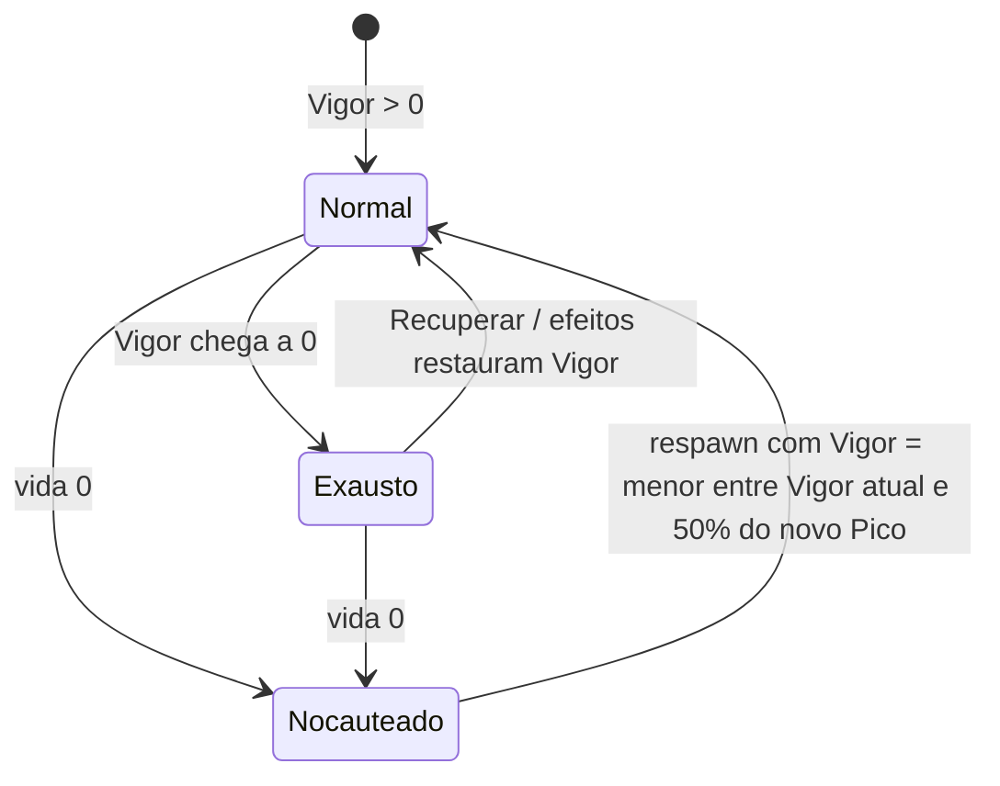

**Exemplos de interação** para cartas: "gaste todo o seu Vigor: cause dano igual ao Vigor gasto"; "se seu Vigor for igual ao Pico (energia cheia), +20% de Ataque"; "ao ficar Exausto, compre 2 cartas"; "transfira até N de Vigor para outro jogador na mesma zona"; "o próximo custo de Vigor é pago com vida"; "aumente seu Pico em N, mas perca todo o Vigor".

### 7.4 Escala, fórmulas e valores iniciais

Todos os valores e fórmulas abaixo são o **ponto de partida para testes**. Cada um pode ser alterado no [Laboratório de testes](#laboratório-de-testes), que deve permitir trocar valores **e fórmulas** para encontrar a melhor jogabilidade e progressão.

- **Energia inicial:** Pico **10**, Vigor **10**. Fontes comuns dão ou tiram **1 a 5** de Pico; fontes grandes (raides, chefes, conclusão de dimensão) dão **10 a 50**.
- **Influência do Pico:** com Pico 0, sem bônus; com Pico 10, +10%; com Pico 100, o dobro; com Pico 500, seis vezes.
- **Cálculo do modificador (pipeline único)**, sempre nesta ordem:
  1. **Soma fixa:** base + equipamentos + refino + efeitos de valor fixo (ex.: "+5 de Defesa");
  2. **× Pico:** multiplica por (1 + Pico ÷ 100);
  3. **× percentuais:** todos os percentuais **somados** num único fator (ex.: reforço com cartas +20%, efeito +5%, Exaustão −10% → ×1,15);
  4. **+ Poder:** só no Ataque de uma habilidade, soma-se o Poder dela.

  Arredonda-se para baixo só no fim. Exemplo: base 5 + arma 12 + refino 1 = 18 → × 1,10 (Pico 10) = 19,8 → × 1,20 (reforço) = 23,76 → + 40 (Poder) = **63**.
- **Vida máxima:** **vida base × (1 + Pico ÷ 100)**, arredondada para baixo. A vida base é 20 por padrão (mais bônus permanentes). Ex.: vida base 20 com Pico 10 → 22; com Pico 100 → 40. Quando o Pico cai e a vida máxima fica abaixo da vida atual, a vida atual cai junto; quando o Pico sobe, a vida atual **não** sobe junto (como o Vigor).
- **Acerto:** chance de acerto (%) = **Precisão ÷ (Precisão + Esquiva do alvo) × 100**, sorteada pelo sistema. Com 50 × 20, ~71% de acerto. A fórmula funciona em qualquer escala.
- **Dano:** veja a fórmula completa em [19.2](#192-cálculo-do-dano).
- **Dados não dependem da Energia:** rolagens de dado (teste de fuga, refino, etc.) **não** são influenciadas por Energia, Pico ou Vigor por padrão, a menos que um efeito ou habilidade diga o contrário.
- **Modificadores iniciais (base):** dependem da **classe primária** com que o jogador inicia a aventura (veja a tabela em [8.7](#87-perfil-das-classes)). No laboratório será possível usar o valor padrão, um valor customizado para todos ou um valor customizado por classe.

---

## 8. Classes e especializações

A classe junta tudo o que veio antes: ela pede uma **composição mínima** do deck de atributos (a trava), define os **slots do inventário** e os **modificadores base** do jogador.

### 8.1 Trilha de progressão

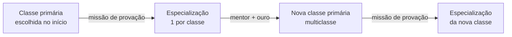

| Etapa | Descrição |
|---|---|
| **Classe primária** | Escolhida no início do jogo. **Trava** o deck de atributos com uma quantidade e/ou combinação de um ou mais atributos específicos. |
| **Especialização** | Uma subclasse dentro das opções da classe primária. Concede um ou mais **efeitos** e também **trava** o deck com uma quantidade e/ou combinação de atributos. |
| **Multiclasse** | Ter mais de uma classe primária e, consequentemente, ter mais de uma especialização. |

Regras:
- Não é possível ter **duas especializações iguais**.
- Não é possível ter **a mesma classe primária duas vezes**.
- **Para jogadores**, habilidades existem **só em equipamentos**. Classes e especializações concedem **efeitos** (passivos ou com gatilho), inclusive efeitos que alteram habilidades (ex.: "suas habilidades de Fogo custam 10% menos Vigor").

### 8.2 A trava do deck

A trava é uma **quantidade mínima** de cartas de certos atributos na **build** do deck. As outras cartas são livres.

**Quando a trava é checada:** ao **escolher o deck na preparação da partida** ([10.1](#101-passo-a-passo)) e ao **salvar a build** (ações **Ajustar deck** e **Usar cofre**). Durante a partida, as cartas em jogo não mudam ([4.4](#44-o-deck-de-atributos)), então o resultado da checagem vale até a próxima vez que a build for salva. Uma classe ou especialização **recém-ganha** (provação, mentor) começa **desligada** e só é checada na próxima vez que o jogador salvar a build.

**A trava habilita a classe.** O jogador **pode** montar um deck que não cumpre a trava. Cumprir a trava é o que **habilita** o que a classe e a especialização proporcionam. Enquanto a build não cumprir a trava de uma classe (ou especialização), o jogador **não tem**:
- os efeitos da classe (ou da especialização);
- a afinidade elemental dela;
- os slots de inventário dela (usa o padrão de 10);
- os modificadores base dela (usa o "valor padrão");
- as habilidades com restrição daquela classe;
- os +20% do reforço com atributo essencial dela.

Se **nenhuma** classe do jogador estiver ativa, ele também usa os valores padrão (10 slots e o "valor padrão" dos modificadores).

**Inventário que diminui:** se uma mudança na build bloquear uma classe e o inventário ficar acima da nova capacidade, o jogador **não pode salvar a build** até tirar os recursos em excesso. Assim ele não perde itens sem querer.

Mesmo sem cumprir a trava, o jogador **continua sendo** daquela classe: gatilhos como "se for Guerreiro" funcionam, e ele pode equipar itens restritos à classe (só não usa as habilidades restritas a ela).

**Cada trava é checada separadamente.** A **trava da especialização inclui a trava completa da classe primária**, com o reforço somado e os atributos adicionais. Por isso, uma especialização ativa sempre significa a classe ativa; o contrário não (a classe pode estar ativa sem a especialização). No multiclasse, cada classe e cada especialização é checada contra a **própria** trava; a mesma carta conta para todas. O jogo deve mostrar ao jogador (tooltip ou painel do deck) quais travas estão cumpridas.

| Origem | Trava (deck de 60; números sujeitos a análise) |
|---|---|
| Classe primária com **1** atributo essencial | mín. **18** cartas do atributo essencial |
| Classe primária com **2** atributos essenciais | mín. **10** de cada atributo essencial |
| Especialização — atributo **adicional** | mín. **6** cartas de cada adicional |
| Especialização — **reforço** | mín. **+4** cartas de cada atributo de reforço (somadas à trava da classe) |

**Exemplos:**
- **Guerreiro Bárbaro:** 14 Força, 14 Resistência, 6 Espírito = 34 cartas travadas, 26 livres.
- **Guerreiro Espadachim** (reforço só em Força): 14 Força (10 + 4), 10 Resistência (trava da classe) e 6 Destreza = 30 cartas travadas.
- **Ladino Assassino** (2 adicionais): 22 Destreza (18 + 4 de reforço), 6 Inteligência e 6 Sorte = 34 cartas travadas.

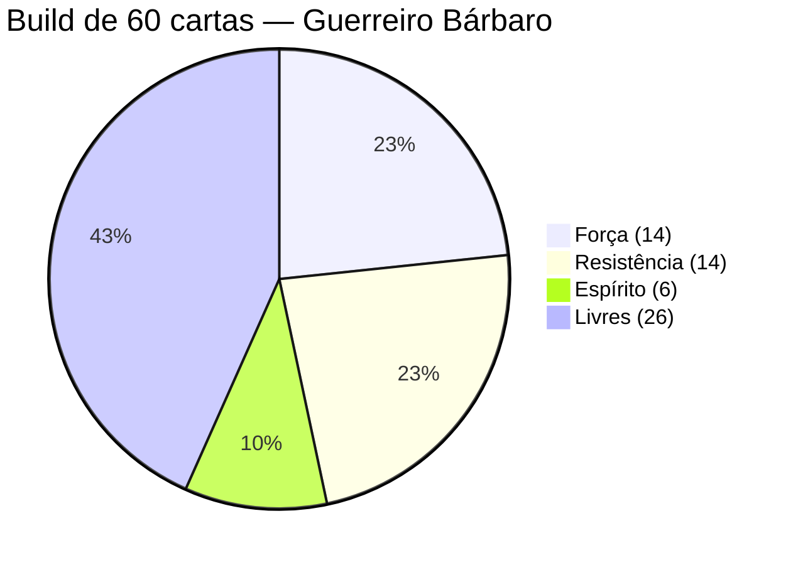

**Exemplo de multiclasse (Mago Elementalista + Alquimista):**

| Trava | Exige | Build com 14 Int, 14 Esp, 6 Sab (+ 26 livres) |
|---|---|---|
| Mago | 10 Int, 10 Esp | ✔ ativa |
| Elementalista | 14 Int, 14 Esp (reforço), 6 Sab (adicional) | ✔ ativa |
| Alquimista | 18 Int | ✘ inativa (faltam 4 Int) |

Cartas sinérgicas contam para a trava de cada atributo que possuem.

**Deck irregular:** a build precisa ter **no mínimo 60 cartas**. Enquanto tiver menos, ela não pode ser salva:
- no **cofre**, o jogador não consegue sair do cofre e voltar a jogar enquanto a build estiver irregular;
- na ação **Ajustar deck**, o jogador não consegue prosseguir com suas ações enquanto a build estiver irregular.

Uma build com 60 cartas ou mais que não cumpre a trava **não** é irregular: ela só deixa a classe (ou especialização) sem os seus benefícios. Como a trava é uma **quantidade** mínima (não uma proporção), um deck maior que 60 continua precisando do mesmo número de cartas do atributo, mas as compra com menos frequência.

### 8.3 Como obter uma especialização

**Provação de especialização:**
- Cada especialização tem uma **missão de provação**. A própria missão diz em quais zonas ela pode ser pega e continuada. Essas zonas **não precisam** ter relação com o tema da especialização (ex.: um Cavaleiro não depende de existir uma zona Fortificada na dimensão).
- A missão de provação **não fica no deck de missões** e **não é exclusiva**: ela está sempre disponível nas zonas indicadas por ela, para qualquer jogador, em todos os modos de mapa (veja [21.2](#212-tipos-de-missão)).
- Requisito para **pegar** a provação: ter a classe primária correspondente e **Pico mínimo 30** (ajustável no laboratório).
- Ao **finalizar** a provação, o jogador ganha a especialização de forma permanente (na campanha). Os benefícios dela só ficam ativos quando a build cumprir a trava da especialização.
- O jogador pode ter **uma especialização por classe primária**, e **não é possível trocar** de especialização dentro da mesma classe.
- Nos modos de run (Desbravadores e Clássico), **não existe carta de objetivo** de conseguir especialização, mas o jogador pode conseguir uma especialização **fazendo a missão de provação** nas zonas, como na campanha.

### 8.4 Como se tornar multiclasse

**Mentoria:**
- Pré-requisito: já ter uma especialização em **todas** as classes primárias atuais.
- **Treinar com mentor:** ação de zona presente em **todas** as zonas **Urbanas** e **Habitadas** (custa todos os pontos de ação restantes) que dá ao jogador a **missão do mentor**. Ao concluir a missão, ele ganha a nova classe primária. Não existe custo de descartar cartas.
- **Custo em ouro:** pago ao **pegar** a missão do mentor. O custo **dobra** a cada nova classe (ajustável no laboratório):

| Nova classe | Custo (ouro) |
|---|---|
| 2ª | 150 |
| 3ª | 300 |
| 4ª | 600 (exige bolsa expandida) |
| Seguintes | dobra |

- Se o jogador não concluir a missão do mentor (ou ela for cancelada ao mudar de dimensão), o **ouro é perdido**; para tentar de novo, paga outra vez.
- A missão do mentor também **não fica no deck de missões** e **não é exclusiva**.
- O mentor existe em **todos os modos com mapa** (Campanha, Desbravadores e Clássico). No Enfrentamento não há mapa: as classes são definidas na build ([28.4](#284-enfrentamento-pvp)).

O mentor dá a missão de **nova classe**; a especialização da nova classe continua vindo da **missão de provação**.

**Regras do multiclasse:**
- **Travas:** cada classe e especialização é checada contra a própria trava (veja [8.2](#82-a-trava-do-deck)).
- **Inventário:** vale o **maior** número de slots entre as classes **ativas** do jogador.
- **Modificadores base:** valem os da classe com que o jogador **iniciou** (não mudam ao ganhar nova classe), desde que ela esteja ativa; se não estiver, vale o "valor padrão".

### 8.5 Como ler a tabela de classes

- **Atributos essenciais** representam a identidade mecânica da classe primária.
- **Atributos adicionais** complementam a especialização e podem introduzir novas possibilidades (efeitos, uso de recursos, etc.). Uma especialização tem **até 2** atributos adicionais e **não necessariamente precisa** ter algum.
- **Reforço** representa uma concentração maior nos atributos essenciais da classe.
- Os atributos **não são restrições absolutas**: personagens podem desenvolver capacidades fora de suas especialidades, porém, talvez tenham menos afinidade, menos consistência no deck e talvez não se beneficiem tanto assim.
- Duas classes primárias **nunca** têm a mesma trava, e duas especializações também não.
- Outras dimensões podem ter classes e especializações exclusivas.

### 8.6 Lista de classes

#### Guerreiro — essenciais: Força, Resistência

| Especialização | Foco | Adicional | Reforço |
|---|---|---|---|
| **Cavaleiro** | Defesa, armaduras e disciplina | Sabedoria (disciplina e percepção tática) | Resistência (capacidade defensiva e sobrevivência) |
| **Bárbaro** | Força bruta e fúria | Espírito (controle e manifestação da fúria) | Força e Resistência (potência física e durabilidade) |
| **Espadachim** | Técnica e precisão com espadas | Destreza (precisão, velocidade e coordenação) | Força (potência dos golpes) |
| **Gladiador** | Combate agressivo e resistência | Carisma (presença e intimidação) | Força e Resistência (agressividade e capacidade de suportar danos) |

#### Mago — essenciais: Inteligência, Espírito

| Especialização | Foco | Adicional | Reforço |
|---|---|---|---|
| **Necromante** | Manipulação da morte e dos mortos-vivos | Sanidade (contato com forças perturbadoras e conhecimento sobre a morte) | Inteligência e Espírito (domínio e manipulação de energias sobrenaturais) |
| **Ilusionista** | Ilusões e manipulação da percepção | Carisma (manipulação da percepção e influência sobre outras pessoas) | Inteligência (complexidade e precisão das ilusões) |
| **Invocador** | Conjuração de criaturas e entidades | Carisma (comando e domínio sobre as entidades invocadas) | Inteligência e Espírito (complexidade das invocações e controle das entidades) |
| **Elementalista** | Manipulação dos elementos | Sabedoria (compreensão das forças naturais) | Inteligência e Espírito (controle e intensidade das manifestações elementais) |

#### Ladino — essencial: Destreza

| Especialização | Foco | Adicional | Reforço |
|---|---|---|---|
| **Ladrão** | Furtividade, furtos e arrombamentos | Inteligência (mecanismos, fechaduras e armadilhas) | Destreza (agilidade e precisão) |
| **Assassino** | Eliminação precisa de alvos | Inteligência (planejamento e identificação de vulnerabilidades) e Sorte (oportunidade) | Destreza (precisão e execução) |
| **Espião** | Disfarces, espionagem e coleta de informações | Carisma (persuasão, disfarces e interação social) | Destreza (furtividade e movimentação) |
| **Trapaceiro** | Enganação e artimanhas | Carisma (persuasão e manipulação) e Sorte (improvisação) | Destreza (execução de artimanhas) |

#### Clérigo — essenciais: Sabedoria, Espírito

| Especialização | Foco | Adicional | Reforço |
|---|---|---|---|
| **Sacerdote** | Cura, bênçãos e suporte divino | Carisma (liderança espiritual e inspiração) | Sabedoria e Espírito (poderes divinos e capacidade de cura) |
| **Exorcista** | Combate a espíritos e entidades malignas | Sanidade (resistência psicológica diante de entidades perturbadoras) | Espírito (resistência e enfrentamento de forças sobrenaturais) |
| **Inquisidor** | Investigação, julgamento e combate a hereges | Inteligência (investigação e raciocínio) | Sabedoria e Espírito (discernimento e convicção) |
| **Oráculo** | Profecias, visões e conhecimento divino | Sanidade (capacidade de suportar visões perturbadoras) | Sabedoria e Espírito (intuição e conexão espiritual) |

#### Patrulheiro — essenciais: Destreza, Sabedoria

| Especialização | Foco | Adicional | Reforço |
|---|---|---|---|
| **Caçador** | Rastreamento e caça de criaturas | Resistência (perseguições prolongadas e sobrevivência) | Destreza e Sabedoria (precisão e identificação de alvos) |
| **Arqueiro** | Maestria com arcos e armas de longo alcance | Força (potência dos disparos) | Destreza (precisão e coordenação) |
| **Explorador** | Sobrevivência e exploração de territórios | Resistência (esforço físico e adaptação a ambientes hostis) | Sabedoria (percepção e orientação) |
| **Rastreador** | Identificação e perseguição de rastros | Inteligência (interpretação de evidências e identificação de padrões) | Sabedoria e Destreza (percepção e movimentação) |

#### Druida — essenciais: Sabedoria, Resistência

| Especialização | Foco | Adicional | Reforço |
|---|---|---|---|
| **Metamorfo** | Transformação em animais e criaturas | Destreza (agilidade e instinto animal) | Resistência (adaptação física e capacidade de suportar transformações) |
| **Guardião** | Proteção da natureza | Espírito (conexão e domínio das forças naturais) | Sabedoria e Resistência (proteção e preservação de ambientes naturais) |
| **Xamã** | Comunicação com espíritos e ancestrais | Sanidade (capacidade de suportar contatos sobrenaturais) | Sabedoria (percepção e conexão espiritual) |
| **Naturalista** | Conhecimento da fauna, flora e ecossistemas | Inteligência (conhecimento científico e identificação de espécies) | Sabedoria (percepção e compreensão da natureza) |

#### Monge — essenciais: Destreza, Espírito

| Especialização | Foco | Adicional | Reforço |
|---|---|---|---|
| **Mestre Marcial** | Maestria em artes marciais | Força (potência dos golpes) | Destreza e Espírito (precisão e controle corporal) |
| **Asceta** | Disciplina física e espiritual | Resistência (privação, esforço e tolerância física) | Espírito (autocontrole e disciplina) |
| **Mestre das Sombras** | Técnicas furtivas e movimentos ocultos | Sorte (oportunidades e circunstâncias favoráveis) | Destreza (agilidade e furtividade) |
| **Punho Elemental** | Artes marciais combinadas com energia elemental | Sabedoria (compreensão e percepção das forças elementais) | Espírito e Destreza (canalização de energia e precisão dos movimentos) |

#### Bardo — essencial: Carisma

| Especialização | Foco | Adicional | Reforço |
|---|---|---|---|
| **Menestrel** | Música e entretenimento | Destreza (execução e coordenação musical) | Carisma (expressividade e capacidade de entreter) |
| **Trovador** | Narrativas, inspiração e tradição oral | Sabedoria (tradição oral, memória e experiência) | Carisma (comunicação e capacidade de inspirar) |
| **Diplomata** | Persuasão, negociação e influência | Inteligência (argumentação e estratégia) | Carisma (persuasão e influência social) |
| **Artista** | Expressão artística e criatividade | Sorte (inspiração imprevisível) | Carisma (expressividade e impacto artístico) |

#### Alquimista — essencial: Inteligência

| Especialização | Foco | Adicional | Reforço |
|---|---|---|---|
| **Transmutador** | Transformação da matéria | Espírito (manipulação de energias necessárias à transmutação) | Inteligência (conhecimento e precisão dos processos) |
| **Toxicologista** | Venenos, toxinas e substâncias | Resistência (tolerância a toxinas e exposição a substâncias) | Inteligência (conhecimento químico e preparação de compostos) |
| **Bombardeiro** | Explosivos e dispositivos químicos | Destreza (manuseio e precisão no lançamento) | Inteligência (preparação e conhecimento dos compostos) |
| **Farmacêutico** | Poções, remédios e preparados | Sabedoria (identificação de propriedades e aplicação adequada de preparados) | Inteligência (conhecimento e elaboração de fórmulas) |

#### Artífice — essenciais: Inteligência, Destreza

| Especialização | Foco | Adicional | Reforço |
|---|---|---|---|
| **Engenhoqueiro** | Mecanismos e dispositivos | Sabedoria (percepção de como os mecanismos funcionam) | Destreza (montagem e manipulação de mecanismos) |
| **Inventor** | Criação de ferramentas e máquinas | Sorte (experimentação e resultados inesperados) | Inteligência (criatividade e desenvolvimento de invenções) |
| **Construtor** | Construções e estruturas especiais | Força (manipulação de materiais e trabalho físico) | Inteligência (planejamento e engenharia) |
| **Ferreiro Arcano** | Criação e aprimoramento de equipamentos mágicos | Espírito (manipulação e canalização de energias mágicas) | Inteligência (conhecimento técnico e mágico) |

#### Bruxo — essenciais: Espírito, Sanidade

| Especialização | Foco | Adicional | Reforço |
|---|---|---|---|
| **Demonologista** | Pactos com demônios e entidades infernais | Resistência (suportar a presença e as forças infernais) | Espírito (controle e manutenção dos pactos) |
| **Ocultista** | Conhecimentos proibidos e rituais | Inteligência (compreensão e execução de rituais) | Sanidade (contato com conhecimentos perturbadores) |
| **Pactário** | Vínculos sobrenaturais e contratos | Carisma (negociação e estabelecimento de contratos) | Espírito (manutenção e controle dos vínculos) |
| **Abissalista** | Poderes de entidades cósmicas e abissais | Sabedoria (percepção de entidades incompreensíveis) | Espírito e Sanidade (canalização de poderes abissais) |

#### Feiticeiro — essenciais: Espírito, Carisma

| Especialização | Foco | Adicional | Reforço |
|---|---|---|---|
| **Dracônico** | Herança de dragões e poderes dracônicos | Resistência (vigor e tolerância a poderes dracônicos) | Espírito (manifestação dos poderes herdados) |
| **Elemental** | Afinidade natural com elementos | Sabedoria (compreensão e percepção das forças elementais) | Espírito (manifestação e controle dos poderes elementais) |
| **Celestial** | Poderes de origem divina ou celestial | Sabedoria (discernimento e compreensão de forças divinas) | Espírito e Carisma (manifestação e expressão dos poderes celestiais) |
| **Trevoso** | Poderes de origem demoníaca ou infernal | Sanidade (exposição e adaptação a forças sombrias) | Espírito (controle e manifestação dos poderes infernais) |

### 8.7 Perfil das classes

**Conceito principal e inventário.** O conceito principal é o ponto de partida para os efeitos de especialização (pode mudar no futuro):

| Classe | Conceito principal | Slots de inventário |
|---|---|---|
| Guerreiro | Aguenta mais: menos dano recebido, armas pesadas sem penalidade | 12 |
| Mago | Habilidades mais fortes e mais baratas em Vigor | 8 |
| Ladino | Manipula o deck: olha/reordena o topo, compra extra, fuga mais fácil | 10 |
| Clérigo | Cura e remove debuffs de si e de outros jogadores na mesma zona | 10 |
| Patrulheiro | Mobilidade no mapa e ataques à distância (Projétil) | 10 |
| Druida | Bônus conforme o **tipo de zona** em que está | 10 |
| Monge | Ataques múltiplos e Celeridade; luta bem sem arma | 8 |
| Bardo | Suporte: buffs para outros jogadores, descontos no mercado, vantagens na negociação | 10 |
| Alquimista | Itens consumíveis mais fortes; cria consumíveis a partir de materiais | 14 |
| Artífice | Repara, refina e cria equipamentos fora do ferreiro, para si e para outros jogadores na mesma zona (ação **Oficina do Artífice**, veja [25.5](#255-oficina-do-artífice)) | 14 |
| Bruxo | Paga custos com vida ou Sanidade (descartando cartas de Sanidade no lugar de Vigor); maldições no inimigo | 10 |
| Feiticeiro | Converte cartas de atributo em efeitos; habilidades elementais fortes (o Feiticeiro **não tem elemento próprio**: os elementos estão nas habilidades; o ataque básico dele é sem elemento) | 8 |

**Modificadores base** (sujeitos a alteração). Ponto de partida: um "valor padrão". Cada classe **troca pontos** a partir dele, seguindo o conceito principal, com o mesmo **orçamento**.

**Orçamento:** cada modificador tem um **peso** (quanto vale 1 ponto dele). A soma de (valor × peso) de toda classe fica em **97 ± 1**, igual ao padrão. Pesos (ajustáveis no laboratório):

| Ataque | Defesa | Precisão | Esquiva | Celeridade | Perfuração | Reflexão |
|---|---|---|---|---|---|---|
| ×4 | ×4 | ×0,5 | ×1 | ×2 | ×3 | ×3 |

| Classe | Ataque | Defesa | Precisão | Esquiva | Celeridade | Perfuração | Reflexão | Orçamento | *Justificativa* |
|---|---|---|---|---|---|---|---|---|---|
| Padrão | 5 | 3 | 50 | 20 | 10 | 0 | 0 | 97 | — |
| Guerreiro | 6 | 5 | 45 | 15 | 8 | 0 | 0 | 97,5 | *Aguenta mais, é lento* |
| Mago | 4 | 2 | 55 | 20 | 10 | 2 | 0 | 97,5 | *Frágil; força vem das habilidades* |
| Ladino | 5 | 2 | 46 | 22 | 12 | 0 | 0 | 97 | *Rápido e esquivo* |
| Clérigo | 4 | 4 | 50 | 18 | 9 | 0 | 1 | 96 | *Resistente, suporte* |
| Patrulheiro | 5 | 2 | 60 | 18 | 10 | 0 | 0 | 96 | *Preciso (ataque à distância)* |
| Druida | 5 | 4 | 42 | 20 | 10 | 0 | 0 | 97 | *Equilibrado (bônus vêm da zona)* |
| Monge | 4 | 2 | 46 | 26 | 12 | 0 | 0 | 97 | *Velocidade e esquiva* |
| Bardo | 4 | 3 | 50 | 22 | 11 | 0 | 0 | 97 | *Fraco sozinho, forte em suporte* |
| Alquimista | 4 | 3 | 50 | 20 | 10 | 1 | 0 | 96 | *Força vem dos consumíveis* |
| Artífice | 5 | 4 | 44 | 18 | 9 | 1 | 0 | 97 | *Força vem dos equipamentos* |
| Bruxo | 5 | 2 | 50 | 15 | 10 | 1 | 2 | 97 | *Maldições e retribuição* |
| Feiticeiro | 6 | 2 | 48 | 18 | 10 | 1 | 0 | 97 | *Dano alto, frágil* |

A **afinidade elemental** de cada classe está em [16.3](#163-afinidade-elemental-das-classes), depois que os elementos são explicados.

### 8.8 Conceitos de classe a desenvolver

- É necessário analisar quais classes e especializações facilitam certas builds. Algumas builds podem ser exclusivas de certas classes e especializações.
- É necessário definir o **conceito principal** de cada especialização. Exemplos: um Feiticeiro Trevoso causa mais dano com habilidades **Obscuras** quando está com pouca vida; um Guerreiro Espadachim consegue comprar mais cartas do que outras classes. Um conceito pode ou não ser exclusivo, e mais de uma classe/especialização pode compartilhar o mesmo conceito.
- O reparo, o refino e a criação fora do ferreiro são conceito da **classe Artífice** ([25.5](#255-oficina-do-artífice)). Outras classes e especializações também podem ter efeitos de reparo (veja [25.1](#251-consertar)).

---

## 9. O jogador

Com atributos, recursos, Energia e classe definidos, dá para descrever com o que o jogador começa.

### 9.1 Valores iniciais

Cada jogador começa a aventura com:
- **10 moedas de ouro**, numa bolsa com capacidade de **300** (veja [5.3](#53-dinheiro));
- **vida base 20**. A **vida máxima** é a vida base × (1 + Pico ÷ 100) (veja [7.4](#74-escala-fórmulas-e-valores-iniciais)); com o Pico inicial 10, começa com **22 pontos de vida**. Curas (Recuperar, poções, efeitos) **não** passam da vida máxima. Não há teto para a vida máxima em si: ela cresce com o Pico e com bônus permanentes;
- **1 classe primária**, escolhida para iniciar a aventura, com o **deck pré-pronto** dela;
- **pasta de TCG vazia**;
- **7 cartas** compradas do seu deck de atributos para a mão;
- **Energia** inicial: Pico 10 e Vigor 10 (veja [7.4](#74-escala-fórmulas-e-valores-iniciais));
- os **modificadores base** da sua classe (veja [8.7](#87-perfil-das-classes)).

Se essa é a **primeira dimensão** do jogador (é a primeira aventura dele), ele começa **sem equipamentos, armas, recursos, montaria, etc.** Nas dimensões seguintes da campanha, ele mantém o que tinha, inclusive a vida atual (veja [28.1](#281-campanha)).

**Vida atual × vida base × vida máxima:** a **vida atual** só muda por dano, cura e efeitos, e nunca passa da vida máxima. A **vida base** (20 + bônus) só muda por efeitos permanentes, classe ou especialização. A **vida máxima** é a vida base escalada pelo Pico. Depois de um nocaute, o jogador volta com **10% da vida máxima** ([20.2](#202-nocaute)).

### 9.2 Regras gerais do jogador

- **Mão de cartas:** não há limite de cartas na mão por padrão. Alguns efeitos podem impor um limite; as cartas em excesso vão **sempre** para a **pilha de descarte de atributos** do jogador.
- **Deck de atributos esgotado:** se o deck de atributos chegar a zero cartas, o jogador **não perde o jogo**. Considera-se que ele administrou mal seus atributos. O jogo segue normalmente, mas será bem difícil continuar sem deck. Existem efeitos, recursos e outros fatores que permitem um *comeback* e a restauração do deck (por exemplo, a ação **Recuperar**).
- **Números inteiros:** todos os cálculos do jogo resultam em **números inteiros**. As lógicas podem arredondar para cima ou para baixo, conforme a finalidade de cada cálculo.

---

## 10. Preparação da partida

### 10.1 Passo a passo

1. **Monte o mapa** (veja [3.5](#35-montagem-do-mapa)).
2. Cada jogador escolhe uma **classe primária** e o **deck pré-pronto** dela (na campanha, só na primeira aventura do grupo; depois ele mantém as classes e os decks que tem).
3. Cada jogador escolhe o **deck** que vai usar (na campanha, um dos slots de decks do cofre; nas runs, sempre o pré-pronto), recebe os [valores iniciais](#91-valores-iniciais) e compra **7 cartas** do deck de atributos. As **travas** são checadas nesse momento ([8.2](#82-a-trava-do-deck)).
4. Cada jogador escolhe a **zona inicial** (seu ponto de **spawn**, veja [20.1](#201-spawn-e-respawn)). Cada jogador precisa escolher uma zona **diferente** das já escolhidas; só quando não houver zona livre ele pode escolher uma zona com outro jogador. Jogadores que começam na mesma zona **não podem se enfrentar** na primeira vez de cada um.
   - **Campanha:** obrigatoriamente uma zona **Urbana** (todas começam reveladas).
   - **Desbravadores e Clássico:** o jogador escolhe "às cegas" uma posição do mapa, e essa zona é revelada.
   - A **cidade inicial** começa revelada em todos os modos e pode ser escolhida como spawn.
5. Define-se a **ordem dos jogadores** com D20, fixa até o fim da dimensão ou da partida (veja [11.2](#112-ordem-dos-jogadores)).

---

## 11. A vez do jogador

### 11.1 Pontos de ação

1. O jogador tem **3 pontos de ação** por vez, por padrão.
2. Cada [ação de zona](#12-ações-de-zona) gasta pontos de ação (exceto as indicadas como gratuitas), inclusive a ação **Movimentar**.
3. As ações podem ser feitas **em qualquer ordem**. Exemplo: Iniciar evento → Movimentar → Ir ao Mercado.
4. O jogador **não precisa usar todos os pontos**: ele pode encerrar a vez quando quiser.
5. A vez passa para o próximo jogador quando os pontos acabam, quando o jogador encerra a vez ou quando o tempo acaba.

Os pontos de ação são sempre **por vez**, nunca por zona. Efeitos que dão pontos extras dizem "por vez".

### 11.2 Ordem dos jogadores

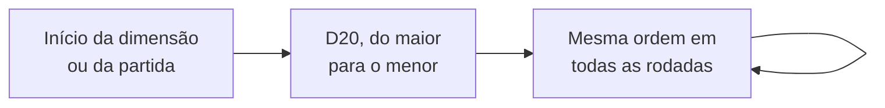

1. **Definição da ordem:** no início da dimensão (ou da partida, nos modos de run), cada jogador rola um **D20**. A ordem vai do **maior para o menor** resultado. Empate: os empatados rolam de novo.
2. **Ordem fixa:** depois de definida, a ordem **não muda mais** até o fim da dimensão (ou da partida). Nenhum efeito, habilidade, modificador (inclusive a Celeridade) ou regra altera a ordem dos jogadores. A Celeridade só define a ordem **dentro do combate**.

> Decisão provisória: o autor pode rever esta regra no futuro.

### 11.3 Tempo da vez

1. Cada vez tem um **tempo limite de 60 segundos**. Esgotado o tempo, a vez termina.
2. **Relógio pausado:** o relógio da vez **pausa** durante eventos, combates, raides, mercado, ferreiro, cofre, **Preparar**, **Ajustar deck** e **Negociação**. Cada um tem seu próprio tempo de decisão (padrão: **30 s por escolha**; turno de combate: **30 s**). O relógio de 60 s só corre enquanto o jogador decide qual ação de zona fazer. Por isso, uma vez pode durar mais de 60 s no total.
3. **Tempo de escolha esgotado** (ação padrão):
   - **evento:** o jogador aceita a **coisa ruim** (como se não tentasse resolver);
   - **turno de combate:** o turno é **pulado** (nenhum ataque é feito);
   - **votação da raide:** vale a escolha do iniciador (ou a opção mais votada, se ele não confirmar);
   - **outras telas** (mercado, ferreiro, cofre, negociação, etc.): a tela é fechada sem mudanças pendentes.
4. **Vez encerrada cedo:** se o jogador encerrar a vez antes dos 60 s, ela passa imediatamente para o próximo (sem esperar o relógio).
5. **Jogador ausente:** se um jogador deixar o tempo acabar em **2 vezes seguidas**, as próximas vezes dele são **puladas automaticamente** até ele voltar a interagir.

### 11.4 Agir fora da vez

Todos veem o que acontece na vez dos outros **ao vivo** (movimento, eventos, combates). Um jogador fora da sua vez **nunca inicia** uma ação: ele só participa quando outro jogador, na vez dele, o convida.
- **Negociação:** o jogador da vez pode convidar outro para negociar; o convidado negocia fora da sua vez. O jogador fora da vez não pode iniciar uma negociação.
- **Combate e raide:** quem é **convidado** ou **desafiado** (recrutado para um combate, chamado para uma raide, alvo de um Enfrentar) participa fora da sua vez.
- Efeitos com gatilho "na vez de outro jogador" também podem ser ativados.
- **Preparar** e **Ajustar deck** não podem ser usadas fora da vez para adiantar a jogada.

---

## 12. Ações de zona

### 12.1 Ações universais e ações locais

"Ação de zona" é qualquer ação que o jogador faz na sua vez. Elas se dividem em dois grupos:
- **Ações universais**, disponíveis em **todas** as zonas: Movimentar, Recuperar, Preparar, Ajustar deck, Negociar, Iniciar evento, Oficina do Artífice (só para quem tem a classe Artífice ativa) e, só no Desbravadores, Enfrentar (que fica disponível quando há 2 ou mais jogadores na mesma zona).
- **Ações locais**, impressas na carta da zona: as demais.

### 12.2 Lista de ações padrão

| Ação | Grupo | Custo | Descrição |
|---|---|---|---|
| **Movimentar** | Universal | 1 ponto de ação | O jogador se move para uma zona **conectada** à zona atual. Pode ser usada **mais de uma vez** na mesma vez. |
| **Recuperar** | Universal | 1 ponto de ação | O jogador recupera **15% da vida máxima** (arredondado para baixo, mínimo 1, sem passar da vida máxima) e restaura em **Vigor** o equivalente a **5% do Pico** por padrão, e escolhe uma opção: (a) comprar cartas até ter 7 na mão; (b) reembaralhar a mão no deck de atributos; (c) reembaralhar a pilha de descarte de atributos no deck de atributos. Pode ser usada **mais de uma vez** na mesma vez, sem limite (veja [12.5](#125-recuperar)). |
| **Preparar** | Universal | **Gratuita** | Pode ser usada **mais de uma vez** na mesma vez. Faz tudo isto na mesma ação: (a) **trocar equipamentos** em uso por outros do inventário; (b) **usar recursos** do inventário (ativar efeitos e habilidades); (c) **abrir boosters** (veja [24.3](#243-boosters)). |
| **Ajustar deck** | Universal | 1 ponto de ação | Mexe na build do deck usando as cartas da **pasta de TCG** (e da pasta extra da montaria): trocar, colocar ou tirar cartas. Recolhe a mão e a pilha de descarte no deck, salva a build (travas checadas), embaralha e compra a mesma quantidade de cartas que havia na mão (veja [4.4](#44-o-deck-de-atributos)). |
| **Negociar** | Universal | **Gratuita** | Troca de itens entre jogadores na mesma zona (veja [Negociação](#23-negociação)). Não gasta ponto de ação de nenhum envolvido. |
| **Enfrentar jogador ou jogadores** | Universal (só Desbravadores) | 1 ponto de ação | Entra em combate com os jogadores da mesma zona (veja [PvP](#282-desbravadores)). Fica disponível quando há 2 ou mais jogadores na zona. |
| **Oficina do Artífice** | Universal (só Artífice ativo) | 1 ponto de ação | Consertar, refinar (até +6) e criar equipamentos fora do ferreiro, para si ou para jogadores na mesma zona (veja [25.5](#255-oficina-do-artífice)). |
| **Iniciar evento** | Universal | 1 ponto de ação | Revela um [evento](#14-eventos). Resolver dá recompensas; falhar dá debuffs e penalidades. As mecânicas de TCG acontecem principalmente aqui. Pode ser usada **mais de uma vez** na mesma vez. |
| **Vasculhar** | Local | 1 ponto de ação | Procura recursos na zona com uma **ferramenta** (veja [12.6](#126-vasculhar)). |
| **Usar cofre** | Local (toda Urbana tem) | 1 ponto de ação | Acessa o [cofre](#64-cofre). Pode ser usada **mais de uma vez** na mesma vez. |
| **Pegar / Continuar / Finalizar missão X** | Local | 1 ponto de ação | Interage com uma [missão](#21-missões) disponível na zona. |
| **Cumprir objetivo X** | Local | 1 ponto de ação | Somente nos modos **Desbravadores** e **Clássico**. Disponível na zona descrita numa carta de objetivo de zona do jogador; cumpre esse objetivo (veja [28.2](#282-desbravadores)). |
| **Iniciar raide** | Local | Todos os pontos de ação restantes (mínimo 1) | Inicia uma [raide](#22-raides). |
| **Ir ao Ferreiro** | Local | Todos os pontos de ação restantes (mínimo 1) | Refinar, encantar, criar e consertar equipamentos (veja [Ferreiro](#25-ferreiro)). |
| **Ir ao Mercado** | Local | Todos os pontos de ação restantes (mínimo 1) | Comprar e vender itens, cartas e boosters (veja [Mercado](#24-mercado)). |
| **Treinar com mentor** | Local (todas as Urbanas e Habitadas) | Todos os pontos de ação restantes (mínimo 1) | Pega a missão do mentor para ganhar uma nova classe primária (veja [8.4](#84-como-se-tornar-multiclasse)). |
| **Salvar ponto de respawn** | Local (só zonas Urbanas; toda Urbana tem) | Todos os pontos de ação restantes (mínimo 1) | Define a zona atual como o ponto de [respawn](#20-nocaute-spawn-e-respawn). |
| **Ir para nova dimensão** | Especial (só Campanha) | 1 ponto de ação | Disponível só quando a próxima dimensão está liberada, o grupo aprovou a troca na votação e **todos** os jogadores estão na mesma zona. Basta um jogador usar (veja [Ir para nova dimensão](#ir-para-nova-dimensão)). |

### 12.3 Regras gerais das ações

- Na **campanha** e no **Clássico**, jogadores **não podem se enfrentar**: a ação Enfrentar não existe nesses modos. O modo Enfrentamento (PVP) é todo de combate entre jogadores.
- Depois de qualquer ação que gasta "todos os pontos restantes", o jogador ainda pode usar **ações gratuitas** (Preparar, Negociar) e depois a vez termina. A raide é a exceção: ao terminar a raide, a vez termina.

### 12.4 Ações por custo (resumo visual)

```
GRATUITAS            1 PONTO DE AÇÃO                     TODOS OS PONTOS RESTANTES
─────────            ───────────────                     ─────────────────────────
Preparar             Movimentar      Usar cofre          Iniciar raide
Negociar             Recuperar       Missões             Ir ao Ferreiro
                     Ajustar deck    Cumprir objetivo    Ir ao Mercado
                     Iniciar evento  Enfrentar           Treinar com mentor
                     Vasculhar       Oficina do Artífice Salvar ponto de respawn
```

### 12.5 Recuperar

- Recuperar pode ser usada quantas vezes o jogador quiser, porque a opção (a) só compra **até ter 7 cartas na mão** (usar 3 vezes não compra 21 cartas). Cada uso restaura em Vigor **5% do Pico** e recupera **15% da vida máxima** (mínimo 1), sem passar da vida máxima ([9.1](#91-valores-iniciais)).
- **Opção (b):** a mão vai inteira para o deck e o jogador fica **sem cartas na mão**. É intencional: há builds que se beneficiam de ter a mão vazia.
- **Opção (c):** a pilha de descarte de atributos volta inteira para o deck. Como as cartas em jogo são sempre as mesmas da build ([4.4](#44-o-deck-de-atributos)), o deck nunca cresce além da build.

### 12.6 Vasculhar

- Exige a **ferramenta** adequada no inventário (ex.: picareta em zona Subterrânea ou Montanhosa; vara de pesca em zona Fluvial, Lacustre ou Costeira; foice em zona Florestal ou Rural).
- O jogador **procura** no **deck de recompensas** da zona uma carta que combine com a ferramenta, coloca-a no inventário e **embaralha** o deck de recompensas.
- Pode ser usada **mais de uma vez** na mesma vez.
- A ferramenta **não se desgasta** por padrão; uma ferramenta pode ter na carta "quebra após N usos".
- Se o deck de recompensas **não tiver** nenhuma carta que combine com a ferramenta, o ponto de ação é gasto mesmo assim e o deck é embaralhado.
- Cartas de recompensa coletáveis têm o **ícone da ferramenta** (picareta, vara de pesca, foice, etc.) e um **texto** que explica com qual ferramenta são coletadas.

---

## 13. Efeitos

Efeitos são uma das partes **mais dinâmicas** do jogo. Eles podem afetar qualquer coisa, positiva ou negativamente, e praticamente tudo no jogo pode ter um efeito: cartas de atributo aprimoradas, recursos, classes, zonas, dimensões, eventos, habilidades e inimigos. Os próximos capítulos (eventos, fuga, habilidades, combate) usam esta estrutura o tempo todo.

Todo efeito tem quatro partes:

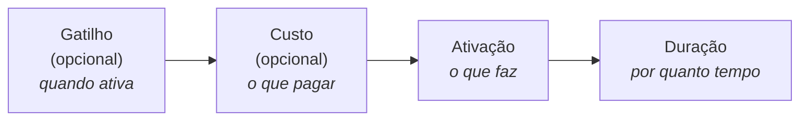

**Exemplo lido parte por parte:** *"Ao entrar numa zona Montanhosa (gatilho), descarte 1 carta de Força (custo): ganhe +5 de Defesa (ativação) até sair desta zona (duração)."*

Em todas as categorias abaixo, mais variações podem surgir no futuro (veja a [Parte III](#parte-iii--etapas-de-desenvolvimento)).

### 13.1 Gatilho (opcional)

O gatilho é a **condição de ativação**. Nem todo efeito tem gatilho.

| Categoria | Exemplos |
|---|---|
| **De zona** | Ao entrar nesta zona; ao entrar numa zona montanhosa; ao entrar numa zona campestre, fluvial ou religiosa; ao entrar em qualquer zona que não seja vulcânica ou subterrânea; ao entrar numa zona pantanosa, num local de vila, de castelo ou de pradaria; ao entrar numa zona desértica que não seja um oásis. |
| **De ação de zona** | Ao não usar **Iniciar evento** numa zona; ao passar por mais de duas zonas diferentes sem usar Iniciar evento; ao usar **Recuperar** três vezes seguidas; ao não usar Recuperar nenhuma vez ao chegar a uma zona; enquanto não usar Recuperar mais de 1 vez; ao ficar sem usar Recuperar depois de passar por mais de quatro zonas; ao finalizar uma missão numa zona; ao finalizar todas as missões de uma zona; ao finalizar mais de três missões numa zona; ao finalizar uma missão em três zonas diferentes; ao finalizar uma raide numa zona; ao finalizar uma raide; ao finalizar 5 raides diferentes; ao finalizar a mesma raide 5 vezes. |
| **De evento aleatório** | Na fase de antecipação; na fase de encontro; na fase de êxito ou revés; em qualquer fase que não seja a de antecipação. |
| **De evento de combate** | Ao derrotar um oponente; ao derrotar três oponentes diferentes; ao tentar fugir. |
| **De habilidade** | Ao usar uma habilidade de calçado; ao usar a habilidade de um equipamento de cabeça ou inferior; ao usar a habilidade de um equipamento que não seja de tronco; ao usar qualquer habilidade do equipamento "NOME DO EQUIPAMENTO"; ao usar qualquer habilidade de uma shuriken, espada de duas mãos ou adaga; ao usar uma habilidade de capa ou manopla. |
| **De recurso** | Ao ativar um efeito de um recurso; ao ativar quatro efeitos de recursos diferentes; enquanto não ativar mais de dois efeitos de recursos diferentes. |
| **De classe/especialização** | Enquanto você for de uma especialização da classe Bruxo; enquanto tiver apenas uma classe primária; se tiver duas classes primárias; se tiver mais de três classes primárias; se tiver duas especializações; se for um Guerreiro; se for um Ladino ou Clérigo; se for Feiticeiro **e** Druida (multiclasse). |
| **De modificador** | Se seu maior modificador for Reflexão; se seu maior modificador for Celeridade ou Precisão; se seu menor modificador for Ataque; se seu menor modificador for Esquiva ou Celeridade; se tiver mais Precisão do que Defesa; se a soma de Ataque e Reflexão for maior que N. |
| **De atributo** | Se tiver uma carta de Sanidade na mão; duas cartas de Sorte; mais de três cartas de Destreza; três ou menos cartas de Força; uma de Resistência e uma de Carisma; uma de Espírito ou de Inteligência; três ou mais atributos diferentes; apenas um tipo de atributo; quatro ou menos atributos diferentes na mão. |
| **De inventário** | Ao ativar um efeito de um recurso do inventário; ao ativar dois ou mais efeitos de recursos diferentes do inventário; ao ativar um efeito de um item do inventário; ao ativar um efeito de um equipamento do inventário; ao ter 4 ou menos recursos diferentes no inventário; se não tiver nenhum recurso no inventário. |
| **De efeito** | Ao usar um efeito de um equipamento; ao usar dois ou mais efeitos de equipamentos diferentes; ao usar três ou menos efeitos de recursos diferentes do inventário; se usou efeitos de um item e de um equipamento; se usou efeitos de um equipamento de cabeça; se não usou efeito de equipamento de tronco ou capa; se usou três ou mais efeitos de itens diferentes do inventário. |
| **De jogador** | Se estiver sem cartas na mão; se tiver três ou menos cartas na mão; se não tiver cartas na pilha de descarte de atributos; se tiver 10 ou mais pontos de vida; se não tiver mais cartas no deck de atributos; se tiver 30 ou mais moedas de ouro; se tiver 3 ou menos pontos de vida. |
| **De energia** | Se seu Vigor for igual ao Pico; ao ficar com 0 de Vigor; se seu Pico for 100 ou mais; ao gastar 50 ou mais de Vigor numa vez; se seu Vigor for menor que a metade do Pico; ao perder Pico. |
| **De elemento** | Ao usar uma habilidade de Fogo; ao acertar um inimigo com vantagem elemental; ao receber dano de uma habilidade com elemento; ao receber dano do elemento X; se todas as suas habilidades em uso forem do mesmo elemento; ao enfrentar um inimigo Obscuro. |
| **De inimigo** | Ao enfrentar um Morto-vivo; ao derrotar um Elite; se houver 3 ou mais inimigos no combate; ao ser atacado por um inimigo Agressivo. |

### 13.2 Custo (opcional)

O custo é o que é preciso pagar para ativar o efeito. Nem todo efeito tem custo.
- **Efeitos muito fortes** têm custos **difíceis e mais específicos**.
- Um custo pode ter **um ou infinitos requisitos**, misturando todas as categorias.
- **O efeito não pode ser ativado se o custo não for pago.**

| Requisito | Destino do que é pago | Exemplos |
|---|---|---|
| **Atributos** (um específico, uma combinação ou qualquer um) | Pilha de descarte de atributos | Um de Força; um de Carisma + três de Destreza + dois de Sanidade; dois de Espírito + 2 quaisquer. |
| **Doar vida** | — (o jogador pode pagar até ficar com 0 de vida e ser nocauteado; o jogo avisa antes) | Doe 7 de vida; doe vida igual à quantidade de equipamentos em uso (mín. 2); igual à quantidade de equipamentos no inventário (mín. 3); igual à quantidade de recursos no inventário (mín. 4); igual à quantidade de relíquias e documentos no inventário (mín. 2 no total); igual às cartas da pilha de descarte de atributos (mín. 5); metade da sua vida (arredonde para cima); igual ao seu maior modificador (mín. 200); igual ao seu menor modificador (mín. 100). |
| **Pagar ouro** | — | Pague 15 moedas; ouro igual à quantidade de equipamentos em uso (mín. 2); igual aos equipamentos no inventário (mín. 6); igual aos recursos no inventário (mín. 4); igual às relíquias e documentos no inventário (mín. 2 no total); igual às cartas da pilha de descarte de atributos (mín. 5); metade do seu ouro (arredonde para cima); igual ao seu maior modificador (mín. 50); igual ao seu menor modificador (mín. 90). |
| **Abdicar de equipamento** | **Limbo** | Só equipamentos **em uso** (no slot do jogador) no momento do gatilho. Abdique do equipamento de cabeça; de capa e tronco; de qualquer um que não seja calçado; de um aleatório; de um aleatório que não seja inferior; de três equipamentos. |
| **Descartar carta de atributo** | Pilha de descarte de atributos (sempre) | Descarte 1 carta da mão; 1 aleatória; 1 de Carisma; 1 que não seja Força nem Sabedoria; 3 cartas; 4 que não sejam Destreza nem Espírito; até ficar com 2 na mão (mín. 1); toda a mão (mín. 3); 1 de Sanidade, 1 de Resistência e 1 de Sorte; 3 cartas diferentes; 2 cartas iguais. |
| **Oferecer recurso do inventário** | **Limbo** | Ofereça 1 item; 2 itens diferentes; 1 equipamento e 1 relíquia; 3 recursos iguais; 1 ferramenta, 1 tesouro e 1 documento; 5 recursos diferentes; 2 equipamentos e 2 itens; 1 que não seja equipamento; 2 que não sejam itens; 4 diferentes que não sejam relíquias, tesouros ou calçados. |
| **Manipulação de cartas** | Pilha de descarte de atributos (cartas em jogo) | Enviar N cartas do topo do deck de atributos para a pilha de descarte de atributos; enviar N cartas do fundo do deck para a pilha de descarte de atributos; reembaralhar N cartas da pilha de descarte no deck; reembaralhar no mínimo 3 cartas da mão no deck; colocar no mínimo 1 carta da mão no topo do deck; colocar no mínimo 3 cartas da mão no fundo do deck. |
| **Gastar Vigor** | — | Gaste 20 de Vigor; gaste Vigor igual a 10× o número de inimigos; gaste metade do seu Vigor; gaste todo o seu Vigor (mín. 30). |
| **Reduzir o Pico** | — | Reduza seu Pico em 5; reduza seu Pico em 10% (custo raro, para efeitos muito fortes). |

Os valores grandes nos exemplos (ex.: vida "mín. 200") são válidos: vida, modificadores e ouro chegam às centenas e aos milhares ao longo do jogo.

**O que significa "mín. N" nos custos:** é uma **condição para ativar**. O efeito só pode ser ativado se o valor calculado for **pelo menos N**. Exemplo: "doe vida igual ao seu maior modificador (mín. 200)": se o maior modificador for 150, o efeito não pode ser ativado; se for 230, o jogador paga 230.

### 13.3 Ativação

A ativação é a consequência do efeito: a ação, o ato. Podem existir **muito mais variantes** do que as listadas: os efeitos são o que torna o jogo dinâmico e estratégico.

| Categoria | Exemplos |
|---|---|
| **Interação matemática** | Perca/ganhe X moedas de ouro; perca/ganhe X pontos de vida; aumente seu Pico em X; restaure X de Vigor (nunca acima do Pico); aumente Ataque e Esquiva em X; reduza Defesa, Perfuração e Reflexão em X; zere Celeridade e Defesa; zere o modificador X; uma carta do atributo X vale 2; uma carta do atributo X tem o valor multiplicado por 2; reduza sua vida pela metade (arredonde para cima); cause X de dano no oponente; reduza o ataque do oponente em X. |
| **Interação de cartas** | Compre X cartas do deck de atributos; descarte X cartas da mão; descarte uma carta específica; escolha uma carta da pilha de descarte de atributos e coloque-a no topo do deck; coloque X cartas do topo do deck na pilha de descarte; procure um atributo X na pilha de descarte; procure um atributo X no deck e coloque-o na mão; procure duas cartas do atributo X no deck, coloque-as na mão e embaralhe o deck; coloque X cartas da mão no topo do deck; envie X cartas do topo/fundo do deck para a pilha de descarte de atributos. Interações de cartas só movem cartas **entre deck, mão e pilha de descarte**; nunca trazem cartas da pasta ou do cofre para o jogo. |
| **Interação de efeito** | Anule todos os efeitos de um equipamento (a habilidade ativa, mas o efeito "não faz nada"); anule todos os efeitos dos itens; de equipamentos da categoria X; de itens da categoria X; de atributos aprimorados. |
| **Interação de habilidade** | Anule todas as habilidades de um equipamento (a habilidade **nem pode ser ativada**); de equipamentos de capa e calçado; de armas; de cimitarras, katanas, adagas e facas. |
| **Interação de regra** | Altera uma regra padrão do jogo: vida base 40 em vez de 20; ter 4 pontos de ação por vez em vez de 3; ganhar X pontos de ação extras por vez; andar até 2 (ou X) zonas de distância com um único Movimentar; começar com 50 moedas em vez de 10; Recuperar cura 25% da vida máxima em vez de 15%; não ativar a coisa ruim de um evento no revés; ter no máximo X cartas na mão; valor de sucesso de fuga passa a ser 5; diminuir o valor de fuga em uma quantidade igual às cartas na mão; aumentar o valor de fuga em 4; a vitrine do mercado mostra +2 cartas para você; a vitrine mostra apenas 1 carta para você; a pasta de TCG passa a caber 50 cartas; a pasta passa a caber apenas 5 cartas. |
| **Interação de dados** | Ao rolar um dado, escolha o resultado; some 3 ao resultado; diminua do resultado uma quantidade igual às cartas na sua mão. |
| **Interação de recursos** | Quebre um equipamento de outro jogador (PvP; inimigos não têm equipamentos); quebre o equipamento de tronco de outro jogador; quebre um equipamento seu aleatório; abdique de um equipamento seu à escolha ou aleatório; abdique do seu calçado ou da cabeça; repare um equipamento seu; repare um equipamento de um jogador na mesma zona; ofereça um recurso do tipo X ou Y do inventário; ofereça X recursos do inventário. |
| **Interação de elemento** | Mude o elemento da sua próxima habilidade para X; dê o elemento X a uma habilidade sem elemento; o inimigo perde o elemento (vira "sem elemento"); ignore desvantagens elementais neste combate; a vantagem elemental passa a dar +50% em vez de +25%; inverta as relações elementais até o fim do combate (vantagem vira desvantagem); torne-se resistente ao elemento X (dano desse elemento reduzido pela metade); torne-se imune ao elemento X por 1 ciclo de combate; torne o inimigo vulnerável ao elemento X (todo dano X conta como vantagem); habilidades do elemento X custam 10% menos Vigor; nesta zona, habilidades de Gélido custam 10% mais Vigor. Nenhum efeito cria multi-elemento. |
| **Interação de combate** | Derrote o inimigo automaticamente, sem causar dano; ganhe um ataque extra neste turno; o inimigo perde o próximo turno de combate; troque de lugar na ordem de Celeridade com outro participante; ressuscite um aliado nocauteado com metade da vida máxima; recrute um jogador de uma zona vizinha para este combate (não funciona no Desbravadores, onde recrutar é proibido). |
| **Interação de movimento** | Teleporte para seu ponto de respawn; mova-se para qualquer zona do mesmo tipo; empurre outro jogador da sua zona para uma zona vizinha; revele uma zona virada para baixo. |

### 13.4 Duração

A duração é por quanto tempo o efeito vale. Podem existir muito mais variantes.

| Categoria | Descrição e exemplos |
|---|---|
| **Imediata** | O efeito acontece na hora e não se prolonga para nenhum outro cenário. |
| **Infinita** | O efeito fica em vigor até que uma carta, efeito, habilidade, recurso, etc. o desabilite. |
| **De carta** | Até esta carta ir para a pilha de descarte de atributos; até a carta X ir para a pilha de descarte; até você ter três ou menos cartas na mão; até pelo menos quatro recursos irem para o limbo. |
| **De vez** | Até o fim da sua vez; até o início da sua próxima vez; durante as próximas N vezes suas; até o fim da vez do próximo jogador. |
| **De rodada** | Até o fim desta rodada; durante N rodadas; até o início da próxima rodada. |
| **De zona** | Enquanto estiver nesta zona; até sair desta zona; até entrar numa zona do tipo X; até passar por N zonas. |
| **De evento aleatório** | Até o fim deste evento; durante os próximos N eventos aleatórios; até resolver um evento com sucesso; até falhar num evento. |
| **De evento de combate** | Até o fim do próximo combate; durante os próximos N combates; até vencer um combate. |
| **De fase de evento** | Até o fim da fase de encontro; só durante a fase de êxito; da antecipação até o revés. |
| **De ação de zona** | Até usar a ação X; durante as próximas N ações; até usar Recuperar; até usar Movimentar duas vezes. |
| **De combate** | Até o fim do seu próximo turno de combate; durante N turnos de combate; durante N ciclos de combate; até receber dano; até atacar; até errar um ataque. |
| **De habilidade** | Até usar uma habilidade; durante as próximas N habilidades usadas; até usar uma habilidade do elemento X; enquanto a habilidade contínua X estiver ativa. |
| **De efeito** | Até ativar outro efeito de recurso; até que um efeito seja anulado; enquanto o efeito X estiver ativo. |
| **De atributo** | Enquanto tiver uma carta de X na mão; até descartar uma carta de X; até ter N cartas de X na pilha de descarte. |
| **De jogador** | Até ser nocauteado; enquanto tiver 10 ou mais pontos de vida; até ficar sem cartas na mão; até gastar N moedas de ouro. |
| **De inventário** | Enquanto o recurso X estiver no inventário; até o inventário ficar cheio; até oferecer um recurso. |
| **De modificador** | Enquanto seu maior modificador for X; até seu Vigor cair abaixo de N; enquanto sua Defesa for maior que seu Ataque. |
| **De classe/especialização** | Enquanto tiver a classe X; até ganhar uma especialização; enquanto tiver apenas uma classe primária. |
| **De dimensão / partida** | Até o fim da partida; até sair desta dimensão. |

### 13.5 Ordem de resolução

Quando vários efeitos disparam ao mesmo tempo, eles se resolvem nesta ordem:

```
dimensão → zona → evento/inimigos → jogador da vez → outros jogadores (na ordem da rodada)
```

Dentro de um mesmo jogador, ele escolhe a ordem.

---

## 14. Eventos


Eventos precisam ser resolvidos pelos jogadores para conseguir recompensas. Alguns tipos de eventos são (podem existir mais no futuro):
- **Evento aleatório**: um desafio com requisitos a cumprir;
- **Evento de combate**: um combate contra um ou mais [inimigos](#18-inimigos) (veja [Sistema de combate](#19-sistema-de-combate)). Os inimigos **não são cartas à parte**: eles estão **impressos dentro da própria carta de evento de combate**, com todos os seus dados (ex.: "2× Lobo Cinzento, 1× Lobo Alfa", cada um com vida, modificadores, habilidades, etc.; veja [18.1](#181-o-inimigo-na-carta-de-evento-de-combate)). Depois do combate, a carta de evento (com seus inimigos) vai para a pilha de descarte de eventos.

### 14.1 A carta de evento

Ao usar **Iniciar evento**, compra-se uma carta do **deck de eventos da zona**, que é revelada ao jogador. A carta contém:
- **Título**;
- **Flavor text**;
- **Requisitos de resolução**;
- **Coisa boa**: o que acontece se o jogador resolver o evento;
- **Coisa ruim**: o que acontece se o jogador não resolver;
- opcionalmente, o símbolo **Sem fuga** (veja [14.5](#145-fugir-de-um-evento-aleatório)).

Na **carta de evento de combate**, o requisito de resolução é **vencer o combate**: a **coisa boa** são as recompensas por derrotar os inimigos e a **coisa ruim** são as penalidades para quem for nocauteado por eles. Os inimigos (com seus dados) também estão na carta.

Observações:
- O jogador **não é obrigado** a resolver o evento. Ele pode simplesmente aceitar a coisa ruim.
- Nem sempre resolver dá algo ao jogador: às vezes, resolver apenas **evita a coisa ruim**.
- A coisa boa e a coisa ruim são **efeitos** (capítulo [13](#13-efeitos)) e **devem ser ativadas** por padrão.

### 14.2 Requisitos de resolução

Um evento pode exigir um ou uma combinação de dois ou mais dos requisitos abaixo. Eles funcionam como os **custos** de efeitos (veja [13.2](#132-custo-opcional) para exemplos de cada um):
- **Atributos**: uma combinação de atributos específicos, um único atributo específico ou um atributo genérico;
- **Doar vida** (pagar com pontos de vida);
- **Descartar carta de atributo**;
- **Abdicar de equipamento**;
- **Pagar ouro**;
- **Oferecer recurso do inventário**;
- **Manipulação de cartas**, como nos exemplos do custo de mesmo nome. Exemplo: "Para resolver, coloque 3 cartas da sua mão no fundo do deck";
- **Gastar Vigor**, ou ter **Pico/Vigor mínimo**;
- **Modificador mínimo** (ex.: ter Esquiva 80 ou mais).

### 14.3 Fases do evento

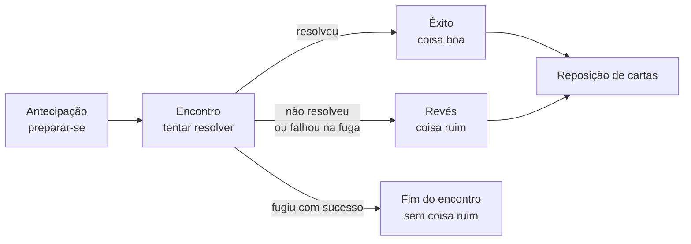

| Fase | Quando acontece |
|---|---|
| **Antecipação** | Antes de a carta de evento ser revelada. |
| **Encontro** | O jogador tenta (ou não) resolver o evento. |
| **Êxito** | Depois de o evento ser resolvido com sucesso: o jogador recebe benefícios, buffs, itens e/ou recompensas (ou apenas evita a coisa ruim). |
| **Revés** | Depois de o evento não ser resolvido: o jogador sofre as penalidades da carta. |

**Antecipação:** é a fase para **se preparar** para o evento. Nela, o jogador pode ativar efeitos e habilidades (pagando seus custos), inclusive efeitos com gatilho "na fase de antecipação". Exemplos: olhar a carta do topo do deck de eventos e decidir se a compra ou a manda para o fundo; ganhar +1 em todos os atributos para este evento.

Durante o encontro, o jogador pode tentar **fugir** (veja [14.5](#145-fugir-de-um-evento-aleatório)).

### 14.4 Reposição de cartas

Ao terminar o evento (depois do êxito ou do revés), o jogador **compra imediatamente** do deck de atributos **a mesma quantidade de cartas de atributo** que jogou para tentar resolver o evento.

| Exemplo | O que aconteceu | Compra cartas? |
|---|---|---|
| 1 | Gastou 4 cartas e resolveu o evento → as 4 cartas vão para a pilha de descarte de atributos → êxito encerrado. | **Sim, 4** |
| 2 | Gastou 2 cartas, percebeu que não ia conseguir, tentou fugir e falhou → sofre as penalidades → revés encerrado. | **Sim, 2** |
| 3 | Não quis gastar cartas, tentou fugir e falhou → sofre as penalidades → revés encerrado. | **Não** (nenhuma carta usada) |
| 4 | Gastou 5 cartas, percebeu que não ia conseguir, tentou fugir e **conseguiu** → não sofre penalidades → o encontro se encerra. | **Não** (fugiu com sucesso: as cartas gastas são o preço da fuga) |

As cartas descartadas como **custo de efeitos** durante o evento (não como requisito) **não** são repostas. Só as cartas usadas para cumprir os requisitos do evento são repostas.

### 14.5 Fugir de um evento aleatório

A fuga usa o [teste de fuga](#15-teste-de-fuga). No evento aleatório, ela tem estas regras extras:
- Se a fuga **falhar**, além da coisa ruim, o jogador **perde 1 ponto de ação**. Se ele estiver com **0 pontos de ação**, a perda fica **acumulada** e ele perde 1 ponto na **próxima vez**.
- Eventos com o símbolo **Sem fuga** não permitem fuga. O texto da carta também diz que não é possível fugir.

---

## 15. Teste de fuga

Esta é a **fonte única** das regras de fuga; os capítulos de evento e combate só acrescentam as consequências específicas.

- O teste de fuga pode acontecer durante um **evento**, um **combate** ou em **outras situações** indicadas por cartas.
- **Custo:** tentar fugir (de evento, de combate ou de PvP) custa **20% do Pico** em Vigor, com **mínimo de 1**, pago com ou sem sucesso (valor de teste, ajustável no laboratório). Sem Vigor suficiente, **não é possível** tentar (por isso, com Pico 0 não há fuga). Efeitos ou habilidades podem permitir **fuga automática** (sem pagar e sem rolar dados), se a carta disser.
- O jogador que quer fugir rola um **D20**.
- Por padrão, para fugir é preciso tirar **um número maior que 10**.
- Alguns eventos e combates têm um **valor mínimo de fuga** próprio.
- Efeitos/habilidades podem aumentar ou diminuir tanto o valor do dado quanto o valor mínimo de fuga. Energia, Pico e Vigor **não** influenciam o dado por padrão.

**Consequências da falha:**

| Onde | Falha |
|---|---|
| **Evento aleatório** | Sofre a coisa ruim e perde 1 ponto de ação (veja [14.5](#145-fugir-de-um-evento-aleatório)). |
| **Combate** | **Perde o turno de combate** e recebe um **ataque livre**: o primeiro inimigo que vem **depois dele** na ordem de Celeridade faz um **ataque básico** extra contra ele. Se ele for o último da ordem, a contagem **volta ao início** (o primeiro inimigo da ordem ataca). O combate continua. |
| **PvP (Desbravadores)** | Regra própria de D20 contra D20 (veja [28.2](#282-desbravadores)). |

**Não é possível fugir:**
- de eventos com o símbolo **Sem fuga**;
- em batalhas **dentro de raides**;
- no modo **Enfrentamento (PVP)**, onde o jogador pode apenas **desistir** do combate.

---

## 16. Elementos

Elementos têm relações de vantagem, desvantagem e neutralidade entre si. O elemento de um inimigo só importa **quando ele é atacado** (os ataques dele contra jogadores são sempre neutros). Eles influenciam o cálculo de dano e diversos outros cenários do jogo. Este capítulo vem antes de habilidades e combate porque os dois usam elementos.

### 16.1 Relações e efetividade

| Relação | Efeito padrão |
|---|---|
| **Vantagem** | +25% de efetividade contra o elemento |
| **Desvantagem** | −25% de efetividade contra o elemento |
| **Neutro** | Os elementos não têm relação entre si; a habilidade funciona normalmente. |
| **Sem elemento** | A habilidade não tem afinidade elemental; o resultado é sempre neutro. |

Exemplos: Fogo contra Água tem desvantagem. Fogo contra Elétrico é neutro. Uma habilidade sem elemento contra Água ou contra Fogo é neutra.

**Quem tem elemento:**
- **Habilidades** têm **0 ou 1 elemento**. Jogadores e inimigos usam o **mesmo conjunto** de habilidades e efeitos: uma habilidade usada por um inimigo tem elemento da mesma forma que a de um jogador.
- **Inimigos** têm **0 ou 1 elemento**.
- O **ataque básico** (sem habilidade), de jogadores e de inimigos, **não tem elemento**.
- **Jogadores não têm elemento** (inclusive o Feiticeiro). Quando um jogador é atacado, o elemento do ataque é sempre neutro contra ele, salvo efeitos (ex.: "torne-se resistente ao elemento X").
- **Recursos e equipamentos não têm elemento.** Equipamentos podem dar **bônus de elemento**, um percentual de efetividade (ex.: "+10% de efetividade em habilidades de Fogo").
- **Zonas não têm elemento.**
- **Não existe multi-elemento** em nenhuma situação do jogo.

**O que é efetividade:** a efetividade é definida pela relação entre o **elemento do ataque** e o **elemento do inimigo** atingido. Ela é aplicada **uma única vez**, sobre o **dano final** (depois de Ataque − Defesa): +25% com vantagem, −25% com desvantagem. A Defesa do inimigo **não** é alterada pelo elemento.

```
Habilidade de Fogo  →  inimigo de Gélido   (Fogo tem vantagem)
Dano base 40 − Defesa 20 = 20   →   20 × 1,25 = 25 de dano
```

Bônus de equipamentos, efeitos e habilidades podem **aumentar ou diminuir** a efetividade de um elemento.

### 16.2 Tabela de elementos

Novos elementos podem surgir no futuro. Toda vantagem de A sobre B corresponde a uma desvantagem de B contra A. **Equilíbrio:** todo elemento tem 2 ou 3 vantagens e 2 ou 3 desvantagens, e a diferença entre as duas quantidades é no máximo 1.

**Elementos básicos:** Terra, Água, Fogo, Ar, Gélido e Elétrico. Os demais são **elementos avançados**.

| Elemento | Descrição | Vantagem contra | Desvantagem contra |
|---|---|---|---|
| **Terra** | Rochas, minerais, areia, cristais e manifestações geológicas. Resistência, estabilidade e força. | Elétrico, Sônico, Ar | Orgânico, Água |
| **Água** | Água, líquidos, correntes, pressão e manipulação de fluidos. | Fogo, Tóxico, Terra | Elétrico, Gélido, Orgânico |
| **Fogo** | Chamas, calor, combustão, explosões e energia térmica. | Gélido, Cósmico | Água, Ar |
| **Ar** | Ventos, pressão atmosférica, tempestades e manipulação de gases. | Tóxico, Fogo | Terra, Elétrico |
| **Gélido** | Gelo, congelamento, baixas temperaturas e cristalização. | Água, Orgânico | Fogo, Sônico, Dracônico |
| **Elétrico** | Eletricidade, raios, magnetismo e descargas energéticas. | Água, Ar | Terra, Cósmico |
| **Orgânico** | Vegetação, raízes, fungos, flores e manifestações biológicas da natureza. | Terra, Água | Gélido, Tóxico, Dracônico |
| **Tóxico** | Venenos, toxinas, ácidos, contaminação e substâncias nocivas. | Orgânico, Sanguíneo | Água, Ar, Celestial |
| **Arcano** | Energia mágica, feitiços, runas, encantamentos e forças sobrenaturais. | Dracônico, Espiritual, Cósmico | Obscuro, Psíquico |
| **Obscuro** | Sombras, maldições, corrupção, trevas e energia negativa. | Psíquico, Arcano | Celestial, Espiritual |
| **Celestial** | Luz divina, bênçãos, energia sagrada, purificação e manifestações celestiais. | Obscuro, Tóxico | Sanguíneo, Cósmico |
| **Dracônico** | Poderes de dragões, sangue dracônico, sopros e energia ancestral. | Orgânico, Gélido | Arcano, Sanguíneo |
| **Cósmico** | Estrelas, gravidade, energia astral, dimensões, espaço e fenômenos cósmicos. | Elétrico, Celestial | Fogo, Arcano |
| **Sônico** | Vibrações, frequências, ondas sonoras e ressonância. | Psíquico, Gélido | Terra, Sanguíneo |
| **Psíquico** | Telepatia, telecinese, ilusões e manipulação mental. | Sanguíneo, Espiritual, Arcano | Obscuro, Sônico |
| **Sanguíneo** | Sangue, vitalidade, sacrifícios e manipulação biológica. | Celestial, Dracônico, Sônico | Tóxico, Psíquico, Espiritual |
| **Espiritual** | Espíritos, almas, aparições e manifestações espectrais. | Sanguíneo, Obscuro | Arcano, Psíquico |

**Mapa dos elementos básicos** (seta = "tem vantagem contra"):

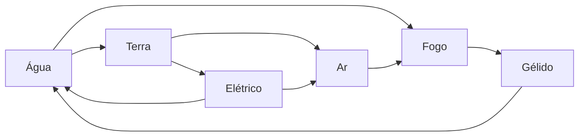

### 16.3 Afinidade elemental das classes

Cada classe tem **elementos de afinidade** (pode mudar no futuro). Habilidades desses elementos custam **10% menos Vigor**: custo final = custo × 0,9, **arredondando o custo para baixo**. Especializações podem acrescentar elementos. A afinidade é da classe, não do jogador: ela **não** dá elemento ao jogador nem ao ataque básico.

| Classe | Afinidade | Especializações com afinidade própria |
|---|---|---|
| Guerreiro | Terra, Sanguíneo | Cavaleiro: + Celestial |
| Mago | Arcano | Necromante: + Obscuro; Elementalista: + os 6 elementos básicos |
| Ladino | Ar, Tóxico | Assassino: + Obscuro |
| Clérigo | Celestial, Espiritual | Exorcista: + Sônico |
| Patrulheiro | Orgânico, Ar | — |
| Druida | Orgânico, Terra, Água | Xamã: + Espiritual; Metamorfo: + Sanguíneo |
| Monge | Espiritual, Ar | Punho Elemental: + os 6 elementos básicos |
| Bardo | Sônico, Psíquico | — |
| Alquimista | Tóxico, Fogo | Transmutador: + Arcano |
| Artífice | Elétrico, Terra | Ferreiro Arcano: + Arcano |
| Bruxo | Obscuro | Demonologista: + Fogo; Abissalista: + Cósmico; Pactário: + Sanguíneo |
| Feiticeiro | Arcano | Dracônico: + Dracônico; Elemental: + os 6 elementos básicos; Celestial: + Celestial; Trevoso: + Obscuro |

Elementalista, Punho Elemental e Feiticeiro Elemental têm afinidade com **os 6** elementos básicos, sem limite nem custo (não há escolha).

---

## 17. Habilidades

- **Para jogadores**, habilidades estão **vinculadas a equipamentos** de todas as categorias. **Inimigos** têm as habilidades impressas na carta de evento de combate em que aparecem (veja [18.1](#181-o-inimigo-na-carta-de-evento-de-combate)).
- Cada habilidade tem um **nome** e um ou mais **[efeitos](#13-efeitos)**.
- **Custo:** usar uma habilidade consome pontos de **Vigor** por padrão. Quanto mais forte a habilidade, mais Vigor ela custa. Algumas habilidades não consomem Vigor, e recursos, efeitos e outras habilidades podem reduzir ou aumentar o custo.
- Cada habilidade tem **0 ou 1 [elemento](#16-elementos)** e uma **forma** (detalhes em [17.4](#174-detalhe-das-formas)):

| Forma | Descrição |
|---|---|
| **Direcionada** | Atinge um alvo específico. |
| **Projétil** | Dispara algo em direção a um alvo. |
| **Área** | Afeta uma região e mais de um inimigo ao mesmo tempo. |
| **Contínua** | Permanece ativa por determinado período (exige ativação). |
| **Canalizada** | Exige concentração ou preparação: é preciso usar a habilidade algumas vezes antes de ela poder ser usada de fato. |
| **Passiva** | Funciona sem ativação manual. |

### 17.1 Anatomia de uma habilidade

Toda habilidade (impressa no equipamento ou no inimigo da carta de evento de combate) segue este modelo. Os efeitos das habilidades **não precisam de nome próprio**: o texto descreve o que acontece.

| Campo | Descrição | Exemplo |
|---|---|---|
| **Nome** | Nome da habilidade | *Corte Flamejante* |
| **Forma** | Uma das formas acima | Direcionada |
| **Elemento** | 0 ou 1 | Fogo |
| **Custo** | Vigor (padrão) + custos extras opcionais (cartas de atributo da mão, vida, ouro, etc.) | 20 Vigor + descarte 1 carta de Força |
| **Poder** | Valor somado ao Ataque quando a habilidade causa dano | +40 |
| **Efeitos** | Gatilho/custo/ativação/duração (capítulo [13](#13-efeitos)) | O alvo sofre 10 de dano no início de cada turno de combate dele, por 2 turnos de combate |
| **Recarga** | Quantos **turnos de combate do usuário** é preciso esperar até poder usar a habilidade de novo (0 = pode usar de novo no próximo turno). **Fora do combate**, a recarga conta em **vezes** do usuário | 1 (usa no turno 1, espera o turno 2, volta no turno 3) |
| **Momento de uso** | Em combate, fora de combate (via Preparar) ou ambos | Em combate |

A habilidade **não tem requisito de Pico próprio**: ela usa o **Requisito de Pico do equipamento** em que está (veja [7.3](#73-regras-da-energia)).

### 17.2 Regras de uso

1. Cada habilidade pode ser usada **uma vez por turno de combate por padrão** e, **fora do combate**, **uma vez por vez**, a menos que a própria habilidade diga o contrário (ex.: "pode usar esta habilidade até X vezes"). Depois de usada, ela respeita a **Recarga** (em turnos de combate dentro do combate; em vezes fora dele).
2. Várias habilidades **diferentes** podem ser usadas no mesmo turno, desde que o jogador pague todos os custos.
3. Habilidades que causam dano **não substituem** o ataque com a arma no fim do turno: elas causam um **dano extra**, e depois o jogador ainda tem direito ao seu ataque.
4. **Dano de habilidade:** usa **o mesmo cálculo do ataque** ([19.2](#192-cálculo-do-dano)), somando o **Poder** ao Ataque, e rola acerto conforme a forma ([17.4](#174-detalhe-das-formas)). O elemento da habilidade define a efetividade.
5. Habilidades de um equipamento **quebrado**, **anulado** ou com **Requisito de Pico** não cumprido não podem ser usadas.

Nem toda classe deve ter habilidades que causam dano; só as que fazem sentido.

### 17.3 Restrições de classe

As duas formas abaixo podem existir, conforme a carta:
1. **Equipamento com restrição de classe** (ex.: "Só Mago, Bruxo, Feiticeiro"): quem não é dessas classes não pode equipá-lo.
2. **Habilidade com restrição de classe** (ex.: "Habilidade usável só por Guerreiro"): qualquer classe equipa o item e recebe os bônus de modificadores, mas só as classes indicadas (e **ativas**, veja [8.2](#82-a-trava-do-deck)) usam aquela habilidade.

Equipamentos sem restrição podem ser usados por qualquer classe.

### 17.4 Detalhe das formas

Os cálculos podem ser trocados no laboratório.

| Forma | Regra |
|---|---|
| **Direcionada** | Escolhe 1 alvo. Rola acerto normalmente (Precisão × Esquiva). |
| **Projétil** | Escolhe 1 alvo. Rola acerto com **+10% de Precisão**, mas um **escudo** do alvo reduz o dano pela metade (só afeta jogadores, porque inimigos não têm equipamentos). |
| **Área** | Atinge **todos** os inimigos (ou todos os jogadores, se usada por inimigo; no PvP, todos os **adversários** do combate, nunca os aliados). Dano em cada alvo é **metade** do normal. **Não rola acerto e não pode ser esquivada.** Para compensar, a maioria das habilidades de área deve ter alguma desvantagem ou ser **Canalizada**. |
| **Contínua** | Paga uma vez, fica ativa por N turnos de combate (ex.: aura que dá +2 Defesa). Só uma habilidade contínua ativa por equipamento. |
| **Canalizada** | Precisa ser "carregada" N vezes (cada carga usa a ação da habilidade no turno). Na carga final, dispara com efeito muito forte. Se o jogador sofrer, num único golpe, dano **maior que 20% da vida que tinha ao começar a canalização**, as cargas são perdidas (ajustável no laboratório). |
| **Passiva** | Sem custo de ativação; vale enquanto o equipamento estiver em uso. Não conta como "usar uma habilidade" para gatilhos. |

---

## 18. Inimigos

**Jogadores não têm raça** (ex.: elfo, orc, anão): essa mecânica pode ser implementada no futuro. Inimigos têm **tipo** e **criatura** (veja abaixo). O modelo do inimigo pode ser alterado no laboratório.

### 18.1 O inimigo na carta de evento de combate

**Inimigos não são cartas à parte.** Eles ficam **impressos dentro da carta de evento de combate** (e, nas missões e raides que têm combate, dentro da carta da missão ou da etapa da raide). A carta traz um bloco com os dados de cada inimigo do combate. A mesma criatura pode aparecer em cartas diferentes, inclusive com valores diferentes.

**Recompensas e penalidades** ficam na própria carta de evento de combate: a **coisa boa** (o que o jogador ganha ao vencer: ouro, recursos, compras do deck de recompensas da zona, Pico ou Vigor) e a **coisa ruim** (o que acontece com quem é nocauteado pelos inimigos dela).

Dados de cada inimigo impresso na carta:

| Campo | Descrição |
|---|---|
| **Nome** e **flavor text** | — |
| **Tipo** | Veja [18.2](#182-tipos-de-inimigo). Um inimigo pode ter **de 1 até todos** os tipos. |
| **Criatura** | Registro livre: o que o inimigo é. Pode ser qualquer coisa ou **qualquer mistura** de criaturas (ex.: "Goblin", "Rato-leão-pombo"). Criaturas são infinitas. Efeitos e habilidades podem interagir **especificamente** com uma criatura (ex.: "+20% de dano contra Goblins"). |
| **Categoria** | Veja [18.3](#183-categorias-de-inimigo). |
| **Elemento** | 0 ou 1. Define a efetividade dos ataques recebidos (veja [16.1](#161-relações-e-efetividade)). |
| **Vida** e **modificadores** | Ataque, Defesa, Precisão, Esquiva, Celeridade, Perfuração, Reflexão. Seus valores já são **finais** (o Pico não se aplica). |
| **Habilidades** | As habilidades do inimigo ficam **impressas no bloco dele na carta** (inimigos não usam equipamentos). |
| **Energia** | Opcional: Vigor do inimigo para pagar habilidades. Habilidades também podem ter só recarga ou nenhum custo. |
| **Comportamento** | Perfil da IA: Agressivo, Defensivo, Suporte, Covarde (foge com pouca vida; o jogador não recebe nada por um inimigo que fugiu, porque ele não foi derrotado), Caçador (ataca o alvo mais fraco). |

Inimigos **não têm** classe, especialização, inventário nem **equipamentos**. Efeitos que quebram equipamentos **não funcionam** contra inimigos.

### 18.2 Tipos de inimigo

| Tipo | Exemplos |
|---|---|
| **Fera** | Lobos, ursos, aranhas gigantes |
| **Humanoide** | Bandidos, cultistas, soldados |
| **Morto-vivo** | Esqueletos, zumbis, liches |
| **Espírito** | Fantasmas, aparições |
| **Demônio** | Diabretes, demônios maiores |
| **Celestial** | Anjos caídos, guardiões divinos |
| **Elemental** | Golens de pedra, elementais de fogo |
| **Constructo** | Autômatos, armadilhas vivas |
| **Dracônico** | Dragões, wyverns, kobolds |
| **Aberração** | Entidades cósmicas, criaturas do abismo |
| **Planta** | Fungos, árvores carnívoras |

Os tipos (e as criaturas) servem para **gatilhos e efeitos** (ex.: "+3 de dano contra Mortos-vivos", "Espíritos ignoram sua Defesa") e para dar identidade às zonas (zonas Pantanosas com mais Plantas e Feras; Religiosas com Espíritos e Celestiais).

### 18.3 Categorias de inimigo

| Categoria | Onde aparece | Observação |
|---|---|---|
| **Comum** | Deck de eventos das zonas | Maioria dos combates |
| **Elite** | Deck de eventos (raro) | Mais forte, recompensa melhor |
| **Chefe** | Missões ou eventos especiais | Cada chefe é uma **aparição única**: quando **qualquer** jogador o derrota, **nenhum outro** jogador pode derrotá-lo de novo naquela jogada da dimensão (a carta sai do jogo). Uma dimensão pode ter vários chefes |
| **Chefe de raide** | Etapas de raide | Narrativo, sem fuga |
| **Chefe final** | Condição de conclusão da dimensão | Veja [3.2](#32-conclusão-de-uma-dimensão) |

---

## 19. Sistema de combate

Quando um **evento de combate** é revelado (ou acontece uma batalha numa raide), começa um combate. A regra base (1 jogador contra 1 inimigo) vale para todos os outros casos, que só acrescentam diferenças.

### 19.1 Combate 1 jogador × 1 inimigo (regra base)

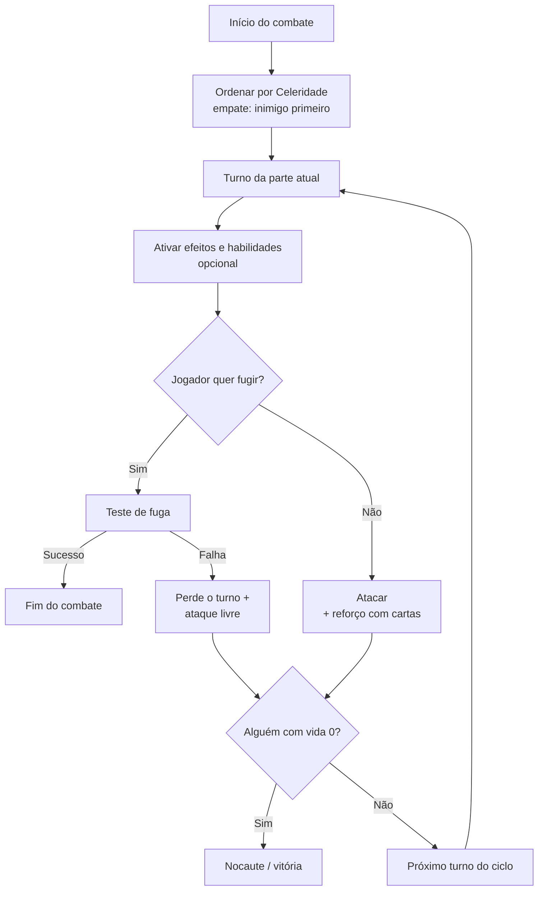

1. **Ordem de ataque:** pela **Celeridade**, da maior para a menor. Em caso de empate, o **inimigo tem prioridade** por padrão (efeitos, habilidades e itens podem mudar isso).
2. **Turnos de combate:** as partes se revezam, uma por vez. Quando todas jogaram, termina um **ciclo de combate** e começa o próximo.
3. **No seu turno de combate**, a parte pode ativar vários efeitos, habilidades, etc. **A última coisa do turno é sempre atacar.**
4. **Resultado do ataque** (veja o cálculo em [19.2](#192-cálculo-do-dano)):
   - Ataque **igual ou menor** que a defesa → o oponente não toma dano.
   - Ataque **maior** que a defesa → o oponente perde vida igual à diferença.
   - Se o alvo **esquivar**, o ataque é um **"miss"** e o turno passa para o próximo atacante.
5. **Ataques múltiplos:** efeitos, habilidades e itens podem permitir atacar mais de uma vez, desde que suas condições sejam cumpridas e nenhum **efeito** ou **habilidade** impeça.
6. O inimigo segue a mesma lógica: ativa efeitos e habilidades e por fim ataca. Inimigos **não usam "cartas na mão"**: tudo é feito automaticamente pelo sistema.
7. **Quem chegar a 0 de vida primeiro é nocauteado.**
   - **Vitória do jogador:** recebe a coisa boa da carta de evento de combate e segue para a próxima ação, se ainda tiver pontos de ação.
   - **Derrota do jogador:** é [nocauteado](#20-nocaute-spawn-e-respawn) e sofre a coisa ruim da carta de evento de combate, se houver.
8. **Troca de equipamentos:** não é permitida durante o combate por padrão; efeitos, habilidades ou outros fatores podem mudar isso.
9. **Fuga:** o jogador pode tentar o [teste de fuga](#15-teste-de-fuga) no seu turno de combate.
   - **Sucesso:** o combate termina imediatamente.
   - **Falha:** o jogador **perde o turno de combate** e recebe um **ataque livre** (veja [15](#15-teste-de-fuga)). O combate continua.

**Empates de Celeridade:** entre **jogadores**, resolve-se por **D20** (maior começa; empate no dado, rola de novo). Entre aliados, eles escolhem a ordem. Entre jogador e inimigo, o inimigo tem prioridade (regra 1).

### 19.2 Cálculo do dano

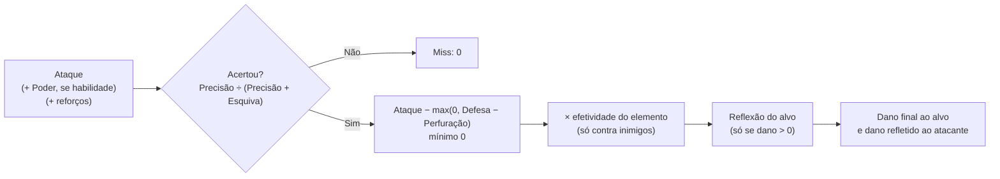

1. **Acerto:** chance (%) = Precisão ÷ (Precisão + Esquiva do alvo) × 100. Habilidades de Área não rolam acerto.
2. **Dano bruto:** Ataque (+ Poder da habilidade, se houver; calculado pelo pipeline de [7.4](#74-escala-fórmulas-e-valores-iniciais)) − **max(0, Defesa do alvo − Perfuração do atacante)**, mínimo 0. A Perfuração pode zerar a Defesa, mas nunca a deixa negativa.
3. **Elemento:** se o alvo for um inimigo com elemento e o ataque tiver elemento, aplica-se a efetividade ([16.1](#161-relações-e-efetividade)).
4. **Reflexão:** se o dano for maior que 0, o alvo devolve ao atacante até o valor da sua Reflexão, e esse valor é subtraído do dano que o alvo recebe. Com dano 0, nada é refletido. O dano refletido vai **direto na vida** do atacante (ignora a Defesa dele) e **pode nocauteá-lo**.

Fórmulas em teste; podem mudar no laboratório.

### 19.3 Cartas de atributo no combate

As cartas de atributo da mão são usadas no combate de duas formas:
1. **Pagar custos** de habilidades, efeitos e recursos que exigem cartas de atributo.
2. **Reforçar** um modificador, descartando cartas. O reforço acontece **no momento do ataque**: ao atacar, o jogador faz os descartes de atributos.

| Atributo descartado | Reforça | Tipo de reforço |
|---|---|---|
| Força | Ataque | Ataque |
| Destreza | Precisão | Ataque |
| Inteligência | Perfuração | Ataque |
| Resistência | Defesa | Defesa |
| Espírito | Reflexão | Defesa |

**Regras do reforço** (valores em teste, podem mudar):
- Cada carta dá **+10% no modificador** (+20% se for atributo **essencial** de uma classe **ativa** do jogador). Os bônus de várias cartas **se somam** e entram na etapa de percentuais do pipeline ([7.4](#74-escala-fórmulas-e-valores-iniciais)).
- **Carta sinérgica:** reforça **cada** modificador ligado aos atributos dela, segundo a tabela acima. Ex.: uma carta Força + Resistência reforça o Ataque (pela Força) **e** a Defesa (pela Resistência). O bônus de atributo essencial vale **para cada** atributo da carta: num Guerreiro ativo, essa carta dá +20% no Ataque **e** +20% na Defesa. Atributos sem reforço na carta (ex.: Sorte) não fazem nada no reforço.
- **Duração:** reforços de **ataque** valem até o fim do turno de combate. Reforços de **defesa** também são feitos no ataque, mas valem **até o início do próximo turno de combate** do jogador, para cobrir os ataques inimigos.
- **Sanidade, Sorte, Carisma e Sabedoria** não reforçam modificadores no combate; são atributos como os outros (pagam requisitos e custos).
- Nenhum atributo reforça **Esquiva** nem **Celeridade**: elas só mudam por equipamentos e efeitos.
- Ao fim do combate, as cartas gastas no reforço são **repostas** como nos eventos ([14.4](#144-reposição-de-cartas)), com as mesmas regras (fuga com sucesso = sem reposição; cartas pagas como custo de efeitos não são repostas).

### 19.4 Combate 1 jogador × 2 ou mais inimigos

Segue a regra base, com duas diferenças:
- No seu turno de combate, o jogador **escolhe qual inimigo atacar**.
- As recompensas só são entregues depois de **todos os inimigos** serem derrotados.

### 19.5 Combate com 2 ou mais jogadores × 1 ou mais inimigos

Este tipo de combate existe na Campanha e no Clássico. No Desbravadores, **não** é possível recrutar ajudantes contra inimigos.

**Quem pode entrar:** se um jogador inicia um evento de combate e há outros jogadores na mesma zona, ele pode **recrutá-los** para ajudar. Não há limite de ajudantes.

**Custo e recompensas:**
- Só o **jogador que iniciou o combate** gasta ponto de ação. Os ajudantes não perdem pontos de ação.
- Só o **jogador que iniciou** recebe os itens e recompensas.
- **Ajudantes:** cada ajudante que termina o combate **de pé** ganha o mesmo **Vigor ou Pico** de "derrotar inimigos" que a carta de evento de combate dá ("ganhe N de Pico" ou "restaure N de Vigor") e a **reposição de cartas**.
- **Exceção:** se quem iniciou fugir, ou for nocauteado e não for ressuscitado até o fim, e os outros vencerem, as recompensas são **divididas entre os sobreviventes**. Eles escolhem as recompensas em ordem de Celeridade, da maior para a menor.
- Isso cria uma dinâmica no combate: alguns jogadores podem fugir por conta própria, enquanto outros podem querer ficar e vencer para levar as recompensas.

**Nocaute durante o combate:**
- O jogador nocauteado **não é teletransportado** imediatamente, porque outros jogadores podem **ressuscitá-lo** com itens, efeitos, habilidades, etc.
- Enquanto está nocauteado, ele **não joga** seu turno de combate (apenas assiste).
- Se o combate terminar **com vitória** e algum jogador ainda estiver nocauteado, ele vai para o respawn e **não sofre** a coisa ruim da carta de evento de combate, mas sofre as consequências normais do nocaute: **perde Pico** e **perde a próxima vez** ([20.2](#202-nocaute)).

**Fuga em grupo:**
- Cada jogador tenta o teste de fuga **um por vez**, no seu turno de combate.
- Falhar na fuga faz o jogador **perder o turno de combate** e receber um **ataque livre** do inimigo.
- Quem foge com sucesso sai do combate e não joga mais nele.

**Resultado do combate:**

| Situação | Resultado | Penalidades dos inimigos |
|---|---|---|
| Os jogadores derrotam todos os inimigos | **Vitória** | Ninguém sofre |
| **Todos** os jogadores fogem com sucesso | **Fuga com sucesso** | Ninguém sofre |
| Nenhum jogador restante de pé (todos fugiram ou foram nocauteados) e pelo menos um nocauteado | **Derrota** | Só os **nocauteados** sofrem |

Quem fugiu com sucesso não sofre as penalidades dos inimigos, mas pode sofrer penalidades de outros fatores (efeitos, etc.).

**Exemplo:**
1. Participantes: jogadores A, B e C; inimigos A, B, C e D.
2. Ordem por Celeridade: jogador A → inimigo C → inimigo A → jogador C → jogador B → inimigo D → inimigo B.
3. Os jogadores percebem que não vão vencer e decidem fugir.
4. O jogador A tenta fugir e falha: perde o turno e recebe um ataque livre. Os inimigos C e A atacam, e o jogador A chega a 0 de vida (nocauteado). O jogador C tenta fugir e falha: perde o turno e recebe um ataque livre, ficando com pouca vida. O jogador B foge com sucesso e sai do combate.
5. No **ciclo de combate** seguinte, os inimigos nocauteiam o jogador C antes de ele conseguir fugir.
6. Resultado: **derrota**. Os jogadores A e C (nocauteados) sofrem as penalidades dos inimigos; o jogador B não.

**Não é permitido negociar** entre jogadores durante um combate. **Nada** pode alterar essa regra.

### 19.6 Combate em raides

- **Não é possível fugir** de batalhas dentro de uma raide, porque o confronto faz parte da história.

**Nocaute dentro da raide:**
1. O jogador nocauteado é um **"peso morto"**: ele não age, e o grupo **não pode avançar** para a próxima etapa enquanto houver jogador nocauteado.
2. Os outros jogadores podem **ressuscitá-lo** com itens, efeitos, habilidades, etc.
3. **Fim da etapa:** ao fim da etapa (combate vencido ou evento resolvido), os jogadores de pé têm **uma chance** de usar itens/efeitos de reviver. Quem não for revivido nesse momento **sai da raide**, sofre as penalidades daquela etapa (se houver), **perde Pico** e **a próxima vez** (como em [20.2](#202-nocaute)) e vai para o respawn. Os que estão de pé seguem para a próxima etapa.
4. Se **todos** os jogadores forem nocauteados na mesma etapa, a raide termina em **derrota** e todos sofrem as penalidades da etapa.
5. Quem sai da raide **não recebe** recompensas das etapas já vencidas: as recompensas são entregues só no final.
6. Se o jogador que **iniciou** a raide (e decide as escolhas da história) sair, o **próximo jogador na ordem da rodada** que ainda está na raide passa a decidir e **herda o papel de iniciador**, inclusive o direito às recompensas finais.

### 19.7 IA dos inimigos

É necessário implementar uma IA que controle as ações dos inimigos em combate: perceber quando o jogador tem defesa ou ataque fracos, escolher as melhores estratégias, ajudar ou ressuscitar um aliado, etc. O campo **Comportamento** de cada inimigo na carta ([18.1](#181-o-inimigo-na-carta-de-evento-de-combate)) define o perfil que a IA segue.

---

## 20. Nocaute, spawn e respawn

### 20.1 Spawn e respawn

- **Spawn** e **respawn** são o mesmo ponto do mapa:
  - **spawn** é onde o jogador aparece no mundo **pela primeira vez** (escolhido na [preparação](#101-passo-a-passo));
  - **respawn** é onde o jogador **reaparece depois de ser nocauteado**.
- Em **todos os modos com mapa** (Campanha, Desbravadores e Clássico), a ação **Salvar ponto de respawn** muda esse ponto para a zona atual. Só zonas **Urbanas** têm essa ação.

### 20.2 Nocaute

Quando o jogador chega a **0 pontos de vida**, ele é **nocauteado**:
1. Volta para o seu **ponto de respawn** com **10% da vida máxima** (calculada já com o novo Pico; arredondado para baixo, mínimo 1; ajustável no laboratório).
2. Perde as **ações restantes** da vez e a sua **próxima vez**.
   - **Exceção:** jogando **sozinho** nos modos Campanha, Desbravadores e Clássico, o jogador **não** perde a vez.
3. Sofre as penalidades da coisa que o nocauteou, se houver (por exemplo, a coisa ruim da carta de evento de combate).
4. Perde Pico (padrão: −10%) e volta com Vigor igual ao **menor** valor entre o Vigor que tinha e **50% do novo Pico** (veja [7.3](#73-regras-da-energia)).

> **Sem auto-reviver:** não existem efeitos, habilidades ou recursos que façam o próprio jogador voltar sozinho ao chegar a 0 de vida (ex.: "quando você chegar a 0 de vida, volte com X"). Só outros jogadores podem reviver alguém, onde a regra permitir.

> Em combates com vários jogadores, o nocauteado só é teletransportado ao fim do combate (veja [19.5](#195-combate-com-2-ou-mais-jogadores--1-ou-mais-inimigos)).

---

## 21. Missões

### 21.1 Regras gerais

- Missões são encontradas em algumas zonas. Nem toda zona tem missões.
- Algumas missões envolvem recolher itens, falar com um NPC, etc.
- Ações relacionadas: **Pegar**, **Continuar** e **Finalizar missão**. Quando o jogador chega a uma zona que tem uma etapa de uma missão que ele já pegou, ele interage para continuar ou finalizar a missão. Missões de várias etapas indicam em que tipo de zona fica cada etapa.
- **Não são obrigatórias:** se o jogador pegar uma missão e não cumpri-la, nada acontece. A missão fica em aberto até ele decidir cumpri-la.
- **Missões são individuais:** a missão fica atrelada ao jogador que a pegou e só ele pode finalizá-la.
- **Não se repetem:** cada jogador só pode completar a mesma missão **uma vez por jogada da dimensão**. Ao **repetir** uma dimensão na campanha ([3.2](#32-conclusão-de-uma-dimensão)), todas as missões voltam a poder ser feitas, com as recompensas reduzidas pelo decaimento. Nos modos de run, vale **por partida**.
- Missões em aberto ao sair de uma dimensão são canceladas.
- Ao concluir uma missão, o jogador pode receber recompensas (inclusive do [deck de recompensas](#34-o-que-uma-carta-de-zona-contém)) e **Pico**.

### 21.2 Tipos de missão

| Tipo | Onde fica | Quem pode pegar |
|---|---|---|
| **Missão de zona** | No **deck de missões** da zona | **Exclusiva**: só o jogador que pegou (veja o quadro abaixo) |
| **Missão de provação** (especialização) | Fixa nas zonas indicadas pela própria missão, fora do deck | **Qualquer** jogador que cumpra os requisitos ([8.3](#83-como-obter-uma-especialização)) |
| **Missão do mentor** (multiclasse) | Ação Treinar com mentor | **Qualquer** jogador que cumpra os requisitos ([8.4](#84-como-se-tornar-multiclasse)) |

**Quadro de missões (missões de zona):**

```
Deck de missões da zona          Quadro (visível ao entrar na zona)
┌──────┐                         ┌──────┐ ┌──────┐ ┌──────┐
│ ???? │ ──── repõe ──────────►  │  M1  │ │  M2  │ │  M3  │
└──────┘                         └──────┘ └──────┘ └──────┘
                                     │ jogador pega M2
                                     ▼
                                 M2 sai do quadro → vai para o jogador
                                 a carta do topo do deck ocupa o lugar
```

1. Cada zona com missões tem um **deck de missões** pequeno. As **3 primeiras** cartas ficam viradas para cima no **quadro de missões**, visíveis a quem estiver na zona.
2. Ao **pegar** uma missão, o jogador tira a carta do quadro: ela passa a ser dele, e nenhum outro jogador pode pegá-la. A carta do topo do deck de missões repõe a vaga.
3. Ao **concluir** a missão, a carta sai do jogo nessa partida.

**NPCs:** NPCs **não são uma mecânica**. São apenas **flavor text** ou uma lógica calculada automaticamente pelo jogo. "Falar com o NPC X na zona Y" = usar a ação **Continuar missão** na zona Y. Mercado, ferreiro e mentor também são mecânicas do jogo; qualquer "personagem" neles é só flavor text.

---

## 22. Raides

Uma **raide** (dungeon ou instância) é uma **sequência determinada de eventos**, um após o outro, que acontece **somente na zona onde foi iniciada**.

**Onde as raides ficam:**
- A carta de zona traz a ação local com o **nome da raide**, por exemplo: *"Iniciar a raide Prisma do Lago Verde"*.
- Cada dimensão tem um **catálogo de raides** com a história completa de cada uma (o "jogo-livro"). No jogo físico, os jogadores consultariam esse livro; no digital, o catálogo fica **embutido na aplicação** (salvo no banco de dados).
- Durante a raide, os capítulos e as decisões aparecem **na tela**, um após o outro (como eventos), e são resolvidos automaticamente pelo sistema conforme as escolhas dos jogadores.
- A **Raide Final** da dimensão também fica no catálogo e é indicada pela Carta de Dimensão ([3.2](#32-conclusão-de-uma-dimensão)).

### 22.1 Como iniciar

- Um jogador pode iniciar a raide **sozinho** ou chamar os jogadores da **mesma zona**, que podem aceitar ou não. No **Desbravadores**, cada jogador faz a raide **sozinho**.
- Quem inicia a raide **gasta todos os pontos de ação** restantes. Ao terminar a raide, a vez dele termina.
- Quem participa junto **não gasta pontos de ação** nem perde a vez.
- Algumas raides exigem **requisitos** para ser iniciadas. Quando o jogador tenta iniciar a raide, o jogo verifica se ele tem os requisitos no inventário. Se tiver, a raide pode ser iniciada.
- Cada carta de raide diz se o requisito é **"Ter"** (só verificado) ou **"Oferecer"** (consumido, vai para o limbo). Só quem **inicia** a raide precisa cumprir os requisitos.

### 22.2 Como funciona

- Os eventos da raide são **específicos** e **não se misturam** com o deck de eventos da zona.
- A raide funciona como um **jogo-livro**: o jogador participa ativamente da história e toma decisões que mudam a narrativa.
- A história **não precisa ser linear**. Dependendo das decisões, o jogador pode seguir caminhos diferentes, encontrar personagens distintos, enfrentar desafios, adquirir itens, obter equipamentos com novas habilidades e chegar a **finais completamente diferentes**.

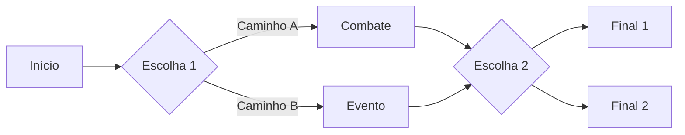

- Raides são **muito difíceis e extensas**, e por isso podem dar recompensas **muito boas e fortes** (uma ou mais).
- **Quem recebe as recompensas** é o jogador que **iniciou** a raide (ou quem herdou esse papel, veja [19.6](#196-combate-em-raides)). Depois, os jogadores podem [negociar](#23-negociação) entre si para distribuí-las.
- Os outros participantes que terminam a raide **de pé** ganham o **Pico ou Vigor** de "derrotar inimigos" e a reposição de cartas, como os ajudantes no combate (veja [19.5](#195-combate-com-2-ou-mais-jogadores--1-ou-mais-inimigos)).
- Para as regras de combate dentro da raide, veja [Combate em raides](#196-combate-em-raides).

**Formato digital:**
- A raide é exibida como **telas de narrativa** (texto + imagem + escolhas), no estilo jogo-livro.
- As histórias das raides ficam **salvas no banco de dados**: cada nó da história tem texto, escolhas, eventos e destinos.
- **Quem decide** as escolhas da história é o jogador que **iniciou** a raide. Os participantes podem discutir e fazer uma **votação** para indicar a opção que agrada mais, mas a decisão final é de quem iniciou.
- **Votação:** tela de votação com tempo curto (ex.: 20 s). O resultado é mostrado ao iniciador, que confirma ou escolhe outra opção.

### 22.3 Repetição e cooldown

- É possível repetir a mesma raide várias vezes para ver outros finais, explorar outros caminhos e conseguir recompensas diferentes.
- **Toda raide tem um cooldown em rodadas**, escrito na carta (padrão: **3 rodadas**; ajustável no laboratório).
- O cooldown é **por jogador** e vale para **todos que participaram** da raide, não só para quem iniciou.
- **Nada** adianta o cooldown de uma raide (nenhum recurso, efeito ou habilidade).
- **Decaimento por repetição:** cada jogador recebe recompensas menores a cada vez que conclui a **mesma raide** na mesma jogada da dimensão, com a mesma tabela da repetição de dimensão ([3.2](#32-conclusão-de-uma-dimensão)): 1ª vez 100%, 2ª 80%, 3ª 60%, 4ª em diante 40% (ajustável no laboratório). A contagem é por jogador e é zerada ao entrar numa nova dimensão ou ao repetir a dimensão. Quando a própria dimensão também está em repetição, os dois percentuais se multiplicam.
- Na campanha, o cooldown fica **salvo no save** e continua contando na sessão seguinte. Ao entrar numa nova dimensão (ou repetir a mesma), todos os cooldowns são **zerados**.

---

## 23. Negociação

- Acontece entre **dois jogadores na mesma zona**.
- **Não gasta ponto de ação** de nenhum dos jogadores.
- Só o jogador **da vez** pode convidar outro para negociar; o convidado pode aceitar e negociar fora da sua vez (veja [11.4](#114-agir-fora-da-vez)).
- O relógio da vez fica **pausado** durante a negociação.
- Não há limite de coisas negociadas de cada lado (respeitando o espaço de quem recebe, inclusive a capacidade da bolsa de ouro).
- **O que pode ser negociado:** **ouro**, coisas do **inventário** e cartas da **pasta de TCG**. Cartas da mão, do deck, da pilha de descarte e equipamentos em uso não podem ser negociados.
- O **conteúdo** da montaria (inventário e pasta extras) pode ser negociado; a **montaria** em si, não.
- Algumas zonas têm efeitos que **proíbem** a negociação.
- **Nunca** é permitido negociar durante um combate.

---

## 24. Mercado

O mercado aparece em algumas zonas e permite **comprar e vender** recursos, cartas e boosters. Compras só são possíveis se houver espaço: recursos e boosters precisam de espaço no **inventário**, cartas de atributo precisam de espaço na **pasta de TCG** (veja [6.6](#66-recompensas-e-falta-de-espaço)).

O mercado tem **três vitrines**:

```
┌──────────────────────┬──────────────────────┬──────────────────────┐
│ ESTOQUE              │ BOOSTERS             │ SINGLES              │
│ ilimitado            │ ilimitados           │ 4 slots, estoque     │
│ poções, munição...   │ 30 ouro              │ limitado e "vivo"    │
│ preço da carta ×     │ coleções vigentes    │ (nem todo mercado)   │
│ fator do mercado     │                      │                      │
└──────────────────────┴──────────────────────┴──────────────────────┘
```

### 24.1 Compra no estoque

- O **estoque** vende recursos comuns (poções, munição, materiais básicos, ferramentas, etc.). Todo item do estoque é uma **carta**.
- Mercados de zonas diferentes podem oferecer recursos **iguais** e recursos **exclusivos**. O jogador precisa explorar vários mercados para encontrar o que procura.
- O estoque é **ilimitado**: não há limite de compra de um item, recurso ou equipamento do estoque.
- Coisas essenciais, como **munição e poções**, existem em todos os mercados.
- **Preço do estoque** = **preço base impresso na carta × fator do mercado** ([24.4](#244-singles)), arredondado para cima. Não há fator de escassez (o estoque não acaba). Valores de referência (ajustáveis no laboratório):

| Item de estoque (exemplo) | Preço base (ouro) |
|---|---|
| Munição (pacote de 10) | 3 |
| Poção de vida pequena | 6 |
| Poção de Vigor pequena | 8 |
| Antídoto / remédio simples | 5 |
| Material básico (minério, couro, erva) | 4 |
| Ferramenta (picareta, vara de pesca, foice) | 20 |

**Munição:** é comprada no **mercado**. Armas como arcos, pistolas, etc. têm **habilidades** que consomem uma quantidade **X de munição**, que depende de cada habilidade. O **ataque básico** dessas armas **não** gasta munição; só as habilidades gastam. Sem munição, a habilidade não pode ser usada, mas o ataque básico continua.

### 24.2 Venda pelo jogador

- **Preço tabelado:** todos os mercados pagam a **mesma quantia** pelo mesmo recurso. Nenhum mercado paga mais que outro por padrão (sem fator do mercado nem de escassez).
- **Cartas de coleção** (cartas obtidas em boosters, singles e recompensas): vendidas por **50% de (preço base da raridade × ajuste da carta)** (veja [24.4](#244-singles)).
- **Cartas do estoque** (poções, munição, etc.): vendidas por **50% do preço base impresso na carta**.
- **Carta que é de estoque e de coleção ao mesmo tempo** (ex.: uma poção que também veio num booster): vale sempre a regra do **estoque** (50% do preço base impresso). Como ela pode ser comprada sem limite no estoque, vendê-la pela regra de coleção daria lucro sem risco.
- **Equipamentos quebrados** valem **0**. Cada marca de reparo reduz o preço de venda em **12%** (veja [5.1](#51-equipamentos)).
- Efeitos, habilidades e recursos do jogador podem fazer o mercado oferecer **mais ouro**.
- **Arredondamento da venda:** para **baixo**, com **mínimo de 1 ouro** para qualquer carta que não esteja quebrada nem com preço reduzido a 0 por marcas de reparo. Assim o mercado nunca paga mais do que a regra diz e nenhuma carta válida vale 0.

### 24.3 Boosters

- Todos os mercados têm **boosters ilimitados** das [coleções](#27-coleções) vigentes.
- O preço do booster é **sempre tabelado** (**30 ouro**), mas efeitos, buffs e habilidades podem dar desconto.
- Um booster contém **cartas novas de recursos e de atributos**. Boosters **nunca** contêm **montarias** (veja [26](#26-montarias)).
- Boosters também podem ser **recompensas** (eventos, missões, raides, inimigos, deck de recompensas).
- Um booster fechado é um **recurso** (categoria Boosters, [5.2](#52-itens)): fica no **inventário**, ocupa slot e se empilha com boosters iguais.
- Boosters fechados podem ser **vendidos**, **negociados**, **saqueados** no PvP e **oferecidos** como custo.

**Abrir um booster:**
- **Abrir** só é possível dentro das ações **Preparar** ou **Usar cofre**.
- Dentro de **Preparar**, as cartas de **atributo** vão para a **pasta de TCG** e as de **recurso** vão para o **inventário**. Se não houver espaço para todas, o jogador **não pode** abrir o booster.
- Dentro de **Usar cofre**, as cartas podem ir **direto para o cofre**. Se o cofre não tiver slots livres para elas, o booster **não pode** ser aberto ali.

**Conteúdo e raridade** (ponto de partida para o laboratório):
- **8 cartas** por booster, com proporção **variada** entre atributos e recursos. Algumas cartas são **mais raras** (têm chance menor de vir no booster).
- **Composição:** a quantidade de atributos e de recursos varia de booster para booster; as cartas são sorteadas com as chances abaixo, com **1 slot garantido** de Incomum ou melhor.
- **Cartas de atributo Básicas** são sempre Comuns; Sinérgicas e Aprimoradas podem ser de qualquer raridade.
- A raridade aparece como um **símbolo no canto da carta**.
- O laboratório mostra estatísticas (ex.: quantos boosters, em média, para completar uma coleção) para ajudar no balanceamento.

| Raridade | Chance por carta | Estoque de single sugerido ([24.4](#244-singles)) |
|---|---|---|
| Comum | 60% | 6 |
| Incomum | 25% | 4 |
| Rara | 11% | 2 |
| Épica | 3,5% | 1 |
| Lendária | 0,5% | 1 |

### 24.4 Singles

**Singles** são cópias avulsas de uma carta específica de coleção: recursos, itens e equipamentos (que vão **sempre para o inventário**; para equipar, usa-se **Preparar**) e cartas de atributo.

**Para onde vão os singles:**
- Singles de **atributo** vão para a **pasta de TCG**. Com a pasta cheia, não é possível comprá-los. Para entrar no deck, o jogador usa **Ajustar deck** (veja [6.3](#63-pasta-de-tcg)).
- Singles de **recurso** (itens e equipamentos) só podem ser comprados se houver **espaço no inventário**.
- Singles **nunca vão para o cofre** depois de comprados.

**Onde aparecem:**
- **Nem todo mercado** vende singles.
- **Vitrine:** os singles ficam numa vitrine de **4 slots** por padrão. Quando uma carta sai da vitrine (compra ou decaimento), entra outra carta aleatória do **pool** que ainda tenha **estoque naquele mercado**. Se o mercado não tiver mais estoque de nenhuma carta do pool, o slot fica **vazio** até o próximo pool.
- **Distribuição aleatória:** não se sabe em qual mercado um single vai aparecer. Mais de um mercado pode vender o mesmo single.
- Nem todas as cartas das coleções vigentes estarão disponíveis como singles, porque o volume de cartas é grande e provavelmente não haveria tempo de jogo para todas circularem.

**Pool e esgotamento:**
1. No início da partida, sorteia-se um **pool de singles** da dimensão (um subconjunto das coleções vigentes).
2. Cada carta do pool tem um **estoque global** (ex.: 1 a 6 cópias, conforme a raridade), distribuído aleatoriamente entre os mercados que vendem singles. Exemplo: a carta X tem 4 cópias no mercado da zona A e 2 no da zona B.
3. Quando o estoque global de X acaba (por compra de jogadores ou decaimento), X sai do pool e não aparece mais em nenhuma vitrine.
4. Quando **todas** as cartas do pool tiverem saído, sorteia-se um novo pool e o ciclo recomeça.

**Mercado "vivo" (decaimento):** independentemente do número de jogadores, no fim de cada rodada cada mercado com singles rola 1 D20 por slot da vitrine; com 1–3, aquela carta é "comprada" pelo jogo (sai da vitrine e do estoque global). Os jogadores precisam ficar atentos para não perder uma carta de que precisam.

**Preço dos singles** (valores ajustáveis no laboratório). Cada mercado tem seu próprio preço, e cartas com mais vantagens, benefícios, efeitos, buffs, dano ou defesa são mais caras:

**Preço = preço base da raridade × ajuste da carta × fator do mercado × fator de escassez**, arredondado **para cima**.

| Raridade | Preço base (ouro) |
|---|---|
| Comum | 5 |
| Incomum | 15 |
| Rara | 45 |
| Épica | 130 |
| Lendária | 370 |

Os preços base foram escolhidos para que, sem escassez, uma carta de raridade maior **nunca** custe menos que uma de raridade menor: o preço mais alto possível de uma raridade (base × 1,5 × 1,2) fica abaixo do mais baixo da seguinte (base × 0,8 × 0,8).

- **Ajuste da carta:** cada carta tem um ajuste de preço próprio, de **×0,8 a ×1,5**, **definido pelo designer** da coleção na carta (ajustável no laboratório), para que cartas mais fortes custem mais que outras da mesma raridade.
- **Fator do mercado:** sorteado para cada mercado no início da partida, entre **0,8 e 1,2** (um mercado pode ser 20% mais barato ou mais caro que outro). Vale para singles e para o estoque.
- **Fator de escassez:** quanto menos cópias restam no **estoque global** da carta, mais cara ela fica: 1,0 com estoque cheio, **+10%** para cada cópia já vendida (comprada ou decaída).
- Como o ouro inicial é 10 moedas, no início o jogador compra praticamente só cartas Comuns. Com a bolsa padrão (300), a maioria das cartas Lendárias (base 370) exige expandir a bolsa.

### 24.5 Serviços do mercado

- **Expansão do cofre** e **dos slots de decks** (veja [6.4](#64-cofre)).
- **Expansão da bolsa de ouro:** cada compra **dobra** a capacidade da bolsa. O preço é **metade da capacidade atual** (valores ajustáveis no laboratório):

| Expansão | Capacidade | Preço (ouro) |
|---|---|---|
| 1ª | 600 | 150 |
| 2ª | 1.200 | 300 |
| 3ª | 2.400 | 600 |
| Seguintes | dobra | metade da capacidade atual |

- **Expansão do ouro do cofre:** cada compra **dobra** a capacidade de ouro do cofre. O preço é **25% da capacidade atual** (valores ajustáveis no laboratório):

| Expansão | Capacidade | Preço (ouro) |
|---|---|---|
| 1ª | 4.000 | 500 |
| 2ª | 8.000 | 1.000 |
| 3ª | 16.000 | 2.000 |
| Seguintes | dobra | 25% da capacidade atual |

- **Pagamento das expansões do cofre:** as expansões do cofre (slots, slots de decks e ouro) podem ser pagas com o ouro da **bolsa**, do **cofre** ou dos dois somados. Assim a 1ª expansão de ouro do cofre (500) é possível sem expandir a bolsa antes.
- Todas as expansões são **permanentes** na campanha (veja [5.3](#53-dinheiro)).
- **Estábulo** (em **todas** as zonas Rurais e Habitadas que têm mercado): compra e venda de montarias (veja [26](#26-montarias)).

---

## 25. Ferreiro

Ação de zona **Ir ao Ferreiro**: refinar, encantar, criar e consertar equipamentos. Como a ação gasta todos os pontos de ação restantes, numa mesma visita o jogador pode usar **vários serviços**, quantas vezes puder pagar.

Em todos os serviços, **valores, custos e chances** são ajustáveis no laboratório, e **efeitos e habilidades** podem alterá-los (para mais ou para menos) ou mudar as regras.

| Serviço | Custo padrão | Teste (D20) | Falha |
|---|---|---|---|
| Consertar | 5 + 2 × nível de refino | — | — |
| Refinar | materiais + 10 × nível desejado | +1–+3: automático; +4–+6: ≥8; +7–+9: ≥12; +10: ≥16 | perde materiais e ouro; a partir de +7 também quebra |
| Encantar | relíquias/materiais raros + 50 (elemento) ou 100 (efeito/habilidade) | ≥10 (elemento); ≥13 (efeito/habilidade) | perde materiais e ouro |
| Criar | receita + materiais + ouro da receita | — | — |

### 25.1 Consertar

- Restaura um equipamento **quebrado** ([5.1](#51-equipamentos)). Cada conserto acrescenta uma marca de reparo (−12% no preço de venda).
- Custo padrão: **5 ouro + 2 ouro por nível de refino** do equipamento (valor de teste; pode mudar).
- **Reparo por classe:** o reparo fora do ferreiro é conceito da classe **Artífice** ([25.5](#255-oficina-do-artífice)). Outras classes ou especializações podem ter efeitos de reparo. **Cada uma diz no seu efeito** qual benefício dá: **pagar metade** do conserto no ferreiro **ou** **consertar fora do ferreiro**.

### 25.2 Refinar

- O jogador leva os **materiais** ao ferreiro e paga **10 ouro × o nível de refino desejado** (ex.: subir para +5 custa 50 ouro; ajustável no laboratório).
- **Materiais de refino:** todo equipamento refinável traz na carta o texto com os materiais necessários ([5.1](#51-equipamentos)). A **maioria** segue o mesmo **modelo padrão** de materiais; equipamentos mais raros, lendários ou fortes podem exigir um ou mais **materiais específicos**.
- Aumenta o **nível de refino** do equipamento (+1 a +10). Cada nível dá **+5% do valor base** do modificador principal do equipamento (Ataque para armas, Defesa para armaduras/escudos, etc.; veja a anatomia em [5.1](#51-equipamentos)). Efeitos e habilidades podem alterar esse valor; o laboratório testa outras fórmulas.
- **Nem todo equipamento pode ser refinado**: o próprio equipamento indica isso.
- **Teste de refino:** rola-se 1 D20. Até +3, sucesso garantido; de +4 a +6, precisa de 8 ou mais; de +7 a +9, 12 ou mais; para +10, 16 ou mais.
- **Falha (padrão):** os materiais e o ouro são perdidos. A partir de +7, uma falha também **quebra** o equipamento (o refino é mantido).
- Efeitos e habilidades podem mudar o dado e a regra de falha. Exemplos: "ao falhar no refino, perca 2 níveis de refino do equipamento"; "ao falhar no refino, o equipamento vai para o limbo".

### 25.3 Encantar

- Adiciona ao equipamento **um bônus de elemento** ou **um efeito/habilidade** de uma lista oferecida pelo ferreiro daquela zona (ferreiros de zonas diferentes oferecem encantamentos diferentes).
- Custo: **relíquias** ou materiais raros + **50 ouro** (encantamento de elemento) ou **100 ouro** (encantamento de efeito/habilidade) (ajustável no laboratório).
- **O próprio equipamento diz** quantos encantamentos e elementos pode receber, e a partir de qual **nível de refino**. Exemplos: "o equipamento A só pode receber uma nova habilidade com refino mínimo +5"; "o equipamento B pode receber até dois encantamentos diferentes (1 elemental e 1 de habilidade) a partir do refino +9". As variações são ilimitadas.
- **Nem todo equipamento pode ser encantado**: o próprio equipamento indica isso.
- **Teste de encantamento:** rola-se 1 D20; precisa de **10 ou mais** para encantamento de elemento e **13 ou mais** para encantamento de efeito/habilidade. Na falha, o ouro e os materiais são perdidos e o equipamento não muda. Efeitos e habilidades podem facilitar ou dificultar o sucesso.
- **Substituição:** encantar quando não há mais espaço **substitui** um encantamento anterior; o jogador escolhe qual.
- **Elemento:** equipamentos não têm elemento; o encantamento elemental dá um **bônus de elemento** (veja [16.1](#161-relações-e-efetividade)).
- **Refino abaixo do requisito:** se o refino cair (por efeitos ou habilidades) abaixo do nível exigido por um encantamento, o encantamento fica **desligado** (não dá seus benefícios) até o requisito ser cumprido de novo.
- **Ferreiro Arcano:** consegue colocar **1 encantamento a mais**, além do limite do equipamento. Ele é pago e testado normalmente; só **não conta no limite** do equipamento.

### 25.4 Criar

- Fabrica um equipamento a partir de uma **receita** (item da categoria **Documentos**, ex.: "Projeto: Espada Rúnica") + materiais + ouro (a receita diz quanto).
- A receita não é consumida (pode ser usada de novo), a menos que diga o contrário.
- Alguns equipamentos só podem ser obtidos assim, o que liga o Ferreiro às missões, raides e ao deck de recompensas das zonas.

### 25.5 Oficina do Artífice

O Artífice carrega uma oficina portátil. Ela não substitui o ferreiro (não encanta e não passa de +6), mas é **barata em pontos de ação**, funciona **em qualquer zona** e serve **a equipe toda**.

- **Ação:** **Oficina do Artífice**, universal, **1 ponto de ação**. Só pode ser usada por quem tem a classe **Artífice ativa** (trava cumprida, [8.2](#82-a-trava-do-deck)).
- **Serviços** (numa mesma ação, quantos o jogador puder pagar):
  - **Consertar:** mesmo custo do ferreiro (5 + 2 × nível de refino), com **desconto de 50%** no ouro.
  - **Refinar:** mesmos materiais e ouro do ferreiro, **só até +6**. O Artífice soma **+2 no D20** do teste de refino (também quando ele próprio usa o ferreiro). De +7 em diante, só no ferreiro.
  - **Criar:** com receita, materiais e ouro da receita, como no ferreiro.
  - **Encantar:** não disponível.
- **Para outros jogadores:** o Artífice pode atender equipamentos de jogadores **na mesma zona**, que participam como convidados (podem estar fora da vez, [11.4](#114-agir-fora-da-vez)). O **dono** do equipamento paga os materiais e o ouro e precisa aceitar o serviço. O bônus de +2 no D20 vale também para eles. Só o Artífice gasta o ponto de ação.
- **Combate:** a oficina não pode ser usada durante combates nem raides.
- **Ferreiro Arcano** (especialização do Artífice): continua sendo o único que coloca 1 encantamento além do limite, mas **só no ferreiro**.
- Valores ajustáveis no laboratório.

---

## 26. Montarias

- **Montaria** é um tipo de **recurso**, com **slot próprio** (não ocupa inventário nem slot de equipamento). **O jogador tem no máximo 1 montaria.**
- **Como obter:** só o próprio jogo dá montarias: em mercados com o serviço *Estábulo* (zonas Rurais e Habitadas) e como recompensa de eventos, missões e raides. Montarias **nunca** aparecem em boosters.
- **Trocar de montaria:** para ter uma montaria nova, o jogador precisa **vender a antiga no Estábulo** antes.
- **Vender a montaria:** o inventário extra e a pasta extra precisam estar **vazios**. O jogador tira tudo antes de vender.
- **Montaria ganha com montaria em uso:** se o jogador ganhar uma montaria (evento, missão, raide, etc.) enquanto já tem uma, ele **não a recebe**: a montaria volta para o deck de recompensas (ou vai para o limbo, se não veio de lá; veja [6.6](#66-recompensas-e-falta-de-espaço)).
- **Entre dimensões:** na campanha, a montaria (com tudo o que está nela) **acompanha o jogador** para a próxima dimensão.

**Benefícios principais:**
- **Movimento:** cada ação **Movimentar** pode levar o jogador **até 2 zonas** de distância (passando por zonas conectadas), pagando 1 ponto de ação. Não existe restrição de terreno: a montaria funciona em qualquer tipo de zona. Ao andar 2 zonas, a zona do meio é **revelada** (se estiver virada para baixo) e seus efeitos "ao entrar nesta zona" são **ativados**.
- **Inventário extra:** **+4 slots** de inventário por padrão (valor ajustável).
- **Pasta extra:** uma **pasta de TCG extra** de **10 cartas** (só cartas de atributo; valor ajustável no laboratório). Ela é usada junto com a pasta na ação **Ajustar deck**.

**Benefícios secundários** (por carta): +Celeridade em combate, bônus em testes de fuga, etc.

**Tipo e criatura:** montarias têm **tipo** (um ou mais, como os inimigos: ex.: Dracônico e Constructo) e **criatura** (ex.: "Dragão Artefato"). Montarias **não têm categoria**, e o tipo da montaria **não tem mecânica** própria: o que ela faz vem dos seus efeitos.

**Perda da montaria:**
- Só **efeitos e habilidades** fazem o jogador perder a montaria. Inimigos e outros jogadores **não podem atacá-la**.
- Ao perder a montaria, **tudo o que estiver nela** é perdido, sem chance de mover nada antes: os recursos do inventário extra **e** as cartas de atributo da pasta extra vão para o **limbo** (veja [6.5](#65-pilhas-de-descarte-e-limbo)).
- No **Desbravadores**, o vencedor de um PvP pode **saquear** a montaria do perdedor **com tudo o que está nela**, desde que **não tenha** montaria.

---

## 27. Coleções

- As coleções funcionam como os lançamentos de coleções de TCGs tradicionais.
- **Por padrão, cada dimensão é uma coleção nova** de cartas (atributos, recursos, zonas, etc.).
- Todas as cartas de uma coleção podem ser obtidas dentro da dimensão em que ela foi lançada.
- Uma coleção pode **estender seu período ativo**, por exemplo, por até três dimensões seguintes. Por isso, **várias coleções podem estar vigentes** ao mesmo tempo numa dimensão: a da própria dimensão e as estendidas.
- Pode haver **reprint** de uma coleção já lançada numa nova dimensão completamente diferente.
- O que uma nova coleção traz:
  - **Para o jogador** (dentro dos boosters): novas cartas de recursos e atributos.
  - **Para o jogo** (a dimensão): novas zonas, possíveis ações exclusivas, novos eventos, novas raides, etc.
- Novas dimensões e coleções são lançadas periodicamente (por exemplo, a cada 3 meses).
- No modo **Clássico**, é possível escolher quais coleções ficam ativas (veja [Clássico](#283-clássico)).

**Coleções antigas na campanha:**
- As cartas que o jogador conseguiu são **sempre levadas com ele** e **sempre podem ser usadas**, de qualquer coleção, em qualquer dimensão.
- O que muda de uma dimensão para outra são as **coleções vigentes para compra** no mercado (boosters e singles): a coleção da dimensão e as coleções estendidas.
- A coleção vigente também define o conteúdo **gerado pela dimensão** (zonas, eventos, inimigos, deck de recompensas): a dimensão só gera cartas da sua coleção. A regra de "sempre usar" vale só para as cartas que o jogador já possui.

---

## 28. Modos de jogo

**Comparativo dos modos:**

| Regra | Campanha | Desbravadores | Clássico | Enfrentamento (PVP) |
|---|---|---|---|---|
| Tipo | Cooperativo | Cada um por si | Cooperativo | Só combate (FFA ou times) |
| Vitória | Concluir a dimensão (Carta de Dimensão) | 10 pontos de objetivo primeiro | Todos com 10+ pontos de objetivo | Último de pé ou por ciclos de combate |
| Dimensão e coleções | Ordem de lançamento | Escolhidas pelo host | Escolhidas pelo host | Coleções escolhidas pelo host |
| Progresso mantido | Sim (save do grupo) | Não | Não | Não |
| Deck inicial | Pré-pronto ou do cofre | Pré-pronto | Pré-pronto | Build de teste |
| Cofre | Permanente | Temporário | Temporário | — |
| PvP | Não | Sim (Enfrentar) | Não | Sim |
| Recrutar contra inimigos | Sim | Não | Sim | — |
| Raide em grupo | Sim | Não | Sim | — |
| Spawn | Zona Urbana | Escolha às cegas | Escolha às cegas | — |
| Fuga | Sim | Sim | Sim | Não (só desistir) |
| Desconexão | Sessão encerrada, retoma do último salvamento (fim da última vez) | Quem desconectou perde; os demais vencem | Partida encerrada sem vencedor | — |

### 28.1 Campanha

- **Cooperativo:** todos trabalham juntos para "zerar" a dimensão (veja a condição de conclusão em [3.2](#32-conclusão-de-uma-dimensão)).
- Jogadores **não podem se enfrentar**.
- Os capítulos 3 a 27 descrevem este modo.

**Partida e save:** na campanha, uma **partida** é a **jogada de uma dimensão** inteira (do início até o grupo ir para a próxima dimensão ou começar uma repetição), que pode durar várias sessões. Tudo o que o manual diz que é sorteado ou definido "no início da partida" (fator do mercado, pool de singles, mapa, etc.) vale para a dimensão inteira. O **save** guarda o **estado completo** da partida: mapa e zonas reveladas, decks de zona e pilhas de descarte, vitrines e estoques dos mercados, missões, cooldowns, posição, cartas e valores de cada jogador e a ordem da rodada.

**Salvamento automático:** o save é gravado automaticamente **no fim de cada vez**. Todo sorteio já feito (ordem dos decks, rolagens de dado, estado do gerador de números aleatórios) é **definitivo**: voltar a um salvamento nunca gera um resultado diferente para o mesmo sorteio.

**Progressão infinita de dimensões:**
- **Tudo o que um jogador conquista** (poções, equipamentos, montaria, buffs, prêmios, dinheiro, expansões, etc.) **é levado para a próxima dimensão**.
- **Não existe dimensão final.**
- Periodicamente (por exemplo, a cada 3 meses), uma **nova dimensão** é lançada com novos itens, cartas, prêmios, etc. (veja [Coleções](#27-coleções)).
- Os jogadores desbravam infinitas dimensões em busca dos melhores itens, equipamentos, buffs, mais dinheiro, etc.

**Ordem das dimensões:**

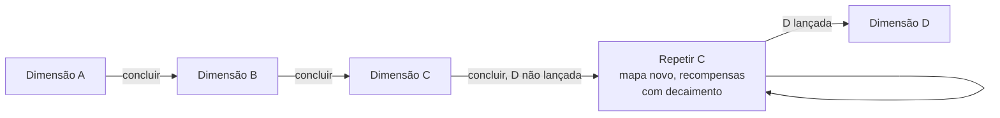

- As dimensões seguem a **ordem de lançamento**. Todo grupo novo (inclusive um "grupo de 1") começa sempre pela **primeira** dimensão lançada e, ao concluir uma, vai para a seguinte.
- **Repetição:** se o grupo concluir a dimensão mais recente e a próxima ainda não tiver sido lançada, ele pode jogar essa mesma dimensão **de novo quantas vezes quiser**. Cada repetição gera um **mapa novo** e dá recompensas menores ([decaimento](#32-conclusão-de-uma-dimensão)).
- **Sem volta:** quando o grupo avança para uma nova dimensão, ele **não pode voltar** a dimensões anteriores.
- Exemplo: existem as dimensões A, B e C. Um grupo começa na A, depois vai para a B e para a C. Ao concluir a C, se a D ainda não foi lançada, o grupo pode repetir a C. Quando a D for lançada, o grupo avança para ela e não volta mais à C.

#### Ir para nova dimensão

Depois de concluir a dimensão, o grupo **não é obrigado** a sair dela: pode continuar explorando (com o decaimento de recompensas) até decidir avançar. Para ir para a nova dimensão:
1. A nova dimensão precisa estar **disponível** (lançada).
2. **Votação:** qualquer jogador pode propor a troca; **todos** precisam aceitar, porque depois não é possível voltar.
3. **Encontro:** com a troca aprovada, **todos** os jogadores precisam estar na **mesma zona**.
4. Com todos na mesma zona, fica disponível para todos a ação **Ir para nova dimensão** (1 ponto de ação). Basta **um** jogador usá-la.
5. Todos são teletransportados para a nova dimensão. A vez **continua** com o jogador que usou a ação, se ele ainda tiver pontos de ação; senão, segue o próximo jogador da sequência.

A mesma ação é usada para começar uma **repetição** da dimensão atual.

**Curva de progressão (diretriz de design):** os inimigos têm valores finais (sem Pico), e os jogadores ficam mais fortes com o Pico. Para acompanhar, **cada dimensão é desenhada para uma faixa de Pico de referência**, e os inimigos dela são calibrados para essa faixa. Ponto de partida para o laboratório (ajustável):

| Dimensão (ordem de lançamento) | Pico de referência ao entrar | Pico de referência ao concluir |
|---|---|---|
| 1ª | 10 | 60 |
| 2ª | 60 | 130 |
| 3ª | 130 | 220 |
| Seguintes | Pico ao concluir a anterior | +~70% a cada dimensão |

- Inimigos **comuns** são calibrados para o Pico de entrada; **elites**, para o meio da faixa; **chefes** e a **Raide Final**, para o Pico de conclusão.
- O laboratório deve simular um jogador "médio" e mostrar se a curva está fácil ou difícil demais.

**O que acontece ao entrar numa nova dimensão (ou repetir uma):**

| Mantém | Reinicia |
|---|---|
| Vida atual, ouro, cofre (com expansões), bolsa (com expansões), inventário, pasta de TCG, montaria, equipamentos em uso, decks, classes e especializações, Energia (Pico e Vigor), todas as cartas de qualquer coleção | A mão é reembaralhada no deck e compra-se 7; efeitos com duração de partida/dimensão terminam; missões em aberto da dimensão anterior são canceladas; o registro de missões concluídas e os cooldowns de raide são zerados; a ordem dos jogadores é rolada de novo (D20) e fica fixa na nova dimensão |

**Grupos e saves:**
- Ao começar uma campanha com outros jogadores, o grupo fica **preso a essa configuração de jogadores**. Esse grupo é um **save** com identidade própria: a dimensão atual, o progresso e as coisas de cada jogador.
- As mesmas pessoas podem formar **outros grupos** (outros saves), com configurações diferentes de jogadores.
- Um jogador que joga em vários grupos **não pode transferir** cartas, recursos, ouro, etc. entre os saves. O cofre, o inventário, a pasta, os decks, as classes, a montaria e a Energia de cada jogador pertencem ao save do grupo.
- Ao entrar num **novo grupo**, o jogador começa **do zero** ("primeira dimensão": valores iniciais, classe e deck pré-pronto).
- Jogar **sozinho** na campanha também é um **"grupo de 1"** (um save separado).
- Um grupo **não pode aceitar** novos jogadores depois de criado.
- Se um jogador do grupo **não puder jogar** (sair, ficar ausente), o grupo **não pode progredir** nesse save sem ele. Se ele abandonar o jogo de vez, o save fica **perdido para sempre**: não existe forma de remover ou substituir o jogador.

**Desconexão:** se um jogador **desconectar** no meio de uma sessão de campanha, a sessão é **encerrada imediatamente** (o grupo não pode progredir sem ele). Na próxima sessão, o jogo retoma do **último salvamento automático** (fim da última vez concluída). Uma vez interrompida no meio é jogada de novo a partir do início dela, mas com os mesmos sorteios (cartas compradas, dados), então desconectar não muda nenhum resultado. A regra do "jogador ausente" ([11.3](#113-tempo-da-vez)) vale para quem continua conectado mas não joga.

### 28.2 Desbravadores

**Visão geral:**
- **Competitivo, sempre cada um por si.** **Não existem alianças**, nem temporárias.
- Formato de **runs**: é possível jogar a mesma dimensão várias vezes, só por diversão. Cada run é uma **aventura nova**, sem relação com outras runs.
- As vezes são jogadas **uma de cada vez**, e a movimentação segue **as mesmas regras da campanha**.
- A Carta de Dimensão, a Raide Final e o prêmio máximo são **ignorados**.
- **Dimensão e coleções:** antes da partida, o **host** escolhe a dimensão e quais coleções de cartas ficam ativas.
- **Progressões separadas:** Desbravadores e Clássico **não afetam** a progressão da campanha, e a campanha **não afeta** esses modos.
- **Desconexão:** se um jogador desconectar, a partida é **encerrada imediatamente**: quem desconectou **perde** e **todos os outros** jogadores são declarados **vencedores**.

**Com o que o jogador começa uma run** (vale também para o Clássico):
- Cada jogador começa como na "primeira dimensão": valores iniciais, **sem equipamentos**, pasta vazia.
- Ele escolhe a classe e começa **sempre** com o **deck pré-pronto** dela.
- O **cofre não existe** na run: a ação Usar cofre abre um **cofre temporário** que começa vazio e é apagado no fim da partida. Ele funciona como o cofre normal, inclusive guardando até **2.000 moedas de ouro** e permitindo expansões no mercado (que também são apagadas no fim).
- Os **slots de decks** pertencem à run: são os slots do cofre temporário, servem para montar decks durante a run e são apagados no fim da partida.
- Especialização (provação) e multiclasse (mentor) podem ser conquistadas durante a run, como na campanha.
- Nada do que é conquistado na run é levado para fora dela.

**Objetivos e vitória:**
- **Deck de objetivos:** é **universal**, o mesmo para qualquer dimensão. Por isso os objetivos são **genéricos** (ex.: "ir para uma zona do tipo X", e não para uma zona específica de uma dimensão). **Não existem** objetivos de atacar ou nocautear outros jogadores (nem no Desbravadores, nem no Clássico).
- No início, cada jogador recebe **5 cartas de objetivo** por padrão. Exemplos: "Ir para a zona X", "Ir para a zona Y", "Coletar N itens de um tipo".
- Os objetivos são **secretos** até serem cumpridos.
- Cada jogador escolhe quais objetivos quer cumprir.
- **Categorias de objetivo:**

| Categoria | Como é cumprido | Exemplos |
|---|---|---|
| **De zona** | O jogador vai até a zona descrita na carta e usa a ação **Cumprir objetivo** (1 ponto de ação). | "Ir para a zona X" |
| **Passivo** | É cumprido automaticamente quando a condição acontece; não usa ação. | "Coletar N itens de um tipo", "Resolver 3 eventos aleatórios sem entrar em combate" |

- Cada objetivo dá a quantidade de **pontos de objetivo** escrita na carta. Objetivos mais difíceis dão mais pontos, e o mínimo por padrão é **2 pontos**.
- Ao cumprir um objetivo, o jogador **compra 1 novo** objetivo.
- Pontos de objetivo **não ficam negativos** (perder 3 com 1 ponto → fica 0).
- **Vence quem somar 10 pontos de objetivo primeiro.**

**Interação entre jogadores:**
- **Proibido:** pedir ajuda de outro jogador (recrutar) para enfrentar inimigos. Cada jogador enfrenta seus inimigos sozinho.
- **Proibido:** raides em grupo. Cada jogador faz a raide **sozinho**.
- **Permitido:** **negociar** itens entre jogadores ([23](#23-negociação)).
- Efeitos que beneficiam "outro jogador" (curar, dar buffs, transferir Vigor, etc.) **funcionam normalmente**: o jogador pode usá-los em outro jogador, mesmo que isso ajude um adversário. **Exceção:** efeitos que recrutam jogadores para um combate contra inimigos **não funcionam** neste modo.
- **Missões de zona** são exclusivas (como em todos os modos); **missões de provação e do mentor** não são (veja [21.2](#212-tipos-de-missão)).

**Classes de suporte no Desbravadores (proposta para validar):** Bardo e Clérigo causam pouco dano e brilham ajudando os outros, o que vale pouco num modo cada um por si. Para que tenham builds viáveis, baseadas em **evitar o combate** em vez de vencê-lo, o design deve oferecer:
- **Objetivos de sobrevivência e evasão** no deck universal, que qualquer classe pode cumprir, mas que favorecem essas builds: "fugir com sucesso de 2 enfrentamentos", "terminar 5 rodadas seguidas sem ser nocauteado", "resolver 3 eventos aleatórios sem entrar em combate", "negociar com 2 jogadores diferentes".
- **Efeitos de evasão no PvP** (para especializações e equipamentos dessas classes): "+3 no D20 de fuga do PvP"; "ao fugir com sucesso de um enfrentamento, mova-se para uma zona conectada"; "a bênção que você ganha ao fugir dura 1 rodada a mais".
- **Dissuasão** (Bardo, com Carisma): "quando alguém usar Enfrentar na sua zona, descarte 2 cartas de Carisma: você é ignorado neste enfrentamento (como se tivesse a bênção)"; "o jogador que iniciar um enfrentamento contra você perde 1 ponto de ação extra".
- **Retribuição** (Clérigo, com Reflexão e cura): builds de Defesa e Reflexão altas, em que o atacante se machuca mais do que o Clérigo, e curas em si mesmo durante o combate para durar até o atacante cair por reflexão.

Esses efeitos valem para Desbravadores; os que dependem de PvP não têm efeito nos outros modos.

**Spawn:**
- Antes da partida, cada jogador escolhe sua **zona de spawn** (veja [10.1](#101-passo-a-passo)).
- O ponto de spawn pode ser trocado com **Salvar ponto de respawn**, só em zonas Urbanas (veja [20.1](#201-spawn-e-respawn)).

**Bênção do spawn** (exclusiva deste modo):
- Quando reaparece depois de um nocaute, o jogador provavelmente acabou de sofrer penalidades. A bênção existe para que ele não entre em combate contra outro jogador em desvantagem.
- Quem **foge com sucesso** de um enfrentamento também recebe a bênção (fica na mesma zona; veja o item 3 do PvP abaixo).
- Enquanto tem a bênção, ele **não pode ser atacado** por outros jogadores e **também não pode atacá-los**. Quando alguém usa Enfrentar, jogadores com a bênção na zona são **ignorados** (não participam).
- A bênção acaba quando:
  - o jogador **sai do seu ponto de spawn** (ou, se ganhou a bênção fugindo, **sai da zona onde fugiu**), ou
  - termina a **primeira vez que ele realmente joga** depois de ganhar a bênção (vezes perdidas pelo nocaute não contam).

**Encontro entre jogadores (PvP):**

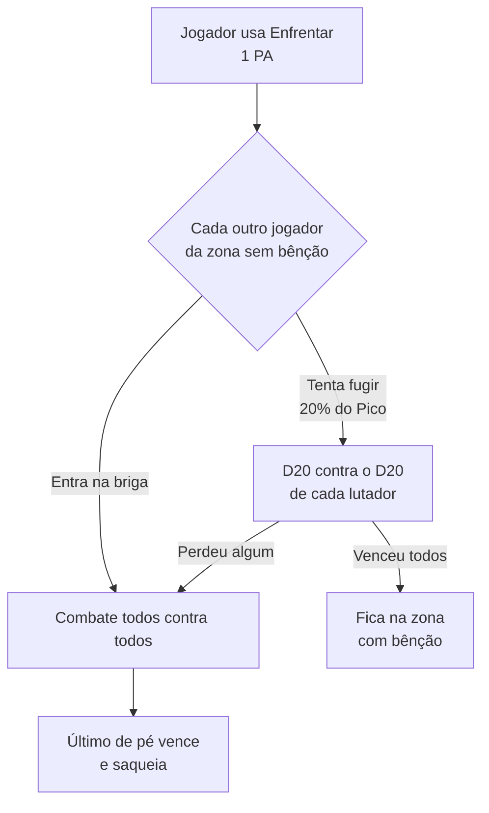

1. Quando um jogador está numa zona em que há outro jogador, a ação **Enfrentar jogador ou jogadores** fica disponível. Ela consome **um ponto de ação só de quem iniciou**; os outros participantes não gastam nada.
2. **Ninguém quer lutar:** não é obrigatório iniciar um conflito. Cada jogador segue com suas ações normalmente.
3. **Alguém inicia o enfrentamento:** cada um dos outros jogadores da zona decide se **entra na briga** ou **tenta fugir**. A fuga só é possível **antes** do combate; depois que ele começa, não é possível fugir. Tentar fugir custa **20% do Pico** em Vigor ([15](#15-teste-de-fuga)). Quem quer fugir faz um **teste de fuga**:
   - quem quer lutar rola um D20;
   - quem quer fugir rola um D20;
   - se o resultado de quem quer fugir for **menor**, os dois são obrigados a lutar; se for **maior**, a fuga dá certo; se for **igual**, os dois rolam de novo;
   - se **mais de um** jogador quiser lutar, quem quer fugir rola um D20 **contra cada um** deles. Ele precisa passar no teste contra todos. Falhar em um teste já basta para ser obrigado a lutar;
   - quem **foge com sucesso** continua **na mesma zona** e recebe a **bênção do spawn** (não pode ser enfrentado de novo enquanto tiver a bênção).
4. **Combate de vários lados:** o combate **não é entre dois times**. Cada jogador que ficou na briga é **um lado**, e todos lutam contra todos. Exemplo: 3 jogadores na zona, todos aceitam lutar → a batalha tem **3 lados**.
   - A ordem dos turnos de combate segue a **Celeridade** (empate entre jogadores: D20).
   - No seu turno de combate, o jogador **escolhe qual outro jogador quer atacar**.
   - Quem chega a 0 de vida está fora do combate. Os nocauteados só vão para o spawn **no fim do combate**.
   - **Reviver:** no PvP, **ninguém** pode ser revivido.
5. Pode haver lutas com **2, 3, 4, 5 ou mais jogadores**, dependendo de quantos estão na mesma zona. **Só pode haver um vencedor**: o último jogador de pé.
6. **Vencedor:** só o **vencedor final** pode **saquear** o inventário, a pasta de TCG e o **ouro** dos perdedores (e a montaria, veja [26](#26-montarias)), pegando quanto quiser **enquanto tiver espaço** no próprio inventário, pasta de TCG e bolsa de ouro. **Equipamentos em uso não podem ser saqueados.**
7. **Perdedores:**
   - perdem os itens e o ouro saqueados;
   - perdem **3 pontos de objetivo** por padrão;
   - são nocauteados ([20.2](#202-nocaute)) e vão para o seu ponto de spawn (no fim do combate);
   - recebem a **bênção do spawn**.

### 28.3 Clássico

- É o **Desbravadores em versão cooperativa**: usa as mesmas regras de início de run, **cartas de objetivo** e a ação de objetivo.
- Antes da partida, o **host** escolhe **qualquer dimensão**.
- **Coleções:** o host pode manter apenas as cartas daquela dimensão ou ativar uma ou mais outras coleções. Uma coleção ativada afeta **tudo**: eventos, inimigos, decks de recompensas, missões, equipamentos, atributos, boosters, singles, etc.
- Usa o mesmo **deck universal de objetivos**.
- As vezes são jogadas **uma de cada vez**, como na campanha.
- **Não existe combate entre jogadores.**
- A Carta de Dimensão, a Raide Final e o prêmio máximo são **ignorados**.
- Os objetivos são **abertos**: todos veem os objetivos de todos, mas cada jogador só cumpre os **próprios**. Ao cumprir um objetivo, o jogador **compra 1 novo** objetivo.
- **Desconexão:** se um jogador desconectar, a partida é **encerrada imediatamente**. Ninguém ganha e ninguém perde.
- **Nenhuma recompensa** é levada para outras dimensões. É uma run curta, para jogar rápido com amigos ou sozinho e para testar a dimensão.

**Vitória:** **todos** os jogadores precisam atingir ou ultrapassar **10 pontos de objetivo cada um**.

**Derrota:** os jogadores **escolhem a forma de derrota** antes da partida:
- **por rodadas:** a partida tem um limite de rodadas (padrão: **25**); se os jogadores não vencerem até lá, perdem;
- **por relógio de perigo:** a dimensão tem um "relógio de perigo" de **20 marcas** que avança **1 por rodada** (efeitos podem fazê-lo avançar ou recuar); ao chegar à última marca, a partida termina em derrota.

Os dois valores são ajustáveis no laboratório.

### 28.4 Enfrentamento (PVP)

- Modo **apenas de combate** entre jogadores, sem compromisso, para **testar decks e builds**.
- Aceita **todos contra todos** ou várias combinações de **times**: 1 contra 1, 1 contra 3, 4 contra 3, etc.
- **Times:** a habilidade de Área **não atinge aliados**, e aliados **podem reviver** uns aos outros.
- **Não afeta** a progressão de nenhum outro modo: não dá recompensas nem vantagens que sejam levadas para outros modos.
- Cada jogador tem **10 slots de builds** para testar combos. Cada slot é uma **build completa**: classes + especializações + deck + equipamentos + inventário (o jogador escolhe o que leva no inventário). Esses slots são separados dos slots de decks do cofre da campanha.
- Uma build pode ter **quantas classes primárias quiser** e **uma especialização por classe** que possui, sem missões de provação nem de mentor. As travas continuam valendo ([8.2](#82-a-trava-do-deck)).
- Todos os jogadores têm acesso a **todas as cartas já lançadas**, de coleções vigentes ou não.
- **Não é possível fugir**, mas é possível **desistir** do combate.

**Configuração da partida:** antes da batalha, o **host** define como ela funciona, porque o modo é só diversão e não afeta o progresso. Ele escolhe entre um **valor fixo para todos** ou um **valor customizado por jogador** para:
- Pico e Vigor iniciais (equipamentos com requisito de Pico usam esse valor);
- vida inicial;
- mão inicial.

Além disso, o host define para a partida:
- a **condição de vitória**:
  - **último de pé** (todos contra todos): quem chega a 0 pontos de vida sai do combate; vence o **último jogador de pé** (a vida inicial é a que o host definiu). Nos times, vence o time com o último jogador de pé;
  - **por ciclos de combate** (todos contra todos ou times): a partida tem um limite de **ciclos de combate** (um ciclo termina quando todos os participantes jogaram seu turno de combate uma vez, veja [2.1](#21-tempo)); quando ele acaba, vence quem tiver **mais vida restante, em percentual da vida inicial** (nos times, a soma da vida restante do time em percentual da soma das vidas iniciais; percentuais iguais: **empate**). Um time cujos jogadores estejam todos nocauteados perde antes do limite;
- as **coleções permitidas**;
- o **limite de cópias de cartas de recurso**, que existe só no PVP e por padrão é **sem limite** (o limite de cartas de atributo sinérgicas e aprimoradas **não** pode ser alterado);
- **recursos proibidos** (ex.: consumíveis);
- o **tempo por turno de combate** (padrão: 30 s).

Por padrão, todas as opções vêm com os valores padrão do jogo.

---

## Apêndice A — Valores ajustáveis

Todos os valores abaixo são **pontos de partida** e podem ser alterados no [Laboratório de testes](#laboratório-de-testes).

| Área | Valor | Padrão | Onde |
|---|---|---|---|
| Deck | Tamanho mínimo da build | 60 (especulativo) | [4.4](#44-o-deck-de-atributos) |
| Deck | Cópias máx. de sinérgicas/aprimoradas | 4 (especulativo) | [4.3](#43-tipos-de-carta-de-atributo) |
| Deck | Travas de classe/especialização | 18 / 10+10 / 6 / +4 | [8.2](#82-a-trava-do-deck) |
| Mapa | Zonas por dimensão | 12, 16 ou 20 (teste com 16) | [3.5](#35-montagem-do-mapa) |
| Mapa | Cartas do deck de eventos por tipo de zona | ~30 (especulativo) | [3.4](#34-o-que-uma-carta-de-zona-contém) |
| Dimensão | Decaimento de recompensas na repetição | 100% / 80% / 60% / 40% | [3.2](#32-conclusão-de-uma-dimensão) |
| Jogador | Vida base, ouro e mão iniciais | 20 / 10 / 7 | [9.1](#91-valores-iniciais) |
| Jogador | Vida máxima | vida base × (1 + Pico ÷ 100) | [7.4](#74-escala-fórmulas-e-valores-iniciais) |
| Jogador | Vida ao voltar do nocaute | 10% da vida máxima | [20.2](#202-nocaute) |
| Partida | Jogadores por partida (MVP) | 1 a 6 | [1.3](#13-número-de-jogadores) |
| Jogador | Pontos de ação por vez | 3 | [11.1](#111-pontos-de-ação) |
| Tempo | Tempo da vez / por escolha / turno de combate | 60 s / 30 s / 30 s | [11.3](#113-tempo-da-vez) |
| Energia | Pico e Vigor iniciais | 10 / 10 | [7.4](#74-escala-fórmulas-e-valores-iniciais) |
| Energia | Vigor restaurado por Recuperar | 5% do Pico | [7.3](#73-regras-da-energia) |
| Energia | Vigor após nocaute | menor entre Vigor atual e 50% do novo Pico | [7.3](#73-regras-da-energia) |
| Jogador | Vida restaurada por Recuperar | 15% da vida máxima | [12.5](#125-recuperar) |
| Artífice | Oficina: desconto no conserto / refino máximo / bônus no D20 | 50% / +6 / +2 | [25.5](#255-oficina-do-artífice) |
| Tempo | Vezes estouradas seguidas para "jogador ausente" | 2 | [11.3](#113-tempo-da-vez) |
| Raides | Tempo da votação | 20 s | [22.2](#222-como-funciona) |
| Raides | Decaimento por repetição da mesma raide | 100% / 80% / 60% / 40% | [22.3](#223-repetição-e-cooldown) |
| Mercado | Slots da vitrine de singles | 4 | [24.4](#244-singles) |
| Mercado | Decaimento da vitrine (D20 por slot no fim da rodada) | 1–3 | [24.4](#244-singles) |
| Mercado | Fator do mercado | 0,8 a 1,2 | [24.4](#244-singles) |
| Ferreiro | Bônus por nível de refino | +5% do valor base do modificador principal | [25.2](#252-refinar) |
| Classes | Pesos do orçamento de modificadores | 4 / 4 / 0,5 / 1 / 2 / 3 / 3 (orçamento 97) | [8.7](#87-perfil-das-classes) |
| Campanha | Pico de referência por dimensão | tabela | [28.1](#281-campanha) |
| Desbravadores / Clássico | Cartas de objetivo iniciais / pontos para vencer | 5 / 10 | [28.2](#282-desbravadores) |
| Desbravadores | Pontos de objetivo perdidos no PvP | −3 | [28.2](#282-desbravadores) |
| Energia | Penalidade da Exaustão | −10% | [7.3](#73-regras-da-energia) |
| Fórmulas | Influência do Pico, acerto, dano | veja os capítulos | [7.4](#74-escala-fórmulas-e-valores-iniciais), [19.2](#192-cálculo-do-dano) |
| Classes | Modificadores base, slots de inventário | tabela | [8.7](#87-perfil-das-classes) |
| Classes | Pico mínimo da provação | 30 | [8.3](#83-como-obter-uma-especialização) |
| Classes | Custo do mentor | 150, dobra a cada classe | [8.4](#84-como-se-tornar-multiclasse) |
| Fuga | Custo em Vigor | 20% do Pico | [15](#15-teste-de-fuga) |
| Fuga | Valor mínimo no D20 | maior que 10 | [15](#15-teste-de-fuga) |
| Fuga | Pontos de ação perdidos na fuga falha de evento aleatório | 1 | [14.5](#145-fugir-de-um-evento-aleatório) |
| Elementos | Efetividade com vantagem / desvantagem | +25% / −25% | [16.1](#161-relações-e-efetividade) |
| Elementos | Desconto de Vigor por afinidade elemental da classe | 10% | [16.3](#163-afinidade-elemental-das-classes) |
| Combate | Reforço com cartas | +10% / +20% | [19.3](#193-cartas-de-atributo-no-combate) |
| Habilidades | Fórmulas das formas; limite da Canalizada | 20% da vida inicial da canalização | [17.4](#174-detalhe-das-formas) |
| Raides | Cooldown padrão | 3 rodadas | [22.3](#223-repetição-e-cooldown) |
| Guardar | Inventário / pasta / cofre | 10 / 30 / 30 slots + 10 decks + 2.000 ouro | [6](#6-onde-ficam-as-cartas) |
| Guardar | Bolsa de ouro | 300 | [5.3](#53-dinheiro) |
| Mercado | Booster: preço, cartas, chances | 30 / 8 / tabela | [24.3](#243-boosters) |
| Mercado | Singles: preços base, ajuste, fatores | tabela | [24.4](#244-singles) |
| Mercado | Preço base do estoque | tabela | [24.1](#241-compra-no-estoque) |
| Mercado | Expansões (cofre, decks, bolsa, ouro do cofre) | tabelas | [6.4](#64-cofre), [24.5](#245-serviços-do-mercado) |
| Ferreiro | Conserto, refino, encanto (custos e testes) | tabela | [25](#25-ferreiro) |
| Ferreiro | Marca de reparo | −12% por reparo | [5.1](#51-equipamentos) |
| Montaria | Slots extras de inventário / pasta | +4 / 10 | [26](#26-montarias) |
| Clássico | Limite de rodadas / relógio de perigo | 25 / 20 marcas | [28.3](#283-clássico) |

### Pico por fonte

Valores padrão para teste ([7.2](#72-energia-pico-e-vigor)). Quando uma carta diz um valor próprio, vale o da carta. Todos ajustáveis no laboratório.

| Fonte | Pico |
|---|---|
| Resolver um evento aleatório com sucesso | +1 |
| Vencer um combate | +1 por inimigo comum derrotado; +3 por Elite |
| Derrotar um Chefe | +15 |
| Cumprir uma missão de zona | +3 |
| Cumprir uma missão de provação ou do mentor | +5 |
| Concluir uma raide | +10 |
| Concluir a dimensão (Raide Final) | +25 (todos os jogadores da partida) |
| Não conseguir resolver um evento aleatório | −1 |
| Fugir de um evento aleatório (com sucesso) | 0 |
| Fugir de um combate (com sucesso) | −2 |
| Ser nocauteado (= perder um combate) | −10% do Pico (mínimo 1) |
| Perder uma raide | −5 (somado ao nocaute) |

---

# Parte II — Requisitos técnicos

> **Atenção**: muitos conceitos estão sujeitos a mudar com o tempo devido a novas ideias ou à descoberta de problemas. Esta seção apresenta as ideias básicas.

## II.1 Natureza do projeto

- Este documento descreve o jogo como se fosse um jogo físico de verdade. O projeto, porém, é uma **versão digital**, onde muitas partes do gameplay podem ser **automatizadas** para facilitar a implementação e deixar o jogo mais fluido.
- O jogo é **por turnos com interatividade em tempo real**: os jogadores veem as ações dos outros ao vivo e podem reagir quando a regra permite. Cada vez tem **60 s de decisão de ação de zona**, com o relógio **pausado nas telas internas** (eventos, combate, mercado, etc.), que têm seus próprios tempos (veja [11.3](#113-tempo-da-vez)).
- **Backend autoritativo desde o início:** toda a lógica de regras (sorteios, cálculos, validação de ações, estado da partida) roda no **backend**, inclusive na etapa de um jogador. O frontend só exibe o estado e envia as intenções do jogador. Assim, a fase online não exige reescrever o motor do jogo.
- **Saves por grupo:** cada grupo de campanha é um save separado; nada é transferido entre saves (veja [28.1](#281-campanha)).
- As **histórias das raides** ficam salvas no banco de dados como nós de texto, escolhas, eventos e destinos (veja [22.2](#222-como-funciona)).
- **Autenticação (pendente):** o jogo terá um **sistema de autenticação por usuário** (contas, login, papel de admin). Ainda não foi especificado; fica anotado para ser feito depois.
- O jogo funcionará principalmente em **PC (monitores)**. Distâncias, tamanhos, margens e espaços devem se ajustar ao monitor do usuário para a melhor experiência possível.

## II.2 Stack

- **Frontend:** TypeScript, Vite, React, TanStack Query (React Query) e React Router DOM, além de outras bibliotecas a decidir durante o desenvolvimento.
  - Primeiro roda localmente via web; depois será portado para executável de PC com **[Tauri](https://v2.tauri.app/start/)**. **Decisão pendente (antes da Etapa 1):** como o executável Tauri vai rodar o backend NestJS e o banco de dados (ex.: backend embutido como *sidecar* com banco local, ou servidor remoto obrigatório).
  - **O jogo é inteiramente 2D.** Não há renderização 3D. O estilo PSX ([II.5](#ii5-estilo-gráfico-psx)) aparece nas **imagens, ícones, animações e transições**.
- **Backend:** TypeScript, NestJS, ORM Drizzle, arquitetura hexagonal e Domain-Driven Design, além de WebSockets, Socket.IO, Aggregate Root, Domain Events & State Machine, Portas (interfaces) e Adaptadores (implementações), e outras tecnologias e arquiteturas que surgirem conforme a necessidade.
  - **Docker Compose** para o banco de dados e o backend, para implementar primeiro localmente antes do deploy (as plataformas de hospedagem são pagas).
- **Não instalar bibliotecas de terceiros sem permissão.**

## II.3 Testes

- **Frontend:** Vitest (unitários) e Playwright (end-to-end). Sugestões são aceitas para testes de integração.
- **Backend:** Vitest, **Supertest** para testar requests aos endpoints e outros testes considerados importantes.

## II.4 Interface e experiência

- Animações e transições **bonitas e simples**.
- **Termos do jogo com highlight:** termos (e suas variações) devem ter destaque ou cor própria e mostrar um **tooltip** explicativo ao passar o mouse. Exemplos: Atributos e cada atributo, Zonas, Classes e cada classe, modificadores, cada ação de zona, cada tipo de evento, etc. O [glossário](#22-vocabulário-básico) é o ponto de partida para a lista de termos.
- **Categorias de carta visíveis:** cada carta mostra a sua categoria com **ícone, imagem e label** (ex.: diferenciar amuletos de Arma, Acessório e Relíquia).
- **Imagens e ícones** serão fornecidos pelo autor. Imagens e ícones SVG podem ser criados apenas para testes.
- Termos do jogo podem ser alterados, **com aprovação** do autor.

## II.5 Estilo gráfico PSX

O jogo é **2D**. O estilo PSX vale para as **imagens, ícones, animações e transições** (as artes podem retratar cenas com aparência de 3D de PS1, mas a interface e o jogo não renderizam 3D).

> Mantido em inglês de propósito: é o texto de referência para prompts de geração de arte.

- **Geometry and models:** Extremely low-poly 3D models, low polygon counts, angular silhouettes, visibly faceted surfaces, simple geometric shapes, coarse environmental geometry, primitive character models and rigid-looking structures.
- **Textures and materials:** Very low-resolution textures, visibly pixelated texture maps, blurry and muddy surfaces, crude hand-painted textures, limited texture detail, affine texture mapping artifacts, perspective distortion, warped textures, and subtle polygon vertex jitter reminiscent of original PS1 hardware.
- **Rendering and lighting:** Original PlayStation-era rendering aesthetics, simple vertex lighting, minimal dynamic lighting, limited shading, basic diffuse materials, hard-edged shadows where appropriate, low color depth appearance, restrained visual effects, and authentic late-1990s 3D game rendering.
- **Image quality:** Low internal rendering resolution, visible pixelation, jagged polygon edges, aliasing, subtle dithering, limited draw distance, atmospheric distance fog when appropriate, and the characteristic imperfections of early real-time 3D graphics. Preserve the raw, imperfect appearance of vintage console footage rather than modernizing the image.
- **Art direction:** Nostalgic, atmospheric, imperfect, surreal when appropriate, visually distinctive and unmistakably from the original PlayStation era. The final image should look like an authentic screenshot captured directly from a real 1990s PS1 game running on original hardware.
- **Strict restrictions:** No modern photorealism, no high-poly models, no physically based rendering (PBR), no ray tracing, no modern cinematic CGI, no ultra-high-resolution textures, no Unreal Engine 5 aesthetic and no excessive post-processing.

## II.6 Laboratório de testes

É necessário implementar uma página interativa e intuitiva para o autor conseguir testar todas as funcionalidades dentro do jogo uma vez que elas estiverem finalizadas. Nessa tela será possível também fazer configurações e ajustar pesos, valores, quantidades, etc. do jogo, como forma de testar as melhores opções para o jogo. Por exemplo: mudar a quantidade de cartas iniciais por padrão ao começar um jogo, aumentar/diminuir o número de ações que um jogador pode fazer por padrão, quantidade de cartas no deck de atributos, etc. Será tudo possível de ajustar e encontrar os melhores valores. É necessário criar um sistema de controle para orquestrar tudo no jogo para saber as melhores condições.

**Acesso:** o laboratório é controlado por um **feature flag de build**: existe só nos builds de **desenvolvimento** (dev) e só jogadores **admin** podem abri-lo. Nos builds de **release** (web ou executável Tauri), a tela e suas rotas **não existem**.

A lista completa de valores está no [Apêndice A](#apêndice-a--valores-ajustáveis). Requisitos do laboratório já definidos:
- **Valores e regras combinados:** testar diferentes combinações de valores **e de regras** para ver qual se adequa melhor à jogabilidade e à progressão.
- **Fórmulas editáveis:** alterar as fórmulas e os cálculos (influência do Pico, chance de acerto, dano, etc.; veja [7.4](#74-escala-fórmulas-e-valores-iniciais) e [19.2](#192-cálculo-do-dano)), não só os números.
- **Modificadores base:** usar o valor padrão, um valor customizado **para todos** ou um valor customizado **por classe**.
- **Energia:** Pico e Vigor iniciais, Vigor restaurado por Recuperar, custo de fuga, Vigor no nocaute, penalidade da Exaustão.
- **Inimigos:** alterar o modelo e os valores dos inimigos impressos nas cartas de evento de combate.
- **Boosters:** raridades, chances e proporção de cartas.
- **Ferreiro e montarias:** custos, chances, fórmula do refino e slots extras.
- **Mercado:** preços de singles, estoque, boosters, expansão do cofre e da bolsa de ouro.
- **Mapa:** número de zonas por dimensão e regras do gerador de mapa (veja [3.5](#35-montagem-do-mapa)).
- **Dimensão:** decaimento de recompensas na repetição.

## II.7 Jogadores controlados por IA

- A IA de jogador é **onisciente**: ela tem acesso a **todas** as informações do jogo, inclusive as ocultas (cartas da própria mão e das mãos dos outros, a ordem de todos os decks, o próximo evento de cada zona, zonas viradas para baixo, objetivos secretos, etc.).
- Ela conhece **todas as regras** e **todas as variáveis**, e escolhe sempre a **melhor decisão** (ações de zona, deck building, classes e builds, negociação, combate, mercado, ferreiro).
- Resultado esperado: no modo competitivo, uma IA **muito difícil** de vencer; no cooperativo, uma IA que **não comete erros**.
- É diferente da IA dos inimigos ([19.7](#197-ia-dos-inimigos)), que segue o Comportamento impresso na carta.

---

# Parte III — Etapas de desenvolvimento

## III.1 Agentes e skills

- Criar os agentes e skills necessários para desenvolver o projeto. O [arquivo de referência](PROMPT-AGENTES-E-SKILLS.md) dá uma ideia de como criá-los.
- Instruções obrigatórias nos agentes de desenvolvimento:
  - "Não disfarce suas dúvidas. Explicite as vantagens e desvantagens de cada escolha."
  - "Implemente apenas o necessário para resolver o problema. Não acrescente nada baseado em suposições."
  - "Modifique apenas o que for indispensável. Corrija ou limpe tudo aquilo que suas próprias alterações deixarem para trás."
  - "Estabeleça critérios claros para considerar a tarefa concluída. Continue iterando até confirmar que eles foram atendidos."

## III.2 Desenvolvimento por feature

- Dois projetos em paralelo, **frontend** e **backend**, cada um com seus próprios agentes e skills.
- Toda implementação resolve **uma feature ou um bug específico**.
- Uma feature só está completa quando foi resolvida **nos dois lados** (ou no único lado que precisa de alteração).
- O autor faz o controle e leva as informações de um projeto para o outro. As skills e os agentes devem ter instruções claras sobre **quando precisam de validação do outro lado**.
- Analisar todos os requisitos e criar os agentes e skills do frontend e do backend.
- Criar a lista de passos, etapas e fases de desenvolvimento do frontend e do backend.

## III.3 Efeitos

- Para cada categoria de gatilho, custo, ativação e duração, é preciso criar uma **vasta variedade** de possibilidades, para permitir estratégia "infinita" e fazer o jogador pensar.
- Analisar todo o [capítulo de efeitos](#13-efeitos) e criar a maior variedade possível de combinações de gatilho, custo, ativação e duração. Quanto mais variedade, mais desafiador e estratégico fica o jogo.
- A lista de variações deve ser **validada pelo autor**, que decide o que entra e o que sai.

## III.4 Etapas (ordem sugerida pelo autor; pode ser alterada se houver uma sequência melhor)

**Etapa 1 — Análise e planejamento**
- Analisar o documento inteiro e apontar pontos em aberto, problemas de conceito, contradições, pontos que precisam de esclarecimento e dúvidas (técnicas e de ideia do jogo).
- **Entrevistar o autor** para tirar todas as dúvidas antes de seguir.
- **Decidir a arquitetura de distribuição do executável Tauri** (como o backend e o banco rodam no PC; veja [II.2](#ii2-stack)) antes de começar a implementação.
- Registrar no plano o **sistema de autenticação por usuário** ([II.1](#ii1-natureza-do-projeto)), a ser feito numa etapa posterior.
- Planejar com **spec-driven development**. Referências:
  - https://martinfowler.com/articles/exploring-gen-ai/sdd-3-tools.html
  - https://blog.dsacademy.com.br/spec-driven-development-a-nova-arquitetura-de-engenharia-de-software-na-era-dos-agentes-de-ia-parte-3/
  - https://www.ibm.com/br-pt/think/topics/spec-driven-development
  - https://thoughtworks.medium.com/spec-driven-development-d85995a81387
- Organizar as etapas em três momentos:
  1. Jogo funcional (frontend e backend) para **um jogador**.
  2. **Mais jogadores controlados por IA** (testar com outros três jogadores, todos IAs oniscientes; veja [II.7](#ii7-jogadores-controlados-por-ia)).
  3. Jogo **online web** com interatividade em tempo real, WebSockets, etc.
- Separar em **dois arquivos**: um com todo o contexto, regras, aspectos e etapas do frontend, e outro com o mesmo para o backend.

**Etapa 2 — Manual de regras para jogadores**
- Este documento é o manual de regras e técnico **para o desenvolvimento**. Depois que todas as regras estiverem fechadas e validadas, criar um **manual separado só com as regras do jogo** (sem a parte técnica), organizado e estruturado como um manual de jogo de tabuleiro, que sirva de guia para os jogadores.
- Ordenar as regras de forma que cada uma facilite o entendimento da próxima.
- Explicar em detalhe, com **infográficos e imagens** para os conceitos mais complexos.
