# Misadventures

> *Working title.* Jogo de cartas colecionáveis (TCG) para web, com frontend e backend, que mistura **TCG**, **RPG**, **jogo de tabuleiro**, **grind** e **interatividade em tempo real**.

> **Atenção**: muitos conceitos estão sujeitos a mudar com o tempo devido a novas ideias ou à descoberta de problemas. Este documento apresenta as ideias básicas. Valores marcados como "ajustáveis no laboratório" são pontos de partida para testes (veja o [Laboratório de testes](#ii6-laboratório-de-testes) e o [Apêndice A](#apêndice-a--valores-ajustáveis)).
>
> **Decisões já tomadas:** antes de apontar contradições, ambiguidades ou pontos estranhos, consulte o [Apêndice B — Decisões registradas](#apêndice-b--decisões-registradas). Os pontos listados lá já foram analisados e decididos pelo autor.

---

## Sumário

**Parte I — Manual de regras**

*Começo: o que é o jogo*
1. [O jogo em uma página](#1-o-jogo-em-uma-página)
2. [Glossário](#2-glossário)

*O mundo: onde se joga*

3. [Dimensões, zonas e mapa](#3-dimensões-zonas-e-mapa)

*O personagem: o que o jogador tem*

4. [Atributos e o deck de atributos](#4-atributos-e-o-deck-de-atributos)
5. [Recursos](#5-recursos)
6. [Onde ficam as cartas](#6-onde-ficam-as-cartas)
7. [Modificadores e Energia](#7-modificadores-e-energia)
8. [Classes e especializações](#8-classes-e-especializações)
9. [O jogador](#9-o-jogador)

*A partida: como se joga*

10. [Preparação da partida](#10-preparação-da-partida)
11. [A vez do jogador](#11-a-vez-do-jogador)
12. [Ações de zona](#12-ações-de-zona)

*Efeitos e desafios: como as coisas interagem*

13. [Efeitos](#13-efeitos)
14. [Eventos](#14-eventos)
15. [Teste de fuga](#15-teste-de-fuga)
16. [Elementos](#16-elementos)
17. [Habilidades](#17-habilidades)
18. [Inimigos](#18-inimigos)
19. [Sistema de combate](#19-sistema-de-combate)
20. [Nocaute, spawn e respawn](#20-nocaute-spawn-e-respawn)

*Conteúdo e economia: o que fazer no mundo*

21. [Missões](#21-missões)
22. [Raides (fora do escopo atual)](#22-raides-fora-do-escopo-atual)
23. [Negociação](#23-negociação)
24. [Mercado](#24-mercado)
25. [Ferreiro](#25-ferreiro)
26. [Montarias](#26-montarias)
27. [Coleções](#27-coleções)

*Modos*

28. [Modo de jogo: Campanha](#28-modo-de-jogo-campanha)

*Apêndice*

- [Apêndice A — Valores ajustáveis](#apêndice-a--valores-ajustáveis)
- [Apêndice B — Decisões registradas](#apêndice-b--decisões-registradas) (no fim do documento)

**[Parte II — Requisitos técnicos](#parte-ii--requisitos-técnicos)**

**[Parte III — Etapas de desenvolvimento](#parte-iii--etapas-de-desenvolvimento)**

---

# Parte I — Manual de regras

## 1. O jogo em uma página

### 1.1 Sinopse

Um ou mais aventureiros chegam a uma **dimensão** para conquistar o **prêmio máximo** daquele lugar (um artefato, um prêmio em moedas de ouro, equipamentos muito fortes, etc.) ou para **derrotar o chefe final** dela.

No modo **Campanha** (o único modo do jogo por enquanto, veja [1.4](#14-modos-de-jogo-resumo)), os jogadores **se ajudam** para concluir a dimensão.

### 1.2 Como se joga, em resumo

- O jogo é **jogado em vezes alternadas** (cada jogador na sua vez; veja o vocabulário de tempo em [2.1](#21-tempo)) e combina conceitos de TCG, mecânicas de jogo de tabuleiro e interatividade em tempo real: um jogador joga a sua vez de cada vez, e todos veem **ao vivo** o que acontece na vez dos outros.
- Cada jogador tem um **deck de atributos**, que usa para resolver desafios e pagar custos, e **recursos** (equipamentos e itens) que o fortalecem.
- Os jogadores **percorrem o mapa** e resolvem **encontros** (eventos aleatórios) e **confrontos** (contra inimigos do próprio mundo, sozinhos ou junto com outros jogadores).
- A partida termina quando a dimensão é **concluída** (veja [3.2](#32-conclusão-de-uma-dimensão) e [Campanha](#28-modo-de-jogo-campanha)).

**O ciclo do jogo:**

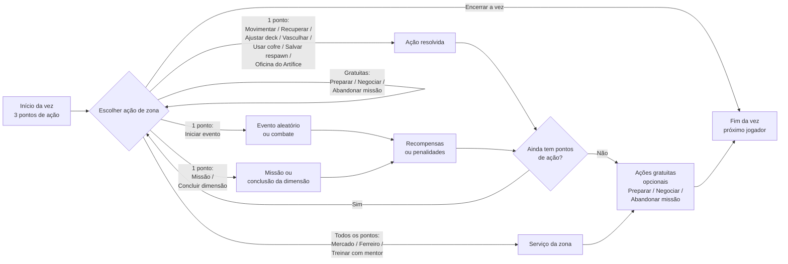

### 1.3 Número de jogadores

O jogo é **modular** na quantidade de jogadores. No **MVP**, cada partida comporta de **1 a 6 jogadores** (limite prático, ajustável no laboratório). A arquitetura não deve impedir aumentar esse limite no futuro. Para reduzir a espera em partidas grandes, cada vez tem tempo limitado (veja [11.3](#113-tempo-da-vez)). Vezes simultâneas não existem.

### 1.4 Modos de jogo (resumo)

| Modo | Tipo | Progresso levado para outras dimensões? |
|---|---|---|
| **Campanha** | Cooperativo | Sim |

Por enquanto, **a Campanha é o único modo do jogo**. Outros modos (competitivos, runs curtas, PvP) poderão ser adicionados aos poucos no futuro; até lá, **não existem** regras, ações nem efeitos ligados a eles (não há combate entre jogadores, cartas de objetivo nem pontos de objetivo).

Os capítulos 3 a 27 descrevem as regras do jogo; o capítulo [28](#28-modo-de-jogo-campanha) trata da campanha como modo (saves, grupos, troca de dimensão, sessão e desconexão).

---

## 2. Glossário

Este capítulo apresenta o vocabulário usado no resto do manual. Cada termo é detalhado no seu capítulo.

### 2.1 Tempo

| Termo | Significado |
|---|---|
| **Vez** | O momento em que **um** jogador joga (move-se, executa ações, etc.). |
| **Rodada** | Termina quando **todos** os jogadores jogaram sua vez uma vez. |
| **Turno de combate** | Dentro de um combate, o momento em que uma das partes (jogador ou inimigo) age e ataca. |
| **Ciclo de combate** | Termina quando **todas** as partes do combate jogaram seu turno de combate uma vez. |

```
Fora do combate:   Rodada  = [ vez A ] → [ vez B ] → [ vez C ]
Dentro do combate: Ciclo   = [ turno jogador ] → [ turno inimigo 1 ] → [ turno inimigo 2 ]
```

**Exemplo de rodada:** três jogadores (A, B e C). O jogador A joga sua vez, depois o B, depois o C. A rodada termina e começa a próxima, sempre na mesma ordem (veja [11.2](#112-ordem-dos-jogadores)).

**Regra de vocabulário (fixa):**
- **Vez** e **rodada** são usadas **só fora do combate**.
- **Turno de combate** e **ciclo de combate** são usados **só dentro do combate**. Dentro de um texto de combate, "turno" sozinho significa sempre "turno de combate".
- A palavra "turno" **nunca** é usada fora do combate (nem em expressões como "por turnos"). Se aparecer, leia como "vez".
- Durações e recargas seguem a mesma regra: dentro do combate contam em turnos/ciclos de combate; fora dele, em vezes/rodadas. Quando o combate termina, durações contadas em turnos/ciclos de combate **terminam** e as recargas **zeram** ([17.2](#172-regras-de-uso)).

### 2.2 Vocabulário básico

| Termo | Em uma frase | Capítulo |
|---|---|---|
| **Dimensão** | O mundo de uma partida, formado por cartas de zona. | [3](#3-dimensões-zonas-e-mapa) |
| **Zona** | Carta de lugar que compõe o mapa e oferece ações. | [3](#3-dimensões-zonas-e-mapa) |
| **Carta de atributo** | Carta do deck do jogador, usada para resolver eventos e pagar custos. | [4](#4-atributos-e-o-deck-de-atributos) |
| **Recurso** | Equipamento, item ou montaria que o jogador possui. | [5](#5-recursos) |
| **Inventário / pasta de TCG / cofre / montaria** | Os lugares onde o jogador guarda suas coisas (a montaria tem inventário e pasta extras). | [6](#6-onde-ficam-as-cartas) |
| **Limbo** | Pilha de descarte comum a todos os jogadores; o que vai para lá é perdido para sempre. | [6](#6-onde-ficam-as-cartas) |
| **Modificador** | Número do jogador usado em cálculos (Ataque, Defesa, etc.). | [7](#7-modificadores-e-energia) |
| **Energia** | Mecânica formada pelo **Pico** (o "nível") e pelo **Vigor** (o que é gasto). | [7](#7-modificadores-e-energia) |
| **Pico** | Energia máxima do jogador; substitui o "nível" e fortalece os modificadores. | [7](#7-modificadores-e-energia) |
| **Vigor** | Energia atual do jogador; é gasto em habilidades, efeitos e recursos. | [7](#7-modificadores-e-energia) |
| **Classe** | Identidade do personagem; define a composição mínima do deck. | [8](#8-classes-e-especializações) |
| **Trava** | Quantidade mínima de cartas de certos atributos que o deck precisa ter para ativar uma classe/especialização. | [8.2](#82-a-trava-do-deck) |
| **Ponto de ação** | O que o jogador gasta para executar ações de zona na sua vez. | [11](#11-a-vez-do-jogador) |
| **Efeito** | Qualquer regra escrita numa carta: gatilho → custo → ativação → duração. | [13](#13-efeitos) |
| **Evento** | Carta de desafio comprada do deck da zona. | [14](#14-eventos) |
| **Habilidade** | Poder ligado a um equipamento ou inimigo (impresso no inimigo da carta de evento de combate); pode ser ativa (paga, em geral, com Vigor) ou passiva. | [17](#17-habilidades) |
| **Booster** | Pacote fechado de cartas novas; é um recurso que fica no inventário até ser aberto. | [24.3](#243-boosters) |
| **Travessia** | Ligação entre duas zonas, formada quando as setas de conexão das duas apontam uma para a outra. | [3.5](#35-montagem-do-mapa) |
| **Build** | A lista de cartas do deck de atributos salva pelo jogador. | [4.4](#44-o-deck-de-atributos) |
| **Cartas em jogo** | As cartas da build durante a partida: deck de atributos, mão e pilha de descarte de atributos. | [4.4](#44-o-deck-de-atributos) |
| **Exaustão** | Estado de quem está com Vigor 0: não paga custos de Vigor e tem −10% em todos os modificadores. | [7.3](#73-regras-da-energia) |
| **Nocaute** | O que acontece ao chegar a 0 de vida: volta ao respawn, perde Pico e a próxima vez. | [20.2](#202-nocaute) |
| **Spawn / respawn** | Onde o jogador aparece no início da partida / onde reaparece depois de um nocaute (o mesmo ponto). | [20.1](#201-spawn-e-respawn) |
| **Missão** | Tarefa pega numa zona (de zona, de provação ou do mentor) que dá recompensas. Pode ser abandonada. | [21](#21-missões) |
| **Item de conclusão** | Item exigido pela Carta de Dimensão; fica numa área própria, não ocupa slot e nunca é perdido (só muda de dono por negociação). | [3.2](#32-conclusão-de-uma-dimensão) |
| **Concluir dimensão** | Ação feita na zona indicada pela Carta de Dimensão, por quem cumpre o requisito; conclui a dimensão (ou inicia o combate contra o chefe final). | [3.2](#32-conclusão-de-uma-dimensão) |
| **Mercado / Ferreiro / Estábulo** | Serviços de zona: comprar e vender; refinar, encantar, criar e consertar; comprar e vender montarias. | [24](#24-mercado), [25](#25-ferreiro), [26](#26-montarias) |
| **Coleção** | Conjunto de cartas lançado com uma dimensão. | [27](#27-coleções) |
| **Host** | Jogador que criou o grupo da campanha. | [28.1](#281-campanha) |
| **Ajudante de IA** | Jogador controlado pela IA, incluído pelo host na criação do grupo; joga por conta própria e sorteia suas classes e especializações. (Não confundir com "ajudante" de combate, que é qualquer jogador recrutado para um combate, [19.5](#195-combate-com-2-ou-mais-jogadores--1-ou-mais-inimigos).) | [28.1](#281-campanha) |
| **Jogo solo** | Partida com 1 participante (sem ajudantes de IA): o nocaute não tira a próxima vez, mas faz o tempo passar e custa ouro. | [20.2](#202-nocaute) |

---

## 3. Dimensões, zonas e mapa

Antes de conhecer o personagem, é preciso conhecer o palco: **onde** a partida acontece.

### 3.1 Dimensões

- Uma **dimensão** é o mundo onde a partida acontece. Ela é composta por um conjunto de **cartas de zona** (por exemplo, 12, 16 ou 20 cartas; valores especulativos, sujeitos a análise).
- A dimensão pode ter **nenhum, um ou vários efeitos** padrão. Exemplos:
  - jogadores dentro dela não podem usar efeitos do equipamento de cabeça;
  - jogadores precisam pagar 1 moeda de ouro para usar uma ação;
  - durante eventos de combate, não é possível usar poções.
- Uma dimensão sem efeitos pode significar que seus eventos são muito difíceis.
- **Tema:** cada dimensão tem um **tema**, que define quais tipos de zona e quais locais aparecem nela, e em que proporção. Ex.: uma dimensão de velho oeste teria mais zonas Desérticas e locais como oásis e cidadezinhas. Por isso, **qualquer tipo de zona pode faltar** numa dimensão; o único tipo garantido é o **Urbano** (validação de [3.5](#35-montagem-do-mapa)). Regras e cartas que valem em **todas** as dimensões (como as missões de provação e do mentor, [8.3](#83-como-obter-uma-especialização)) **nunca** dependem de um tipo de zona específico, exceto o Urbano.

### 3.2 Conclusão de uma dimensão

Cada dimensão tem uma **Carta de Dimensão** que define:
- a **condição de conclusão**: a **zona** onde a dimensão é concluída com a ação **Concluir dimensão** e, opcionalmente, um **chefe final** impresso na própria Carta de Dimensão (ex.: "derrotar o Rei Lich na zona Y", ou "levar o artefato X até a zona Y");
- o **requisito para liberar** a condição: por enquanto, ele é **sempre uma lista de itens de conclusão** (ex.: reunir 3 *Fragmentos* obtidos em missões e eventos), só **verificados** ("Ter"). Não existem outros tipos de requisito. **Um único jogador** precisa ter todos os itens (ex.: os 3 Fragmentos com o mesmo jogador); os itens podem ser negociados entre os jogadores para isso;
- o **prêmio máximo**.

**Ação Concluir dimensão:** é uma **ação contextual** (não está impressa na carta de zona, veja [12.1](#121-ações-universais-e-ações-locais)) que custa **1 ponto de ação**. Ela só aparece **na zona indicada** pela Carta de Dimensão e só para o jogador que **cumpre sozinho** o requisito (ex.: tem os 3 Fragmentos). Assim, ninguém conclui a dimensão sem querer só por entrar na zona.
- **Sem chefe final:** ao usar a ação, a dimensão é **concluída** na hora.
- **Com chefe final:** a ação inicia um **combate** contra o chefe final, com as regras normais de [combate](#19-sistema-de-combate) (inclusive recrutar ajudantes da mesma zona, [19.5](#195-combate-com-2-ou-mais-jogadores--1-ou-mais-inimigos), e fugir, salvo se a Carta de Dimensão disser **Sem fuga**). Se o combate terminar em **vitória**, a dimensão é **concluída**. Em qualquer outro resultado (fuga, derrota ou limite de ciclos de combate), nada é concluído: os itens de conclusão continuam com o jogador e a ação pode ser usada de novo depois.
- Os itens de conclusão são só **verificados** ("Ter"), **nunca** consumidos pela ação.

**Itens de conclusão:** os itens exigidos pela Carta de Dimensão (ex.: os Fragmentos) são **itens de conclusão**. Para que a dimensão nunca fique impossível de concluir:
- eles ficam numa **área própria** do jogador (a mesma das cartas de missão, [21.1](#211-regras-gerais)) e **não ocupam slot**, por isso são sempre recebidos, mesmo com o inventário cheio;
- **não podem** ser vendidos, descartados, oferecidos, abdicados nem perdidos: nenhum efeito, habilidade, regra ou perda de montaria os manda para o limbo;
- **só** mudam de dono por **negociação** ([23](#23-negociação));
- quando a dimensão é concluída, eles **saem do jogo** ([28.1](#281-campanha)).

Quando a dimensão é concluída, **todos os jogadores da partida** a concluem e cada um recebe o prêmio máximo. A partida daquela dimensão **termina** nesse momento: o grupo **não** continua explorando a dimensão concluída e **não** pode jogá-la de novo (veja [Ir para nova dimensão](#ir-para-nova-dimensão)).

**Sem repetição:** uma dimensão concluída **nunca** é jogada de novo pelo mesmo grupo. Se a próxima dimensão ainda não foi lançada, o save do grupo fica **congelado** até o lançamento (veja [28.1](#281-campanha)). O jogo é lançado já com algumas dimensões, para que os grupos tenham o que jogar enquanto as próximas não saem.

**Pico da conclusão:** ao concluir a dimensão, **todos os jogadores da partida** recebem o Pico de conclusão (+25 por padrão, veja o [Apêndice A](#pico-por-fonte)), assim como o prêmio máximo.

### 3.3 Zonas

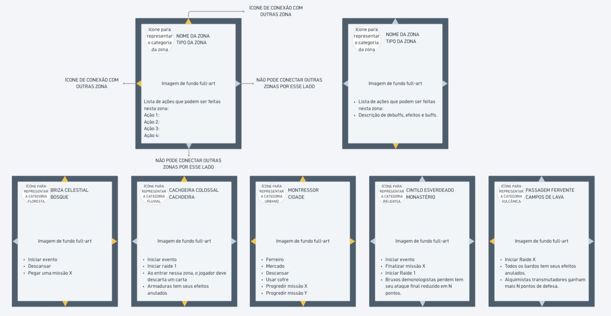

**Zonas** são cartas de lugares que compõem o mapa de uma dimensão. Cada zona tem um **tipo** e um **local**. Outras dimensões podem ter zonas específicas e diferentes.

| Tipo de zona | Possíveis locais |
|---|---|
| **Montanhosa** | Montanhas, colinas, vales, picos, cordilheiras, etc. |
| **Florestal** | Florestas, bosques, matas, selvas, etc. |
| **Costeira** | Praias, falésias, enseadas, litoral, portos, docas, ancoradouros, etc. |
| **Lacustre** | Lagos, lagoas, margens, áreas alagadas, etc. |
| **Pantanosa** | Pântanos, brejos, manguezais, charcos, etc. |
| **Campestre** | Campos, pradarias, pastagens, planícies, etc. |
| **Desértica** | Desertos, dunas, oásis, terrenos áridos, etc. |
| **Vulcânica** | Vulcões, crateras, campos de lava, etc. |
| **Fluvial** | Rios, riachos, cachoeiras, corredeiras, etc. |
| **Subterrânea** | Cavernas, grutas, túneis, minas, abismos, etc. |
| **Urbana** | Cidades, metrópoles, etc. |
| **Rural** | Fazendas, plantações, etc. |
| **Habitada** | Vilas, aldeias, povoados, assentamentos, acampamentos, etc. |
| **Fortificada** | Castelos, fortalezas, cidadelas, muralhas, etc. |
| **Religiosa** | Templos, santuários, monastérios, etc. |
| **Industrial** | Fábricas, oficinas, complexos industriais. |

### 3.4 O que uma carta de zona contém

```
┌──────────────── ▲ ────────────────┐
│  [Tipo: Florestal]  [Local: Bosque]│
│                                    │
◄   Ações: Iniciar evento, Vasculhar │   ▲ ◄ ►  = setas de conexão
│   Efeito: (opcional)               │           (1 a 4)
│   Decks: eventos | recompensas |   │
│          missões (se houver)       │
└────────────────────────────────────┘
```

- **Setas de conexão:** de uma a quatro setas, cada uma apontando para uma aresta da carta. **Toda zona tem pelo menos 1 seta.** **Toda zona Urbana tem obrigatoriamente as quatro setas.** A **maioria** das cartas tem **2 setas** (veja [3.5](#35-montagem-do-mapa)).
- **Ações:** cada zona tem as suas próprias [ações de zona](#12-ações-de-zona). Uma zona pode ter 5 ações e outra apenas 1. Algumas ações são exclusivas de certas zonas; outras aparecem em várias. Exemplo: uma cidade (Urbana) pode ter, além das ações obrigatórias de toda Urbana (Usar cofre, Salvar ponto de respawn e Treinar com mentor), "Ir ao Ferreiro" e "Ir ao Mercado"; já um bosque (Florestal) pode ter só "Iniciar evento" e "Vasculhar". Isso obriga o jogador a pensar para onde ir para cumprir seus objetivos ou conseguir algum item ou serviço.
- **Ofertas dos serviços:** quando a zona tem **Mercado**, a carta lista os **itens do estoque** daquele mercado e indica se ele tem **vitrine de singles** ([24](#24-mercado)); quando tem **Estábulo**, a carta lista as **montarias à venda** ([26](#26-montarias)). São dados do designer da coleção.
- **Efeitos:** nenhum, um ou vários. Exemplos: na zona X, a classe Mago causa mais dano em combate; na zona Y, quem for nocauteado em evento ou combate perde todas as moedas de ouro; na zona Z, equipamentos do tipo armadura têm seus efeitos anulados.
- **Decks por tipo de zona:** zonas do **mesmo tipo** compartilham os mesmos decks (ex.: todas as zonas Florestais da dimensão usam o mesmo deck de eventos):
  - **deck de eventos** (cerca de 30 cartas de eventos aleatórios por tipo de zona; número especulativo, sujeito a análise);
  - **deck de recompensas**, que contém cartas de recursos (equipamentos e itens, inclusive boosters) e cartas de atributo. Não existe deck de recursos separado.

  Tipos de zona diferentes podem ter a mesma carta nesses decks.
- **Deck de missões (por zona, não por tipo):** cada zona que tem missões tem o **seu próprio** deck de missões (veja [Missões](#21-missões)).
- **Zonas Urbanas:** toda zona Urbana tem a ação **Salvar ponto de respawn**. **Só** zonas Urbanas têm essa ação. Toda zona Urbana também tem a ação **Usar cofre** (outras zonas podem ter cofre, se a carta indicar).
- **Iniciar evento:** **toda** zona tem a ação Iniciar evento.

**Como o deck de recompensas é usado:**
- **Comprar do topo:** quando a "coisa boa" de um evento, uma missão ou um inimigo diz "compre N recompensas da zona".
- **Buscar uma carta específica:** quando um evento ou missão diz, por exemplo, "busque o item X no deck de recompensas, coloque-o no seu inventário (se tiver espaço) e embaralhe o deck de recompensas". Toda carta que manda **buscar** no deck de recompensas deve dizer também para **embaralhá-lo** depois.
- **Ação Vasculhar** (veja [12.6](#126-vasculhar)).

**Deck de reserva (genérico e infinito):** quando o deck de recompensas de um tipo de zona **acaba**, toda compra do topo passa a ser feita do **deck de reserva**, que é o mesmo para todas as zonas, **nunca acaba** (é sorteado a cada compra) e contém só cartas genéricas de baixo valor: ouro, consumíveis e materiais básicos (conteúdo e chances ajustáveis no laboratório). **Buscar** uma carta específica e **Vasculhar** não usam o deck de reserva: se a carta não existe mais no deck da zona, nada é encontrado.

O destino das cartas compradas do deck de recompensas está em [6.6](#66-recompensas-e-falta-de-espaço).

### 3.5 Montagem do mapa

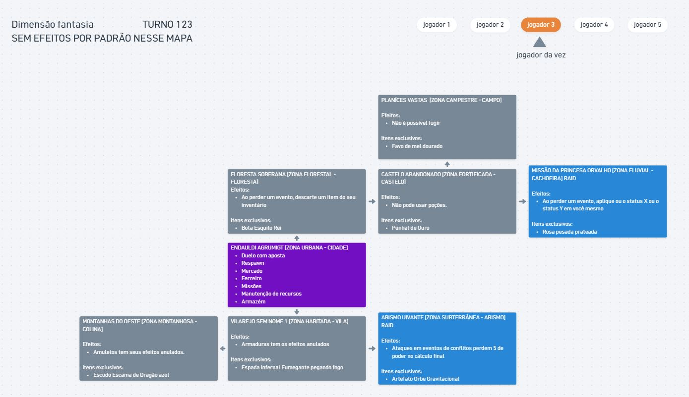

1. **Embaralhe** as cartas de zona da dimensão.
2. Selecione **aleatoriamente uma zona Urbana** (cidade, metrópole ou outro local Urbano) e posicione-a na mesa como **primeira carta** (a **cidade inicial**).
3. Compre cartas do **topo** do deck de zonas.
4. Posicione cada nova carta **onde uma seta de conexão livre de uma carta já posicionada aponta**, girada de forma que uma **seta de conexão dela aponte para essa carta** (veja as regras de encaixe).
5. Repita até montar o mapa. **Todas as cartas de zona da dimensão devem entrar no mapa.**

Assim, **cada vez que a dimensão é jogada, um mapa diferente é construído**, o que dá rejogabilidade e permite estratégias e planos diferentes. Como todas as zonas sempre entram no mapa, **todos os grupos têm acesso ao mesmo conteúdo** (recursos, atributos, missões, mercados); só muda a disposição e o caminho até cada coisa.

**Regras de encaixe:**

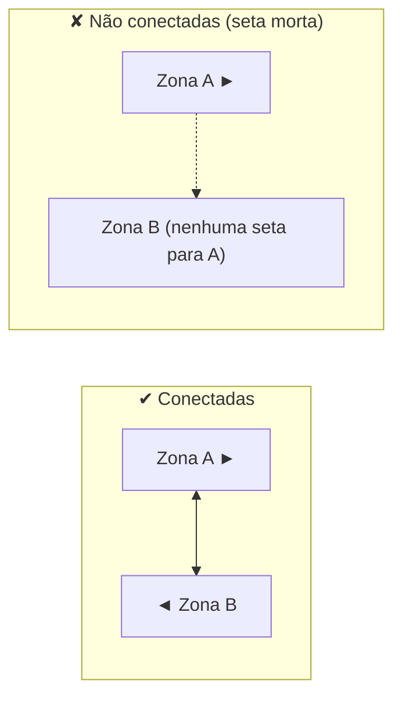

1. **Conexão (travessia):** quando uma **seta de conexão** de uma zona e uma **seta de conexão** de outra zona **apontam uma para a outra**, existe ali uma **travessia** entre as duas zonas. O jogador pode atravessar **nos dois sentidos**.
2. Cartas vizinhas na mesa sem setas de conexão apontando uma para a outra **não** têm travessia entre elas.
3. **Setas mortas:** uma seta de conexão que não encontra outra seta apontando para ela não forma travessia. Isso é permitido e cria becos naturais no mapa.
4. Quando há várias setas livres, o gerador **sorteia** em qual delas a nova carta entra.
5. **Sem orientação:** cartas de zona **não têm** "topo", "baixo", "esquerda" nem "direita". Elas podem ser posicionadas **em qualquer rotação**. O gerador escolhe a rotação.

**Gerador de mapa:**
1. **Todas as zonas entram (obrigatório):** o mapa é montado por um algoritmo que **refaz a montagem** (outro sorteio) sempre que alguma carta não couber, até **todas** as cartas de zona entrarem, com limite de **1.000 tentativas** (ajustável no laboratório). Se o limite for atingido, o jogo **não monta o mapa** e mostra o mesmo **erro para o designer** da validação (item 2). O mapa continua aleatório a cada partida.
2. **Validação da composição:** ao carregar a dimensão (antes de montar o mapa), o jogo confere se ela tem **pelo menos 1 zona Urbana** e se a **soma das setas** de todas as zonas é **maior ou igual a 2 × (número de zonas − 1)** (o mínimo para ligar todas as cartas). Se falhar, o jogo **não monta o mapa** e mostra um **erro para o designer** da coleção, em vez de tentar para sempre.
3. **Regras de composição da dimensão** (para o designer da coleção): 2 setas na maioria, 4 nas Urbanas, poucas com 1 seta ("becos") e poucas com 3 ("encruzilhadas"). Assim o gerador quase sempre acerta de primeira.
4. **Tamanho:** começar os testes com **16 zonas** por dimensão (ex.: 2–3 Urbanas, ~9 com 2 setas, ~2 com 3 setas, ~2 com 1 seta). O laboratório deve permitir testar 12, 16 e 20 zonas.
5. **Aleatoriedade sem restrições de distância:** o gerador **não** controla distâncias entre zonas (nem da cidade inicial, nem entre mercados, ferreiros ou cidades). A disposição é **totalmente aleatória**, de propósito. Como todas as zonas sempre entram, o conteúdo é igual para todos os grupos; só muda o caminho.

### 3.6 Exploração

- **Não existe mecânica de exploração (por enquanto).** **Todas as zonas** são posicionadas **viradas para cima** desde a montagem do mapa: todos veem o tipo, o local, as ações, os efeitos e as setas de todas as zonas desde o início da partida.
- Não existem zonas viradas para baixo, nem regras ou efeitos que revelem zonas.

---

## 4. Atributos e o deck de atributos

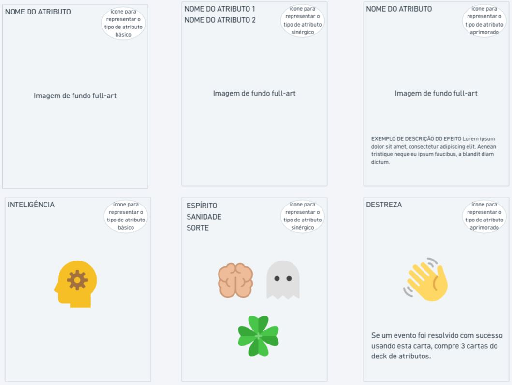

O deck de atributos é a peça central do jogador: é com ele que o jogador resolve desafios e paga custos.

### 4.1 Os 9 atributos

Os atributos se organizam em três categorias.

```
FÍSICOS              MENTAIS/SOCIAIS        METAFÍSICOS
Força                Inteligência           Espírito
Destreza             Sabedoria              Sanidade
Resistência          Carisma                Sorte
```

#### Atributos físicos

| Atributo | Representa | Relacionado a |
|---|---|---|
| **Força** | Potência física e capacidade de exercer força muscular. | Levantar, empurrar, carregar, quebrar objetos e causar impacto físico. |
| **Destreza** | Agilidade, coordenação motora e precisão dos movimentos. | Movimentos rápidos, esquiva, equilíbrio, manipular objetos com precisão e usar armas que exigem técnica. |
| **Resistência** | Capacidade física de suportar esforços, danos e condições adversas. | Vitalidade, tolerância à dor, fôlego e continuar lutando sob desgaste físico. |

#### Atributos mentais/sociais

| Atributo | Representa | Relacionado a |
|---|---|---|
| **Inteligência** | Raciocínio, aprendizado e compreensão lógica. | Conhecimento, memória, resolução de problemas, investigação, planejamento e domínio de assuntos complexos. |
| **Sabedoria** | Percepção, intuição e capacidade de interpretar situações. | Discernimento, experiência, leitura do ambiente, reconhecimento de padrões e decisões sensatas. |
| **Carisma** | Personalidade e capacidade de influenciar outras pessoas. | Persuasão, liderança, negociação, intimidação, eloquência e conquistar confiança ou respeito. |

#### Atributos metafísicos

| Atributo | Representa | Relacionado a |
|---|---|---|
| **Espírito** | Força interior, determinação e capacidade de exercer ou resistir a influências sobrenaturais. | Força de vontade, concentração, energia espiritual, resistência a possessões e domínio de poderes místicos. |
| **Sanidade** | Estabilidade mental e capacidade de preservar a lucidez diante de experiências psicologicamente perturbadoras. | Resistência ao horror, ao desconhecido, a entidades incompreensíveis e a fenômenos que desafiam a percepção da realidade. |
| **Sorte** | Influência do acaso sobre o que envolve o personagem. | Encontrar oportunidades, evitar situações desfavoráveis, obter resultados inesperados e se beneficiar de circunstâncias imprevisíveis. |

### 4.2 Distinções entre atributos parecidos

| Par | Diferença |
|---|---|
| **Força × Resistência** | Força: exercer potência física. Resistência: suportar esforço e danos. |
| **Inteligência × Sabedoria** | Inteligência: adquirir e processar conhecimento. Sabedoria: interpretar situações e aplicar discernimento. |
| **Espírito × Sanidade** | Espírito: força interior para resistir a influências externas e sobrenaturais. Sanidade: preservar a lucidez diante de experiências perturbadoras. |
| **Carisma × Espírito** | Carisma: influenciar outras pessoas. Espírito: sustentar a própria vontade diante de influências externas. |

Espírito e Sanidade **não são exclusivos de personagens mágicos**. Um guerreiro pode ter Espírito elevado pela determinação; um explorador pode ter Sanidade elevada por lidar com situações extremas. Assim, todos os atributos são relevantes para diferentes classes, mesmo que algumas tenham mais afinidade com certos atributos.

### 4.3 Tipos de carta de atributo

| Tipo | Descrição | Cópias permitidas no deck |
|---|---|---|
| **Básico** | Vale **1** do atributo da carta. | Ilimitadas |
| **Sinérgico** | Vale por **2 a 4 atributos diferentes**. Ex.: 1 Carisma + 1 Sabedoria; ou 1 Resistência + 1 Destreza + 1 Sorte. | Máximo 4 da mesma carta (número especulativo, sujeito a análise) |
| **Aprimorado** | Igual ao Básico, mas possui um **efeito**. Cada carta diz o **próprio gatilho** do efeito (ex.: ao ser paga, enquanto estiver na mão); não há regra geral de quando ele vale. | Máximo 4 da mesma carta (número especulativo, sujeito a análise) |

O limite de cópias vale **dentro do deck**; na pasta de TCG e no cofre, não há limite de cópias.

**Como a carta sinérgica paga requisitos:**
- A carta sinérgica fornece **todos** os seus atributos ao mesmo tempo, mas **só num único pagamento** (não dá para usar o Carisma num evento e a Sabedoria noutro).
- Ela paga "N atributos quaisquer" contando cada atributo dela (a carta "1 Carisma + 1 Sabedoria" paga 2).
- Em requisitos que contam **cartas** ("descarte 3 cartas", "tenha 2 cartas na mão"), ela conta como **1 carta**.
- Em gatilhos de atributo ("se tiver uma carta de Carisma na mão"), ela conta como carta de **cada** atributo que possui.
- Ela conta para a **trava** de cada atributo que possui (veja [8.2](#82-a-trava-do-deck)).

### 4.4 O deck de atributos

- Cada jogador tem o **seu próprio deck de atributos** com **no mínimo 60 cartas** (número especulativo, sujeito a análise). O deck **pode ter mais de 60 cartas**, sem limite máximo. O limite de cópias de cartas sinérgicas e aprimoradas ([4.3](#43-tipos-de-carta-de-atributo)) vale para qualquer tamanho de deck.
- O **deck building** deste jogo consiste em construir o deck de atributos.
- As cartas de atributo são usadas principalmente para **resolver eventos**, **ativar efeitos/habilidades/recursos** e **pagar custos** de efeitos.
- **Deck pré-pronto:** cada classe primária tem um **deck básico pré-pronto** de 60 cartas que já cumpre a trava da classe (veja [8.2](#82-a-trava-do-deck)). Ao iniciar uma partida sem progresso, o jogador escolhe a classe e o deck pré-pronto dela.
  - O pré-pronto é dado **uma única vez**, no início do save. As cartas passam a ser do jogador (como qualquer outra carta) e o deck ocupa um slot de decks do cofre. Ganhar uma nova classe (mentor) **não** dá o pré-pronto dela.

**Build e cartas em jogo.** Chama-se **build** a lista de cartas do deck salva pelo jogador. Durante a partida, as cartas da build estão sempre em um destes três lugares: **deck de atributos**, **mão** ou **pilha de descarte de atributos**. Juntos, eles formam as **cartas em jogo**.

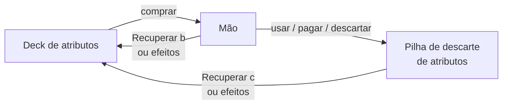

- **O total de cartas em jogo é fixo** e igual ao tamanho da build. Ele **só muda** quando o jogador salva uma nova build (ação **Ajustar deck** ou **Usar cofre**).

**Mexer na build** (vale para Ajustar deck e Usar cofre):

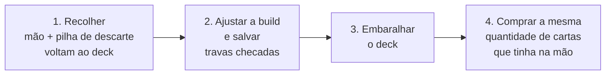

1. **Recolher:** todas as cartas da **mão** e da **pilha de descarte de atributos** voltam para o deck.
2. **Ajustar e salvar:** o jogador troca, coloca ou tira cartas da build (respeitando o mínimo de 60) e salva. As travas são checadas nesse momento ([8.2](#82-a-trava-do-deck)).
3. **Embaralhar:** o deck é embaralhado.
4. **Comprar:** o jogador compra **a mesma quantidade de cartas que tinha na mão** antes de recolher.

Isso tudo faz parte da mesma ação; recolher não é uma ação separada. Se o jogador abrir o ajuste e não mudar nada, os passos 1, 3 e 4 acontecem do mesmo jeito.
- Cartas em jogo **nunca** vão para o limbo nem saem do jogador: **nenhum** efeito, habilidade ou regra pode mudar isso. Cartas que digam "limbo" para cartas de atributo em jogo devem ser escritas com "pilha de descarte de atributos".
- Cartas de atributo **guardadas** (pasta de TCG, pasta extra da montaria, cofre) seguem outra regra: veja [6.5](#65-pilhas-de-descarte-e-limbo).

---

## 5. Recursos

**Recursos** são equipamentos, itens e [montarias](#26-montarias) (mais tipos podem ser adicionados no futuro). Eles possuem efeitos e ajudam o jogador. Enquanto as cartas de atributo são "consumidas" e voltam ao deck, os recursos ficam com o jogador até serem perdidos, vendidos ou trocados.

### 5.1 Equipamentos

- São recursos que o jogador usa **o tempo todo**. As cartas ficam posicionadas **na frente do jogador**, mostrando que estão equipadas.
- Equipamentos **não vão para a mão**. Podem ser guardados no **inventário** e trocados pelos que estão em uso, por estratégia (veja a ação [Preparar](#12-ações-de-zona)).
- **Equipamento guardado não funciona:** um equipamento no inventário (ou no inventário extra da montaria) **não** dá bônus de modificadores, efeitos nem habilidades. Ele só funciona enquanto estiver **em uso** (no slot).
- O jogador pode usar **1 equipamento de cada categoria**:

| Categoria | Exemplos |
|---|---|
| **Cabeça** | Capacetes, tiaras mágicas, capuzes, coroas, etc. |
| **Tronco** | Peitorais de metal, cotas de malha, túnicas de tecido, corpetes de couro, etc. |
| **Inferior** | Calças, grevas de armadura, saias de combate, etc. |
| **Calçado** | Botas de ferro, sapatos leves de couro, sandálias encantadas, etc. |
| **Capa** | Capa, manto, etc. |
| **Arma** | Adagas, punhais, facas, espadas curtas, espadas longas, sabres, cimitarras, katanas, clavas, maças, martelos de guerra, manguais, porretes, lanças, alabardas, tridentes, foices, espadas de duas mãos (montantes), machados de batalha grandes, martelos pesados, manoplas reforçadas, garras, soco-inglês, arcos, bestas, facas de arremesso, machadinhas, azagaias, shurikens, dardos, pistolas, mosquetes, rifles, bacamartes, cajados, varinhas, tomos, grimórios, cruzes, amuletos e talismãs usados como **foco mágico**, orbes mágicos, etc. |
| **Escudo** | Escudo leve de madeira ou metal (pequeno), escudo pesado, escudo de corpo/pavês, escudos especiais (ornamental, concha, táurico), etc. |
| **Acessório** | Cintos, pochetes, anéis, colares, amuletos e talismãs **com efeito passivo**, etc. |

> Algumas armas **não permitem usar escudo** (campo "Bloqueia escudo"). Nesse caso, o jogador fica com um slot a menos.
>
> **Equipar arma que bloqueia escudo com escudo equipado:** o escudo precisa sair do slot e ir para o **inventário** ou para o **inventário extra da montaria**. A troca **só é permitida** se houver espaço livre para o escudo num deles (o espaço deixado pela arma que sai do inventário conta). Sem espaço, a troca não pode ser feita: o jogador precisa liberar espaço antes. Nenhum item é perdido nem vai para o limbo nessa troca.

> **Sem arma** = slot de **Arma vazio**. Manoplas, garras e soco-inglês são **Arma**: quem os usa **não** está sem arma. O ataque básico de quem está sem arma usa **só o modificador base de Ataque** (com o Pico e os percentuais do pipeline de [7.4](#74-escala-fórmulas-e-valores-iniciais)). Equipamentos, recursos e efeitos podem aumentar esse ataque (ex.: efeitos do Monge ou acessórios).

- **Amuletos e talismãs** podem ser **Arma** (foco mágico), **Acessório** (efeito passivo) ou **Relíquia** (item de inventário que não se equipa). A carta mostra a categoria com **ícone, imagem e label** próprios, para o jogador saber qual é qual.
- Equipamentos **não têm elemento**, mas podem dar **bônus de elemento** (veja [Elementos](#16-elementos)).
- Equipamentos e armas podem ter **[habilidades](#17-habilidades)**, que podem causar dano ao oponente ou ativar efeitos. Armas e equipamentos de categorias diferentes podem ter as mesmas habilidades.

**Anatomia da carta de equipamento:**

| Campo | Descrição | Exemplo |
|---|---|---|
| **Nome** | Nome do equipamento | *Espada Rúnica* |
| **Categoria** | Uma das categorias acima (ícone + label) | Arma |
| **Raridade** | Comum a Lendária (símbolo no canto, veja [24.3](#243-boosters)) | Rara |
| **Modificadores** | Bônus que dá enquanto equipado; o primeiro listado é o **modificador principal** (usado pelo refino) | +12 Ataque, +5 Precisão |
| **Requisito de Pico** | Opcional. Pico mínimo para equipar e usar (veja [7.3](#73-regras-da-energia)) | Pico 30 |
| **Restrição de classe** | Opcional (veja [17.3](#173-restrições-de-classe)) | Só Guerreiro, Monge |
| **Bloqueia escudo** | Só armas; se ocupa o slot de escudo | Não |
| **Habilidades** | 0 ou mais (veja [17.1](#171-anatomia-de-uma-habilidade)) | *Corte Flamejante* |
| **Efeitos** | 0 ou mais (capítulo [13](#13-efeitos)) | +5% de Defesa enquanto sem marca de reparo |
| **Refino** | Se pode ser refinado, o nível máximo (até +10) e os **materiais de refino** (obrigatório em todo equipamento refinável; veja [25.2](#252-refinar)) | Refinável, máx. +10; materiais: 1 minério de ferro + 1 gema bruta por tentativa |
| **Encantamentos** | Se pode ser encantado, quantos, de que tipo e com qual refino mínimo | 1 elemental a partir de +3 |
| **Ajuste de preço** | ×0,8 a ×1,5, definido pelo designer (veja [24.4](#244-singles)) | ×1,2 |
| **Estado** | Quebrado ou não; marca "Reparado ×N" | Reparado ×1 |

**Quebra de equipamentos:** equipamentos são quebrados por **habilidades e efeitos de inimigos** (pool exclusiva, veja [17.5](#175-habilidades-exclusivas-de-inimigos)), e pela **falha de refino** a partir de +7 ([25.2](#252-refinar)). Para repará-los, é preciso levá-los ao [ferreiro](#25-ferreiro) ou usar um efeito/habilidade/recurso de reparo. Um equipamento **quebrado**:
- **continua no slot** (ou no inventário) e ainda ocupa o slot;
- não dá bônus de modificadores, suas habilidades não podem ser usadas e seus efeitos ficam anulados;
- vale **0 moedas de ouro** na venda (o jogador provavelmente vai preferir consertá-lo) e pode ser oferecido/abdicado normalmente.

**Marca de reparo:** cada conserto deixa no equipamento uma marca **"Reparado ×N"** (N = quantas vezes ele foi consertado), visível na carta. Cada reparo reduz o preço de venda em **12%**, de forma acumulada sobre o preço original (ex.: ×1 → −12%; ×3 → −36%; ajustável no laboratório). O preço de venda tem **piso 0** (a partir do 9º reparo o equipamento vale 0). A marca também pode ser usada por efeitos (ex.: "equipamentos sem marca de reparo dão +5% de Defesa").

### 5.2 Itens

Podem existir mais categorias no futuro, inclusive categorias exclusivas de uma dimensão.

| Categoria | Finalidade | Exemplos |
|---|---|---|
| **Consumíveis** | Recuperar vida, remover status negativos, obter status positivos e ganhar efeitos. | Poções, elixires, alimentos, bebidas, pergaminhos, bombas, remédios, munição, etc. |
| **Materiais** | Fabricação, aprimoramento ou outras atividades. | Minérios, gemas, ervas, tecidos, couros, componentes, peças, etc. |
| **Relíquias** | Objetos especiais, geralmente raros, mágicos ou com propriedades extraordinárias. Não se equipam. | Artefatos, amuletos, talismãs, objetos amaldiçoados, objetos lendários, etc. |
| **Ferramentas** | Executar atividades específicas, interagir com o ambiente ou superar obstáculos. | Ferramentas de mineração e de coleta, instrumentos, utensílios, equipamentos de exploração, dispositivos. |
| **Tesouros** | Representar valor econômico ou servir de recompensa. | Moedas antigas ou estrangeiras, joias, pedras preciosas, objetos valiosos, antiguidades, etc. |
| **Documentos** | Carregar informações, registros ou conhecimentos. | Mapas, livros, cartas, manuscritos, registros, contratos, receitas, etc. |
| **Boosters** | Pacotes fechados de cartas novas, comprados no mercado ou recebidos como recompensa. | Booster da coleção X. Veja [Boosters](#243-boosters). |
| **Objetos especiais** | Relacionados a eventos, progressão ou situações específicas do jogo. | Qualquer coisa, inclusive itens das outras categorias. |

Todo item é uma **carta**, inclusive os vendidos no estoque do mercado (poções, munição, etc.).

### 5.3 Dinheiro

O dinheiro do jogo são as **moedas de ouro**, um **contador** que não ocupa slot. Tesouros são objetos de valor que ocupam slot e precisam ser **vendidos** no mercado (ou usados em efeitos) para virar ouro.

**Bolsa de ouro:** cada jogador carrega o ouro numa **bolsa** com capacidade máxima. Por padrão, a bolsa comporta **300 moedas de ouro** (ajustável no laboratório). O ouro recebido acima da capacidade é **perdido** (não há escolha, como acontece com cartas). O mercado oferece um serviço de **expansão da bolsa** (veja [24.5](#245-serviços-do-mercado)).

**Ouro no cofre:** o jogador pode guardar ouro no [cofre](#64-cofre), que comporta **2.000 moedas** por padrão (não ocupa slot). A capacidade também pode ser expandida no mercado.

**Expansões são permanentes:** as capacidades expandidas da bolsa, da pasta de TCG e do cofre (slots, slots de decks e ouro) acompanham o jogador por todas as dimensões do save.

---

## 6. Onde ficam as cartas

Agora que as cartas de atributo e os recursos foram apresentados, é preciso saber onde cada um fica e para onde vai depois de usado.

### 6.1 Visão geral

| Onde | O que guarda | Capacidade padrão | Quando acessa |
|---|---|---|---|
| **Mão** | Cartas de atributo compradas | Sem limite | Sempre |
| **Deck de atributos** | Cartas de atributo a comprar | Mínimo 60 cartas (build) | Por compra e efeitos |
| **Pilha de descarte de atributos** | Cartas de atributo usadas (de cada jogador) | Sem limite | Por efeitos e **Recuperar** |
| **Equipamentos em uso** | 1 equipamento por categoria | 1 por categoria | Sempre (troca via **Preparar**) |
| **Bolsa de ouro** | Moedas de ouro | 300 moedas | Sempre |
| **Inventário** | Recursos que o jogador carrega (inclusive boosters fechados) | 10 slots (fixo, igual para todas as classes) | Sempre |
| **Pasta de TCG** | Cartas de atributo guardadas para ajustar o deck; singles de atributo comprados | 30 cartas no total | Ação **Ajustar deck** |
| **Montaria** | Inventário extra e pasta extra | +4 slots e 10 cartas | Como o inventário e a pasta |
| **Cofre** | Tudo do jogador | 30 slots + 10 slots de decks + 2.000 moedas de ouro | Ação **Usar cofre** |
| **Limbo** | O que foi destruído (recursos e cartas de atributo guardadas) | Sem limite | Nunca (nada volta do limbo) |

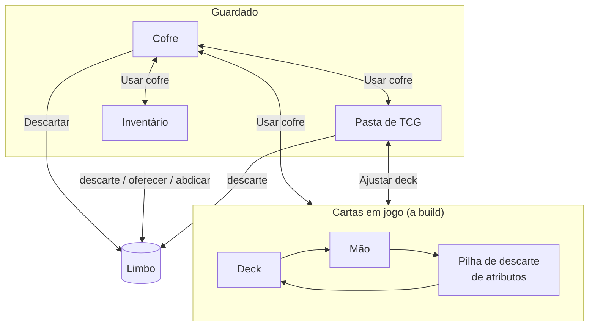

### 6.2 Inventário

- Funciona como uma **"segunda mão"**.
- **Todas as classes têm 10 slots**, sempre. Classe, especialização, trava, buffs, efeitos, itens, equipamentos e habilidades **não alteram** o tamanho do inventário (o valor pode ser mudado só no laboratório). O inventário extra da montaria é um espaço **separado** ([26](#26-montarias)), não um aumento do inventário.
- Durante eventos, combates, etc., o jogador pode usar o que está no inventário, desde que o conteúdo do slot permita. Equipamentos guardados no inventário não funcionam ([5.1](#51-equipamentos)).

**Empilhamento:**

| Empilham sem limite num mesmo slot | Não empilham |
|---|---|
| Consumíveis (inclusive munição), materiais, tesouros e boosters iguais | Equipamentos, relíquias, documentos, ferramentas e objetos especiais |

### 6.3 Pasta de TCG

- Todo jogador carrega uma pasta de TCG com até **30 cartas** no total (ajustável no laboratório).
- Ela permite mexer na build do deck **sem precisar do cofre**, por meio da ação **Ajustar deck** (1 ponto de ação), seguindo os passos de [4.4](#44-o-deck-de-atributos).
- A pasta **não ocupa slot do inventário**: ela tem um slot exclusivo.
- A pasta guarda **apenas cartas de atributo**. Com Ajustar deck, o jogador pode **trocar, colocar ou tirar** cartas entre a pasta e a build, desde que a build continue com **no mínimo 60 cartas**. Uma carta só pode sair da build se **couber** na pasta (ou na pasta extra da montaria); com as pastas cheias, não é possível tirar cartas, só trocar.
- **Singles de atributo** comprados no mercado vão **direto para a pasta**. Se a pasta estiver cheia, o jogador não pode comprá-los (veja [Singles](#244-singles)).
- No começo da **primeira aventura** do jogador, a pasta começa **vazia**.
- **Capacidade fixa:** **nenhum** efeito, habilidade, recurso, classe, zona ou dimensão altera a capacidade da pasta de TCG (nem a da pasta extra da montaria), para mais ou para menos. A capacidade da pasta só aumenta pelo serviço de **expansão da pasta** no mercado ([24.5](#245-serviços-do-mercado)). Por isso a pasta nunca fica acima da capacidade e não existem cartas desabilitadas.

### 6.4 Cofre

- Guarda **todas as coisas** do jogador: recursos, itens, cartas de atributo, boosters, etc.
- O cofre está **atrelado ao jogador dentro do grupo** (veja [Campanha](#281-campanha)): os mesmos itens podem ser acessados de qualquer zona que tenha cofre, inclusive em **dimensões diferentes**, mas não por outro grupo (outro "save") do mesmo jogador.
- No cofre, o jogador faz **todo o deck building**: gerencia decks, monta builds diferentes e move cartas, itens e recursos entre o inventário, a pasta e o cofre. Mexer na build em uso segue os passos de [4.4](#44-o-deck-de-atributos) (recolher, ajustar, embaralhar, comprar).
- **Slots do cofre:**
  - **10 slots de decks** por padrão (builds diferentes). Slots de decks são exclusivos e separados dos demais. Cada slot guarda um deck de qualquer tamanho; o limite é só a quantidade de decks.
  - **Cópias físicas:** cada deck salvo usa cartas **reais**, como num TCG físico. Uma carta que está num deck não está em outro nem na pasta: para ter a mesma carta em 3 decks, o jogador precisa de 3 cópias.
  - A **build em uso** é um dos slots de decks.
  - **30 slots** por padrão para cartas, boosters, recursos, itens, etc.
  - Cópias repetidas **se empilham** sem limite; cada carta/item/recurso **diferente** ocupa um slot diferente.
- **Ouro:** o cofre guarda até **2.000 moedas de ouro** por padrão, separadas dos slots. O jogador move ouro entre a bolsa e o cofre livremente dentro de Usar cofre, respeitando a capacidade dos dois.
- **Descartar:** dentro do cofre, o jogador pode usar a ação **Descartar**, que manda o recurso ou a carta de atributo escolhida para o **limbo**.

**Expansão do cofre:** o mercado oferece um serviço de expansão do cofre. Cada compra dá **+5 slots**, e o preço cresce a cada expansão (valores ajustáveis no laboratório):

| Expansão | Slots totais | Preço (ouro) |
|---|---|---|
| 1ª | 35 | 50 |
| 2ª | 40 | 100 |
| 3ª | 45 | 200 |
| 4ª em diante | +5 cada | dobra a cada compra |

Os **slots de decks** também podem ser expandidos no mercado: **+1 slot de deck por 100 ouro**, e o preço **dobra** a cada compra (valores ajustáveis no laboratório).

### 6.5 Pilhas de descarte e limbo

**Esta é a única fonte da regra de destino das cartas.** Os outros capítulos apontam para cá.

| Origem | Destino |
|---|---|
| **Cartas de atributo em jogo** (mão, deck, pilha de descarte) usadas como requisito, pagas como custo, descartadas por efeito/habilidade, manipuladas ou descartadas em **qualquer** outra situação, inclusive o excesso de cartas na mão | **Sempre** a **pilha de descarte de atributos** do próprio jogador |
| **Cartas de atributo guardadas** (pasta de TCG, pasta extra da montaria, cofre) que são descartadas | **Limbo** |
| **Recurso** do inventário (ou do inventário extra da montaria) descartado | **Limbo** |
| **Equipamento abdicado** | **Limbo** |
| **Recurso oferecido** | **Limbo** |
| **Cartas que não são de atributo** usadas para resolver um evento | **Limbo** |
| **Carta de evento**, resolvida ou não | **Pilha de descarte de eventos** do tipo daquela zona |
| **Consumível usado** (poção bebida, munição gasta, etc.) | **Limbo** |
| **Booster aberto** (a embalagem) | **Limbo** |
| **Ferramenta quebrada** ("quebra após N usos") | **Limbo** |
| **Carta de missão concluída** | **Sai do jogo** nessa partida |
| **Carta de missão de zona abandonada** | **Fundo** do deck de missões da zona de onde veio ([21.1](#211-regras-gerais)) |
| **Carta vendida no mercado** (qualquer tipo) | **Sai do jogo** (não volta a pool, estoque nem deck) |
| **Carta de evento de Chefe** derrotado | **Sai do jogo** nessa partida ([18.3](#183-categorias-de-inimigo)) |
| Cartas **negociadas** | Passam para o outro jogador |
| **Item de conclusão** ([3.2](#32-conclusão-de-uma-dimensão)) | **Nunca** vai para o limbo; só muda de dono por negociação. **Sai do jogo** quando a dimensão é concluída ([28.1](#281-campanha)) |

- O **limbo** é uma **pilha de descarte comum a todos os jogadores**.
- **Nada volta do limbo:** o que vai para o limbo é **perdido para sempre**. Nenhum efeito, habilidade, classe ou especialização pode recuperar coisas do limbo, e o limbo não é acessível nem guardado. Na prática, mandar algo para o limbo é **destruí-lo**.
- Quando o deck de eventos de um tipo de zona acaba, a pilha de descarte de eventos **daquele tipo** é reembaralhada para formar um novo deck.
- **IMPORTANTE:** se uma carta não diz explicitamente para embaralhar um deck, o deck **NÃO** deve ser embaralhado.

### 6.6 Recompensas e falta de espaço

**Nada vai direto para o cofre:** o que o jogador ganha ou compra nunca é "teleportado" para o cofre.

| O que chega | Para onde vai |
|---|---|
| **Recursos e boosters** | **Inventário** ou, se o jogador tiver montaria, o **inventário extra** dela |
| **Cartas de atributo** | **Pasta de TCG** ou, se o jogador tiver montaria, a **pasta extra** dela |
| **Ouro** | **Bolsa** (o excesso é perdido) |

Isso vale para tudo o que chega: recompensas, compras no mercado (estoque e singles) e cartas de boosters abertos. Quando há espaço nos dois (inventário/pasta e montaria), o jogador escolhe onde guardar. Nas regras que exigem espaço livre (ex.: comprar singles, abrir booster no Preparar), o espaço da montaria conta junto.

**Pagamentos saem sempre da bolsa:** toda compra e todo pagamento em ouro (mercado, singles, boosters, expansões, ferreiro, mentor, custos de efeitos) usa **só o ouro da bolsa**. Para gastar o ouro do cofre, o jogador precisa antes movê-lo para a bolsa (ação Usar cofre).

**Sem espaço**, o jogador escolhe entre:
- **descartar** algo do inventário ou da pasta para abrir espaço (vai para o **limbo**, veja [6.5](#65-pilhas-de-descarte-e-limbo)); ou
- **deixar a recompensa**: se ela veio do deck de recompensas, vai para o **fundo** desse deck; se veio do **deck de reserva**, simplesmente **desaparece** (o deck de reserva é infinito e não tem fundo); se não veio de deck nenhum (recompensa fixa de inimigo, missão, etc.), vai para o **limbo**.

Exceção: abrir um booster **dentro** do cofre manda as cartas para o cofre (veja [24.3](#243-boosters)).

Exceção: **itens de conclusão** ([3.2](#32-conclusão-de-uma-dimensão)) vão sempre para a área própria do jogador, sem precisar de espaço.

---

## 7. Modificadores e Energia

Os modificadores dizem **quão forte** o jogador é; a Energia diz **quanto ele ainda pode gastar** e é o que mais pesa nos modificadores.

### 7.1 Modificadores

**Modificadores** são pontos do jogador que afetam cálculos e interações durante toda a partida. Recursos, efeitos e habilidades podem **aumentar ou diminuir** um ou mais modificadores. Mais modificadores podem surgir no futuro.

Todos os modificadores são usados **principalmente em combate**, mas também podem aparecer como requisito em eventos aleatórios e em outras ocasiões. O cálculo de cada um combina o próprio modificador com equipamentos, efeitos ativos, outros fatores (como cartas de atributo específicas na mão) e, **principalmente, o Pico** (veja [7.4](#74-escala-fórmulas-e-valores-iniciais)).

| Modificador | O que o resultado do cálculo define |
|---|---|
| **Ataque** | O valor do ataque desferido no oponente (usa a força dos equipamentos). |
| **Defesa** | Quanto o jogador resiste ao ataque inimigo (usa a defesa dos equipamentos). Se o ataque for **maior** que a defesa, o defensor toma a diferença como dano; se for **igual** (ou menor), não toma dano. |
| **Precisão** | Se o ataque **acerta**. Se acertar, o valor de ataque é usado. |
| **Esquiva** | Se o alvo **escapa** do ataque. Se escapar, não sofre dano. |
| **Celeridade** | A **ordem de ação** no combate: quanto maior, mais cedo a parte age. (Não afeta a ordem dos jogadores na rodada, que é fixa; veja [11.2](#112-ordem-dos-jogadores).) |
| **Perfuração** | Quantos pontos da **defesa** do oponente são ignorados no cálculo de dano (valor fixo). |
| **Reflexão** | Quantos pontos do dano recebido são **devolvidos** ao atacante (valor fixo). O valor devolvido é subtraído do dano ao defensor. Se o ataque não causar dano (Ataque ≤ Defesa), a Reflexão **não** devolve nada. O dano refletido vai **direto na vida** do atacante (não passa pela Defesa dele) e **pode nocauteá-lo** (jogador ou inimigo). Só ataques disparam Reflexão; **dano de efeito** não ([19.2](#192-cálculo-do-dano)). |

**Escala:** os modificadores e a vida máxima **não têm limite máximo** (os modificadores só têm **piso 0**, veja [7.4](#74-escala-fórmulas-e-valores-iniciais)) e **ambos escalam com o Pico** (a vida atual é limitada pela vida máxima, veja [9.1](#91-valores-iniciais)); o ouro é limitado só pela capacidade da [bolsa](#53-dinheiro) e do cofre. Eles começam pequenos e podem chegar às **centenas e aos milhares**.

### 7.2 Energia: Pico e Vigor

**Não existe nível no jogo.** No lugar dele existe a **Energia**, formada por dois valores:

```
Pico  (máximo) ████████████████████  100
Vigor (atual)  ███████████░░░░░░░░░   55   ← gasto em habilidades, efeitos, fugas
               └── nunca passa do Pico ──┘
```

| Valor | O que é | Como muda |
|---|---|---|
| **Pico** | A energia máxima do jogador; funciona como o "nível". É o que mais pesa no cálculo de **todos** os modificadores. | Sobe e desce com quase tudo que acontece no jogo (tabela abaixo). |
| **Vigor** | A energia atual; é o que o jogador **gasta** para usar efeitos, habilidades, recursos, etc. **Nunca** passa do Pico. | Diminui quando é gasto. **Não** volta ao Pico sozinho, nem no início de um combate. Só é restaurado por **recursos, efeitos, habilidades e a ação Recuperar**. |

**O que altera o Pico:**

| Aumentam o Pico | Diminuem o Pico |
|---|---|
| Cumprir missões | Fugir de combates |
| Usar itens pontuais | Usar algumas habilidades de equipamentos |
| Habilidades de equipamentos | Não conseguir resolver eventos |
| Resolver eventos com sucesso | Perder combates (= ser nocauteado) |
| Ganhar combates | |
| Derrotar inimigos | |
| Efeitos positivos (buffs) | Efeitos negativos (debuffs) |
| Etc. | Etc. |

Os valores padrão de cada fonte estão no [Apêndice A](#apêndice-a--valores-ajustáveis) (tabela "Pico por fonte") e são ajustáveis no laboratório. Quando uma carta diz um valor próprio, vale o da carta.

O **Vigor** é o **custo padrão** para usar [habilidades](#17-habilidades) e também pode ser custo de efeitos e recursos. Pico e Vigor podem ser usados como **critérios, requisitos, custos, gatilhos** e em qualquer outro tipo de interação.

### 7.3 Regras da Energia

1. **Teto absoluto:** o Vigor **nunca** passa do valor do Pico, de nenhuma forma e em nenhuma hipótese. Não existe "sobrecarga": nenhum efeito, habilidade ou recurso pode colocar o Vigor acima do Pico. Qualquer restauração que passaria do Pico para no Pico.
2. **Piso:** o Pico e o Vigor **nunca ficam negativos**. O Pico **pode chegar a 0**; nesse caso o Vigor também fica em 0 e o jogador fica Exausto. A Exaustão só acaba quando o **Vigor** ficar maior que 0 (regra 5); o Pico subir não basta (regra 4).
3. **Pico caindo:** se o Pico ficar abaixo do Vigor atual, o Vigor cai junto, até o valor do Pico.
4. **Pico subindo:** quando o Pico sobe, o Vigor **não** sobe junto (o jogador ganha "espaço" para recuperar mais).
5. **Exaustão:** com Vigor 0, o jogador fica **Exausto**: não pode pagar custos de Vigor e tem **−10% em todos os modificadores** até recuperar Vigor.
6. **Recuperar:** além da vida, a ação Recuperar restaura em **Vigor** o equivalente a **5% do Pico** (arredondado para baixo, mínimo 1, respeitando o teto do Pico). O Pico não muda.
7. **Nocaute:** o jogador perde Pico (padrão: **−10% do Pico, mínimo 1, arredondado para baixo**, veja o Apêndice A) e volta ao respawn com Vigor igual ao **menor** valor entre o **Vigor que tinha** e **50% do novo Pico**. Assim, ser nocauteado nunca recarrega o Vigor.
8. **Requisito de Pico:** equipamentos fortes podem ter um **Requisito de Pico** (ex.: "Requer Pico 150"). É **um único requisito** que vale para **equipar** e para **usar** o equipamento e as habilidades dele. Isso cria uma progressão natural de equipamentos sem ter "nível".
   - Com Pico abaixo do requisito, o jogador **não pode equipar** o item.
   - Se o Pico cair abaixo do requisito com o item já equipado, ele **continua no slot**, mas suas **habilidades e efeitos não podem ser ativados**, os efeitos já ativos são **desligados** e ele **não dá bônus de modificadores** até o Pico voltar ao requisito.

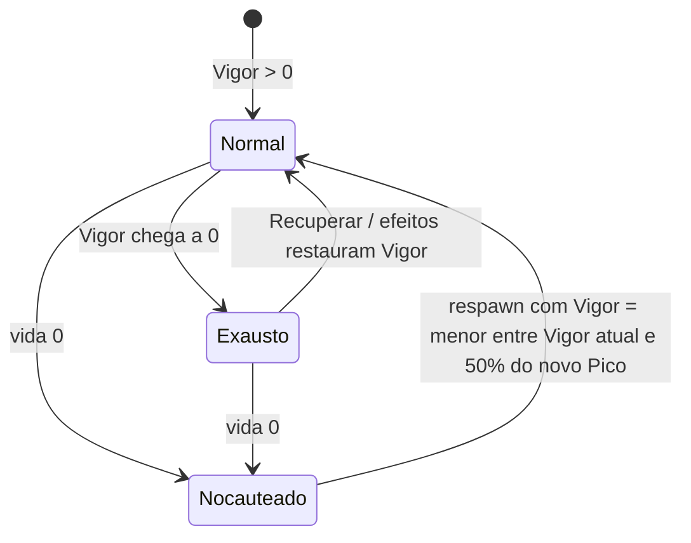

**Exemplos de interação** para cartas: "gaste todo o seu Vigor: cause dano igual ao Vigor gasto"; "se seu Vigor for igual ao Pico (energia cheia), +20% de Ataque"; "ao ficar Exausto, compre 2 cartas"; "transfira até N de Vigor para outro jogador na mesma zona"; "o próximo custo de Vigor é pago com vida"; "aumente seu Pico em N, mas perca todo o Vigor".

### 7.4 Escala, fórmulas e valores iniciais

Todos os valores e fórmulas abaixo são o **ponto de partida para testes**. Cada um pode ser alterado no [Laboratório de testes](#ii6-laboratório-de-testes), que deve permitir trocar valores **e fórmulas** para encontrar a melhor jogabilidade e progressão.

- **Energia inicial:** Pico **10**, Vigor **10**. Fontes comuns dão ou tiram **1 a 5** de Pico; fontes grandes (chefes, conclusão de dimensão) dão **10 a 50**.
- **Influência do Pico:** com Pico 0, sem bônus; com Pico 10, +10%; com Pico 100, o dobro; com Pico 500, seis vezes.
- **Cálculo do modificador (pipeline único)**, sempre nesta ordem:
  1. **Soma fixa:** base + equipamentos + refino + efeitos de valor fixo (ex.: "+5 de Defesa");
  2. **× Pico:** multiplica por (1 + Pico ÷ 100);
  3. **× percentuais:** todos os percentuais **somados** num único fator (ex.: efeito +20%, outro efeito +5%, Exaustão −10% → ×1,15);
  4. **+ Poder:** só no Ataque de uma habilidade, soma-se o Poder dela;
  5. **Piso 0:** o resultado nunca fica negativo (mínimo 0), mesmo com debuffs fixos (ex.: "reduza Defesa em 5" com Defesa 2 → 0). O fator dos percentuais (etapa 3) também tem mínimo ×0 (ex.: −70% e −50% somados → ×0, não ×−0,2).

  Arredonda-se para baixo só no fim (inclusive o refino, que entra com casas decimais). Exemplo: base 5 + arma 12 + refino +2 (2 × 5% de 12 = 1,2) = 18,2 → × 1,10 (Pico 10) = 20,02 → × 1,20 (efeito de +20%) = 24,024 → + 40 (Poder) = 64,024 → **64**.
- **Vida máxima:** **vida base × (1 + Pico ÷ 100)**, arredondada para baixo. A vida base é 20 por padrão (mais bônus permanentes). Ex.: vida base 20 com Pico 10 → 22; com Pico 100 → 40. Quando o Pico cai e a vida máxima fica abaixo da vida atual, a vida atual cai junto; quando o Pico sobe, a vida atual **não** sobe junto (como o Vigor).
- **Acerto:** chance de acerto (%) = **Precisão ÷ (Precisão + Esquiva do alvo) × 100**, sorteada pelo sistema. Com 50 × 20, ~71% de acerto. A fórmula funciona em qualquer escala. Se a Precisão do atacante for **0**, o ataque **erra** sem rolagem (evita a divisão por zero).
- **Dano:** veja a fórmula completa em [19.2](#192-cálculo-do-dano).
- **Dados não dependem da Energia:** rolagens de dado (teste de fuga, refino, etc.) **não** são influenciadas por Energia, Pico ou Vigor por padrão, a menos que um efeito ou habilidade diga o contrário.
- **Modificadores iniciais (base):** dependem da **classe ativa** do jogador (veja a tabela em [8.7](#87-perfil-das-classes) e a regra do multiclasse em [8.4](#84-como-se-tornar-multiclasse)). No laboratório será possível usar o valor padrão, um valor customizado para todos ou um valor customizado por classe.

---

## 8. Classes e especializações

A classe junta tudo o que veio antes: ela pede uma **composição mínima** do deck de atributos (a trava) e define os **modificadores base** do jogador. (O inventário é sempre de 10 slots e não depende da classe.)

### 8.1 Trilha de progressão

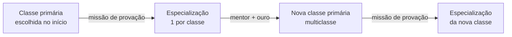

| Etapa | Descrição |
|---|---|
| **Classe primária** | Escolhida no início do jogo. **Trava** o deck de atributos com uma quantidade e/ou combinação de um ou mais atributos específicos. |
| **Especialização** | Uma subclasse dentro das opções da classe primária. Concede um ou mais **efeitos** e também **trava** o deck com uma quantidade e/ou combinação de atributos. |
| **Multiclasse** | Ter mais de uma classe primária e, consequentemente, ter mais de uma especialização. |

Regras:
- Não é possível ter **duas especializações iguais**.
- Não é possível ter **a mesma classe primária duas vezes**.
- **Para jogadores**, habilidades existem **só em equipamentos**. Classes e especializações concedem **efeitos** (passivos ou com gatilho), inclusive efeitos que alteram habilidades (ex.: "suas habilidades de Fogo custam 10% menos Vigor").

### 8.2 A trava do deck

A trava é uma **quantidade mínima** de cartas de certos atributos na **build** do deck. As outras cartas são livres.

**Quando a trava é checada:** ao **escolher o deck na preparação da partida** ([10.1](#101-passo-a-passo)) e ao **salvar a build** (ações **Ajustar deck** e **Usar cofre**). Durante a partida, as cartas em jogo não mudam ([4.4](#44-o-deck-de-atributos)), então o resultado da checagem vale até a próxima vez que a build for salva. Uma classe ou especialização **recém-ganha** (provação, mentor) começa **desligada** e só é checada na próxima vez que o jogador salvar a build.

**A trava habilita a classe.** O jogador **pode** montar um deck que não cumpre a trava. Cumprir a trava é o que **habilita** o que a classe e a especialização proporcionam. Enquanto a build não cumprir a trava de uma classe (ou especialização), o jogador **não tem**:
- os efeitos da classe (ou da especialização);
- a afinidade elemental dela;
- os modificadores base dela (veja [8.4](#84-como-se-tornar-multiclasse));
- as habilidades com restrição daquela classe.

Se **nenhuma** classe do jogador estiver ativa, ele usa o "valor padrão" dos modificadores.

Mesmo sem cumprir a trava, o jogador **continua sendo** daquela classe: gatilhos como "se for Guerreiro" funcionam, e ele pode equipar itens restritos à classe (só não usa as habilidades restritas a ela).

**Cada trava é checada separadamente.** A **trava da especialização inclui a trava completa da classe primária**, com o reforço somado e os atributos adicionais. Por isso, uma especialização ativa sempre significa a classe ativa; o contrário não (a classe pode estar ativa sem a especialização). No multiclasse, cada classe e cada especialização é checada contra a **própria** trava; a mesma carta conta para todas. O jogo deve mostrar ao jogador (tooltip ou painel do deck) quais travas estão cumpridas.

| Origem | Trava (deck de 60; números sujeitos a análise) |
|---|---|
| Classe primária com **1** atributo essencial | mín. **18** cartas do atributo essencial |
| Classe primária com **2** atributos essenciais | mín. **10** de cada atributo essencial |
| Especialização — atributo **adicional** | mín. **6** cartas de cada adicional |
| Especialização — **reforço** | mín. **+4** cartas de cada atributo de reforço (somadas à trava da classe) |

**Exemplos:**
- **Guerreiro Bárbaro:** 14 Força, 14 Resistência, 6 Espírito = 34 cartas travadas, 26 livres.
- **Guerreiro Espadachim** (reforço só em Força): 14 Força (10 + 4), 10 Resistência (trava da classe) e 6 Destreza = 30 cartas travadas.
- **Ladino Assassino** (2 adicionais): 22 Destreza (18 + 4 de reforço), 6 Inteligência e 6 Sorte = 34 cartas travadas.

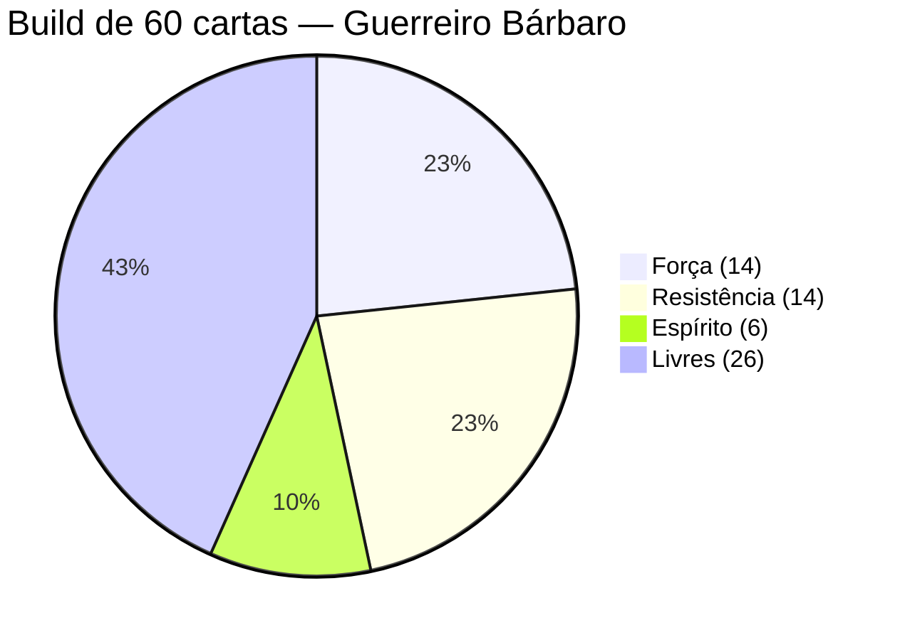

**Exemplo de multiclasse (Mago Elementalista + Alquimista):**

| Trava | Exige | Build com 14 Int, 14 Esp, 6 Sab (+ 26 livres) |
|---|---|---|
| Mago | 10 Int, 10 Esp | ✔ ativa |
| Elementalista | 14 Int, 14 Esp (reforço), 6 Sab (adicional) | ✔ ativa |
| Alquimista | 18 Int | ✘ inativa (faltam 4 Int) |

Cartas sinérgicas contam para a trava de cada atributo que possuem.

**Deck irregular:** a build precisa ter **no mínimo 60 cartas**. Enquanto tiver menos, ela não pode ser salva:
- no **cofre**, o jogador não consegue sair do cofre e voltar a jogar enquanto a build estiver irregular;
- na ação **Ajustar deck**, o jogador não consegue prosseguir com suas ações enquanto a build estiver irregular.

Uma build com 60 cartas ou mais que não cumpre a trava **não** é irregular: ela só deixa a classe (ou especialização) sem os seus benefícios. Como a trava é uma **quantidade** mínima (não uma proporção), um deck maior que 60 continua precisando do mesmo número de cartas do atributo, mas as compra com menos frequência.

### 8.3 Como obter uma especialização

**Provação de especialização:**
- Existe **uma única missão de provação, genérica**, igual para todas as especializações. Ela **não** tem relação com o tema da classe ou da especialização e **não** depende de tipo de zona (veja [Missões genéricas](#missões-genéricas-provação-e-mentor)).
- **Pegar:** ação contextual **Pegar missão de provação** (1 ponto de ação), em **qualquer** zona **Urbana** ou **Habitada**. Ao pegar, o jogador **escolhe** qual especialização vai buscar, entre as 4 de uma classe primária sua que ainda não tem especialização.
- A missão de provação **não fica no deck de missões** e **não é exclusiva**: qualquer jogador pode pegá-la (veja [21.2](#212-tipos-de-missão)).
- Requisito para **pegar** a provação: ter uma classe primária **sem** especialização, **Pico mínimo 30** (ajustável no laboratório) e **nenhuma outra missão genérica em aberto** (veja [Missões genéricas](#missões-genéricas-provação-e-mentor)).
- Ao **finalizar** a provação, o jogador ganha a especialização escolhida de forma permanente. Os benefícios dela só ficam ativos quando a build cumprir a trava da especialização.
- O jogador pode ter **uma especialização por classe primária**, e **não é possível trocar** de especialização dentro da mesma classe.
- Se o jogador **abandonar** a provação ([21.1](#211-regras-gerais)), pode pegá-la de novo depois (e escolher outra especialização), cumprindo os requisitos.
- A provação pode ser **completada mais de uma vez na mesma dimensão** (ex.: depois de ganhar uma nova classe pelo mentor, o jogador pode fazer a provação da nova classe na mesma dimensão). A regra "Não se repetem" de [21.1](#211-regras-gerais) vale só para missões de zona.
- **Ajudantes de IA** ([28.1](#281-campanha)) **sorteiam** a especialização ao pegar a provação (entre as 4 da classe).

#### Missões genéricas (provação e mentor)

As missões de provação e do mentor valem em **qualquer** dimensão, qualquer que seja o tema ([3.1](#31-dimensões)). Por isso:
- **Objetivos genéricos:** os objetivos são contadores que podem ser cumpridos em **qualquer zona**, usando só o que existe em toda dimensão (eventos aleatórios e combates da ação Iniciar evento). Nenhum objetivo cita tipo de zona, local, criatura, categoria de inimigo, mercado ou ferreiro.
- **Objetivos padrão** (ajustáveis no laboratório):

| Missão | Objetivos |
|---|---|
| **Provação** | Resolver **3** eventos aleatórios com sucesso **e** vencer **3** combates |
| **Mentor** | Resolver **5** eventos aleatórios com sucesso **e** vencer **5** combates |

- **Como conta:** só conta o que acontece **depois** de pegar a missão. "Resolver um evento aleatório com sucesso" = chegar ao êxito de um evento aleatório (inclusive os de missões). "Vencer um combate" = terminar **de pé** um combate que termina em **vitória**, como quem iniciou ou como ajudante ([19.5](#195-combate-com-2-ou-mais-jogadores--1-ou-mais-inimigos)). Um mesmo acontecimento conta para **todas** as missões em aberto do jogador que o contam.
- **Uma por vez:** cada jogador pode ter no máximo **1 missão genérica** (provação **ou** mentor) em aberto ao mesmo tempo. Não é possível ter duas provações, dois mentores, nem uma provação e um mentor juntos. Para pegar outra, o jogador precisa finalizar ou abandonar a que está aberta. A missão genérica conta para o limite geral de 3 missões em aberto ([21.1](#211-regras-gerais)).
- **Progresso automático:** não existe "Continuar missão" para elas; o jogo conta o progresso sozinho.
- **Finalizar:** com todos os objetivos cumpridos, o jogador usa a ação contextual **Finalizar missão** (1 ponto de ação) em **qualquer** zona **Urbana** ou **Habitada**. Como toda dimensão tem pelo menos 1 zona Urbana, a missão **sempre** pode ser concluída.

### 8.4 Como se tornar multiclasse

**Mentoria:**
- Pré-requisito: já ter uma especialização em **todas** as classes primárias atuais e **não** ter outra missão genérica em aberto (no máximo 1 por vez, veja [Missões genéricas](#missões-genéricas-provação-e-mentor)).
- **Escolha da classe:** ao **pegar** a missão do mentor, o jogador escolhe **livremente** a nova classe primária, entre as que ainda não tem (ajudantes de IA **sorteiam**, [28.1](#281-campanha)). Existe **uma única missão do mentor, genérica**, igual para todas as classes, sem relação com o tema da classe e sem depender de tipo de zona (veja [Missões genéricas](#missões-genéricas-provação-e-mentor)).
- **Treinar com mentor:** ação de zona presente em **todas** as zonas **Urbanas** e **Habitadas** (custa todos os pontos de ação restantes) que dá ao jogador a **missão do mentor**. Ao finalizar a missão (em qualquer zona Urbana ou Habitada), ele ganha a nova classe primária. Não existe custo de descartar cartas.
- **Custo em ouro:** pago ao **pegar** a missão do mentor. O custo **dobra** a cada nova classe (ajustável no laboratório):

| Nova classe | Custo (ouro) |
|---|---|
| 2ª | 150 |
| 3ª | 300 |
| 4ª | 600 (exige bolsa expandida) |
| Seguintes | dobra |

- Se o jogador **abandonar** a missão do mentor (ação **Abandonar missão**, [21.1](#211-regras-gerais)) ou ela for cancelada ao mudar de dimensão, o **ouro é perdido**; para tentar de novo, pega a missão outra vez e paga outra vez.
- A missão do mentor também **não fica no deck de missões** e **não é exclusiva**.
- A missão do mentor pode ser **completada mais de uma vez na mesma dimensão**, sempre que o jogador cumprir o pré-requisito (e pagar o custo da nova classe). A regra "Não se repetem" de [21.1](#211-regras-gerais) vale só para missões de zona.

O mentor dá a missão de **nova classe**; a especialização da nova classe continua vindo da **missão de provação**.

**Regras do multiclasse:**
- **Travas:** cada classe e especialização é checada contra a própria trava (veja [8.2](#82-a-trava-do-deck)).
- **Inventário:** sempre 10 slots, com qualquer número de classes.
- **Modificadores base:** valem os da **classe ativa**. Se **mais de uma** classe estiver ativa, valem os da classe ativa obtida **primeiro** (a mais antiga do jogador). Se **nenhuma** estiver ativa, vale o "valor padrão".

### 8.5 Como ler a tabela de classes

- **Atributos essenciais** representam a identidade mecânica da classe primária.
- **Atributos adicionais** complementam a especialização e podem introduzir novas possibilidades (efeitos, uso de recursos, etc.). Uma especialização tem **até 2** atributos adicionais e **não necessariamente precisa** ter algum.
- **Reforço** representa uma concentração maior nos atributos essenciais da classe.
- Os atributos **não são restrições absolutas**: personagens podem desenvolver capacidades fora de suas especialidades, porém, talvez tenham menos afinidade, menos consistência no deck e talvez não se beneficiem tanto assim.
- Duas classes primárias **nunca** têm a mesma trava, e duas especializações também não.
- Outras dimensões podem ter classes e especializações exclusivas.

### 8.6 Lista de classes

#### Guerreiro — essenciais: Força, Resistência

| Especialização | Foco | Adicional | Reforço |
|---|---|---|---|
| **Cavaleiro** | Defesa, armaduras e disciplina | Sabedoria (disciplina e percepção tática) | Resistência (capacidade defensiva e sobrevivência) |
| **Bárbaro** | Força bruta e fúria | Espírito (controle e manifestação da fúria) | Força e Resistência (potência física e durabilidade) |
| **Espadachim** | Técnica e precisão com espadas | Destreza (precisão, velocidade e coordenação) | Força (potência dos golpes) |
| **Gladiador** | Combate agressivo e resistência | Carisma (presença e intimidação) | Força e Resistência (agressividade e capacidade de suportar danos) |

#### Mago — essenciais: Inteligência, Espírito

| Especialização | Foco | Adicional | Reforço |
|---|---|---|---|
| **Necromante** | Manipulação da morte e dos mortos-vivos | Sanidade (contato com forças perturbadoras e conhecimento sobre a morte) | Inteligência e Espírito (domínio e manipulação de energias sobrenaturais) |
| **Ilusionista** | Ilusões e manipulação da percepção | Carisma (manipulação da percepção e influência sobre outras pessoas) | Inteligência (complexidade e precisão das ilusões) |
| **Invocador** | Conjuração de criaturas e entidades | Carisma (comando e domínio sobre as entidades invocadas) | Inteligência e Espírito (complexidade das invocações e controle das entidades) |
| **Elementalista** | Manipulação dos elementos | Sabedoria (compreensão das forças naturais) | Inteligência e Espírito (controle e intensidade das manifestações elementais) |

#### Ladino — essencial: Destreza

| Especialização | Foco | Adicional | Reforço |
|---|---|---|---|
| **Ladrão** | Furtividade, furtos e arrombamentos | Inteligência (mecanismos, fechaduras e armadilhas) | Destreza (agilidade e precisão) |
| **Assassino** | Eliminação precisa de alvos | Inteligência (planejamento e identificação de vulnerabilidades) e Sorte (oportunidade) | Destreza (precisão e execução) |
| **Espião** | Disfarces, espionagem e coleta de informações | Carisma (persuasão, disfarces e interação social) | Destreza (furtividade e movimentação) |
| **Trapaceiro** | Enganação e artimanhas | Carisma (persuasão e manipulação) e Sorte (improvisação) | Destreza (execução de artimanhas) |

#### Clérigo — essenciais: Sabedoria, Espírito

| Especialização | Foco | Adicional | Reforço |
|---|---|---|---|
| **Sacerdote** | Cura, bênçãos e suporte divino | Carisma (liderança espiritual e inspiração) | Sabedoria e Espírito (poderes divinos e capacidade de cura) |
| **Exorcista** | Combate a espíritos e entidades malignas | Sanidade (resistência psicológica diante de entidades perturbadoras) | Espírito (resistência e enfrentamento de forças sobrenaturais) |
| **Inquisidor** | Investigação, julgamento e combate a hereges | Inteligência (investigação e raciocínio) | Sabedoria e Espírito (discernimento e convicção) |
| **Oráculo** | Profecias, visões e conhecimento divino | Sanidade (capacidade de suportar visões perturbadoras) | Sabedoria e Espírito (intuição e conexão espiritual) |

#### Patrulheiro — essenciais: Destreza, Sabedoria

| Especialização | Foco | Adicional | Reforço |
|---|---|---|---|
| **Caçador** | Rastreamento e caça de criaturas | Resistência (perseguições prolongadas e sobrevivência) | Destreza e Sabedoria (precisão e identificação de alvos) |
| **Arqueiro** | Maestria com arcos e armas de longo alcance | Força (potência dos disparos) | Destreza (precisão e coordenação) |
| **Explorador** | Sobrevivência e exploração de territórios | Resistência (esforço físico e adaptação a ambientes hostis) | Sabedoria (percepção e orientação) |
| **Rastreador** | Identificação e perseguição de rastros | Inteligência (interpretação de evidências e identificação de padrões) | Sabedoria e Destreza (percepção e movimentação) |

#### Druida — essenciais: Sabedoria, Resistência

| Especialização | Foco | Adicional | Reforço |
|---|---|---|---|
| **Metamorfo** | Transformação em animais e criaturas | Destreza (agilidade e instinto animal) | Resistência (adaptação física e capacidade de suportar transformações) |
| **Guardião** | Proteção da natureza | Espírito (conexão e domínio das forças naturais) | Sabedoria e Resistência (proteção e preservação de ambientes naturais) |
| **Xamã** | Comunicação com espíritos e ancestrais | Sanidade (capacidade de suportar contatos sobrenaturais) | Sabedoria (percepção e conexão espiritual) |
| **Naturalista** | Conhecimento da fauna, flora e ecossistemas | Inteligência (conhecimento científico e identificação de espécies) | Sabedoria (percepção e compreensão da natureza) |

#### Monge — essenciais: Destreza, Espírito

| Especialização | Foco | Adicional | Reforço |
|---|---|---|---|
| **Mestre Marcial** | Maestria em artes marciais | Força (potência dos golpes) | Destreza e Espírito (precisão e controle corporal) |
| **Asceta** | Disciplina física e espiritual | Resistência (privação, esforço e tolerância física) | Espírito (autocontrole e disciplina) |
| **Mestre das Sombras** | Técnicas furtivas e movimentos ocultos | Sorte (oportunidades e circunstâncias favoráveis) | Destreza (agilidade e furtividade) |
| **Punho Elemental** | Artes marciais combinadas com energia elemental | Sabedoria (compreensão e percepção das forças elementais) | Espírito e Destreza (canalização de energia e precisão dos movimentos) |

#### Bardo — essencial: Carisma

| Especialização | Foco | Adicional | Reforço |
|---|---|---|---|
| **Menestrel** | Música e entretenimento | Destreza (execução e coordenação musical) | Carisma (expressividade e capacidade de entreter) |
| **Trovador** | Narrativas, inspiração e tradição oral | Sabedoria (tradição oral, memória e experiência) | Carisma (comunicação e capacidade de inspirar) |
| **Diplomata** | Persuasão, negociação e influência | Inteligência (argumentação e estratégia) | Carisma (persuasão e influência social) |
| **Artista** | Expressão artística e criatividade | Sorte (inspiração imprevisível) | Carisma (expressividade e impacto artístico) |

#### Alquimista — essencial: Inteligência

| Especialização | Foco | Adicional | Reforço |
|---|---|---|---|
| **Transmutador** | Transformação da matéria | Espírito (manipulação de energias necessárias à transmutação) | Inteligência (conhecimento e precisão dos processos) |
| **Toxicologista** | Venenos, toxinas e substâncias | Resistência (tolerância a toxinas e exposição a substâncias) | Inteligência (conhecimento químico e preparação de compostos) |
| **Bombardeiro** | Explosivos e dispositivos químicos | Destreza (manuseio e precisão no lançamento) | Inteligência (preparação e conhecimento dos compostos) |
| **Farmacêutico** | Poções, remédios e preparados | Sabedoria (identificação de propriedades e aplicação adequada de preparados) | Inteligência (conhecimento e elaboração de fórmulas) |

#### Artífice — essenciais: Inteligência, Destreza

| Especialização | Foco | Adicional | Reforço |
|---|---|---|---|
| **Engenhoqueiro** | Mecanismos e dispositivos | Sabedoria (percepção de como os mecanismos funcionam) | Destreza (montagem e manipulação de mecanismos) |
| **Inventor** | Criação de ferramentas e máquinas | Sorte (experimentação e resultados inesperados) | Inteligência (criatividade e desenvolvimento de invenções) |
| **Construtor** | Construções e estruturas especiais | Força (manipulação de materiais e trabalho físico) | Inteligência (planejamento e engenharia) |
| **Ferreiro Arcano** | Criação e aprimoramento de equipamentos mágicos | Espírito (manipulação e canalização de energias mágicas) | Inteligência (conhecimento técnico e mágico) |

#### Bruxo — essenciais: Espírito, Sanidade

| Especialização | Foco | Adicional | Reforço |
|---|---|---|---|
| **Demonologista** | Pactos com demônios e entidades infernais | Resistência (suportar a presença e as forças infernais) | Espírito (controle e manutenção dos pactos) |
| **Ocultista** | Conhecimentos proibidos e rituais | Inteligência (compreensão e execução de rituais) | Sanidade (contato com conhecimentos perturbadores) |
| **Pactário** | Vínculos sobrenaturais e contratos | Carisma (negociação e estabelecimento de contratos) | Espírito (manutenção e controle dos vínculos) |
| **Abissalista** | Poderes de entidades cósmicas e abissais | Sabedoria (percepção de entidades incompreensíveis) | Espírito e Sanidade (canalização de poderes abissais) |

#### Feiticeiro — essenciais: Espírito, Carisma

| Especialização | Foco | Adicional | Reforço |
|---|---|---|---|
| **Dracônico** | Herança de dragões e poderes dracônicos | Resistência (vigor e tolerância a poderes dracônicos) | Espírito (manifestação dos poderes herdados) |
| **Elemental** | Afinidade natural com elementos | Sabedoria (compreensão e percepção das forças elementais) | Espírito (manifestação e controle dos poderes elementais) |
| **Celestial** | Poderes de origem divina ou celestial | Sabedoria (discernimento e compreensão de forças divinas) | Espírito e Carisma (manifestação e expressão dos poderes celestiais) |
| **Trevoso** | Poderes de origem demoníaca ou infernal | Sanidade (exposição e adaptação a forças sombrias) | Espírito (controle e manifestação dos poderes infernais) |

### 8.7 Perfil das classes

**Conceito principal.** O conceito principal é o ponto de partida para os efeitos de especialização (pode mudar no futuro). Todas as classes têm **10 slots** de inventário.

| Classe | Conceito principal |
|---|---|
| Guerreiro | Aguenta mais: menos dano recebido, armas pesadas sem penalidade |
| Mago | Habilidades mais fortes e mais baratas em Vigor |
| Ladino | Manipula o deck: olha/reordena o topo, compra extra, fuga mais fácil |
| Clérigo | Cura e remove debuffs de si e de outros jogadores na mesma zona |
| Patrulheiro | Mobilidade no mapa e ataques à distância (Projétil) |
| Druida | Bônus conforme o **tipo de zona** em que está |
| Monge | Ataques múltiplos e Celeridade; luta bem sem arma |
| Bardo | Suporte: buffs para outros jogadores, descontos no mercado, vantagens na negociação |
| Alquimista | Itens consumíveis mais fortes; cria consumíveis a partir de materiais |
| Artífice | Repara, refina e cria equipamentos fora do ferreiro, para si e para outros jogadores na mesma zona (ação **Oficina do Artífice**, veja [25.5](#255-oficina-do-artífice)) |
| Bruxo | Paga custos com vida ou Sanidade (descartando cartas de Sanidade no lugar de Vigor); maldições no inimigo |
| Feiticeiro | Converte cartas de atributo em efeitos; efeitos que fortalecem as habilidades elementais dos seus equipamentos (o Feiticeiro **não tem elemento próprio**: os elementos estão nas habilidades; o ataque básico dele é sem elemento) |

**Modificadores base** (sujeitos a alteração). Ponto de partida: um "valor padrão". Cada classe **troca pontos** a partir dele, seguindo o conceito principal, com o mesmo **orçamento**.

**Orçamento:** cada modificador tem um **peso** (quanto vale 1 ponto dele). A soma de (valor × peso) de toda classe fica em **97 ± 1**, igual ao padrão. Pesos (ajustáveis no laboratório):

| Ataque | Defesa | Precisão | Esquiva | Celeridade | Perfuração | Reflexão |
|---|---|---|---|---|---|---|
| ×4 | ×4 | ×0,5 | ×1 | ×2 | ×3 | ×3 |

| Classe | Ataque | Defesa | Precisão | Esquiva | Celeridade | Perfuração | Reflexão | Orçamento | *Justificativa* |
|---|---|---|---|---|---|---|---|---|---|
| Padrão | 5 | 3 | 50 | 20 | 10 | 0 | 0 | 97 | — |
| Guerreiro | 6 | 5 | 45 | 15 | 8 | 0 | 0 | 97,5 | *Aguenta mais, é lento* |
| Mago | 4 | 2 | 55 | 20 | 10 | 2 | 0 | 97,5 | *Frágil; força vem das habilidades* |
| Ladino | 5 | 2 | 46 | 22 | 12 | 0 | 0 | 97 | *Rápido e esquivo* |
| Clérigo | 4 | 4 | 50 | 18 | 9 | 0 | 1 | 96 | *Resistente, suporte* |
| Patrulheiro | 5 | 2 | 60 | 18 | 10 | 0 | 0 | 96 | *Preciso (ataque à distância)* |
| Druida | 5 | 4 | 42 | 20 | 10 | 0 | 0 | 97 | *Equilibrado (bônus vêm da zona)* |
| Monge | 4 | 2 | 46 | 26 | 12 | 0 | 0 | 97 | *Velocidade e esquiva* |
| Bardo | 4 | 3 | 50 | 22 | 11 | 0 | 0 | 97 | *Fraco sozinho, forte em suporte* |
| Alquimista | 4 | 3 | 50 | 20 | 10 | 1 | 0 | 96 | *Força vem dos consumíveis* |
| Artífice | 5 | 4 | 44 | 18 | 9 | 1 | 0 | 97 | *Força vem dos equipamentos* |
| Bruxo | 5 | 2 | 50 | 15 | 10 | 1 | 2 | 97 | *Maldições e retribuição* |
| Feiticeiro | 6 | 2 | 48 | 18 | 10 | 1 | 0 | 97 | *Dano alto, frágil* |

A **afinidade elemental** de cada classe está em [16.3](#163-afinidade-elemental-das-classes), depois que os elementos são explicados.

### 8.8 Conceitos das especializações

O **conceito principal** de cada especialização é o ponto de partida para criar os **efeitos** dela (lembrando: especializações têm efeitos, não habilidades). Os números exatos ficam para o design das cartas e o laboratório. Um conceito pode ou não ser exclusivo, e mais de uma especialização pode compartilhar o mesmo conceito. Algumas builds podem ser exclusivas de certas classes e especializações.

| Classe | Especialização | Conceito principal |
|---|---|---|
| Guerreiro | Cavaleiro | Defesa extra para si e para os aliados do mesmo combate |
| Guerreiro | Bárbaro | Ataque maior quanto menos vida tiver (fúria) |
| Guerreiro | Espadachim | Compra cartas extras ao atacar com espada; Precisão extra com espadas |
| Guerreiro | Gladiador | Fica mais forte a cada ciclo de combate (bônus acumulado de Ataque) |
| Mago | Necromante | Restaura Vigor ao derrotar inimigos; bônus contra Mortos-vivos |
| Mago | Ilusionista | Reduz a Precisão dos inimigos e facilita a fuga |
| Mago | Invocador | Habilidades Canalizadas precisam de 1 carga a menos |
| Mago | Elementalista | A vantagem elemental dá um bônus maior |
| Ladino | Ladrão | Descontos no mercado e chance de recompensa extra ao vencer combates |
| Ladino | Assassino | Dano extra no primeiro ataque do combate, se agir antes do alvo |
| Ladino | Espião | Na antecipação, olha a carta do topo do deck de eventos e decide se a manda para o fundo |
| Ladino | Trapaceiro | Rola o D20 duas vezes e escolhe o resultado (uso limitado) |
| Clérigo | Sacerdote | Curas mais fortes, em si e em aliados na mesma zona |
| Clérigo | Exorcista | Dano extra contra Espíritos, Demônios e Mortos-vivos |
| Clérigo | Inquisidor | Anula efeitos e buffs de inimigos |
| Clérigo | Oráculo | Olha e reordena as cartas do topo do próprio deck de atributos |
| Patrulheiro | Caçador | Bônus contra Feras e contra inimigos com pouca vida |
| Patrulheiro | Arqueiro | Habilidades de Projétil mais fortes e com menos gasto de munição |
| Patrulheiro | Explorador | Ignora efeitos negativos de "ao entrar nesta zona" |
| Patrulheiro | Rastreador | Precisão e Celeridade extras no primeiro combate depois de se mover na vez |
| Druida | Metamorfo | Ganha uma "forma" conforme o tipo de zona (ex.: Florestal → Esquiva, Montanhosa → Defesa) |
| Druida | Guardião | Defesa extra para si e aliados em zonas que não sejam Urbanas, Fortificadas ou Industriais |
| Druida | Xamã | Restaura Vigor ao entrar em zonas Religiosas ou naturais; bônus em habilidades Espirituais |
| Druida | Naturalista | Vasculhar mais eficiente e consumíveis de ervas mais fortes |
| Monge | Mestre Marcial | Ataque extra quando luta sem arma |
| Monge | Asceta | Bônus quando está com a mão vazia ou o inventário quase vazio |
| Monge | Mestre das Sombras | Esquiva extra e fuga mais fácil |
| Monge | Punho Elemental | Habilidades elementais de manoplas e garras custam menos e causam mais dano |
| Bardo | Menestrel | Buffs de Ataque e Celeridade para aliados no combate |
| Bardo | Trovador | Aliados na mesma zona restauram Vigor quando ele usa Recuperar |
| Bardo | Diplomata | Descontos no mercado e vantagens na negociação; paga alguns requisitos de evento com Carisma |
| Bardo | Artista | Rola um D20 para receber um bônus aleatório forte |
| Alquimista | Transmutador | Converte materiais em outros materiais |
| Alquimista | Toxicologista | Venenos: dano contínuo nos inimigos |
| Alquimista | Bombardeiro | Consumíveis de dano em Área (bombas) mais fortes |
| Alquimista | Farmacêutico | Poções curam mais e podem ser usadas em aliados |
| Artífice | Engenhoqueiro | Ferramentas duram mais (mais usos antes de quebrar) |
| Artífice | Inventor | Criar gasta menos materiais |
| Artífice | Construtor | Bônus extra de Defesa em armaduras e escudos refinados |
| Artífice | Ferreiro Arcano | 1 encantamento além do limite, só nos próprios equipamentos ([25.3](#253-encantar)) |
| Bruxo | Demonologista | Ganha Ataque quando paga custos com vida |
| Bruxo | Ocultista | Maldições (debuffs em inimigos) mais fortes e mais longas |
| Bruxo | Pactário | Bônus grande agora, com um custo cobrado depois (vida ou Pico) |
| Bruxo | Abissalista | Usa cartas de Sanidade no lugar de qualquer atributo em custos; bônus em habilidades Cósmicas |
| Feiticeiro | Dracônico | Bônus de vida base (só com a trava cumprida, F18) e habilidades Dracônicas mais fortes |
| Feiticeiro | Elemental | Muda o elemento de uma habilidade uma vez por combate |
| Feiticeiro | Celestial | Habilidades Celestiais curam um pouco ao causar dano |
| Feiticeiro | Trevoso | Mais dano com habilidades Obscuras quando está com pouca vida |
- O reparo, o refino e a criação fora do ferreiro são conceito da **classe Artífice** ([25.5](#255-oficina-do-artífice)). Outras classes e especializações também podem ter efeitos de reparo (veja [25.1](#251-consertar)).

---

## 9. O jogador

Com atributos, recursos, Energia e classe definidos, dá para descrever com o que o jogador começa.

### 9.1 Valores iniciais

Cada jogador começa a aventura com:
- **10 moedas de ouro**, numa bolsa com capacidade de **300** (veja [5.3](#53-dinheiro));
- **vida base 20**. A **vida máxima** é a vida base × (1 + Pico ÷ 100) (veja [7.4](#74-escala-fórmulas-e-valores-iniciais)); com o Pico inicial 10, começa com **22 pontos de vida**. Curas (Recuperar, poções, efeitos) **não** passam da vida máxima. Não há teto para a vida máxima em si: ela cresce com o Pico e com bônus permanentes;
- **1 classe primária**, escolhida para iniciar a aventura, com o **deck pré-pronto** dela;
- **pasta de TCG vazia**;
- **7 cartas** compradas do seu deck de atributos para a mão;
- **Energia** inicial: Pico 10 e Vigor 10 (veja [7.4](#74-escala-fórmulas-e-valores-iniciais));
- os **modificadores base** da sua classe (veja [8.7](#87-perfil-das-classes)).

Se essa é a **primeira dimensão** do jogador (é a primeira aventura dele), ele começa **sem equipamentos, armas, recursos, montaria, etc.** Nas dimensões seguintes da campanha, ele mantém o que tinha, inclusive a vida atual (veja [28.1](#281-campanha)).

**Vida atual × vida base × vida máxima:** a **vida atual** só muda por dano, cura e efeitos, e nunca passa da vida máxima. A **vida base** (20 + bônus) só muda por efeitos permanentes, classe ou especialização. Bônus de vida base de classe ou especialização só valem enquanto a trava dela estiver cumprida ([8.2](#82-a-trava-do-deck)); por isso a vida base pode mudar a cada build salva (intencional). A **vida máxima** é a vida base escalada pelo Pico. Depois de um nocaute, o jogador volta com **10% da vida máxima** ([20.2](#202-nocaute)).

### 9.2 Regras gerais do jogador

- **Mão de cartas:** não há limite de cartas na mão por padrão. Alguns efeitos podem impor um limite; as cartas em excesso vão **sempre** para a **pilha de descarte de atributos** do jogador.
- **Deck de atributos esgotado:** se o deck de atributos chegar a zero cartas, o jogador **não perde o jogo**. Considera-se que ele administrou mal seus atributos. O jogo segue normalmente, mas será bem difícil continuar sem deck. Existem efeitos, recursos e outros fatores que permitem um *comeback* e a restauração do deck (por exemplo, a ação **Recuperar**).
- **Números inteiros:** todos os cálculos do jogo resultam em **números inteiros**. As lógicas podem arredondar para cima ou para baixo, conforme a finalidade de cada cálculo.

---

## 10. Preparação da partida

### 10.1 Passo a passo

1. **Monte o mapa** (veja [3.5](#35-montagem-do-mapa)).
2. Cada jogador escolhe uma **classe primária** e o **deck pré-pronto** dela (só na primeira aventura do grupo; depois ele mantém as classes e os decks que tem). Para os **ajudantes de IA**, a classe é **sorteada** ([28.1](#281-campanha)).
3. Cada jogador escolhe o **deck** que vai usar (um dos slots de decks do cofre) e compra **7 cartas** do deck de atributos. Os [valores iniciais](#91-valores-iniciais) são recebidos **só na primeira aventura** (a primeira dimensão do grupo). Nas dimensões seguintes, o jogador mantém o que tem ([28.1](#281-campanha)). As **travas** são checadas nesse momento ([8.2](#82-a-trava-do-deck)).
4. Define-se a **ordem dos jogadores** com D20, fixa até o fim da dimensão (veja [11.2](#112-ordem-dos-jogadores)).
5. Na **ordem dos jogadores**, cada um escolhe a **zona inicial** (seu ponto de **spawn**, veja [20.1](#201-spawn-e-respawn)), obrigatoriamente uma zona **Urbana** (a **cidade inicial** também pode ser escolhida). Cada jogador precisa escolher uma zona **diferente** das já escolhidas; só quando não houver zona Urbana livre ele pode escolher uma zona com outro jogador.

Na campanha, esta preparação é refeita **inteira** a cada nova dimensão, **menos** o passo 2 (escolha de classe e deck pré-pronto). Veja [Ir para nova dimensão](#ir-para-nova-dimensão).

---

## 11. A vez do jogador

### 11.1 Pontos de ação

1. O jogador tem **3 pontos de ação** por vez, por padrão.
2. Cada [ação de zona](#12-ações-de-zona) gasta pontos de ação (exceto as indicadas como gratuitas), inclusive a ação **Movimentar**.
3. As ações podem ser feitas **em qualquer ordem**. Exemplo: Iniciar evento → Movimentar → Ir ao Mercado.
4. O jogador **não precisa usar todos os pontos**: ele pode encerrar a vez quando quiser.
5. A vez passa para o próximo jogador quando o jogador **encerra a vez** ou quando o **tempo acaba**. Com **0 pontos de ação**, o jogador ainda pode usar as **ações gratuitas** (Preparar, Negociar, Abandonar missão) antes de encerrar a vez.

Os pontos de ação são sempre **por vez**, nunca por zona. Efeitos que dão pontos extras dizem "por vez".

### 11.2 Ordem dos jogadores

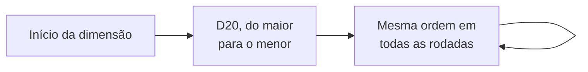

1. **Definição da ordem:** no início da dimensão, cada jogador rola um **D20**. A ordem vai do **maior para o menor** resultado. Empate: os empatados rolam de novo.
2. **Ordem fixa:** depois de definida, a ordem **não muda mais** até o fim da dimensão. Nenhum efeito, habilidade, modificador (inclusive a Celeridade) ou regra altera a ordem dos jogadores. A Celeridade só define a ordem **dentro do combate**.

### 11.3 Tempo da vez

1. Cada vez tem um **tempo limite de 60 segundos**. Esgotado o tempo, a vez termina.
2. **Relógio pausado:** o relógio da vez **pausa** durante **qualquer tela de escolha**: eventos, combates, mercado, ferreiro, cofre, **Preparar**, **Ajustar deck**, **Negociação**, **Oficina do Artífice**, a escolha de carta no **Vasculhar**, **Treinar com mentor** (escolha da classe), missões (inclusive **Abandonar missão**), **Concluir dimensão** e qualquer outra tela em que o jogador precise escolher algo. Cada um tem seu próprio tempo de decisão (padrão: **30 s por escolha**; turno de combate: **30 s**). O relógio de 60 s só corre enquanto o jogador decide qual ação de zona fazer. Por isso, uma vez pode durar mais de 60 s no total.
   - **Tempo máximo da vez:** somando tudo (relógio de 60 s e telas pausadas), uma vez dura no máximo **5 minutos** (ajustável no laboratório). Esgotado esse tempo, a tela aberta é fechada com a ação padrão (item 3) e a vez termina. Combates **não** contam para esse limite (eles têm o tempo por turno de combate e por escolha), para que ninguém seja cortado no meio de uma luta. Combates têm o seu próprio teto: o **limite de ciclos de combate** ([19.1](#191-combate-1-jogador--1-inimigo-regra-base), regra 10).
3. **Tempo de escolha esgotado** (ação padrão):
   - **evento:** o jogador aceita a **coisa ruim** (como se não tentasse resolver);
   - **turno de combate:** o turno é **pulado** (nenhum ataque é feito);
   - **recompensa sem espaço** ([6.6](#66-recompensas-e-falta-de-espaço)): o jogador **deixa a recompensa** (ela segue o destino de "deixar a recompensa" em 6.6);
   - **rodízio de cartas entre sobreviventes** ([19.5](#195-combate-com-2-ou-mais-jogadores--1-ou-mais-inimigos)): o sistema escolhe uma carta **aleatória** pelo jogador;
   - **outras telas** (mercado, ferreiro, cofre, negociação, etc.): a tela é fechada sem mudanças pendentes.
4. **Vez encerrada cedo:** se o jogador encerrar a vez antes dos 60 s, ela passa imediatamente para o próximo (sem esperar o relógio).
5. **Jogador ausente:** se um jogador deixar o tempo acabar em **2 vezes seguidas**, as próximas vezes dele são **puladas automaticamente** até ele apertar o botão **"Voltei"** (disponível a qualquer momento na tela); ele volta a jogar a partir da **próxima vez** dele.
6. **Grupo com um único humano (relógios desligados):** os tempos existem para ninguém esperar demais pelos outros. Quando o grupo tem **só 1 jogador humano** (jogando sozinho ou só com [ajudantes de IA](#281-campanha)), **todos os relógios ficam desligados**: não há tempo da vez (60 s), tempo por escolha (30 s), tempo por turno de combate (30 s) nem tempo máximo da vez (5 min), e a regra do "jogador ausente" não se aplica. O humano joga no seu ritmo. Todo o resto continua igual: pontos de ação, vezes, rodadas, durações e recargas. As IAs decidem na hora, sem relógio.

### 11.4 Agir fora da vez

Todos veem o que acontece na vez dos outros **ao vivo** (movimento, eventos, combates). Um jogador fora da sua vez **nunca inicia** uma ação: ele só participa quando outro jogador, na vez dele, o convida.
- **Negociação:** o jogador da vez pode convidar outro para negociar; o convidado negocia fora da sua vez. O jogador fora da vez não pode iniciar uma negociação.
- **Combate:** quem é **convidado** (recrutado para um combate, [19.5](#195-combate-com-2-ou-mais-jogadores--1-ou-mais-inimigos)) participa fora da sua vez.
- Efeitos com gatilho "na vez de outro jogador" também podem ser ativados.
- **Preparar** e **Ajustar deck** não podem ser usadas fora da vez para adiantar a jogada.

---

## 12. Ações de zona

### 12.1 Ações universais e ações locais

"Ação de zona" é qualquer ação que o jogador faz na sua vez. Elas se dividem em dois grupos:
- **Ações universais**, disponíveis em **todas** as zonas: Movimentar, Recuperar, Preparar, Ajustar deck, Negociar, Iniciar evento, Abandonar missão (só para quem tem missão em aberto) e Oficina do Artífice (só para quem tem a classe Artífice ativa).
- **Ações locais**, impressas na carta da zona: as demais, exceto as contextuais.
- **Ações contextuais**, que não estão impressas na carta e aparecem quando o contexto permite: **Concluir dimensão** (zona indicada pela Carta de Dimensão, para quem cumpre o requisito, [3.2](#32-conclusão-de-uma-dimensão)); **Pegar missão de provação** e **Finalizar** missões de provação e do mentor (qualquer zona Urbana ou Habitada, [Missões genéricas](#missões-genéricas-provação-e-mentor)); **Continuar / Finalizar** etapas de missões de zona em andamento (zonas indicadas pela própria missão). A missão do mentor só é pega pela ação **Treinar com mentor** ([8.4](#84-como-se-tornar-multiclasse)). Na tabela abaixo elas aparecem como "Contextual".

### 12.2 Lista de ações padrão

| Ação | Grupo | Custo | Descrição |
|---|---|---|---|
| **Movimentar** | Universal | 1 ponto de ação | O jogador se move para uma zona **conectada** à zona atual. Pode ser usada **mais de uma vez** na mesma vez. |
| **Recuperar** | Universal | 1 ponto de ação | O jogador recupera **15% da vida máxima** (arredondado para baixo, mínimo 1, sem passar da vida máxima) e restaura em **Vigor** o equivalente a **5% do Pico** por padrão, e escolhe uma opção: (a) comprar cartas até ter 7 na mão; (b) reembaralhar a mão no deck de atributos; (c) reembaralhar a pilha de descarte de atributos no deck de atributos. Pode ser usada **mais de uma vez** na mesma vez, sem limite (veja [12.5](#125-recuperar)). |
| **Preparar** | Universal | **Gratuita** | Pode ser usada **mais de uma vez** na mesma vez. Faz tudo isto na mesma ação: (a) **trocar equipamentos** em uso por outros do inventário (arma que bloqueia escudo: veja [5.1](#51-equipamentos)); (b) **usar recursos** do inventário e **ativar efeitos e habilidades dos equipamentos em uso**; (c) **abrir boosters** (veja [24.3](#243-boosters)). |
| **Ajustar deck** | Universal | 1 ponto de ação | Mexe na build do deck usando as cartas da **pasta de TCG** (e da pasta extra da montaria): trocar, colocar ou tirar cartas. Recolhe a mão e a pilha de descarte no deck, salva a build (travas checadas), embaralha e compra a mesma quantidade de cartas que havia na mão (veja [4.4](#44-o-deck-de-atributos)). |
| **Negociar** | Universal | **Gratuita** | Troca de itens entre jogadores na mesma zona (veja [Negociação](#23-negociação)). Não gasta ponto de ação de nenhum envolvido. |
| **Abandonar missão** | Universal (só com missão em aberto) | **Gratuita** | Desiste de uma missão em aberto, na própria vez e fora de combate (veja [21.1](#211-regras-gerais)). Pode ser usada **mais de uma vez** na mesma vez. |
| **Oficina do Artífice** | Universal (só Artífice ativo) | 1 ponto de ação | Consertar, refinar (até +6) e criar equipamentos fora do ferreiro, para si ou para jogadores na mesma zona (veja [25.5](#255-oficina-do-artífice)). |
| **Iniciar evento** | Universal | 1 ponto de ação | Revela um [evento](#14-eventos). Resolver dá recompensas; falhar dá debuffs e penalidades. As mecânicas de TCG acontecem principalmente aqui. Pode ser usada **mais de uma vez** na mesma vez. |
| **Vasculhar** | Local | 1 ponto de ação | Procura recursos na zona com uma **ferramenta** (veja [12.6](#126-vasculhar)). |
| **Usar cofre** | Local (toda Urbana tem) | 1 ponto de ação | Acessa o [cofre](#64-cofre). Pode ser usada **mais de uma vez** na mesma vez. |
| **Pegar / Continuar / Finalizar missão X** | Local (missão de zona) ou Contextual (pegar provação e finalizar provação/mentor em qualquer Urbana ou Habitada; continuar/finalizar etapas de missões de zona) | 1 ponto de ação | Interage com uma [missão](#21-missões) disponível na zona. A missão do mentor **só** é pega pela ação **Treinar com mentor**. |
| **Concluir dimensão** | Contextual | 1 ponto de ação | Só na zona indicada pela Carta de Dimensão e só para o jogador que cumpre sozinho o requisito. Conclui a dimensão ou, se houver chefe final, inicia o combate contra ele (veja [3.2](#32-conclusão-de-uma-dimensão)). |
| **Ir ao Ferreiro** | Local | Todos os pontos de ação restantes (mínimo 1) | Refinar, encantar, criar e consertar equipamentos (veja [Ferreiro](#25-ferreiro)). |
| **Ir ao Mercado** | Local | Todos os pontos de ação restantes (mínimo 1) | Comprar e vender itens, cartas e boosters (veja [Mercado](#24-mercado)). |
| **Treinar com mentor** | Local (todas as Urbanas e Habitadas) | Todos os pontos de ação restantes (mínimo 1) | Pega a missão do mentor para ganhar uma nova classe primária (veja [8.4](#84-como-se-tornar-multiclasse)). |
| **Salvar ponto de respawn** | Local (só zonas Urbanas; toda Urbana tem) | 1 ponto de ação | Define a zona atual como o ponto de [respawn](#20-nocaute-spawn-e-respawn). |

### 12.3 Regras gerais das ações

- Jogadores **não podem se enfrentar**: não existe combate entre jogadores.
- Sempre que os pontos de ação chegarem a 0 (inclusive depois de uma ação que gasta "todos os pontos restantes"), o jogador ainda pode usar **ações gratuitas** (Preparar, Negociar, Abandonar missão); a vez termina quando ele a encerra ou quando o tempo acaba ([11.1](#111-pontos-de-ação)).

### 12.4 Ações por custo (resumo visual)

```
GRATUITAS            1 PONTO DE AÇÃO                       TODOS OS PONTOS RESTANTES
─────────            ───────────────                       ─────────────────────────
Preparar             Movimentar      Usar cofre            Ir ao Ferreiro
Negociar             Recuperar       Missões               Ir ao Mercado
Abandonar missão     Ajustar deck    Concluir dimensão     Treinar com mentor
                     Iniciar evento  Oficina do Artífice
                     Vasculhar       Salvar ponto de respawn
```

### 12.5 Recuperar

- Recuperar pode ser usada quantas vezes o jogador quiser, porque a opção (a) só compra **até ter 7 cartas na mão** (usar 3 vezes não compra 21 cartas). Cada uso restaura em Vigor **5% do Pico** e recupera **15% da vida máxima** (mínimo 1), sem passar da vida máxima ([9.1](#91-valores-iniciais)).
- **Opção (b):** a mão vai inteira para o deck e o jogador fica **sem cartas na mão**. É intencional: há builds que se beneficiam de ter a mão vazia.
- **Opção (c):** a pilha de descarte de atributos volta inteira para o deck. Como as cartas em jogo são sempre as mesmas da build ([4.4](#44-o-deck-de-atributos)), o deck nunca cresce além da build.

### 12.6 Vasculhar

- Exige a **ferramenta** adequada no inventário (ex.: picareta em zona Subterrânea ou Montanhosa; vara de pesca em zona Fluvial, Lacustre ou Costeira; foice em zona Florestal ou Rural).
- O jogador **procura** no **deck de recompensas** da zona uma carta que combine com a ferramenta (se houver várias, **ele escolhe** qual), coloca-a no inventário e **embaralha** o deck de recompensas. Sem espaço no inventário, vale a regra de [6.6](#66-recompensas-e-falta-de-espaço).
- Pode ser usada **mais de uma vez** na mesma vez.
- A ferramenta **não se desgasta** por padrão; uma ferramenta pode ter na carta "quebra após N usos".
- Se o deck de recompensas **não tiver** nenhuma carta que combine com a ferramenta, o ponto de ação é gasto mesmo assim e o deck é embaralhado.
- Cartas de recompensa coletáveis têm o **ícone da ferramenta** (picareta, vara de pesca, foice, etc.) e um **texto** que explica com qual ferramenta são coletadas.

---

## 13. Efeitos

Efeitos são uma das partes **mais dinâmicas** do jogo. Eles podem afetar qualquer coisa, positiva ou negativamente, e praticamente tudo no jogo pode ter um efeito: cartas de atributo aprimoradas, recursos, classes, zonas, dimensões, eventos, habilidades e inimigos. Os próximos capítulos (eventos, fuga, habilidades, combate) usam esta estrutura o tempo todo.

Todo efeito tem quatro partes:

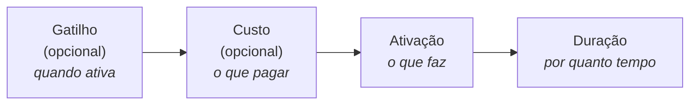

**Exemplo lido parte por parte:** *"Ao entrar numa zona Montanhosa (gatilho), descarte 1 carta de Força (custo): ganhe +5 de Defesa (ativação) até sair desta zona (duração)."*

Em todas as categorias abaixo, mais variações podem surgir no futuro (veja a [Parte III](#parte-iii--etapas-de-desenvolvimento)).

### 13.1 Gatilho (opcional)

O gatilho é a **condição de ativação**. Nem todo efeito tem gatilho.

| Categoria | Exemplos |
|---|---|
| **De zona** | Ao entrar nesta zona; ao entrar numa zona montanhosa; ao entrar numa zona campestre, fluvial ou religiosa; ao entrar em qualquer zona que não seja vulcânica ou subterrânea; ao entrar numa zona pantanosa, num local de vila, de castelo ou de pradaria; ao entrar numa zona desértica que não seja um oásis. |
| **De ação de zona** | Ao não usar **Iniciar evento** numa zona; ao passar por mais de duas zonas diferentes sem usar Iniciar evento; ao usar **Recuperar** três vezes seguidas; ao não usar Recuperar nenhuma vez ao chegar a uma zona; enquanto não usar Recuperar mais de 1 vez; ao ficar sem usar Recuperar depois de passar por mais de quatro zonas; ao finalizar uma missão numa zona; ao finalizar todas as missões de uma zona; ao finalizar mais de três missões numa zona; ao finalizar uma missão em três zonas diferentes; ao abandonar uma missão. |
| **De evento aleatório** | Na fase de antecipação; na fase de encontro; na fase de êxito ou revés; em qualquer fase que não seja a de antecipação. |
| **De evento de combate** | Ao derrotar um oponente; ao derrotar três oponentes diferentes; ao tentar fugir. |
| **De habilidade** | Ao usar uma habilidade de calçado; ao usar a habilidade de um equipamento de cabeça ou inferior; ao usar a habilidade de um equipamento que não seja de tronco; ao usar qualquer habilidade do equipamento "NOME DO EQUIPAMENTO"; ao usar qualquer habilidade de uma shuriken, espada de duas mãos ou adaga; ao usar uma habilidade de capa ou manopla. |
| **De recurso** | Ao ativar um efeito de um recurso; ao ativar quatro efeitos de recursos diferentes; enquanto não ativar mais de dois efeitos de recursos diferentes. |
| **De classe/especialização** | Enquanto você for de uma especialização da classe Bruxo; enquanto tiver apenas uma classe primária; se tiver duas classes primárias; se tiver mais de três classes primárias; se tiver duas especializações; se for um Guerreiro; se for um Ladino ou Clérigo; se for Feiticeiro **e** Druida (multiclasse). |
| **De modificador** | Se seu maior modificador for Reflexão; se seu maior modificador for Celeridade ou Precisão; se seu menor modificador for Ataque; se seu menor modificador for Esquiva ou Celeridade; se tiver mais Precisão do que Defesa; se a soma de Ataque e Reflexão for maior que N. |
| **De atributo** | Se tiver uma carta de Sanidade na mão; duas cartas de Sorte; mais de três cartas de Destreza; três ou menos cartas de Força; uma de Resistência e uma de Carisma; uma de Espírito ou de Inteligência; três ou mais atributos diferentes; apenas um tipo de atributo; quatro ou menos atributos diferentes na mão. |
| **De inventário** | Ao ativar um efeito de um recurso do inventário; ao ativar dois ou mais efeitos de recursos diferentes do inventário; ao ativar um efeito de um item do inventário; ao ativar um efeito de um equipamento em uso; ao ter 4 ou menos recursos diferentes no inventário; se não tiver nenhum recurso no inventário. |
| **De efeito** | Ao usar um efeito de um equipamento; ao usar dois ou mais efeitos de equipamentos diferentes; ao usar três ou menos efeitos de recursos diferentes do inventário; se usou efeitos de um item e de um equipamento; se usou efeitos de um equipamento de cabeça; se não usou efeito de equipamento de tronco ou capa; se usou três ou mais efeitos de itens diferentes do inventário. |
| **De jogador** | Se estiver sem cartas na mão; se tiver três ou menos cartas na mão; se não tiver cartas na pilha de descarte de atributos; se tiver 10 ou mais pontos de vida; se não tiver mais cartas no deck de atributos; se tiver 30 ou mais moedas de ouro; se tiver 3 ou menos pontos de vida. |
| **De energia** | Se seu Vigor for igual ao Pico; ao ficar com 0 de Vigor; se seu Pico for 100 ou mais; ao gastar 50 ou mais de Vigor numa vez; se seu Vigor for menor que a metade do Pico; ao perder Pico. |
| **De elemento** | Ao usar uma habilidade de Fogo; ao acertar um inimigo com vantagem elemental; ao receber dano de uma habilidade com elemento; ao receber dano do elemento X; se todas as suas habilidades em uso forem do mesmo elemento; ao enfrentar um inimigo Obscuro. |
| **De inimigo** | Ao enfrentar um Morto-vivo; ao derrotar um Elite; se houver 3 ou mais inimigos no combate; ao ser atacado por um inimigo Agressivo. |

### 13.2 Custo (opcional)

O custo é o que é preciso pagar para ativar o efeito. Nem todo efeito tem custo.
- **Efeitos muito fortes** têm custos **difíceis e mais específicos**.
- Um custo pode ter **um ou infinitos requisitos**, misturando todas as categorias.
- **O efeito não pode ser ativado se o custo não for pago.**

| Requisito | Destino do que é pago | Exemplos |
|---|---|---|
| **Atributos** (um específico, uma combinação ou qualquer um) | Pilha de descarte de atributos | Um de Força; um de Carisma + três de Destreza + dois de Sanidade; dois de Espírito + 2 quaisquer. |
| **Doar vida** | — (o jogador pode pagar até ficar com 0 de vida e ser nocauteado; o jogo avisa antes) | Doe 7 de vida; doe vida igual à quantidade de equipamentos em uso (mín. 2); igual à quantidade de equipamentos no inventário (mín. 3); igual à quantidade de recursos no inventário (mín. 4); igual à quantidade de relíquias e documentos no inventário (mín. 2 no total); igual às cartas da pilha de descarte de atributos (mín. 5); metade da sua vida (arredonde para cima); igual ao seu maior modificador (mín. 200); igual ao seu menor modificador (mín. 100). |
| **Pagar ouro** | — | Pague 15 moedas; ouro igual à quantidade de equipamentos em uso (mín. 2); igual aos equipamentos no inventário (mín. 6); igual aos recursos no inventário (mín. 4); igual às relíquias e documentos no inventário (mín. 2 no total); igual às cartas da pilha de descarte de atributos (mín. 5); metade do seu ouro (arredonde para cima); igual ao seu maior modificador (mín. 50); igual ao seu menor modificador (mín. 90). |
| **Abdicar de equipamento** | **Limbo** | Só equipamentos **em uso** (no slot do jogador) no momento do gatilho. Abdique do equipamento de cabeça; de capa e tronco; de qualquer um que não seja calçado; de um aleatório; de um aleatório que não seja inferior; de três equipamentos. |
| **Descartar carta de atributo** | Pilha de descarte de atributos (sempre) | Descarte 1 carta da mão; 1 aleatória; 1 de Carisma; 1 que não seja Força nem Sabedoria; 3 cartas; 4 que não sejam Destreza nem Espírito; até ficar com 2 na mão (mín. 1); toda a mão (mín. 3); 1 de Sanidade, 1 de Resistência e 1 de Sorte; 3 cartas diferentes; 2 cartas iguais. |
| **Oferecer recurso do inventário** | **Limbo** | Ofereça 1 item; 2 itens diferentes; 1 equipamento e 1 relíquia; 3 recursos iguais; 1 ferramenta, 1 tesouro e 1 documento; 5 recursos diferentes; 2 equipamentos e 2 itens; 1 que não seja equipamento; 2 que não sejam itens; 4 diferentes que não sejam relíquias, tesouros ou calçados. |
| **Manipulação de cartas** | Pilha de descarte de atributos (cartas em jogo) | Enviar N cartas do topo do deck de atributos para a pilha de descarte de atributos; enviar N cartas do fundo do deck para a pilha de descarte de atributos; reembaralhar N cartas da pilha de descarte no deck; reembaralhar no mínimo 3 cartas da mão no deck; colocar no mínimo 1 carta da mão no topo do deck; colocar no mínimo 3 cartas da mão no fundo do deck. |
| **Gastar Vigor** | — | Gaste 20 de Vigor; gaste Vigor igual a 10× o número de inimigos; gaste metade do seu Vigor; gaste todo o seu Vigor (mín. 30). |
| **Reduzir o Pico** | — | Reduza seu Pico em 5; reduza seu Pico em 10% (custo raro, para efeitos muito fortes). |

Os valores grandes nos exemplos (ex.: vida "mín. 200") são válidos: vida, modificadores e ouro chegam às centenas e aos milhares ao longo do jogo.

**O que significa "mín. N" nos custos:** é uma **condição para ativar**. O efeito só pode ser ativado se o valor calculado for **pelo menos N**. Exemplo: "doe vida igual ao seu maior modificador (mín. 200)": se o maior modificador for 150, o efeito não pode ser ativado; se for 230, o jogador paga 230.

### 13.3 Ativação

A ativação é a consequência do efeito: a ação, o ato. Podem existir **muito mais variantes** do que as listadas: os efeitos são o que torna o jogo dinâmico e estratégico.

| Categoria | Exemplos |
|---|---|
| **Interação matemática** | Perca/ganhe X moedas de ouro; perca/ganhe X pontos de vida; aumente seu Pico em X; restaure X de Vigor (nunca acima do Pico); aumente Ataque e Esquiva em X; reduza Defesa, Perfuração e Reflexão em X; zere Celeridade e Defesa; zere o modificador X; uma carta do atributo X vale 2; uma carta do atributo X tem o valor multiplicado por 2; reduza sua vida pela metade (arredonde para cima); cause X de dano no oponente (**dano de efeito**, [19.2](#192-cálculo-do-dano)); reduza o ataque do oponente em X. |
| **Interação de cartas** | Compre X cartas do deck de atributos; descarte X cartas da mão; descarte uma carta específica; escolha uma carta da pilha de descarte de atributos e coloque-a no topo do deck; coloque X cartas do topo do deck na pilha de descarte; procure um atributo X na pilha de descarte; procure um atributo X no deck e coloque-o na mão; procure duas cartas do atributo X no deck, coloque-as na mão e embaralhe o deck; coloque X cartas da mão no topo do deck; envie X cartas do topo/fundo do deck para a pilha de descarte de atributos. Interações de cartas só movem cartas **entre deck, mão e pilha de descarte**; nunca trazem cartas da pasta ou do cofre para o jogo. |
| **Interação de efeito** | Anule todos os efeitos de um equipamento (a habilidade ativa, mas o efeito "não faz nada"); anule todos os efeitos dos itens; de equipamentos da categoria X; de itens da categoria X; de atributos aprimorados. |
| **Interação de habilidade** | Anule todas as habilidades de um equipamento (a habilidade **nem pode ser ativada**); de equipamentos de capa e calçado; de armas; de cimitarras, katanas, adagas e facas. |
| **Interação de regra** | Altera uma regra padrão do jogo (nunca os **valores iniciais** da aventura, como ouro, mão, Pico ou Vigor iniciais: efeitos desse tipo não existem): não perder Pico ao ser nocauteado; ter 4 pontos de ação por vez em vez de 3; ganhar X pontos de ação extras por vez; andar até 2 (ou X) zonas de distância com um único Movimentar; Recuperar cura 25% da vida máxima em vez de 15%; não ativar a coisa ruim de um evento no revés; ter no máximo X cartas na mão; valor de sucesso de fuga passa a ser 5; diminuir o valor de fuga em uma quantidade igual às cartas na mão; aumentar o valor de fuga em 4; a vitrine do mercado mostra +2 cartas para você; a vitrine mostra apenas 1 carta para você. (Não existem efeitos que alterem a capacidade da pasta de TCG, [6.3](#63-pasta-de-tcg).) |
| **Interação de dados** | Ao rolar um dado, escolha o resultado; some 3 ao resultado; diminua do resultado uma quantidade igual às cartas na sua mão. |
| **Interação de recursos** | **Só inimigos** (pool exclusiva, [17.5](#175-habilidades-exclusivas-de-inimigos)): quebre um equipamento do jogador; quebre o equipamento de tronco do jogador. **Qualquer um:** abdique de um equipamento seu à escolha ou aleatório; abdique do seu calçado ou da cabeça; repare um equipamento seu; repare um equipamento de um jogador na mesma zona; ofereça um recurso do tipo X ou Y do inventário; ofereça X recursos do inventário. |
| **Interação de elemento** | Mude o elemento da sua próxima habilidade para X; dê o elemento X a uma habilidade sem elemento; o inimigo perde o elemento (vira "sem elemento"); ignore desvantagens elementais neste combate; a vantagem elemental passa a dar +50% em vez de +25%; inverta as relações elementais até o fim do combate (vantagem vira desvantagem); torne-se resistente ao elemento X (dano desse elemento reduzido pela metade, na etapa 3 do cálculo de dano, [19.2](#192-cálculo-do-dano)); torne-se imune ao elemento X por 1 ciclo de combate; torne o inimigo vulnerável ao elemento X (todo dano X conta como vantagem); habilidades do elemento X custam 10% menos Vigor; nesta zona, habilidades de Gélido custam 10% mais Vigor. Nenhum efeito cria multi-elemento. |
| **Interação de combate** | Derrote o inimigo automaticamente, sem causar dano; ganhe um ataque extra neste turno; o inimigo perde o próximo turno de combate; troque de lugar na ordem de Celeridade com outro participante (vale só no ciclo de combate atual, salvo se a carta disser outra coisa); ressuscite um aliado nocauteado com metade da vida máxima. Não existem efeitos que recrutem jogadores de **outras zonas** para um combate (o recrutamento é só o da regra de [19.5](#195-combate-com-2-ou-mais-jogadores--1-ou-mais-inimigos), na mesma zona). |
| **Interação de movimento** | Teleporte para seu ponto de respawn; mova-se para qualquer zona do mesmo tipo. Efeitos de movimento só movem **o próprio jogador**: não existem efeitos que empurrem, puxem ou movam **outro jogador** de zona. |

### 13.4 Duração

A duração é por quanto tempo o efeito vale. Podem existir muito mais variantes.

| Categoria | Descrição e exemplos |
|---|---|
| **Imediata** | O efeito acontece na hora e não se prolonga para nenhum outro cenário. |
| **Infinita** | O efeito fica em vigor até que uma carta, efeito, habilidade, recurso, etc. o desabilite. |
| **De carta** | Até esta carta ir para a pilha de descarte de atributos; até a carta X ir para a pilha de descarte; até você ter três ou menos cartas na mão; até pelo menos quatro recursos irem para o limbo. |
| **De vez** | Até o fim da sua vez; até o início da sua próxima vez; durante as próximas N vezes suas; até o fim da vez do próximo jogador. |
| **De rodada** | Até o fim desta rodada; durante N rodadas; até o início da próxima rodada. |
| **De zona** | Enquanto estiver nesta zona; até sair desta zona; até entrar numa zona do tipo X; até passar por N zonas. |
| **De evento aleatório** | Até o fim deste evento; durante os próximos N eventos aleatórios; até resolver um evento com sucesso; até falhar num evento. |
| **De evento de combate** | Até o fim do próximo combate; durante os próximos N combates; até vencer um combate. |
| **De fase de evento** | Até o fim da fase de encontro; só durante a fase de êxito; da antecipação até o revés. |
| **De ação de zona** | Até usar a ação X; durante as próximas N ações; até usar Recuperar; até usar Movimentar duas vezes. |
| **De combate** | Até o fim do seu próximo turno de combate; durante N turnos de combate; durante N ciclos de combate; até receber dano; até atacar; até errar um ataque. |
| **De habilidade** | Até usar uma habilidade; durante as próximas N habilidades usadas; até usar uma habilidade do elemento X; enquanto a habilidade contínua X estiver ativa. |
| **De efeito** | Até ativar outro efeito de recurso; até que um efeito seja anulado; enquanto o efeito X estiver ativo. |
| **De atributo** | Enquanto tiver uma carta de X na mão; até descartar uma carta de X; até ter N cartas de X na pilha de descarte. |
| **De jogador** | Até ser nocauteado; enquanto tiver 10 ou mais pontos de vida; até ficar sem cartas na mão; até gastar N moedas de ouro. |
| **De inventário** | Enquanto o recurso X estiver no inventário; até o inventário ficar cheio; até oferecer um recurso. |
| **De modificador** | Enquanto seu maior modificador for X; até seu Vigor cair abaixo de N; enquanto sua Defesa for maior que seu Ataque. |
| **De classe/especialização** | Enquanto tiver a classe X; até ganhar uma especialização; enquanto tiver apenas uma classe primária. |
| **De dimensão / partida** | Até o fim da partida; até sair desta dimensão. |

### 13.5 Ordem de resolução

Quando vários efeitos disparam ao mesmo tempo, eles se resolvem nesta ordem:

```
dimensão → zona → evento/inimigos → jogador da vez → outros jogadores (na ordem da rodada)
```

Dentro de um mesmo jogador, ele escolhe a ordem.

---

## 14. Eventos

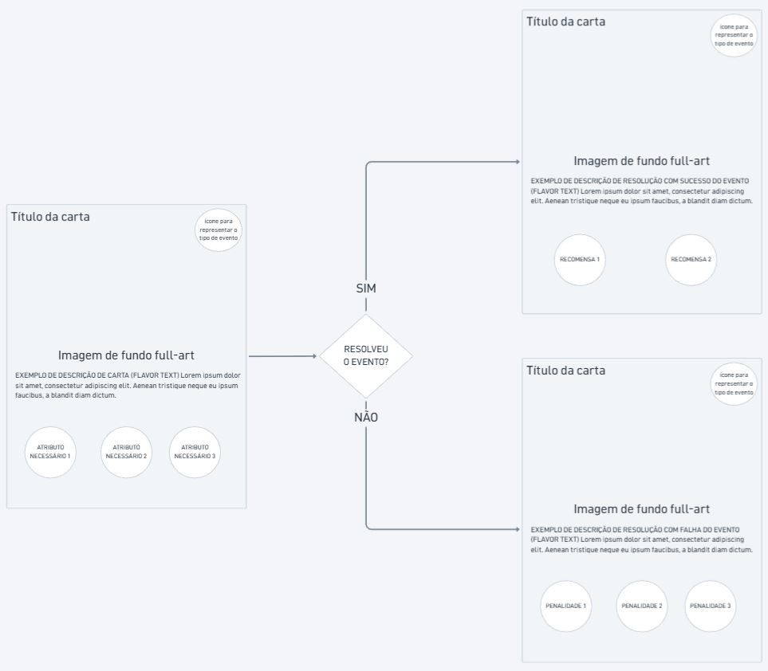

Eventos precisam ser resolvidos pelos jogadores para conseguir recompensas. Alguns tipos de eventos são (podem existir mais no futuro):
- **Evento aleatório**: um desafio com requisitos a cumprir;
- **Evento de combate**: um combate contra um ou mais [inimigos](#18-inimigos) (veja [Sistema de combate](#19-sistema-de-combate)). Os inimigos **não são cartas à parte**: eles estão **impressos dentro da própria carta de evento de combate**, com todos os seus dados (ex.: "2× Lobo Cinzento, 1× Lobo Alfa", cada um com vida, modificadores, habilidades, etc.; veja [18.1](#181-o-inimigo-na-carta-de-evento-de-combate)). Depois do combate, a carta de evento (com seus inimigos) vai para a pilha de descarte de eventos.

### 14.1 A carta de evento

Ao usar **Iniciar evento**, compra-se uma carta do **deck de eventos da zona**, que é revelada ao jogador. A carta contém:
- **Título**;
- **Flavor text**;
- **Requisitos de resolução**;
- **Coisa boa**: o que acontece se o jogador resolver o evento;
- **Coisa ruim**: o que acontece se o jogador não resolver;
- opcionalmente, o símbolo **Sem fuga** (veja [14.5](#145-fugir-de-um-evento-aleatório)).

Na **carta de evento de combate**, o requisito de resolução é **vencer o combate**: a **coisa boa** são as recompensas por derrotar os inimigos e a **coisa ruim** são as penalidades para quem for nocauteado por eles. Os inimigos (com seus dados) também estão na carta.

Observações:
- No **evento aleatório**, o jogador **não é obrigado** a resolver o evento. Ele pode simplesmente aceitar a coisa ruim.
- No **evento de combate**, o jogador **não pode recusar** o combate: as únicas saídas são **lutar** ou **tentar fugir** ([15](#15-teste-de-fuga)).
- Nem sempre resolver dá algo ao jogador: às vezes, resolver apenas **evita a coisa ruim**.
- A coisa boa e a coisa ruim são **efeitos** (capítulo [13](#13-efeitos)) e **devem ser ativadas** por padrão.

### 14.2 Requisitos de resolução

Um evento pode exigir um ou uma combinação de dois ou mais dos requisitos abaixo. Eles funcionam como os **custos** de efeitos (veja [13.2](#132-custo-opcional) para exemplos de cada um):
- **Atributos**: uma combinação de atributos específicos, um único atributo específico ou um atributo genérico;
- **Doar vida** (pagar com pontos de vida);
- **Descartar carta de atributo**;
- **Abdicar de equipamento**;
- **Pagar ouro**;
- **Oferecer recurso do inventário**;
- **Manipulação de cartas**, como nos exemplos do custo de mesmo nome. Exemplo: "Para resolver, coloque 3 cartas da sua mão no fundo do deck";
- **Gastar Vigor**, ou ter **Pico/Vigor mínimo**;
- **Modificador mínimo** (ex.: ter Esquiva 80 ou mais).

**Pagamento tudo ou nada:** os requisitos são pagos **todos de uma vez**, num único pagamento. Não existe pagamento parcial: ou o jogador paga tudo e resolve o evento, ou não paga nada.

### 14.3 Fases do evento

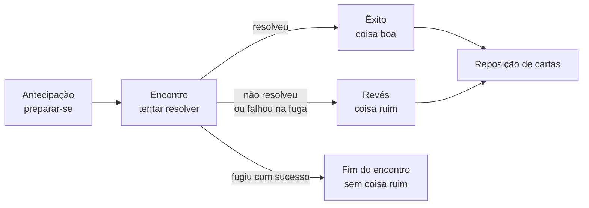

| Fase | Quando acontece |
|---|---|
| **Antecipação** | Antes de a carta de evento ser revelada. |
| **Encontro** | O jogador tenta (ou não) resolver o evento. |
| **Êxito** | Depois de o evento ser resolvido com sucesso: o jogador recebe benefícios, buffs, itens e/ou recompensas (ou apenas evita a coisa ruim). |
| **Revés** | Depois de o evento não ser resolvido: o jogador sofre as penalidades da carta. |

**Antecipação:** é a fase para **se preparar** para o evento. Nela, o jogador pode ativar efeitos e habilidades (pagando seus custos), inclusive efeitos com gatilho "na fase de antecipação". Exemplos: olhar a carta do topo do deck de eventos e decidir se a compra ou a manda para o fundo; ganhar +1 em todos os atributos para este evento.

Durante o encontro, o jogador pode tentar **fugir** (veja [14.5](#145-fugir-de-um-evento-aleatório)).

### 14.4 Reposição de cartas

Esta regra vale para **todo evento aleatório**, inclusive os que aparecem dentro de missões. Ao terminar o evento (depois do êxito ou do revés), o jogador **compra imediatamente** do deck de atributos **a mesma quantidade de cartas de atributo** que jogou para tentar resolver o evento.

| Exemplo | O que aconteceu | Compra cartas? |
|---|---|---|
| 1 | Pagou os requisitos com 4 cartas e resolveu o evento → as 4 cartas vão para a pilha de descarte de atributos → êxito encerrado. | **Sim, 4** |
| 2 | Não pagou os requisitos e aceitou a coisa ruim → revés encerrado. | **Não** (nenhuma carta usada) |
| 3 | Não pagou os requisitos, tentou fugir e falhou → sofre as penalidades → revés encerrado. | **Não** (nenhuma carta usada) |
| 4 | Não pagou os requisitos, tentou fugir e **conseguiu** → não sofre penalidades → o encontro se encerra. | **Não** (nenhuma carta usada) |

Como o pagamento é tudo ou nada ([14.2](#142-requisitos-de-resolução)), na prática só o êxito gera reposição em eventos aleatórios.

As cartas descartadas como **custo de efeitos** durante o evento (não como requisito) **não** são repostas. Só as cartas usadas para cumprir os requisitos do evento são repostas.

### 14.5 Fugir de um evento aleatório

A fuga usa o [teste de fuga](#15-teste-de-fuga). No evento aleatório, ela tem estas regras extras:
- Se a fuga **falhar**, além da coisa ruim, o jogador **perde 1 ponto de ação**. Se ele estiver com **0 pontos de ação**, a perda fica **acumulada** e ele perde 1 ponto na **próxima vez**.
- Eventos com o símbolo **Sem fuga** não permitem fuga. O texto da carta também diz que não é possível fugir.

---

## 15. Teste de fuga

Esta é a **fonte única** das regras de fuga; os capítulos de evento e combate só acrescentam as consequências específicas.

- O teste de fuga pode acontecer durante um **evento**, um **combate** ou em **outras situações** indicadas por cartas.
- **Custo:** tentar fugir (de evento ou de combate) custa **20% do Pico** em Vigor, **arredondado para baixo**, com **mínimo de 1**, pago com ou sem sucesso (valor de teste, ajustável no laboratório). Sem Vigor suficiente, **não é possível** tentar (por isso, com Pico 0 não há fuga). Efeitos ou habilidades podem permitir **fuga automática** (sem pagar e sem rolar dados), se a carta disser.
- O jogador que quer fugir rola um **D20**.
- Por padrão, para fugir é preciso tirar **um número maior que 10**.
- Alguns eventos e combates têm um **valor mínimo de fuga** próprio.
- Efeitos/habilidades podem aumentar ou diminuir tanto o valor do dado quanto o valor mínimo de fuga. Energia, Pico e Vigor **não** influenciam o dado por padrão.

**Consequências da falha:**

| Onde | Falha |
|---|---|
| **Evento aleatório** | Sofre a coisa ruim e perde 1 ponto de ação (veja [14.5](#145-fugir-de-um-evento-aleatório)). |
| **Combate** | **Perde o turno de combate** e recebe um **ataque livre**: o primeiro inimigo que vem **depois dele** na ordem de Celeridade faz um **ataque básico** extra contra ele. Se ele for o último da ordem, a contagem **volta ao início** (o primeiro inimigo da ordem ataca). O combate continua. |

**Não é possível fugir:**
- de eventos com o símbolo **Sem fuga**;
- do combate contra o chefe final quando a Carta de Dimensão disser **Sem fuga** ([3.2](#32-conclusão-de-uma-dimensão)).

---

## 16. Elementos

Elementos têm relações de vantagem, desvantagem e neutralidade entre si. O elemento de um inimigo só importa **quando ele é atacado** (os ataques dele contra jogadores são sempre neutros). Eles influenciam o cálculo de dano e diversos outros cenários do jogo. Este capítulo vem antes de habilidades e combate porque os dois usam elementos.

### 16.1 Relações e efetividade

| Relação | Efeito padrão |
|---|---|
| **Vantagem** | +25% de efetividade contra o elemento |
| **Desvantagem** | −25% de efetividade contra o elemento |
| **Neutro** | Os elementos não têm relação entre si; a habilidade funciona normalmente. |
| **Sem elemento** | A habilidade não tem afinidade elemental; o resultado é sempre neutro. |

Exemplos: Fogo contra Água tem desvantagem. Fogo contra Elétrico é neutro. Uma habilidade sem elemento contra Água ou contra Fogo é neutra.

**Quem tem elemento:**
- **Habilidades** têm **0 ou 1 elemento**. Jogadores e inimigos usam o **mesmo conjunto** de habilidades e efeitos (os inimigos têm também uma pool exclusiva, [17.5](#175-habilidades-exclusivas-de-inimigos)): uma habilidade usada por um inimigo tem elemento da mesma forma que a de um jogador.
- **Inimigos** têm **0 ou 1 elemento**.
- O **ataque básico** (sem habilidade), de jogadores e de inimigos, **não tem elemento**.
- **Jogadores não têm elemento** (inclusive o Feiticeiro). Quando um jogador é atacado, o elemento do ataque é sempre neutro contra ele, salvo efeitos (ex.: "torne-se resistente ao elemento X").
- **Recursos e equipamentos não têm elemento.** Equipamentos podem dar **bônus de elemento**, um percentual de efetividade (ex.: "+10% de efetividade em habilidades de Fogo").
- **Zonas não têm elemento.**
- **Não existe multi-elemento** em nenhuma situação do jogo.

**O que é efetividade:** a efetividade é definida pela relação entre o **elemento do ataque** e o **elemento do inimigo** atingido. Ela é aplicada **uma única vez**, sobre o **dano final** (depois de Ataque − Defesa): +25% com vantagem, −25% com desvantagem. A Defesa do inimigo **não** é alterada pelo elemento.

```
Habilidade de Fogo  →  inimigo de Gélido   (Fogo tem vantagem)
Dano base 40 − Defesa 20 = 20   →   20 × 1,25 = 25 de dano
```

Bônus de equipamentos, efeitos e habilidades podem **aumentar ou diminuir** a efetividade de um elemento. Esses bônus **se somam** à vantagem/desvantagem num único fator, como os percentuais do pipeline (ex.: vantagem +25% e equipamento +10% → ×1,35).

### 16.2 Tabela de elementos

Novos elementos podem surgir no futuro. Toda vantagem de A sobre B corresponde a uma desvantagem de B contra A. **Equilíbrio:** todo elemento tem 2 ou 3 vantagens e 2 ou 3 desvantagens, e a diferença entre as duas quantidades é no máximo 1.

**Elementos básicos:** Terra, Água, Fogo, Ar, Gélido e Elétrico. Os demais são **elementos avançados**.

| Elemento | Descrição | Vantagem contra | Desvantagem contra |
|---|---|---|---|
| **Terra** | Rochas, minerais, areia, cristais e manifestações geológicas. Resistência, estabilidade e força. | Elétrico, Sônico, Ar | Orgânico, Água |
| **Água** | Água, líquidos, correntes, pressão e manipulação de fluidos. | Fogo, Tóxico, Terra | Elétrico, Gélido, Orgânico |
| **Fogo** | Chamas, calor, combustão, explosões e energia térmica. | Gélido, Cósmico | Água, Ar |
| **Ar** | Ventos, pressão atmosférica, tempestades e manipulação de gases. | Tóxico, Fogo | Terra, Elétrico |
| **Gélido** | Gelo, congelamento, baixas temperaturas e cristalização. | Água, Orgânico | Fogo, Sônico, Dracônico |
| **Elétrico** | Eletricidade, raios, magnetismo e descargas energéticas. | Água, Ar | Terra, Cósmico |
| **Orgânico** | Vegetação, raízes, fungos, flores e manifestações biológicas da natureza. | Terra, Água | Gélido, Tóxico, Dracônico |
| **Tóxico** | Venenos, toxinas, ácidos, contaminação e substâncias nocivas. | Orgânico, Sanguíneo | Água, Ar, Celestial |
| **Arcano** | Energia mágica, feitiços, runas, encantamentos e forças sobrenaturais. | Dracônico, Espiritual, Cósmico | Obscuro, Psíquico |
| **Obscuro** | Sombras, maldições, corrupção, trevas e energia negativa. | Psíquico, Arcano | Celestial, Espiritual |
| **Celestial** | Luz divina, bênçãos, energia sagrada, purificação e manifestações celestiais. | Obscuro, Tóxico | Sanguíneo, Cósmico |
| **Dracônico** | Poderes de dragões, sangue dracônico, sopros e energia ancestral. | Orgânico, Gélido | Arcano, Sanguíneo |
| **Cósmico** | Estrelas, gravidade, energia astral, dimensões, espaço e fenômenos cósmicos. | Elétrico, Celestial | Fogo, Arcano |
| **Sônico** | Vibrações, frequências, ondas sonoras e ressonância. | Psíquico, Gélido | Terra, Sanguíneo |
| **Psíquico** | Telepatia, telecinese, ilusões e manipulação mental. | Sanguíneo, Espiritual, Arcano | Obscuro, Sônico |
| **Sanguíneo** | Sangue, vitalidade, sacrifícios e manipulação biológica. | Celestial, Dracônico, Sônico | Tóxico, Psíquico, Espiritual |
| **Espiritual** | Espíritos, almas, aparições e manifestações espectrais. | Sanguíneo, Obscuro | Arcano, Psíquico |

**Mapa dos elementos básicos** (seta = "tem vantagem contra"):

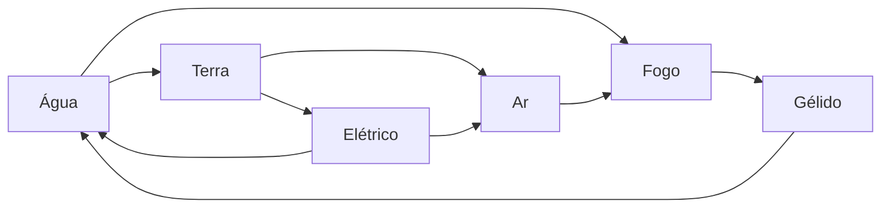

### 16.3 Afinidade elemental das classes

Cada classe tem **elementos de afinidade** (pode mudar no futuro). Habilidades desses elementos custam **10% menos Vigor**: custo final = custo × 0,9, **arredondando o custo para baixo**, com **mínimo de 1** quando o custo original for 1 ou mais (o desconto nunca deixa uma habilidade de graça). Especializações podem acrescentar elementos. A afinidade é da classe, não do jogador: ela **não** dá elemento ao jogador nem ao ataque básico.

| Classe | Afinidade | Especializações com afinidade própria |
|---|---|---|
| Guerreiro | Terra, Sanguíneo | Cavaleiro: + Celestial |
| Mago | Arcano | Necromante: + Obscuro; Elementalista: + os 6 elementos básicos |
| Ladino | Ar, Tóxico | Assassino: + Obscuro |
| Clérigo | Celestial, Espiritual | Exorcista: + Sônico |
| Patrulheiro | Orgânico, Ar | — |
| Druida | Orgânico, Terra, Água | Xamã: + Espiritual; Metamorfo: + Sanguíneo |
| Monge | Espiritual, Ar | Punho Elemental: + os 6 elementos básicos |
| Bardo | Sônico, Psíquico | — |
| Alquimista | Tóxico, Fogo | Transmutador: + Arcano |
| Artífice | Elétrico, Terra | Ferreiro Arcano: + Arcano |
| Bruxo | Obscuro | Demonologista: + Fogo; Abissalista: + Cósmico; Pactário: + Sanguíneo |
| Feiticeiro | Arcano | Dracônico: + Dracônico; Elemental: + os 6 elementos básicos; Celestial: + Celestial; Trevoso: + Obscuro |

Elementalista, Punho Elemental e Feiticeiro Elemental têm afinidade com **os 6** elementos básicos, sem limite nem custo (não há escolha).

**Multiclasse:** a afinidade do jogador é a **união** dos elementos de todas as classes e especializações ativas. O desconto **não se soma**: um elemento presente em duas classes (ex.: Arcano no Mago e no Feiticeiro) continua com um único desconto de 10%.

---

## 17. Habilidades

- **Para jogadores**, habilidades estão **vinculadas a equipamentos** de todas as categorias. **Inimigos** têm as habilidades impressas na carta de evento de combate em que aparecem (veja [18.1](#181-o-inimigo-na-carta-de-evento-de-combate)).
- Cada habilidade tem um **nome** e um ou mais **[efeitos](#13-efeitos)**.
- **Custo:** usar uma habilidade consome pontos de **Vigor** por padrão. Quanto mais forte a habilidade, mais Vigor ela custa. Algumas habilidades não consomem Vigor, e recursos, efeitos e outras habilidades podem reduzir ou aumentar o custo.
- Cada habilidade tem **0 ou 1 [elemento](#16-elementos)** e uma **forma** (detalhes em [17.4](#174-detalhe-das-formas)):

| Forma | Descrição |
|---|---|
| **Direcionada** | Atinge um alvo específico. |
| **Projétil** | Dispara algo em direção a um alvo. |
| **Área** | Afeta uma região e mais de um inimigo ao mesmo tempo. |
| **Contínua** | Permanece ativa por determinado período (exige ativação). |
| **Canalizada** | Exige concentração ou preparação: é preciso usar a habilidade algumas vezes antes de ela poder ser usada de fato. |
| **Passiva** | Funciona sem ativação manual. |

### 17.1 Anatomia de uma habilidade

Toda habilidade (impressa no equipamento ou no inimigo da carta de evento de combate) segue este modelo. Os efeitos das habilidades **não precisam de nome próprio**: o texto descreve o que acontece.

| Campo | Descrição | Exemplo |
|---|---|---|
| **Nome** | Nome da habilidade | *Corte Flamejante* |
| **Forma** | Uma das formas acima | Direcionada |
| **Elemento** | 0 ou 1 | Fogo |
| **Custo** | Vigor (padrão) + custos extras opcionais (cartas de atributo da mão, vida, ouro, etc.) | 20 Vigor + descarte 1 carta de Força |
| **Poder** | Valor somado ao Ataque quando a habilidade causa dano | +40 |
| **Efeitos** | Gatilho/custo/ativação/duração (capítulo [13](#13-efeitos)) | O alvo sofre 10 de dano no início de cada turno de combate dele, por 2 turnos de combate |
| **Recarga** | Quantos **turnos de combate do usuário** é preciso esperar até poder usar a habilidade de novo (0 = pode usar de novo no próximo turno). **Fora do combate**, a recarga conta em **vezes** do usuário | 1 (usa no turno 1, espera o turno 2, volta no turno 3) |
| **Momento de uso** | Em combate, fora de combate (via Preparar) ou ambos | Em combate |

A habilidade **não tem requisito de Pico próprio**: ela usa o **Requisito de Pico do equipamento** em que está (veja [7.3](#73-regras-da-energia)).

### 17.2 Regras de uso

1. Cada habilidade pode ser usada **uma vez por turno de combate por padrão** e, **fora do combate**, **uma vez por vez**, a menos que a própria habilidade diga o contrário (ex.: "pode usar esta habilidade até X vezes"). Depois de usada, ela respeita a **Recarga** (em turnos de combate dentro do combate; em vezes fora dele).
2. Várias habilidades **diferentes** podem ser usadas no mesmo turno, desde que o jogador pague todos os custos.
3. Habilidades que causam dano **não substituem** o ataque com a arma no fim do turno: elas causam um **dano extra**, e depois o jogador ainda tem direito ao seu ataque.
4. **Dano de habilidade:** usa **o mesmo cálculo do ataque** ([19.2](#192-cálculo-do-dano)), somando o **Poder** ao Ataque, e rola acerto conforme a forma ([17.4](#174-detalhe-das-formas)). O elemento da habilidade define a efetividade. Efeitos da habilidade que causam dano à parte (ex.: veneno contínuo) são **dano de efeito** ([19.2](#192-cálculo-do-dano)).
5. Habilidades de um equipamento **quebrado**, **anulado** ou com **Requisito de Pico** não cumprido não podem ser usadas.
6. **Fim do combate:** quando o combate termina, todos os efeitos com duração em **turnos ou ciclos de combate** terminam junto, e as **recargas** de todas as habilidades **zeram** (fora do combate, a habilidade já pode ser usada de novo).
7. **Início do combate:** ao começar um combate, as recargas também **zeram**; a contagem de recarga começa do zero dentro daquele combate. Uma recarga contada em vezes (fora do combate) **não** entra no combate.

Classes **não têm habilidades**: só equipamentos (e inimigos) têm. Classes e especializações têm **efeitos**, que podem alterar habilidades (ex.: "suas habilidades de Fogo causam +10% de dano"). Nem todo equipamento com restrição de classe precisa ter habilidades que causam dano; só os que fazem sentido para aquelas classes.
### 17.3 Restrições de classe

As duas formas abaixo podem existir, conforme a carta:
1. **Equipamento com restrição de classe** (ex.: "Só Mago, Bruxo, Feiticeiro"): quem não é dessas classes não pode equipá-lo.
2. **Habilidade com restrição de classe** (ex.: "Habilidade usável só por Guerreiro"): qualquer classe equipa o item e recebe os bônus de modificadores, mas só as classes indicadas (e **ativas**, veja [8.2](#82-a-trava-do-deck)) usam aquela habilidade.

Equipamentos sem restrição podem ser usados por qualquer classe.

### 17.4 Detalhe das formas

Os cálculos podem ser trocados no laboratório.

| Forma | Regra |
|---|---|
| **Direcionada** | Escolhe 1 alvo. Rola acerto normalmente (Precisão × Esquiva). |
| **Projétil** | Escolhe 1 alvo. Rola acerto com **+10% de Precisão** (percentual no modificador, etapa 3 do pipeline de [7.4](#74-escala-fórmulas-e-valores-iniciais)), mas um **escudo** do alvo reduz o dano pela metade (só afeta jogadores, porque inimigos não têm equipamentos; escudo **quebrado** não conta). |
| **Área** | Atinge **todos** os inimigos (ou todos os jogadores, se usada por inimigo). Dano em cada alvo é **metade** do normal. **Não rola acerto e não pode ser esquivada.** Para compensar, a maioria das habilidades de área deve ter alguma desvantagem ou ser **Canalizada**. |
| **Contínua** | Paga uma vez, fica ativa por N turnos de combate (ex.: aura que dá +2 Defesa). Só uma habilidade contínua ativa por equipamento. |
| **Canalizada** | Precisa ser "carregada" N vezes (cada carga usa a ação da habilidade no turno). Na carga final, dispara com efeito muito forte. Se o jogador sofrer, num único golpe, dano **maior que 20% da vida que tinha ao começar a canalização**, as cargas são perdidas (ajustável no laboratório); cada aplicação de **dano de efeito** ([19.2](#192-cálculo-do-dano)) também conta como um golpe. As cargas também se perdem no **fim do combate**, junto com as durações. |
| **Passiva** | Sem custo de ativação; vale enquanto o equipamento estiver em uso. Não conta como "usar uma habilidade" para gatilhos. |

### 17.5 Habilidades exclusivas de inimigos

- Além do conjunto de habilidades comum a jogadores e inimigos, existe uma **pool de habilidades exclusiva dos inimigos**, feita para **prejudicar o jogador**: por exemplo, habilidades que **quebram equipamentos** do jogador.
- **Só inimigos** usam efeitos e habilidades que **quebram equipamentos**. Equipamentos, recursos, classes e cartas de atributo dos jogadores **nunca** têm esse tipo de efeito, e as habilidades da pool exclusiva **nunca** podem ser colocadas em equipamentos de jogadores (nem por encantamento).

---

## 18. Inimigos

**Jogadores não têm raça** (ex.: elfo, orc, anão): essa mecânica pode ser implementada no futuro. Inimigos têm **tipo** e **criatura** (veja abaixo). O modelo do inimigo pode ser alterado no laboratório.

### 18.1 O inimigo na carta de evento de combate

**Inimigos não são cartas à parte.** Eles ficam **impressos dentro da carta de evento de combate** (e, nas missões que têm combate, dentro da carta da missão; o chefe final fica na Carta de Dimensão). A carta traz um bloco com os dados de cada inimigo do combate. A mesma criatura pode aparecer em cartas diferentes, inclusive com valores diferentes.

**Recompensas e penalidades** ficam na própria carta de evento de combate: a **coisa boa** (o que o jogador ganha ao vencer: ouro, recursos, compras do deck de recompensas da zona, Pico ou Vigor) e a **coisa ruim** (o que acontece com quem é nocauteado pelos inimigos dela).

Dados de cada inimigo impresso na carta:

| Campo | Descrição |
|---|---|
| **Nome** e **flavor text** | — |
| **Tipo** | Veja [18.2](#182-tipos-de-inimigo). Um inimigo pode ter **de 1 até todos** os tipos. |
| **Criatura** | Registro livre: o que o inimigo é. Pode ser qualquer coisa ou **qualquer mistura** de criaturas (ex.: "Goblin", "Rato-leão-pombo"). Criaturas são infinitas. Efeitos e habilidades podem interagir **especificamente** com uma criatura (ex.: "+20% de dano contra Goblins"). |
| **Categoria** | Veja [18.3](#183-categorias-de-inimigo). |
| **Elemento** | 0 ou 1. Define a efetividade dos ataques recebidos (veja [16.1](#161-relações-e-efetividade)). |
| **Vida** e **modificadores** | Ataque, Defesa, Precisão, Esquiva, Celeridade, Perfuração, Reflexão. Seus valores já são **finais** (o Pico não se aplica). Buffs e debuffs **percentuais** sobre um inimigo usam só a etapa 3 do pipeline ([7.4](#74-escala-fórmulas-e-valores-iniciais)): somam-se num fator aplicado ao valor impresso, arredondado para baixo. Como os do jogador, os modificadores do inimigo têm **piso 0**: debuffs fixos ou percentuais nunca os deixam negativos, e o fator percentual tem mínimo ×0. |
| **Habilidades** | As habilidades do inimigo ficam **impressas no bloco dele na carta** (inimigos não usam equipamentos). |
| **Energia** | Opcional: Vigor do inimigo para pagar habilidades. Habilidades também podem ter só recarga ou nenhum custo. |
| **Comportamento** | Perfil da IA: **Agressivo**, **Defensivo**, **Suporte** ou **Caçador**. Cada perfil define o alvo e o uso de habilidades (tabela em [19.6](#196-ia-dos-inimigos)). Inimigos **nunca fogem** do combate. |

Inimigos **não têm** classe, especialização, inventário nem **equipamentos**. Efeitos que quebram equipamentos **não funcionam** contra inimigos.

### 18.2 Tipos de inimigo

| Tipo | Exemplos |
|---|---|
| **Fera** | Lobos, ursos, aranhas gigantes |
| **Humanoide** | Bandidos, cultistas, soldados |
| **Morto-vivo** | Esqueletos, zumbis, liches |
| **Espírito** | Fantasmas, aparições |
| **Demônio** | Diabretes, demônios maiores |
| **Celestial** | Anjos caídos, guardiões divinos |
| **Elemental** | Golens de pedra, elementais de fogo |
| **Constructo** | Autômatos, armadilhas vivas |
| **Dracônico** | Dragões, wyverns, kobolds |
| **Aberração** | Entidades cósmicas, criaturas do abismo |
| **Planta** | Fungos, árvores carnívoras |

Os tipos (e as criaturas) servem para **gatilhos e efeitos** (ex.: "+3 de dano contra Mortos-vivos", "Espíritos ignoram sua Defesa") e para dar identidade às zonas (zonas Pantanosas com mais Plantas e Feras; Religiosas com Espíritos e Celestiais).

### 18.3 Categorias de inimigo

| Categoria | Onde aparece | Observação |
|---|---|---|
| **Comum** | Deck de eventos das zonas | Maioria dos combates |
| **Elite** | Deck de eventos (raro) | Mais forte, recompensa melhor |
| **Chefe** | Missões ou como carta de Chefe no deck de eventos da zona | **Chefe de evento:** **aparição única**: quando **qualquer** jogador o derrota, **nenhum outro** jogador pode derrotá-lo de novo naquela dimensão (a carta sai do jogo). **Chefe de missão:** é **por jogador**: cada jogador que faz a missão enfrenta o seu próprio chefe, e derrotá-lo não impede outro jogador. Uma dimensão pode ter vários chefes |
| **Chefe final** | Carta de Dimensão (opcional); enfrentado pela ação **Concluir dimensão** | Vencê-lo conclui a dimensão. Pode ser enfrentado de novo até ser vencido. Veja [3.2](#32-conclusão-de-uma-dimensão) |

---

## 19. Sistema de combate

Quando um **evento de combate** é revelado (ou uma missão ou a ação Concluir dimensão manda enfrentar inimigos), começa um combate. A regra base (1 jogador contra 1 inimigo) vale para todos os outros casos, que só acrescentam diferenças.

### 19.1 Combate 1 jogador × 1 inimigo (regra base)

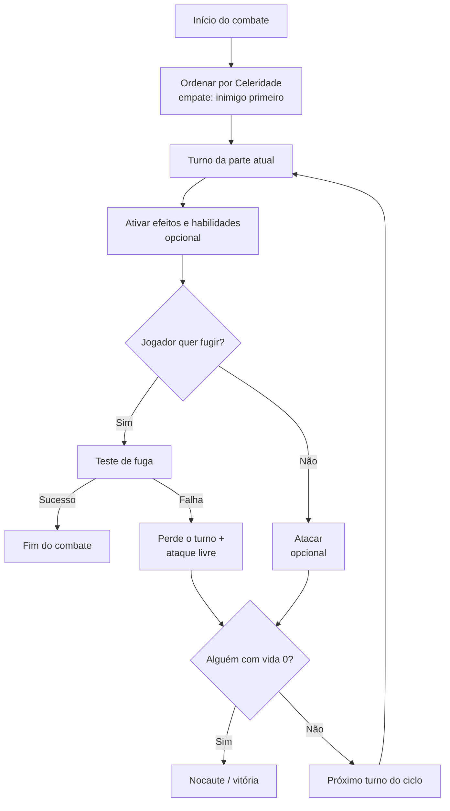

1. **Ordem de ataque:** pela **Celeridade**, da maior para a menor. Em caso de empate, o **inimigo tem prioridade** por padrão (efeitos, habilidades e itens podem mudar isso). A ordem é **recalculada no início de cada ciclo de combate** (mudanças de Celeridade no meio do ciclo só valem a partir do ciclo seguinte).
2. **Turnos de combate:** as partes se revezam, uma por vez. Quando todas jogaram, termina um **ciclo de combate** e começa o próximo.
3. **No seu turno de combate**, a parte pode ativar vários efeitos, habilidades, etc. **A última coisa do turno é o ataque**, que é **opcional**: o jogador pode encerrar o turno sem atacar. Efeitos, habilidades e builds também podem impedir o ataque.
4. **Resultado do ataque** (veja o cálculo em [19.2](#192-cálculo-do-dano)):
   - Ataque **igual ou menor** que a defesa → o oponente não toma dano.
   - Ataque **maior** que a defesa → o oponente perde vida igual à diferença.
   - Se o alvo **esquivar**, o ataque é um **"miss"** e o turno passa para o próximo atacante.
5. **Ataques múltiplos:** efeitos, habilidades e itens podem permitir atacar mais de uma vez, desde que suas condições sejam cumpridas e nenhum **efeito** ou **habilidade** impeça.
6. O inimigo segue a mesma lógica: ativa efeitos e habilidades e por fim ataca. Inimigos **não usam "cartas na mão"**: tudo é feito automaticamente pelo sistema.
7. **Quem chegar a 0 de vida primeiro é nocauteado.**
   - **Vitória do jogador:** recebe a coisa boa da carta de evento de combate e segue para a próxima ação, se ainda tiver pontos de ação.
   - **Derrota do jogador:** é [nocauteado](#20-nocaute-spawn-e-respawn) e sofre a coisa ruim da carta de evento de combate, se houver.
8. **Troca de equipamentos:** não é permitida durante o combate por padrão; efeitos, habilidades ou outros fatores podem mudar isso.
9. **Fuga:** o jogador pode tentar o [teste de fuga](#15-teste-de-fuga) no seu turno de combate.
   - **Sucesso:** o combate termina imediatamente.
   - **Falha:** o jogador **perde o turno de combate** e recebe um **ataque livre** (veja [15](#15-teste-de-fuga)). O combate continua.
10. **Limite de ciclos de combate:** todo combate tem no máximo **20 ciclos de combate** (ajustável no laboratório). O limite garante que todo combate termine, mesmo quando nenhum lado consegue causar dano, ninguém ataca ou ninguém pode fugir. Quando o último ciclo termina sem vencedor, os jogadores ainda de pé são tratados como se tivessem **fugido com sucesso** (perdem o Pico de "Fugir de um combate", [Apêndice A](#pico-por-fonte); não pagam o Vigor da fuga; não recebem recompensa nem sofrem a coisa ruim). Os nocauteados seguem as regras normais, e o resultado do combate segue a tabela de [19.5](#195-combate-com-2-ou-mais-jogadores--1-ou-mais-inimigos). Isso vale também para combates marcados **Sem fuga** (ex.: chefe final).

**Empates de Celeridade:** entre **jogadores** empatados, vale a **ordem dos jogadores** ([11.2](#112-ordem-dos-jogadores)); eles podem combinar outra ordem antes do primeiro ciclo de combate. Se o tempo de escolha acabar, vale a ordem dos jogadores. Entre jogador e inimigo, o inimigo tem prioridade (regra 1). Entre **inimigos**, vale a **ordem em que estão impressos na carta** (o primeiro impresso age antes).

### 19.2 Cálculo do dano

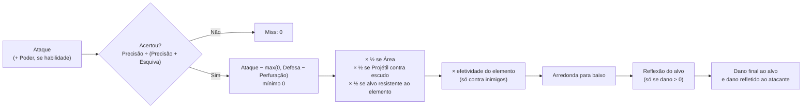

Ordem fixa: **acerto → Ataque − Defesa → ×½ (Área/escudo) → ×efetividade → arredonda para baixo → Reflexão.**

1. **Acerto:** chance (%) = Precisão ÷ (Precisão + Esquiva do alvo) × 100. Habilidades de Área não rolam acerto. Com Precisão 0, o ataque erra sem rolagem ([7.4](#74-escala-fórmulas-e-valores-iniciais)).
2. **Dano bruto:** Ataque (+ Poder da habilidade, se houver; calculado pelo pipeline de [7.4](#74-escala-fórmulas-e-valores-iniciais)) − **max(0, Defesa do alvo − Perfuração do atacante)**, mínimo 0. A Perfuração pode zerar a Defesa, mas nunca a deixa negativa.
3. **Metades:** se a habilidade for de **Área**, ×½; se for **Projétil** contra alvo com **escudo**, ×½ ([17.4](#174-detalhe-das-formas)); se o alvo for **resistente** ao elemento do ataque (efeito, [13.3](#133-ativação)), ×½. Todas podem se acumular (ex.: ×¼). Se o alvo for **imune** ao elemento do ataque, o dano é 0.
4. **Elemento:** se o alvo for um inimigo com elemento e o ataque tiver elemento, aplica-se a efetividade ([16.1](#161-relações-e-efetividade)).
5. **Arredondamento:** o dano é arredondado para baixo aqui.
6. **Reflexão:** se o dano for maior que 0, o alvo devolve ao atacante até o valor da sua Reflexão, e esse valor é subtraído do dano que o alvo recebe. Com dano 0, nada é refletido. O dano refletido vai **direto na vida** do atacante (ignora a Defesa dele) e **pode nocauteá-lo**.

**Nocaute simultâneo (Reflexão):** o dano principal resolve **antes** do dano refletido. Se o alvo cair com o ataque e o atacante também cair pela Reflexão, o atacante **vence** o combate (recebe a coisa boa) e **também** sofre o nocaute dele ([20.2](#202-nocaute)).

**Dano de efeito:** é todo dano que **não** vem de um ataque (básico ou de habilidade): o valor fixo de um efeito ("cause X de dano"), o dano contínuo (ex.: veneno, "sofre 10 de dano no início de cada turno de combate") e os consumíveis de dano (ex.: bombas). Numa habilidade, o dano principal (com o Poder) é ataque e segue o cálculo acima ([17.2](#172-regras-de-uso)); os efeitos dela que causam dano à parte (ex.: o veneno que fica no alvo) são dano de efeito. O dano de efeito **não** segue as etapas 1, 2, 3 (×½ de Área e de escudo) nem 6 acima:
- o valor da carta vai **direto na vida** do alvo: **não** rola acerto, **ignora** Defesa e Perfuração e **não** dispara Reflexão;
- se o efeito tiver elemento, aplicam-se só a **resistência** (×½) e a **imunidade** (dano 0) do alvo e a **efetividade** do elemento contra inimigos ([16.1](#161-relações-e-efetividade)); depois arredonda-se para baixo;
- "dano em Área" de efeito (ex.: bomba): **cada** alvo recebe o valor impresso, **sem** o ×½ (o ×½ é regra da forma Área das habilidades, [17.4](#174-detalhe-das-formas));
- conta como **dano recebido** para gatilhos e para a perda de cargas da Canalizada (cada aplicação conta como um golpe);
- o resultado do combate segue as regras normais: se o dano de efeito derrotar o último inimigo, o combate termina em **vitória**; se derrotar o último jogador de pé, em **derrota**.

Fórmulas em teste; podem mudar no laboratório.

### 19.3 Cartas de atributo no combate

No combate, as cartas de atributo da mão servem **só para pagar custos** de habilidades, efeitos e recursos que exigem cartas de atributo (e gatilhos que olham a mão).

- **Não existe reforço:** o jogador **não** descarta cartas da mão para aumentar Ataque, Defesa ou qualquer outro modificador. Os modificadores só mudam por Pico, equipamentos, refino, efeitos e habilidades.
- **Sem reposição no combate:** como as cartas usadas no combate são sempre pagamento de custo, elas **não** são repostas ao fim do combate (veja [14.4](#144-reposição-de-cartas)).

### 19.4 Combate 1 jogador × 2 ou mais inimigos

Segue a regra base, com duas diferenças:
- No seu turno de combate, o jogador **escolhe qual inimigo atacar**.
- As recompensas só são entregues depois de **todos os inimigos** serem derrotados.

### 19.5 Combate com 2 ou mais jogadores × 1 ou mais inimigos

**Quem pode entrar:** se um jogador inicia um evento de combate (ou um combate de missão, [21.1](#211-regras-gerais)) e há outros jogadores na mesma zona, ele pode **recrutá-los** para ajudar. Não há limite de ajudantes. O convidado **pode recusar**, e o convite só pode ser feito **antes do primeiro ciclo de combate**; ninguém entra depois que o combate começou.

**Custo e recompensas:**
- Só o **jogador que iniciou o combate** gasta ponto de ação. Os ajudantes não perdem pontos de ação.
- Só o **jogador que iniciou** recebe os itens e recompensas.
- **Ajudantes:** cada ajudante que termina o combate **de pé** ganha o **mesmo Pico** calculado para quem iniciou (o valor da carta, se ela disser; senão, o padrão do [Apêndice A](#pico-por-fonte)) e o **mesmo Vigor**, se a carta der Vigor. **Não existe ganho padrão de Vigor:** Vigor só é ganho quando a carta diz um valor.
- **Exceção:** se quem iniciou fugir, ou for nocauteado e não for ressuscitado até o fim, e os outros vencerem, as recompensas são **divididas entre os sobreviventes**:
  - **ouro:** dividido igualmente, arredondado para baixo (o resto se perde);
  - **cartas** (itens, recursos, compras do deck de recompensas): compradas e escolhidas **uma por vez**, em **rodízio** por ordem de Celeridade (da maior para a menor; empates seguem a regra de empate entre jogadores de [19.1](#191-combate-1-jogador--1-inimigo-regra-base)), até acabarem.
- Isso cria uma dinâmica no combate: alguns jogadores podem fugir por conta própria, enquanto outros podem querer ficar e vencer para levar as recompensas.

**Nocaute durante o combate:**
- O jogador nocauteado **não é teletransportado** imediatamente, porque outros jogadores podem **ressuscitá-lo** com itens, efeitos, habilidades, etc.
- Enquanto está nocauteado, ele **não joga** seu turno de combate (apenas assiste).
- **Revivido = como se não tivesse caído:** quem é ressuscitado antes do fim do combate **não** sofre nenhuma penalidade do nocaute (não perde Pico, não perde a próxima vez, não vai para o respawn) e participa do resultado do combate normalmente.
- Se o combate terminar **com vitória** e algum jogador ainda estiver nocauteado, ele vai para o respawn e **não sofre** a coisa ruim da carta de evento de combate, mas sofre as consequências normais do nocaute: **perde Pico** e **perde a próxima vez** ([20.2](#202-nocaute)).

**Fuga em grupo:**
- Cada jogador tenta o teste de fuga **um por vez**, no seu turno de combate.
- Falhar na fuga faz o jogador **perder o turno de combate** e receber um **ataque livre** do inimigo.
- Quem foge com sucesso sai do combate e não joga mais nele.

**Resultado do combate:**

| Situação | Resultado | Penalidades dos inimigos |
|---|---|---|
| Os jogadores derrotam todos os inimigos | **Vitória** | Ninguém sofre |
| **Todos** os jogadores fogem com sucesso | **Fuga com sucesso** | Ninguém sofre |
| Nenhum jogador restante de pé (todos fugiram ou foram nocauteados) e pelo menos um nocauteado | **Derrota** | Só os **nocauteados** sofrem |

Quem fugiu com sucesso não sofre as penalidades dos inimigos, mas pode sofrer penalidades de outros fatores (efeitos, etc.).

**Exemplo:**
1. Participantes: jogadores A, B e C; inimigos A, B, C e D.
2. Ordem por Celeridade: jogador A → inimigo C → inimigo A → jogador C → jogador B → inimigo D → inimigo B.
3. Os jogadores percebem que não vão vencer e decidem fugir.
4. O jogador A tenta fugir e falha: perde o turno e recebe um ataque livre. O inimigo C faz o ataque livre; depois C e A jogam seus turnos normais, e o jogador A chega a 0 de vida (nocauteado). O jogador C tenta fugir e falha: perde o turno e recebe um ataque livre, ficando com pouca vida. O jogador B foge com sucesso e sai do combate.
5. No **ciclo de combate** seguinte, os inimigos nocauteiam o jogador C antes de ele conseguir fugir.
6. Resultado: **derrota**. Os jogadores A e C (nocauteados) sofrem as penalidades dos inimigos; o jogador B não.

**Não é permitido negociar** entre jogadores durante um combate. **Nada** pode alterar essa regra.

### 19.6 IA dos inimigos

O sistema controla os inimigos em combate. O campo **Comportamento** de cada inimigo na carta ([18.1](#181-o-inimigo-na-carta-de-evento-de-combate)) define o perfil que a IA segue. **Inimigos nunca revivem** (nem a si mesmos nem outros inimigos).

| Perfil | Alvo do ataque e das habilidades de dano | Uso de habilidade |
|---|---|---|
| **Agressivo** | O jogador com **menor Defesa** | A de **maior Poder** disponível |
| **Defensivo** | O jogador que o **atacou por último**; se ninguém o atacou ainda, o de **menor Defesa** | Prioriza **buffs em si e habilidades Contínuas**; senão, a de maior Poder disponível |
| **Suporte** | O jogador com **menor Defesa** (como o Agressivo) | Prioriza **cura ou buff num inimigo aliado ferido**; se não houver aliado ferido ou habilidade de suporte disponível, age como o Agressivo |
| **Caçador** | O jogador com **menor vida atual** | A de **maior Poder** disponível |

**Regras comuns a todos os perfis:**
- **Habilidade disponível** = sem recarga pendente, com o custo pagável (Vigor do inimigo, se houver) e sem efeito que a impeça. O inimigo usa **no máximo uma** habilidade por turno de combate, salvo se a carta disser outra coisa.
- Depois da habilidade (ou sem ela), o inimigo **sempre** faz o **ataque básico** no alvo do seu perfil, se puder atacar.
- Habilidades de **Área** atingem todos os jogadores; o alvo não importa.
- Só são alvos os jogadores **de pé** no combate (nocauteados e quem fugiu não contam).
- **Desempates** (fixos, para o resultado ser sempre o mesmo): entre jogadores, vale a **ordem dos jogadores** ([11.2](#112-ordem-dos-jogadores)); entre habilidades, vale a **ordem em que estão impressas** no bloco do inimigo; entre inimigos aliados (Suporte), vale o de **menor vida atual** e, se empatar, a ordem impressa na carta.
- Os perfis e seus critérios são ajustáveis no laboratório. A carta pode trazer uma regra própria de alvo ou de habilidade, que vale sobre o perfil (regra 1 do [Apêndice B](#apêndice-b--decisões-registradas)).

---

## 20. Nocaute, spawn e respawn

### 20.1 Spawn e respawn

- **Spawn** e **respawn** são o mesmo ponto do mapa:
  - **spawn** é onde o jogador aparece no mundo **pela primeira vez** (escolhido na [preparação](#101-passo-a-passo));
  - **respawn** é onde o jogador **reaparece depois de ser nocauteado**.
- A ação **Salvar ponto de respawn** muda esse ponto para a zona atual. Só zonas **Urbanas** têm essa ação.

### 20.2 Nocaute

Quando o jogador chega a **0 pontos de vida**, ele é **nocauteado**:
1. Volta para o seu **ponto de respawn** com **10% da vida máxima** (calculada já com o novo Pico; arredondado para baixo, mínimo 1; ajustável no laboratório).
2. Perde as **ações restantes** da vez e a sua **próxima vez**.
   - **Jogo solo:** jogando **sozinho**, a regra muda (veja o quadro abaixo). "Sozinho" = partida com **1 participante** (um grupo com [ajudantes de IA](#281-campanha) **não** conta como sozinho e segue a regra normal).
3. Sofre as penalidades da coisa que o nocauteou, se houver (por exemplo, a coisa ruim da carta de evento de combate).
4. Perde Pico (padrão: −10%, mínimo 1, arredondado para baixo) e volta com Vigor igual ao **menor** valor entre o Vigor que tinha e **50% do novo Pico** (veja [7.3](#73-regras-da-energia)).

**Nocaute no jogo solo** (partida com 1 participante). Perder a próxima vez não tem sentido quando não há outros jogadores, então ela é trocada por isto:
1. A **vez atual termina** (os pontos de ação restantes são perdidos), como no item 2.
2. **O tempo passa:** em vez de "pular a próxima vez", **uma rodada avança automaticamente** sem o jogador agir. Tudo o que conta por rodada ou por vez anda normalmente (decaimento das vitrines do mercado no fim da rodada, durações e recargas fora do combate). Depois disso, o jogador joga a vez seguinte normalmente.
3. **Penalidade extra do solo:** o jogador perde **10% do ouro da bolsa** (arredondado para baixo; o ouro do cofre não é afetado). O ouro perdido some.
4. Os itens 1, 3 e 4 acima (respawn com 10% da vida, penalidades da coisa que nocauteou e perda de Pico) valem normalmente.

> **Sem auto-reviver:** não existem efeitos, habilidades ou recursos que façam o próprio jogador voltar sozinho ao chegar a 0 de vida (ex.: "quando você chegar a 0 de vida, volte com X"). Só outros jogadores podem reviver alguém, onde a regra permitir.

> Em combates com vários jogadores, o nocauteado só é teletransportado ao fim do combate (veja [19.5](#195-combate-com-2-ou-mais-jogadores--1-ou-mais-inimigos)).

---

## 21. Missões

### 21.1 Regras gerais

- Missões são encontradas em algumas zonas. Nem toda zona tem missões.
- Algumas missões envolvem recolher itens, falar com um NPC, etc.
- Ações relacionadas: **Pegar**, **Continuar** e **Finalizar missão**. Quando o jogador chega a uma zona que tem uma etapa de uma missão de zona que ele já pegou, ele interage para continuar ou finalizar a missão. Missões de zona de várias etapas indicam em que tipo de zona fica cada etapa.
- **Tipos de zona:** missões de zona fazem parte da coleção da dimensão e só citam tipos de zona que existem nela (todas as zonas da dimensão entram no mapa, [3.5](#35-montagem-do-mapa)). As missões de provação e do mentor são **genéricas** e não citam tipo de zona ([Missões genéricas](#missões-genéricas-provação-e-mentor)).
- **Onde ficam as cartas:** cartas de missão pegas e **itens de conclusão** ([3.2](#32-conclusão-de-uma-dimensão)) **não ocupam slot**: ficam numa **área própria** do jogador, separada do inventário, da pasta e do cofre.
- **Limite:** cada jogador pode ter no máximo **3 missões em aberto** ao mesmo tempo, somando missões de zona, de provação e do mentor (ajustável no laboratório). Dessas, no máximo **1** pode ser genérica (provação **ou** mentor, [Missões genéricas](#missões-genéricas-provação-e-mentor)).
- **Não são obrigatórias:** se o jogador pegar uma missão e não cumpri-la, nada acontece. A missão fica em aberto até ele cumpri-la ou abandoná-la.
- **Abandonar missão:** ação **gratuita** e universal ([12.2](#122-lista-de-ações-padrão)), usada **na própria vez** e **fora de combate**, em qualquer zona. O jogador escolhe uma missão em aberto e desiste dela, sem receber nada e sem perder Pico. A vaga no limite de missões é liberada na hora.
  - **Missão de zona:** a carta volta para o **fundo** do deck de missões da zona de onde veio (outro jogador pode pegá-la mais tarde, quando ela voltar ao quadro).
  - **Missão de provação:** pode ser pega de novo depois, em qualquer zona Urbana ou Habitada, cumprindo os requisitos.
  - **Missão do mentor:** o **ouro pago é perdido**; para tentar de novo, o jogador usa Treinar com mentor e paga outra vez ([8.4](#84-como-se-tornar-multiclasse)).
  - O progresso das etapas já feitas é **perdido**: se pegar a mesma missão de novo, começa do início.
  - Abandonar **não** conta como completar: a missão pode ser completada mais tarde (regra "Não se repetem").
- **Missões são individuais:** a missão fica atrelada ao jogador que a pegou e só ele pode finalizá-la.
- **Não se repetem:** cada jogador só pode completar a mesma **missão de zona** **uma vez por dimensão** (uma dimensão nunca é jogada de novo, [3.2](#32-conclusão-de-uma-dimensão)). As missões de **provação** e do **mentor** **não** seguem essa regra: podem ser completadas de novo, na mesma dimensão, sempre que o jogador cumprir os requisitos delas ([8.3](#83-como-obter-uma-especialização), [8.4](#84-como-se-tornar-multiclasse)). Os próprios requisitos já impedem repetição sem sentido (a provação exige uma classe primária sem especialização; o mentor exige especialização em todas as classes primárias).
- Missões em aberto ao sair de uma dimensão são canceladas.
- **Combate em missão:** combates de missão (inimigos impressos na carta da missão, [18.1](#181-o-inimigo-na-carta-de-evento-de-combate)) seguem [19.5](#195-combate-com-2-ou-mais-jogadores--1-ou-mais-inimigos): o recrutamento é permitido, mas **só o dono da missão** avança a etapa. Se o combate terminar em **vitória**, a etapa do dono é **concluída**, mesmo que ele esteja **nocauteado** no fim (como o chefe final, [3.2](#32-conclusão-de-uma-dimensão)); nesse caso ele sofre o nocaute normal ([20.2](#202-nocaute)) e as recompensas do combate seguem a divisão entre sobreviventes de 19.5. A etapa depende **só do resultado do combate** (tabela de [19.5](#195-combate-com-2-ou-mais-jogadores--1-ou-mais-inimigos)): se o **dono fugir** e os ajudantes vencerem, o resultado é **vitória** e a etapa é concluída, como no chefe final ([3.2](#32-conclusão-de-uma-dimensão)). Na **derrota** ou na **fuga com sucesso** (resultado do combate: todos fugiram), a etapa não é concluída, a missão continua em aberto e pode ser tentada de novo.
- Ao concluir uma missão, o jogador pode receber recompensas (inclusive do [deck de recompensas](#34-o-que-uma-carta-de-zona-contém)) e **Pico**.

### 21.2 Tipos de missão

| Tipo | Onde fica | Quem pode pegar |
|---|---|---|
| **Missão de zona** | No **deck de missões** da zona | **Exclusiva**: só o jogador que pegou (veja o quadro abaixo) |
| **Missão de provação** (especialização) | Genérica, fora do deck; pega em qualquer zona Urbana ou Habitada | **Qualquer** jogador que cumpra os requisitos ([8.3](#83-como-obter-uma-especialização)) |
| **Missão do mentor** (multiclasse) | Ação Treinar com mentor | **Qualquer** jogador que cumpra os requisitos ([8.4](#84-como-se-tornar-multiclasse)) |

**Quadro de missões (missões de zona):**

```
Deck de missões da zona          Quadro (visível ao entrar na zona)
┌──────┐                         ┌──────┐ ┌──────┐ ┌──────┐
│ ???? │ ──── repõe ──────────►  │  M1  │ │  M2  │ │  M3  │
└──────┘                         └──────┘ └──────┘ └──────┘
                                     │ jogador pega M2
                                     ▼
                                 M2 sai do quadro → vai para o jogador
                                 a carta do topo do deck ocupa o lugar
```

1. Cada zona com missões tem um **deck de missões** pequeno. As **3 primeiras** cartas ficam viradas para cima no **quadro de missões**, visíveis a quem estiver na zona.
2. Ao **pegar** uma missão, o jogador tira a carta do quadro: ela passa a ser dele, e nenhum outro jogador pode pegá-la. A carta do topo do deck de missões repõe a vaga.
3. Ao **concluir** a missão, a carta sai do jogo nessa partida.
4. Ao **abandonar** a missão, a carta vai para o **fundo** do deck de missões da zona. Se o quadro estiver com vaga (deck vazio), ela entra direto no quadro.

**NPCs:** NPCs **não são uma mecânica**. São apenas **flavor text** ou uma lógica calculada automaticamente pelo jogo. "Falar com o NPC X na zona Y" = usar a ação **Continuar missão** na zona Y. Mercado, ferreiro e mentor também são mecânicas do jogo; qualquer "personagem" neles é só flavor text.

---

## 22. Raides (fora do escopo atual)

As **raides foram removidas do jogo por enquanto**, para simplificar a implementação. Elas serão desenhadas e implementadas mais tarde. Até lá, **não existem** raides, a ação "Iniciar raide", a Raide Final, cooldowns de raide nem efeitos, recompensas ou valores ligados a elas. A numeração do capítulo foi mantida para não quebrar as referências do documento.

---

## 23. Negociação

- Acontece entre **dois jogadores na mesma zona**.
- **Não gasta ponto de ação** de nenhum dos jogadores.
- Só o jogador **da vez** pode convidar outro para negociar; o convidado pode aceitar e negociar fora da sua vez (veja [11.4](#114-agir-fora-da-vez)).
- O relógio da vez fica **pausado** durante a negociação.
- Não há limite de coisas negociadas de cada lado (respeitando o espaço de quem recebe, inclusive a capacidade da bolsa de ouro).
- **O que pode ser negociado:** **ouro**, coisas do **inventário**, cartas da **pasta de TCG** e **itens de conclusão** ([3.2](#32-conclusão-de-uma-dimensão)). Cartas da mão, do deck, da pilha de descarte e equipamentos em uso não podem ser negociados.
- O **conteúdo** da montaria (inventário e pasta extras) pode ser negociado; a **montaria** em si, não.
- Algumas zonas têm efeitos que **proíbem** a negociação.
- **Nunca** é permitido negociar durante um combate.

---

## 24. Mercado

O mercado aparece em algumas zonas e permite **comprar e vender** recursos, cartas e boosters. Compras só são possíveis se houver espaço: recursos e boosters no **inventário**, cartas de atributo na **pasta de TCG**; em ambos os casos o espaço da montaria também conta ([6.6](#66-recompensas-e-falta-de-espaço)).

O mercado tem **três vitrines**:

```
┌──────────────────────┬──────────────────────┬──────────────────────┐
│ ESTOQUE              │ BOOSTERS             │ SINGLES              │
│ ilimitado            │ ilimitados           │ 4 slots, estoque     │
│ poções, munição...   │ 30 ouro              │ limitado e "vivo"    │
│ preço da carta ×     │ coleções vigentes    │ (nem todo mercado)   │
│ fator do mercado     │                      │                      │
└──────────────────────┴──────────────────────┴──────────────────────┘
```

### 24.1 Compra no estoque

- O **estoque** vende recursos comuns (poções, munição, materiais básicos, ferramentas, etc.). Todo item do estoque é uma **carta**.
- Mercados de zonas diferentes podem oferecer recursos **iguais** e recursos **exclusivos**. O jogador precisa explorar vários mercados para encontrar o que procura. Os itens do estoque de cada mercado estão **listados na carta de zona** ([3.4](#34-o-que-uma-carta-de-zona-contém)).
- O estoque é **ilimitado**: não há limite de compra de um item do estoque.
- O estoque vende **só** consumíveis, materiais básicos e ferramentas. **Não vende** equipamentos, relíquias, tesouros, documentos nem montarias (equipamentos vêm de boosters, singles, recompensas e do ferreiro).
- Coisas essenciais, como **munição e poções**, existem em todos os mercados.
- **Preço do estoque** = **preço base impresso na carta × fator do mercado** ([24.4](#244-singles)), arredondado para cima. Não há fator de escassez (o estoque não acaba). Valores de referência (ajustáveis no laboratório):

| Item de estoque (exemplo) | Preço base (ouro) |
|---|---|
| Munição (10 cartas por compra) | 3 |
| Poção de vida pequena | 6 |
| Poção de Vigor pequena | 8 |
| Antídoto / remédio simples | 5 |
| Material básico (minério, couro, erva) | 4 |
| Ferramenta (picareta, vara de pesca, foice) | 20 |

**Munição:** é comprada no **mercado**. **1 carta de munição = 1 unidade**; cada compra no estoque entrega **10 cartas** de munição (que se empilham num slot). Uma habilidade que consome "X de munição" gasta X cartas (vão para o limbo, [6.5](#65-pilhas-de-descarte-e-limbo)). Na venda, a munição só pode ser vendida em **lotes de 10 cartas**; cada lote vale 50% do preço base de uma compra (arredondamento de [24.2](#242-venda-pelo-jogador)). Cartas avulsas (menos de 10) não podem ser vendidas. Armas como arcos, pistolas, etc. têm **habilidades** que consomem uma quantidade **X de munição**, que depende de cada habilidade. O **ataque básico** dessas armas **não** gasta munição; só as habilidades gastam. Sem munição, a habilidade não pode ser usada, mas o ataque básico continua.

### 24.2 Venda pelo jogador

- **Preço tabelado:** todos os mercados pagam a **mesma quantia** pelo mesmo recurso. Nenhum mercado paga mais que outro por padrão (sem fator do mercado nem de escassez).
- **Cartas de coleção** (cartas obtidas em boosters, singles e recompensas): vendidas por **50% de (preço base da raridade × ajuste da carta)** (veja [24.4](#244-singles)).
- **Cartas do estoque** (poções, munição, etc.): vendidas por **50% do preço base impresso na carta**.
- **Carta que é de estoque e de coleção ao mesmo tempo** (ex.: uma poção que também veio num booster): vale sempre a regra do **estoque** (50% do preço base impresso). Como ela pode ser comprada sem limite no estoque, vendê-la pela regra de coleção daria lucro sem risco.
- **Tesouros** (categoria Tesouros): existem para virar ouro, então são vendidos por **100% do valor impresso** na carta. Tesouros **só** são obtidos como recompensa do jogo (eventos, missões, inimigos, deck de recompensas); **nunca** aparecem em boosters, singles ou estoque. Valores de referência por raridade (ajustáveis no laboratório): Comum 10, Incomum 25, Rara 60, Épica 150, Lendária 400.
- **Boosters fechados:** vendidos por **15 ouro** (50% do preço tabelado de 30).
- **Relíquias:** seguem a regra das cartas de coleção (50% de preço base da raridade × ajuste da carta).
- **Refino e encantamentos valorizam o equipamento:** o preço de venda de um equipamento é multiplicado por **(1 + 0,08 × nível de refino + 0,20 × encantamentos ativos)**. Ex.: equipamento +5 com 1 encantamento → ×1,60. A conta é feita antes da redução por marcas de reparo. Encantamentos **desligados** (refino abaixo do requisito) não contam. Valores ajustáveis no laboratório. (Assim o jogador recupera parte do que investiu. Em equipamentos muito caros, os primeiros níveis podem dar um lucro pequeno; isso é **aceito** e será calibrado no laboratório.)
- **Equipamentos quebrados** valem **0**. Cada marca de reparo reduz o preço de venda em **12%** (veja [5.1](#51-equipamentos)).
- Efeitos, habilidades e recursos do jogador podem fazer o mercado oferecer **mais ouro**.
- **Bolsa cheia:** a venda é permitida mesmo que o ouro ultrapasse a capacidade da bolsa; o excesso é **perdido** ([5.3](#53-dinheiro)).
- **Arredondamento da venda:** para **baixo**, com **mínimo de 1 ouro** para qualquer carta que não esteja quebrada nem com preço reduzido a 0 por marcas de reparo. Assim o mercado nunca paga mais do que a regra diz e nenhuma carta válida vale 0.

### 24.3 Boosters

- Todos os mercados têm **boosters ilimitados** das [coleções](#27-coleções) vigentes.
- O preço do booster é **sempre tabelado** (**30 ouro**), mas efeitos, buffs e habilidades podem dar desconto.
- Um booster contém **cartas novas de recursos e de atributos**. Boosters **nunca** contêm **montarias** (veja [26](#26-montarias)) nem **tesouros**, e **jamais** contêm **outros boosters**. Os recursos do booster servem para montar a build do personagem.
- Boosters também podem ser **recompensas** (eventos, missões, inimigos, deck de recompensas).
- Um booster fechado é um **recurso** (categoria Boosters, [5.2](#52-itens)): fica no **inventário**, ocupa slot e se empilha com boosters iguais.
- Boosters fechados podem ser **vendidos**, **negociados** e **oferecidos** como custo.

**Abrir um booster:**
- **Abrir** só é possível dentro das ações **Preparar** ou **Usar cofre**.
- Dentro de **Preparar**, as cartas de **atributo** vão para a **pasta de TCG** e as de **recurso** vão para o **inventário**. O jogador **só pode abrir** o booster se a pasta de TCG (ou o espaço da montaria, [6.6](#66-recompensas-e-falta-de-espaço)) tiver espaço livre para **todas as 8 cartas** (como se todas fossem de atributo), porque a divisão só é conhecida depois de abrir. As cartas de recurso que não couberem no inventário seguem a regra de [6.6](#66-recompensas-e-falta-de-espaço).
- Dentro de **Usar cofre**, as cartas vão **direto para o cofre**, com a mesma lógica: o booster **só pode** ser aberto se o cofre tiver **8 slots livres** (mesmo que algumas cartas acabem se empilhando).

**Conteúdo e raridade** (ponto de partida para o laboratório):
- **8 cartas** por booster, com proporção **variada** entre atributos e recursos. Algumas cartas são **mais raras** (têm chance menor de vir no booster).
- **Composição (sorteio):** para cada carta, sorteia-se a **raridade** pela tabela abaixo e depois **uma carta da coleção com essa raridade**, com chance igual entre as elegíveis (atributos e recursos juntos; ficam de fora montarias, tesouros, boosters e itens de conclusão). Por isso a quantidade de atributos e de recursos varia de booster para booster.
- **Slot garantido:** 1 carta de cada booster é Incomum ou melhor. Nesse slot, a tabela é refeita **sem a Comum** (as chances das outras raridades mantêm a proporção entre si).
- **Cartas de atributo Básicas** são sempre Comuns; Sinérgicas e Aprimoradas podem ser de qualquer raridade.
- A raridade aparece como um **símbolo no canto da carta**.
- O laboratório mostra estatísticas (ex.: quantos boosters, em média, para completar uma coleção) para ajudar no balanceamento.

| Raridade | Chance por carta | Estoque de single sugerido ([24.4](#244-singles)) |
|---|---|---|
| Comum | 60% | 6 |
| Incomum | 25% | 4 |
| Rara | 11% | 2 |
| Épica | 3,5% | 1 |
| Lendária | 0,5% | 1 |

### 24.4 Singles

**Singles** são cópias avulsas de uma carta específica de coleção: recursos, itens e equipamentos (que vão **sempre para o inventário**; para equipar, usa-se **Preparar**) e cartas de atributo.

**Cartas elegíveis:** o pool de singles usa o **mesmo filtro do booster** ([24.3](#243-boosters)): ficam de fora **montarias**, **tesouros**, **boosters** e **itens de conclusão**.

**Para onde vão os singles:**
- Singles de **atributo** vão para a **pasta de TCG** (ou o espaço da montaria, [6.6](#66-recompensas-e-falta-de-espaço)). Com a pasta cheia, não é possível comprá-los. Para entrar no deck, o jogador usa **Ajustar deck** (veja [6.3](#63-pasta-de-tcg)).
- Singles de **recurso** (itens e equipamentos) só podem ser comprados se houver **espaço no inventário** (ou o espaço da montaria, [6.6](#66-recompensas-e-falta-de-espaço)).
- Singles **nunca vão para o cofre** depois de comprados.

**Onde aparecem:**
- **Nem todo mercado** vende singles: a **carta de zona** indica se o mercado tem vitrine de singles ([3.4](#34-o-que-uma-carta-de-zona-contém)).
- **Vitrine:** os singles ficam numa vitrine de **4 slots** por padrão. Quando uma carta sai da vitrine (compra ou decaimento), entra outra carta aleatória do **pool** que ainda tenha **estoque naquele mercado**. Se o mercado não tiver mais estoque de nenhuma carta do pool, o slot fica **vazio** até o próximo pool.
- **Distribuição aleatória:** não se sabe em qual mercado um single vai aparecer. Mais de um mercado pode vender o mesmo single.
- Nem todas as cartas das coleções vigentes estarão disponíveis como singles, porque o volume de cartas é grande e provavelmente não haveria tempo de jogo para todas circularem.

**Pool e esgotamento:**
1. No início da partida, sorteia-se um **pool de singles** da dimensão com **20 cartas** (um subconjunto das cartas **elegíveis** das coleções vigentes, veja acima; ajustável no laboratório).
2. Cada carta do pool tem um **estoque global** (ex.: 1 a 6 cópias, conforme a raridade), distribuído aleatoriamente entre os mercados que vendem singles. Exemplo: a carta X tem 4 cópias no mercado da zona A e 2 no da zona B.
3. Quando o estoque global de X acaba (por compra de jogadores ou decaimento), X sai do pool e não aparece mais em nenhuma vitrine.
4. Quando **todas** as cartas do pool tiverem saído, sorteia-se um novo pool (do mesmo tamanho) e o ciclo recomeça.

**Mercado "vivo" (decaimento):** independentemente do número de jogadores, no fim de cada rodada cada mercado com singles rola 1 D20 por slot da vitrine; com 1–3, aquela carta é "comprada" pelo jogo (sai da vitrine e do estoque global). Os jogadores precisam ficar atentos para não perder uma carta de que precisam.

**Preço dos singles** (valores ajustáveis no laboratório). Cada mercado tem seu próprio preço, e cartas com mais vantagens, benefícios, efeitos, buffs, dano ou defesa são mais caras:

**Preço = preço base da raridade × ajuste da carta × fator do mercado × fator de escassez**, arredondado **para cima**.

| Raridade | Preço base (ouro) |
|---|---|
| Comum | 5 |
| Incomum | 15 |
| Rara | 45 |
| Épica | 130 |
| Lendária | 370 |

Os preços base foram escolhidos para que, sem escassez, uma carta de raridade maior **nunca** custe menos que uma de raridade menor: o preço mais alto possível de uma raridade (base × 1,5 × 1,2) fica abaixo do mais baixo da seguinte (base × 0,8 × 0,8).

- **Ajuste da carta:** cada carta tem um ajuste de preço próprio, de **×0,8 a ×1,5**, **definido pelo designer** da coleção na carta (ajustável no laboratório), para que cartas mais fortes custem mais que outras da mesma raridade.
- **Fator do mercado:** sorteado para cada mercado no início da partida, entre **0,8 e 1,2** (um mercado pode ser 20% mais barato ou mais caro que outro). Vale para singles e para o estoque.
- **Fator de escassez:** quanto menos cópias restam no **estoque global** da carta, mais cara ela fica: 1,0 com estoque cheio, **+10%** para cada cópia já vendida (comprada ou decaída).
- Como o ouro inicial é 10 moedas, no início o jogador compra praticamente só cartas Comuns. Com a bolsa padrão (300), a maioria das cartas Lendárias (base 370) exige expandir a bolsa.

### 24.5 Serviços do mercado

- **Expansão do cofre** e **dos slots de decks** (veja [6.4](#64-cofre)).
- **Expansão da pasta de TCG:** cada compra dá **+10 cartas** de capacidade à pasta (não à pasta extra da montaria). O preço **dobra** a cada compra (valores ajustáveis no laboratório):

| Expansão | Capacidade | Preço (ouro) |
|---|---|---|
| 1ª | 40 | 60 |
| 2ª | 50 | 120 |
| 3ª | 60 | 240 |
| Seguintes | +10 cada | dobra a cada compra |

- **Expansão da bolsa de ouro:** cada compra **dobra** a capacidade da bolsa. O preço é **metade da capacidade atual** (valores ajustáveis no laboratório):

| Expansão | Capacidade | Preço (ouro) |
|---|---|---|
| 1ª | 600 | 150 |
| 2ª | 1.200 | 300 |
| 3ª | 2.400 | 600 |
| Seguintes | dobra | metade da capacidade atual |

- **Expansão do ouro do cofre:** cada compra **dobra** a capacidade de ouro do cofre. O preço é **25% da capacidade atual** (valores ajustáveis no laboratório):

| Expansão | Capacidade | Preço (ouro) |
|---|---|---|
| 1ª | 4.000 | 500 |
| 2ª | 8.000 | 1.000 |
| 3ª | 16.000 | 2.000 |
| Seguintes | dobra | 25% da capacidade atual |

- **Pagamento das expansões:** como toda compra ([6.6](#66-recompensas-e-falta-de-espaço)), as expansões (bolsa, pasta de TCG, slots do cofre, slots de decks e ouro do cofre) são pagas **só com o ouro da bolsa**. Por isso a 1ª expansão de ouro do cofre (500) exige expandir a bolsa antes.
- Todas as expansões são **permanentes** na campanha (veja [5.3](#53-dinheiro)).
- **Estábulo** (em **todas** as zonas Rurais e Habitadas que têm mercado): compra e venda de montarias; as montarias à venda estão listadas na carta de zona, com estoque ilimitado (veja [26](#26-montarias)).

---

## 25. Ferreiro

Ação de zona **Ir ao Ferreiro**: refinar, encantar, criar e consertar equipamentos. Como a ação gasta todos os pontos de ação restantes, numa mesma visita o jogador pode usar **vários serviços**, quantas vezes puder pagar.

Em todos os serviços, **valores, custos e chances** são ajustáveis no laboratório, e **efeitos e habilidades** podem alterá-los (para mais ou para menos) ou mudar as regras.

| Serviço | Custo padrão | Teste (D20) | Falha |
|---|---|---|---|
| Consertar | 5 + 2 × nível de refino | — | — |
| Refinar | materiais + 10 × nível desejado | +1–+3: automático; +4–+6: ≥8; +7–+9: ≥12; +10: ≥16 | perde materiais e ouro; a partir de +7 também quebra |
| Encantar | relíquias/materiais raros + 50 (elemento) ou 100 (efeito/habilidade) | ≥10 (elemento); ≥13 (efeito/habilidade) | perde materiais e ouro |
| Criar | receita + materiais + ouro da receita | — | — |

### 25.1 Consertar

- Restaura um equipamento **quebrado** ([5.1](#51-equipamentos)). Cada conserto acrescenta uma marca de reparo (−12% no preço de venda).
- Custo padrão: **5 ouro + 2 ouro por nível de refino** do equipamento (valor de teste; pode mudar).
- **Reparo por classe:** o reparo fora do ferreiro é conceito da classe **Artífice** ([25.5](#255-oficina-do-artífice)). Outras classes ou especializações podem ter efeitos de reparo. **Cada uma diz no seu efeito** qual benefício dá: **pagar metade** do conserto no ferreiro **ou** **consertar fora do ferreiro**.

### 25.2 Refinar

- O jogador leva **1 conjunto de materiais por tentativa** (a quantidade não muda com o nível) e paga **10 ouro × o nível de refino desejado** (só o ouro escala com o nível) (ex.: subir para +5 custa 50 ouro; ajustável no laboratório).
- **Materiais de refino:** todo equipamento refinável traz na carta o texto com os materiais necessários ([5.1](#51-equipamentos)). A **maioria** segue o mesmo **modelo padrão** de materiais; equipamentos mais raros, lendários ou fortes podem exigir um ou mais **materiais específicos**.
- Aumenta o **nível de refino** do equipamento (+1 a +10). Cada nível dá **+5% do valor base** do modificador principal do equipamento (Ataque para armas, Defesa para armaduras/escudos, etc.; veja a anatomia em [5.1](#51-equipamentos)). Efeitos e habilidades podem alterar esse valor; o laboratório testa outras fórmulas.
- **Nem todo equipamento pode ser refinado**: o próprio equipamento indica isso.
- **Teste de refino:** rola-se 1 D20. Até +3, sucesso garantido; de +4 a +6, precisa de 8 ou mais; de +7 a +9, 12 ou mais; para +10, 16 ou mais.
- **Falha (padrão):** os materiais e o ouro são perdidos. A partir de +7, uma falha também **quebra** o equipamento (o refino é mantido).
- Efeitos e habilidades podem mudar o dado e a regra de falha. Exemplos: "ao falhar no refino, perca 2 níveis de refino do equipamento"; "ao falhar no refino, o equipamento vai para o limbo".

### 25.3 Encantar

- Adiciona ao equipamento **um bônus de elemento** ou **um efeito/habilidade** de uma lista oferecida pelo ferreiro daquela zona (ferreiros de zonas diferentes oferecem encantamentos diferentes).
- Custo: **relíquias** ou materiais raros (quais e quantos, a **lista de encantamentos de cada ferreiro** diz) + **50 ouro** (encantamento de elemento) ou **100 ouro** (encantamento de efeito/habilidade) (ajustável no laboratório).
- **O próprio equipamento diz** quantos encantamentos e elementos pode receber, e a partir de qual **nível de refino**. Exemplos: "o equipamento A só pode receber uma nova habilidade com refino mínimo +5"; "o equipamento B pode receber até dois encantamentos diferentes (1 elemental e 1 de habilidade) a partir do refino +9". As variações são ilimitadas.
- **Nem todo equipamento pode ser encantado**: o próprio equipamento indica isso.
- **Teste de encantamento:** rola-se 1 D20; precisa de **10 ou mais** para encantamento de elemento e **13 ou mais** para encantamento de efeito/habilidade. Na falha, o ouro e os materiais são perdidos e o equipamento não muda. Efeitos e habilidades podem facilitar ou dificultar o sucesso.
- **Substituição:** encantar quando não há mais espaço **substitui** um encantamento anterior; o jogador escolhe qual.
- **Elemento:** equipamentos não têm elemento; o encantamento elemental dá um **bônus de elemento** (veja [16.1](#161-relações-e-efetividade)).
- **Refino abaixo do requisito:** se o refino cair (por efeitos ou habilidades) abaixo do nível exigido por um encantamento, o encantamento fica **desligado** (não dá seus benefícios) até o requisito ser cumprido de novo.
- **Ferreiro Arcano:** consegue colocar **1 encantamento a mais**, além do limite do equipamento, **só nos próprios equipamentos** (não nos de outros jogadores). Ele é pago e testado normalmente; só **não conta no limite** do equipamento.
- A lista de encantamentos **nunca** inclui habilidades da pool exclusiva dos inimigos ([17.5](#175-habilidades-exclusivas-de-inimigos)).

### 25.4 Criar

- Fabrica um equipamento a partir de uma **receita** (item da categoria **Documentos**, ex.: "Projeto: Espada Rúnica") + materiais + ouro (a receita diz quanto).
- A receita não é consumida (pode ser usada de novo), a menos que diga o contrário.
- Alguns equipamentos só podem ser obtidos assim, o que liga o Ferreiro às missões, aos eventos e ao deck de recompensas das zonas.

### 25.5 Oficina do Artífice

O Artífice carrega uma oficina portátil. Ela não substitui o ferreiro (não encanta e não passa de +6), mas é **barata em pontos de ação**, funciona **em qualquer zona** e serve **a equipe toda**.

- **Ação:** **Oficina do Artífice**, universal, **1 ponto de ação**. Só pode ser usada por quem tem a classe **Artífice ativa** (trava cumprida, [8.2](#82-a-trava-do-deck)).
- **Serviços** (numa mesma ação, quantos o jogador puder pagar):
  - **Consertar:** mesmo custo do ferreiro (5 + 2 × nível de refino), com **desconto de 50%** no ouro.
  - **Refinar:** mesmos materiais e ouro do ferreiro, **só até +6**. O Artífice soma **+2 no D20** do teste de refino (também quando ele próprio usa o ferreiro). De +7 em diante, só no ferreiro.
  - **Criar:** com receita, materiais e ouro da receita, como no ferreiro.
  - **Encantar:** não disponível.
- **Para outros jogadores:** o Artífice pode atender equipamentos de jogadores **na mesma zona**, que participam como convidados (podem estar fora da vez, [11.4](#114-agir-fora-da-vez)). O **dono** do equipamento paga os materiais e o ouro e precisa aceitar o serviço. O bônus de +2 no D20 vale também para eles. Só o Artífice gasta o ponto de ação.
- **Combate:** a oficina não pode ser usada durante combates.
- **Ferreiro Arcano** (especialização do Artífice): continua sendo o único que coloca 1 encantamento além do limite, mas **só no ferreiro** e **só nos próprios equipamentos**.
- Valores ajustáveis no laboratório.

---

## 26. Montarias

- **Montaria** é um tipo de **recurso**, com **slot próprio** (não ocupa inventário nem slot de equipamento). **O jogador tem no máximo 1 montaria.**
- **Como obter:** só o próprio jogo dá montarias: em mercados com o serviço *Estábulo* (zonas Rurais e Habitadas) e como recompensa de eventos e missões. Montarias **nunca** aparecem em boosters.
- **O que o Estábulo vende:** as montarias **listadas na carta de zona** ([3.4](#34-o-que-uma-carta-de-zona-contém)), com **estoque ilimitado**, como o estoque do mercado (não há vitrine, sorteio nem decaimento). Montarias vendidas pelo jogador saem do jogo ([6.5](#65-pilhas-de-descarte-e-limbo)) e não mudam o que o Estábulo oferece.
- **Trocar de montaria:** para ter uma montaria nova, o jogador precisa **vender a antiga no Estábulo** antes. **Só no Estábulo** é possível se livrar da montaria (não há como descartá-la em outro lugar).
- **Preço:** cada montaria tem raridade. Compra no Estábulo = **preço base da raridade × fator do mercado**, arredondado para cima. Venda = **50% do preço base** (sem fator do mercado). Valores de referência (ajustáveis no laboratório):

| Raridade da montaria | Preço base (ouro) |
|---|---|
| Comum | 80 |
| Incomum | 150 |
| Rara | 280 |
| Épica | 550 |
| Lendária | 1.100 |
- **Vender a montaria:** o inventário extra e a pasta extra precisam estar **vazios**. O jogador tira tudo antes de vender.
- **Montaria ganha com montaria em uso:** se o jogador ganhar uma montaria (evento, missão, etc.) enquanto já tem uma, ele **não a recebe**: a montaria volta para o deck de recompensas (ou vai para o limbo, se não veio de lá; veja [6.6](#66-recompensas-e-falta-de-espaço)).
- **Entre dimensões:** a montaria (com tudo o que está nela) **acompanha o jogador** para a próxima dimensão.

**Benefícios principais:**
- **Movimento:** cada ação **Movimentar** pode levar o jogador **até 2 zonas** de distância (passando por zonas conectadas), pagando 1 ponto de ação. Não existe restrição de terreno: a montaria funciona em qualquer tipo de zona. Ao andar 2 zonas, os efeitos "ao entrar nesta zona" da zona do meio são **ativados**. A montaria **não se acumula** com efeitos que aumentam a distância do Movimentar (ex.: "ande até 2 zonas"): vale o **maior** valor.
- **Inventário extra:** **+4 slots** de inventário por padrão (valor ajustável).
- **Pasta extra:** uma **pasta de TCG extra** de **10 cartas** (só cartas de atributo; valor ajustável no laboratório). Ela é usada junto com a pasta na ação **Ajustar deck**.

**Benefícios secundários** (por carta): +Celeridade em combate, bônus em testes de fuga, etc.

**Tipo e criatura:** montarias têm **tipo** (um ou mais, como os inimigos: ex.: Dracônico e Constructo) e **criatura** (ex.: "Dragão Artefato"). Montarias **não têm categoria**, e o tipo da montaria **não tem mecânica** própria: o que ela faz vem dos seus efeitos.

**Perda da montaria:**
- Só **efeitos e habilidades** fazem o jogador perder a montaria. Inimigos e outros jogadores **não podem atacá-la**.
- Ao perder a montaria, **tudo o que estiver nela** é perdido, sem chance de mover nada antes: os recursos do inventário extra **e** as cartas de atributo da pasta extra vão para o **limbo** (veja [6.5](#65-pilhas-de-descarte-e-limbo)).

---

## 27. Coleções

- As coleções funcionam como os lançamentos de coleções de TCGs tradicionais.
- **Por padrão, cada dimensão é uma coleção nova** de cartas (atributos, recursos, zonas, etc.).
- Todas as cartas de uma coleção podem ser obtidas dentro da dimensão em que ela foi lançada.
- Uma coleção pode **estender seu período ativo**, por exemplo, por até três dimensões seguintes. Por isso, **várias coleções podem estar vigentes** ao mesmo tempo numa dimensão: a da própria dimensão e as estendidas.
- Pode haver **reprint** de uma coleção já lançada numa nova dimensão completamente diferente.
- O que uma nova coleção traz:
  - **Para o jogador** (dentro dos boosters): novas cartas de recursos e atributos.
  - **Para o jogo** (a dimensão): novas zonas, possíveis ações exclusivas, novos eventos, novas missões, etc.
- Novas dimensões e coleções são lançadas periodicamente (por exemplo, a cada 3 meses).

**Coleções antigas:**
- As cartas que o jogador conseguiu são **sempre levadas com ele** e **sempre podem ser usadas**, de qualquer coleção, em qualquer dimensão.
- O que muda de uma dimensão para outra são as **coleções vigentes para compra** no mercado (boosters e singles): a coleção da dimensão e as coleções estendidas.
- A coleção vigente também define o conteúdo **gerado pela dimensão** (zonas, eventos, inimigos, deck de recompensas): a dimensão só gera cartas da sua coleção. A regra de "sempre usar" vale só para as cartas que o jogador já possui.

---

## 28. Modo de jogo: Campanha

Por enquanto, a **Campanha** é o **único modo** do jogo. Outros modos serão adicionados aos poucos no futuro, cada um com as suas próprias regras.

### 28.1 Campanha

- **Cooperativo:** todos trabalham juntos para "zerar" a dimensão (veja a condição de conclusão em [3.2](#32-conclusão-de-uma-dimensão)).
- Jogadores **não podem se enfrentar**.
- Os capítulos 3 a 27 descrevem as regras deste modo.

**Partida e save:** na campanha, uma **partida** é a **jogada de uma dimensão** inteira (do início até a conclusão da dimensão), que pode durar várias sessões. Tudo o que o manual diz que é sorteado ou definido "no início da partida" (fator do mercado, pool de singles, mapa, etc.) vale para a dimensão inteira. O **save** guarda o **estado completo** da partida: mapa, decks de zona e pilhas de descarte, vitrines e estoques dos mercados, missões, recargas, posição, cartas e valores de cada jogador e a ordem da rodada.

**Salvamento automático:** o save é gravado automaticamente **no fim de cada vez**. Todo sorteio já feito (ordem dos decks, rolagens de dado, estado do gerador de números aleatórios) é **definitivo**: voltar a um salvamento nunca gera um resultado diferente para o mesmo sorteio.

**Progressão infinita de dimensões:**
- **Tudo o que um jogador conquista** (poções, equipamentos, montaria, buffs, prêmios, dinheiro, expansões, etc.) **é levado para a próxima dimensão**.
- **Não existe dimensão final.**
- Periodicamente (por exemplo, a cada 3 meses), uma **nova dimensão** é lançada com novos itens, cartas, prêmios, etc. (veja [Coleções](#27-coleções)).
- Os jogadores desbravam infinitas dimensões em busca dos melhores itens, equipamentos, buffs, mais dinheiro, etc.

**Ordem das dimensões:**

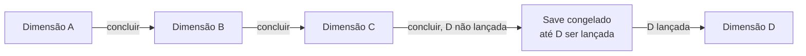

- As dimensões seguem a **ordem de lançamento**. Todo grupo novo (inclusive um "grupo de 1") começa sempre pela **primeira** dimensão lançada e, ao concluir uma, vai para a seguinte. O jogo é lançado já com **algumas dimensões** disponíveis.
- **Sem repetição:** uma dimensão concluída **nunca** é jogada de novo pelo grupo.
- **Sem volta:** quando o grupo avança para uma nova dimensão, ele **não pode voltar** a dimensões anteriores.
- **Save congelado:** se o grupo concluir a dimensão mais recente e a próxima ainda não tiver sido lançada, o save fica **congelado** (não é possível jogar nele) até o lançamento da próxima dimensão.
- Exemplo: existem as dimensões A, B e C. Um grupo começa na A, depois vai para a B e para a C. Ao concluir a C, se a D ainda não foi lançada, o save fica congelado. Quando a D for lançada, o grupo começa a D.

#### Ir para nova dimensão

A passagem para a nova dimensão é **automática**; não existe ação de zona, votação nem encontro dos jogadores:
1. Quando a dimensão é **concluída** ([3.2](#32-conclusão-de-uma-dimensão)), a **vez termina** imediatamente (os pontos de ação restantes são perdidos) e a partida daquela dimensão acaba.
2. Se a próxima dimensão já foi **lançada**, o grupo passa para ela. Se ainda não foi, o save fica **congelado** até o lançamento.
3. Faz-se uma **nova preparação completa** ([10.1](#101-passo-a-passo)) na nova dimensão, **menos** a escolha de classe e deck pré-pronto: monta-se um mapa novo, rola-se a nova ordem dos jogadores (D20) e cada um escolhe, nessa ordem, uma zona Urbana de spawn.
4. A nova dimensão começa pela vez do **1º jogador da nova ordem**.

**Curva de progressão (diretriz de design):** os inimigos têm valores finais (sem Pico), e os jogadores ficam mais fortes com o Pico. Para acompanhar, **cada dimensão é desenhada para uma faixa de Pico de referência**, e os inimigos dela são calibrados para essa faixa. Ponto de partida para o laboratório (ajustável):

| Dimensão (ordem de lançamento) | Pico de referência ao entrar | Pico de referência ao concluir |
|---|---|---|
| 1ª | 10 | 60 |
| 2ª | 60 | 130 |
| 3ª | 130 | 220 |
| Seguintes | Pico ao concluir a anterior | +~70% a cada dimensão |

- Inimigos **comuns** são calibrados para o Pico de entrada; **elites**, para o meio da faixa; **chefes** e o **chefe final**, para o Pico de conclusão.
- O laboratório deve simular um jogador "médio" e mostrar se a curva está fácil ou difícil demais.

**O que acontece ao entrar numa nova dimensão:**

| Mantém | Reinicia |
|---|---|
| Vida atual, ouro, cofre (com expansões), bolsa (com expansões), inventário, pasta de TCG, montaria, equipamentos em uso, decks, classes e especializações, Energia (Pico e Vigor), todas as cartas de qualquer coleção | A mão **e a pilha de descarte de atributos** voltam ao deck, que é embaralhado, e compra-se 7; efeitos com duração de partida/dimensão terminam; missões em aberto da dimensão anterior são canceladas; os itens de conclusão da dimensão concluída saem do jogo; o registro de missões de zona concluídas é zerado; a ordem dos jogadores é rolada de novo (D20) e fica fixa na nova dimensão |

**Grupos e saves:**
- Ao começar uma campanha com outros jogadores, o grupo fica **preso a essa configuração de jogadores**. Esse grupo é um **save** com identidade própria: a dimensão atual, o progresso e as coisas de cada jogador.
- As mesmas pessoas podem formar **outros grupos** (outros saves), com configurações diferentes de jogadores.
- Um jogador que joga em vários grupos **não pode transferir** cartas, recursos, ouro, etc. entre os saves. O cofre, o inventário, a pasta, os decks, as classes, a montaria e a Energia de cada jogador pertencem ao save do grupo.
- Ao entrar num **novo grupo**, o jogador começa **do zero** ("primeira dimensão": valores iniciais, classe e deck pré-pronto).
- Jogar **sozinho** na campanha também é um **"grupo de 1"** (um save separado).
- Um grupo **não pode aceitar** novos jogadores depois de criado, nem humanos nem IAs.
- **Ajudantes de IA:** ao **criar o grupo** (começar uma nova aventura na campanha), o host escolhe se quer incluir **ajudantes de IA** e **quantos** (de 0 até completar o limite de jogadores da partida, [1.3](#13-número-de-jogadores)). Cada ajudante de IA é um **jogador completo** do grupo, controlado pela IA de jogador ([II.7](#ii7-jogadores-controlados-por-ia)):
  - **"segue a sua vida":** joga as próprias vezes, entra na ordem dos jogadores (D20), escolhe o próprio spawn, tem o próprio deck, inventário, cofre, ouro, Energia e missões, e progride sozinho ao longo das dimensões, como qualquer jogador;
  - **classes e especializações aleatórias:** todas as escolhas de **classe primária** (inclusive a inicial, com o deck pré-pronto dela, e a classe nova do mentor) e de **especialização** (qual provação fazer) são feitas por **sorteio uniforme** entre as opções válidas naquele momento. O ajudante não escolhe "a melhor" classe nem combina classes de propósito. Todas as outras decisões (ações, deck building, combate, mercado, etc.) seguem a IA de jogador normal;
  - é tratado como **jogador** por todas as regras: pode ser recrutado para combates ([19.5](#195-combate-com-2-ou-mais-jogadores--1-ou-mais-inimigos)) e pode recrutar, negociar ([23](#23-negociação)), concluir a dimensão ([3.2](#32-conclusão-de-uma-dimensão)) e receber o prêmio máximo;
  - IAs **só** entram na **criação** do grupo. Para jogar com outra quantidade de ajudantes, cria-se um **novo grupo** (novo save).
- **Host:** o host é o jogador **humano** que **criou o grupo**. Se ele for desconectado (e uma IA assumir o personagem dele), o papel de host passa para o **próximo jogador humano na ordem da rodada** que ainda esteja no grupo. IAs nunca são host. Se não sobrar nenhum humano no grupo, não há mais host e o save não pode mais ser jogado.
- **Abandonar a partida:** só o **host** do grupo pode abandonar, pelo menu (tecla **Esc** ou botão de configurações) → **Abandonar a partida**. O **save inteiro é perdido** para todos.
- **Início de sessão:** uma sessão só começa com **todos** os membros humanos do grupo conectados.
- **Troca de controle:** um personagem só passa para uma IA por desconexão; **nunca** é possível colocar outro humano no lugar, nem devolver o personagem ao jogador original.

**Encerrar sessão:** para parar de jogar (ex.: "por hoje é só"), qualquer jogador pode usar **Encerrar sessão** (fora de combates; se for na vez de outro jogador, vale no fim daquela vez). O save é gravado e fica **pausado para todos**; ninguém perde o personagem. A sessão seguinte começa de onde parou, com o grupo completo.

**Desconexão:** a regra abaixo vale só para **quedas** no meio da sessão (não para o Encerrar sessão). Um jogador conta como **desconectado** se ficar sem conexão por mais de **2 minutos seguidos** (ajustável no laboratório); antes disso, a vez dele segue as regras de tempo de [11.3](#113-tempo-da-vez) e ele pode voltar normalmente. Passado esse tempo, uma **IA** ([II.7](#ii7-jogadores-controlados-por-ia)) assume o personagem dele **imediatamente** (inclusive no meio da vez) e de forma **definitiva**: o jogador **nunca mais pode voltar** a esse save. A sessão continua normalmente com os outros jogadores. A regra do "jogador ausente" ([11.3](#113-tempo-da-vez)) vale para quem continua conectado mas não joga.

---

## Apêndice A — Valores ajustáveis

Todos os valores abaixo são **pontos de partida** e podem ser alterados no [Laboratório de testes](#ii6-laboratório-de-testes).

| Área | Valor | Padrão | Onde |
|---|---|---|---|
| Deck | Tamanho mínimo da build | 60 (especulativo) | [4.4](#44-o-deck-de-atributos) |
| Deck | Cópias máx. de sinérgicas/aprimoradas | 4 (especulativo) | [4.3](#43-tipos-de-carta-de-atributo) |
| Deck | Travas de classe/especialização | 18 / 10+10 / 6 / +4 | [8.2](#82-a-trava-do-deck) |
| Mapa | Zonas por dimensão | 12, 16 ou 20 (teste com 16) | [3.5](#35-montagem-do-mapa) |
| Mapa | Cartas do deck de eventos por tipo de zona | ~30 (especulativo) | [3.4](#34-o-que-uma-carta-de-zona-contém) |
| Jogador | Vida base (não é valor inicial: muda por efeitos permanentes) / ouro e mão iniciais | 20 / 10 / 7 | [9.1](#91-valores-iniciais) |
| Jogador | Vida máxima | vida base × (1 + Pico ÷ 100) | [7.4](#74-escala-fórmulas-e-valores-iniciais) |
| Jogador | Vida ao voltar do nocaute | 10% da vida máxima | [20.2](#202-nocaute) |
| Jogo solo | Ouro da bolsa perdido no nocaute / rodadas que passam no lugar da vez perdida | 10% / 1 | [20.2](#202-nocaute) |
| Partida | Jogadores por partida (MVP) | 1 a 6 | [1.3](#13-número-de-jogadores) |
| Jogador | Pontos de ação por vez | 3 | [11.1](#111-pontos-de-ação) |
| Tempo | Tempo da vez / por escolha / turno de combate | 60 s / 30 s / 30 s | [11.3](#113-tempo-da-vez) |
| Energia | Pico e Vigor iniciais | 10 / 10 | [7.4](#74-escala-fórmulas-e-valores-iniciais) |
| Energia | Vigor restaurado por Recuperar | 5% do Pico | [7.3](#73-regras-da-energia) |
| Energia | Vigor após nocaute | menor entre Vigor atual e 50% do novo Pico | [7.3](#73-regras-da-energia) |
| Jogador | Vida restaurada por Recuperar | 15% da vida máxima | [12.5](#125-recuperar) |
| Artífice | Oficina: desconto no conserto / refino máximo / bônus no D20 | 50% / +6 / +2 | [25.5](#255-oficina-do-artífice) |
| Tempo | Vezes estouradas seguidas para "jogador ausente" | 2 | [11.3](#113-tempo-da-vez) |
| Mercado | Slots da vitrine de singles | 4 | [24.4](#244-singles) |
| Mercado | Decaimento da vitrine (D20 por slot no fim da rodada) | 1–3 | [24.4](#244-singles) |
| Mercado | Fator do mercado | 0,8 a 1,2 | [24.4](#244-singles) |
| Ferreiro | Bônus por nível de refino | +5% do valor base do modificador principal | [25.2](#252-refinar) |
| Classes | Pesos do orçamento de modificadores | 4 / 4 / 0,5 / 1 / 2 / 3 / 3 (orçamento 97) | [8.7](#87-perfil-das-classes) |
| Campanha | Pico de referência por dimensão | tabela | [28.1](#281-campanha) |
| Energia | Penalidade da Exaustão | −10% | [7.3](#73-regras-da-energia) |
| Fórmulas | Influência do Pico, acerto, dano | veja os capítulos | [7.4](#74-escala-fórmulas-e-valores-iniciais), [19.2](#192-cálculo-do-dano) |
| Classes | Modificadores base | tabela | [8.7](#87-perfil-das-classes) |
| Tempo | Tempo máximo total da vez (fora de combate) | 5 min | [11.3](#113-tempo-da-vez) |
| Mapa | Conteúdo e chances do deck de reserva | genérico, infinito | [3.4](#34-o-que-uma-carta-de-zona-contém) |
| Mercado | Valor de venda de tesouros por raridade | 10 / 25 / 60 / 150 / 400 | [24.2](#242-venda-pelo-jogador) |
| Montaria | Preço base por raridade | 80 / 150 / 280 / 550 / 1.100 | [26](#26-montarias) |
| Classes | Pico mínimo da provação | 30 | [8.3](#83-como-obter-uma-especialização) |
| Classes | Custo do mentor | 150, dobra a cada classe | [8.4](#84-como-se-tornar-multiclasse) |
| Fuga | Custo em Vigor | 20% do Pico | [15](#15-teste-de-fuga) |
| Fuga | Valor mínimo no D20 | maior que 10 | [15](#15-teste-de-fuga) |
| Fuga | Pontos de ação perdidos na fuga falha de evento aleatório | 1 | [14.5](#145-fugir-de-um-evento-aleatório) |
| Elementos | Efetividade com vantagem / desvantagem | +25% / −25% | [16.1](#161-relações-e-efetividade) |
| Elementos | Desconto de Vigor por afinidade elemental da classe | 10% | [16.3](#163-afinidade-elemental-das-classes) |
| Habilidades | Fórmulas das formas; limite da Canalizada | 20% da vida inicial da canalização | [17.4](#174-detalhe-das-formas) |
| Guardar | Inventário (fixo para todas as classes; só muda no laboratório) / pasta / cofre | 10 / 30 / 30 slots + 10 decks + 2.000 ouro | [6](#6-onde-ficam-as-cartas) |
| Guardar | Bolsa de ouro | 300 | [5.3](#53-dinheiro) |
| Mercado | Booster: preço, cartas, chances | 30 / 8 / tabela | [24.3](#243-boosters) |
| Mercado | Singles: preços base, ajuste, fatores | tabela | [24.4](#244-singles) |
| Mercado | Preço base do estoque | tabela | [24.1](#241-compra-no-estoque) |
| Mercado | Expansões (cofre, decks, bolsa, pasta de TCG, ouro do cofre) | tabelas | [6.4](#64-cofre), [24.5](#245-serviços-do-mercado) |
| Ferreiro | Conserto, refino, encanto (custos e testes) | tabela | [25](#25-ferreiro) |
| Ferreiro | Marca de reparo | −12% por reparo | [5.1](#51-equipamentos) |
| Montaria | Slots extras de inventário / pasta | +4 / 10 | [26](#26-montarias) |
| Mercado | Venda de booster fechado | 15 | [24.2](#242-venda-pelo-jogador) |
| Mercado | Valorização da venda por refino / por encantamento ativo | +8% por nível / +20% cada | [24.2](#242-venda-pelo-jogador) |
| Campanha | Tempo sem conexão para contar como desconexão | 2 min | [28.1](#281-campanha) |
| Jogador | Recuperar (opção a): comprar até ter N cartas na mão | 7 | [12.2](#122-lista-de-ações-padrão) |
| Missões | Cartas viradas no quadro de missões | 3 | [21.2](#212-tipos-de-missão) |
| Missões | Missões em aberto por jogador (todos os tipos) | 3 | [21.1](#211-regras-gerais) |
| Mercado | Munição por compra / lote mínimo de venda | 10 / 10 | [24.1](#241-compra-no-estoque) |
| Combate | Limite de ciclos de combate (todo combate) | 20 | [19.1](#191-combate-1-jogador--1-inimigo-regra-base) |
| Mercado | Cartas no pool de singles | 20 | [24.4](#244-singles) |
| Mapa | Tentativas máximas do gerador de mapa | 1.000 | [3.5](#35-montagem-do-mapa) |
| Missões | Objetivos da provação / do mentor (eventos aleatórios resolvidos + combates vencidos) | 3 + 3 / 5 + 5 | [8.3](#missões-genéricas-provação-e-mentor) |
| Inimigos | Critérios de alvo e de habilidade de cada Comportamento | tabela | [19.6](#196-ia-dos-inimigos) |
| IA de jogador | Ordem de prioridades | nocaute → conclusão → missões → Pico → ouro | [II.7](#ii7-jogadores-controlados-por-ia) |

### Pico por fonte

Valores padrão para teste ([7.2](#72-energia-pico-e-vigor)). Quando uma carta diz um valor próprio, vale o da carta. Todos ajustáveis no laboratório.

**Fontes acumulam:** quando um mesmo acontecimento cumpre várias fontes, **todas se somam**. Ex.: vencer o chefe final com a ação Concluir dimensão dá Chefe (+15) + conclusão da dimensão (+25) = **+40**.

| Fonte | Pico |
|---|---|
| Resolver um evento aleatório com sucesso | +1 |
| Vencer um combate | +1 por inimigo comum derrotado; +3 por Elite |
| Derrotar um Chefe (inclusive o chefe final) | +15 |
| Cumprir uma missão de zona | +3 |
| Cumprir uma missão de provação ou do mentor | +5 |
| Concluir a dimensão (qualquer condição) | +25 (todos os jogadores da partida) |
| Não conseguir resolver um evento aleatório (qualquer revés, inclusive aceitar a coisa ruim sem tentar) | −1 |
| Fugir de um evento aleatório (com sucesso) | 0 |
| Fugir de um combate (com sucesso) | −2 |
| Ser nocauteado (= perder um combate) | −10% do Pico, mínimo 1, arredondado para baixo |
| Abandonar uma missão | 0 |

---

# Parte II — Requisitos técnicos

> **Atenção**: muitos conceitos estão sujeitos a mudar com o tempo devido a novas ideias ou à descoberta de problemas. Esta seção apresenta as ideias básicas.

## II.1 Natureza do projeto

- Este documento descreve o jogo como se fosse um jogo físico de verdade. O projeto, porém, é uma **versão digital**, onde muitas partes do gameplay podem ser **automatizadas** para facilitar a implementação e deixar o jogo mais fluido.
- O jogo é **jogado em vezes alternadas, com interatividade em tempo real**: os jogadores veem as ações dos outros ao vivo e podem reagir quando a regra permite. Cada vez tem **60 s de decisão de ação de zona**, com o relógio **pausado nas telas internas** (eventos, combate, mercado, etc.), que têm seus próprios tempos (veja [11.3](#113-tempo-da-vez)).
- **Backend autoritativo desde o início:** toda a lógica de regras (sorteios, cálculos, validação de ações, estado da partida) roda no **backend**, inclusive na etapa de um jogador. O frontend só exibe o estado e envia as intenções do jogador. Assim, a fase online não exige reescrever o motor do jogo.
- **Só o modo Campanha** é implementado por enquanto ([28](#28-modo-de-jogo-campanha)); raides também ficam de fora ([22](#22-raides-fora-do-escopo-atual)). A arquitetura não deve impedir adicionar outros modos e as raides no futuro.
- **Saves por grupo:** cada grupo de campanha é um save separado; nada é transferido entre saves (veja [28.1](#281-campanha)).
- **Autenticação:** o jogo terá um **sistema de autenticação por usuário** (contas, login, papel de admin). Os detalhes serão decididos pelo autor **na hora da implementação**; até lá, o tema não deve ser analisado, sinalizado nem proposto.
- O jogo funcionará principalmente em **PC (monitores)**. Distâncias, tamanhos, margens e espaços devem se ajustar ao monitor do usuário para a melhor experiência possível.

## II.2 Stack

- **Frontend:** TypeScript, Vite, React, TanStack Query (React Query) e React Router DOM, além de outras bibliotecas a decidir durante o desenvolvimento.
  - Primeiro roda localmente via web; depois será portado para executável de PC com **[Tauri](https://v2.tauri.app/start/)**. **Distribuição do executável (decidida):** **servidor remoto obrigatório**. O executável Tauri é só o cliente (frontend); o backend NestJS e o banco de dados rodam sempre num servidor remoto, o mesmo da versão web. Não há backend embutido nem banco local, e é preciso estar conectado para jogar, inclusive sozinho.
  - **O jogo é inteiramente 2D.** Não há renderização 3D. O estilo PSX ([II.5](#ii5-estilo-gráfico-psx)) aparece nas **imagens, ícones, animações e transições**.
- **Backend:** TypeScript, NestJS, ORM Drizzle, arquitetura hexagonal e Domain-Driven Design, além de WebSockets, Socket.IO, Aggregate Root, Domain Events & State Machine, Portas (interfaces) e Adaptadores (implementações), e outras tecnologias e arquiteturas que surgirem conforme a necessidade.
  - **Docker Compose** para o banco de dados e o backend, para implementar primeiro localmente antes do deploy (as plataformas de hospedagem são pagas).
- **Não instalar bibliotecas de terceiros sem permissão.**

## II.3 Testes

- **Frontend:** Vitest (unitários) e Playwright (end-to-end). Sugestões são aceitas para testes de integração.
- **Backend:** Vitest, **Supertest** para testar requests aos endpoints e outros testes considerados importantes.

## II.4 Interface e experiência

- Animações e transições **bonitas e simples**.
- **Termos do jogo com highlight:** termos (e suas variações) devem ter destaque ou cor própria e mostrar um **tooltip** explicativo ao passar o mouse. Exemplos: Atributos e cada atributo, Zonas, Classes e cada classe, modificadores, cada ação de zona, cada tipo de evento, etc. O [glossário](#22-vocabulário-básico) é o ponto de partida para a lista de termos.
- **Categorias de carta visíveis:** cada carta mostra a sua categoria com **ícone, imagem e label** (ex.: diferenciar amuletos de Arma, Acessório e Relíquia).
- **Imagens e ícones** serão fornecidos pelo autor. Imagens e ícones SVG podem ser criados apenas para testes.
- Termos do jogo podem ser alterados, **com aprovação** do autor.

## II.5 Estilo gráfico PSX

O jogo é **2D**. O estilo PSX vale para as **imagens, ícones, animações e transições** (as artes podem retratar cenas com aparência de 3D de PS1, mas a interface e o jogo não renderizam 3D).

> Mantido em inglês de propósito: é o texto de referência para prompts de geração de arte.

- **Geometry and models:** Extremely low-poly 3D models, low polygon counts, angular silhouettes, visibly faceted surfaces, simple geometric shapes, coarse environmental geometry, primitive character models and rigid-looking structures.
- **Textures and materials:** Very low-resolution textures, visibly pixelated texture maps, blurry and muddy surfaces, crude hand-painted textures, limited texture detail, affine texture mapping artifacts, perspective distortion, warped textures, and subtle polygon vertex jitter reminiscent of original PS1 hardware.
- **Rendering and lighting:** Original PlayStation-era rendering aesthetics, simple vertex lighting, minimal dynamic lighting, limited shading, basic diffuse materials, hard-edged shadows where appropriate, low color depth appearance, restrained visual effects, and authentic late-1990s 3D game rendering.
- **Image quality:** Low internal rendering resolution, visible pixelation, jagged polygon edges, aliasing, subtle dithering, limited draw distance, atmospheric distance fog when appropriate, and the characteristic imperfections of early real-time 3D graphics. Preserve the raw, imperfect appearance of vintage console footage rather than modernizing the image.
- **Art direction:** Nostalgic, atmospheric, imperfect, surreal when appropriate, visually distinctive and unmistakably from the original PlayStation era. The final image should look like an authentic screenshot captured directly from a real 1990s PS1 game running on original hardware.
- **Strict restrictions:** No modern photorealism, no high-poly models, no physically based rendering (PBR), no ray tracing, no modern cinematic CGI, no ultra-high-resolution textures, no Unreal Engine 5 aesthetic and no excessive post-processing.

## II.6 Laboratório de testes

É necessário implementar uma página interativa e intuitiva para o autor conseguir testar todas as funcionalidades dentro do jogo uma vez que elas estiverem finalizadas. Nessa tela será possível também fazer configurações e ajustar pesos, valores, quantidades, etc. do jogo, como forma de testar as melhores opções para o jogo. Por exemplo: mudar a quantidade de cartas iniciais por padrão ao começar um jogo, aumentar/diminuir o número de ações que um jogador pode fazer por padrão, quantidade de cartas no deck de atributos, etc. Será tudo possível de ajustar e encontrar os melhores valores. É necessário criar um sistema de controle para orquestrar tudo no jogo para saber as melhores condições.

**Acesso:** o laboratório é controlado por um **feature flag de build**: existe só nos builds de **desenvolvimento** (dev) e só jogadores **admin** podem abri-lo. Nos builds de **release** (web ou executável Tauri), a tela e suas rotas **não existem**.

A lista completa de valores está no [Apêndice A](#apêndice-a--valores-ajustáveis). Requisitos do laboratório já definidos:
- **Valores e regras combinados:** testar diferentes combinações de valores **e de regras** para ver qual se adequa melhor à jogabilidade e à progressão.
- **Fórmulas editáveis:** alterar as fórmulas e os cálculos (influência do Pico, chance de acerto, dano, etc.; veja [7.4](#74-escala-fórmulas-e-valores-iniciais) e [19.2](#192-cálculo-do-dano)), não só os números.
- **Modificadores base:** usar o valor padrão, um valor customizado **para todos** ou um valor customizado **por classe**.
- **Energia:** Pico e Vigor iniciais, Vigor restaurado por Recuperar, custo de fuga, Vigor no nocaute, penalidade da Exaustão.
- **Inimigos:** alterar o modelo e os valores dos inimigos impressos nas cartas de evento de combate.
- **Boosters:** raridades, chances e proporção de cartas.
- **Ferreiro e montarias:** custos, chances, fórmula do refino e slots extras.
- **Mercado:** preços de singles, estoque, boosters, expansão do cofre e da bolsa de ouro.
- **Mapa:** número de zonas por dimensão e regras do gerador de mapa (veja [3.5](#35-montagem-do-mapa)).

## II.7 Jogadores controlados por IA

- A IA de jogador é **onisciente**: ela tem acesso a **todas** as informações do jogo, inclusive as ocultas (cartas da própria mão e das mãos dos outros, a ordem de todos os decks, o próximo evento de cada zona, etc.).
- Ela conhece **todas as regras** e **todas as variáveis**. É uma **IA heurística forte**: decide (ações de zona, deck building, builds, negociação, combate, mercado, ferreiro) seguindo uma **ordem de prioridades explícita**, sem tentar achar a jogada perfeita. Ordem de partida (ajustável no laboratório):
  1. **não ser nocauteado**;
  2. **avançar o requisito de conclusão** da dimensão ([3.2](#32-conclusão-de-uma-dimensão));
  3. **missões**;
  4. **Pico**;
  5. **ouro**.
- **Exceção:** a escolha de **classes primárias e especializações** é sempre **sorteada** (uniforme entre as opções válidas), nunca otimizada ([28.1](#281-campanha), ajudantes de IA). Dada a classe sorteada, a IA monta a build seguindo as mesmas prioridades.
- **Critério de aceite:** a IA é avaliada por **métricas no laboratório** ([II.6](#ii6-laboratório-de-testes)), como **taxa de nocaute** e **rodadas até concluir a dimensão**. As metas dessas métricas são definidas pelo autor no laboratório.
- É diferente da IA dos inimigos ([19.6](#196-ia-dos-inimigos)), que segue o Comportamento impresso na carta.
- **IAs na campanha:** os **ajudantes de IA** só entram num grupo **na criação** dele, na quantidade que o host escolher, respeitando o limite de jogadores ([1.3](#13-número-de-jogadores), [28.1](#281-campanha)). IAs nunca desconectam e nunca são host. A IA que assume o personagem de um humano desconectado segue as mesmas regras (inclusive o sorteio de classes e especializações daí em diante).

---

# Parte III — Etapas de desenvolvimento

## III.1 Agentes e skills

- Criar os agentes e skills necessários para desenvolver o projeto. O [arquivo de referência](PROMPT-AGENTES-E-SKILLS.md) dá uma ideia de como criá-los.
- Instruções obrigatórias nos agentes de desenvolvimento:
  - "Não disfarce suas dúvidas. Explicite as vantagens e desvantagens de cada escolha."
  - "Implemente apenas o necessário para resolver o problema. Não acrescente nada baseado em suposições."
  - "Modifique apenas o que for indispensável. Corrija ou limpe tudo aquilo que suas próprias alterações deixarem para trás."
  - "Estabeleça critérios claros para considerar a tarefa concluída. Continue iterando até confirmar que eles foram atendidos."

## III.2 Desenvolvimento por feature

- Dois projetos em paralelo, **frontend** e **backend**, cada um com seus próprios agentes e skills.
- Toda implementação resolve **uma feature ou um bug específico**.
- Uma feature só está completa quando foi resolvida **nos dois lados** (ou no único lado que precisa de alteração).
- O autor faz o controle e leva as informações de um projeto para o outro. As skills e os agentes devem ter instruções claras sobre **quando precisam de validação do outro lado**.
- Analisar todos os requisitos e criar os agentes e skills do frontend e do backend.
- Criar a lista de passos, etapas e fases de desenvolvimento do frontend e do backend.

## III.3 Efeitos

- Para cada categoria de gatilho, custo, ativação e duração, é preciso criar uma **vasta variedade** de possibilidades, para permitir estratégia "infinita" e fazer o jogador pensar.
- Analisar todo o [capítulo de efeitos](#13-efeitos) e criar a maior variedade possível de combinações de gatilho, custo, ativação e duração. Quanto mais variedade, mais desafiador e estratégico fica o jogo.
- A lista de variações deve ser **validada pelo autor**, que decide o que entra e o que sai.

## III.4 Etapas (ordem sugerida pelo autor; pode ser alterada se houver uma sequência melhor)

**Etapa 1 — Análise e planejamento**
- Analisar o documento inteiro e apontar pontos em aberto, problemas de conceito, contradições, pontos que precisam de esclarecimento e dúvidas (técnicas e de ideia do jogo).
- **Entrevistar o autor** para tirar todas as dúvidas antes de seguir.
- Arquitetura de distribuição do executável Tauri: **já decidida** (servidor remoto obrigatório, veja [II.2](#ii2-stack)).
- Registrar no plano o **sistema de autenticação por usuário** ([II.1](#ii1-natureza-do-projeto)), a ser feito numa etapa posterior.
- Planejar com **spec-driven development**. Referências:
  - https://martinfowler.com/articles/exploring-gen-ai/sdd-3-tools.html
  - https://blog.dsacademy.com.br/spec-driven-development-a-nova-arquitetura-de-engenharia-de-software-na-era-dos-agentes-de-ia-parte-3/
  - https://www.ibm.com/br-pt/think/topics/spec-driven-development
  - https://thoughtworks.medium.com/spec-driven-development-d85995a81387
- Organizar as etapas em três momentos:
  1. Jogo funcional (frontend e backend) para **um jogador**.
  2. **Mais jogadores controlados por IA** (testar com outros três jogadores, todos IAs oniscientes; veja [II.7](#ii7-jogadores-controlados-por-ia)).
  3. Jogo **online web** com interatividade em tempo real, WebSockets, etc.
- Separar em **dois arquivos**: um com todo o contexto, regras, aspectos e etapas do frontend, e outro com o mesmo para o backend.

**Etapa 2 — Manual de regras para jogadores**
- Este documento é o manual de regras e técnico **para o desenvolvimento**. Depois que todas as regras estiverem fechadas e validadas, criar um **manual separado só com as regras do jogo** (sem a parte técnica), organizado e estruturado como um manual de jogo de tabuleiro, que sirva de guia para os jogadores.
- Ordenar as regras de forma que cada uma facilite o entendimento da próxima.
- Explicar em detalhe, com **infográficos e imagens** para os conceitos mais complexos.

---

# Apêndice B — Decisões registradas

> **Situações não cobertas pelas regras**, resolvidas nesta ordem:
> 1. vale o texto da carta;
> 2. vale a regra mais específica sobre a mais geral;
> 3. vale a decisão mais recente deste Apêndice B;
> 4. se ainda houver dúvida, quem implementa escolhe a interpretação **mais simples de implementar** que não contradiga nenhuma regra, registra neste Apêndice B e segue, sem bloquear o trabalho.
>
> **Para revisões de IA:** só sinalizar o que **impede a implementação** (duas regras que exigem coisas incompatíveis, ou uma mecânica sem regra nenhuma). Casos raros e combinações extremas entram no item 4 e **não** são listados como problema, ambiguidade ou ponto em aberto.

> **Para IAs e revisores:** os pontos abaixo já foram analisados e **decididos pelo autor** (revisão de 12/11/2026). As regras do documento já foram atualizadas. **Não** sinalize estes pontos de novo como contradição, ambiguidade, ponto em aberto ou "estranho", e não proponha alternativas para eles, a menos que o autor peça. Se encontrar um texto que contradiga uma decisão abaixo, a decisão abaixo vale e o texto deve ser corrigido.

| # | Tema | Decisão | Onde |
|---|---|---|---|
| 1 | Ordem dos jogadores ao trocar de dimensão | A vez termina ao concluir a dimensão; rola-se a nova ordem (D20); a nova dimensão começa pelo 1º da ordem. (Atualizada pela C3.) | [28.1](#ir-para-nova-dimensão) |
| 2 | Para onde se vai na nova dimensão | A troca dispara uma nova preparação completa (10.1), menos a escolha de classe e deck pré-pronto. | [10.1](#101-passo-a-passo), [28.1](#ir-para-nova-dimensão) |
| 3 | Valores iniciais na campanha | Só na primeira aventura; nas dimensões seguintes o jogador mantém o que tem. | [10.1](#101-passo-a-passo) |
| 4 | Inventário que diminui | Não existe mais: o inventário é fixo (veja #41). A pasta também tem capacidade fixa (só cresce por expansão no mercado, veja G2). | [6.2](#62-inventário) |
| 5 | Empate de Celeridade | Aliados escolhem a ordem; adversários (PvP) rolam D20; jogador × inimigo: inimigo primeiro. | [19.1](#191-combate-1-jogador--1-inimigo-regra-base) |
| 6 | Deck de missões | É **por zona**, não por tipo de zona. | [3.4](#34-o-que-uma-carta-de-zona-contém) |
| 7 | Destinos que faltavam em 6.5 | Consumíveis usados, boosters abertos e ferramentas quebradas → limbo; carta de missão concluída e de Chefe derrotado → saem do jogo. | [6.5](#65-pilhas-de-descarte-e-limbo) |
| 8 | Pico dos ajudantes | Ganham o mesmo Pico/Vigor calculado para quem iniciou (valor da carta ou padrão). | [19.5](#195-combate-com-2-ou-mais-jogadores--1-ou-mais-inimigos) |
| 9 | Pico de conclusão | "Concluir a dimensão (qualquer condição)", não só pela Raide Final. | [Apêndice A](#pico-por-fonte) |
| 10 | Glossário: Habilidade | "Poder ligado a um equipamento ou inimigo" (ativa ou passiva). | [2.2](#22-vocabulário-básico) |
| 11 | Coleções no Desbravadores | Mesma regra do Clássico: o host escolhe e a coleção ativada afeta tudo. | [27](#27-coleções), [28.2](#282-desbravadores) |
| 12 | Deck de recompensas esgotado | Compras do topo passam a vir de um **deck de reserva genérico e infinito**. Buscar e Vasculhar não usam a reserva. | [3.4](#34-o-que-uma-carta-de-zona-contém) |
| 13 | Ordem de escolha do spawn | A ordem dos jogadores é definida antes; o spawn é escolhido nessa ordem. | [10.1](#101-passo-a-passo) |
| 14 | Ordem das reduções no dano | Acerto → Ataque − Defesa → ×½ (Área/escudo) → ×efetividade → arredonda para baixo → Reflexão. | [19.2](#192-cálculo-do-dano) |
| 15 | Bônus de efetividade | Somam-se num único fator (ex.: +25% +10% = ×1,35). | [16.1](#161-relações-e-efetividade) |
| 16 | Percentuais em inimigos | Só a etapa 3 do pipeline, sobre o valor impresso. | [18.1](#181-o-inimigo-na-carta-de-evento-de-combate) |
| 17 | Valor do refino | O percentual entra com decimais e só se arredonda no fim do pipeline; exemplo de 7.4 corrigido. | [7.4](#74-escala-fórmulas-e-valores-iniciais) |
| 18 | Afinidade no multiclasse | União dos elementos; desconto único de 10% (não soma). | [16.3](#163-afinidade-elemental-das-classes) |
| 19 | Pico de fontes grandes | Todas as fontes se somam (ex.: Chefe + raide + conclusão = +50). | [Apêndice A](#pico-por-fonte) |
| 20 | Falhar evento (−1 Pico) | Qualquer revés conta, inclusive aceitar a coisa ruim sem tentar. | [Apêndice A](#pico-por-fonte) |
| 21 | Pagamento de requisitos | Tudo ou nada; não há pagamento parcial. Exemplos de 14.4 refeitos. | [14.2](#142-requisitos-de-resolução), [14.4](#144-reposição-de-cartas) |
| 22 | Abrir booster | Só com espaço livre na pasta para as 8 cartas (no Preparar) ou no cofre para as 8 cartas (no Usar cofre). | [24.3](#243-boosters) |
| 23 | Pasta que diminui | **Substituída pela G2**: nenhum efeito altera a pasta; não existem cartas desabilitadas. | [6.3](#63-pasta-de-tcg) |
| 24 | Venda com a bolsa cheia | Mantido: a venda é permitida e o ouro que passa da capacidade da bolsa é **perdido**. Intencional. | [5.3](#53-dinheiro), [6.6](#66-recompensas-e-falta-de-espaço) |
| 25 | De onde sai o ouro das compras | Sempre da bolsa, inclusive todas as expansões. | [6.6](#66-recompensas-e-falta-de-espaço), [24.5](#245-serviços-do-mercado) |
| 26 | Preços de montarias, tesouros e relíquias | Tabelas definidas; montaria só pode ser descartada (vendida) no Estábulo. | [24.2](#242-venda-pelo-jogador), [26](#26-montarias) |
| 27 | Inimigo Covarde | Removido. Inimigos nunca fogem (simplificação de implementação). | [18.1](#181-o-inimigo-na-carta-de-evento-de-combate) |
| 28 | Chefe em missão | Chefes de missão são por jogador; aparição única só vale para Chefes de evento. | [18.3](#183-categorias-de-inimigo) |
| 29 | Revelação de zonas | **Substituída pela C2**: não existe mais exploração; todas as zonas começam viradas para cima. | [3.6](#36-exploração) |
| 30 | Requisito de "Ir para nova dimensão" | **Substituída pela C3**: a passagem é automática ao concluir a dimensão (se a próxima estiver lançada; senão o save congela). Não existe mais a ação. | [28.1](#ir-para-nova-dimensão) |
| 31 | Desconexão no Enfrentamento | Equivale a desistir. | [28.4](#284-enfrentamento-pvp) |
| 32 | Recompensa de PvP no Desbravadores | Só o saque; nada de Pico, Vigor ou pontos de objetivo. | [28.2](#282-desbravadores) |
| 33 | IA em saves da campanha | IAs só entram num grupo na criação; para jogar com IAs, cria-se um novo grupo. | [28.1](#281-campanha) |
| 34 | Efeito da carta Aprimorada | Cada carta diz o próprio gatilho; não há regra geral. | [4.3](#43-tipos-de-carta-de-atributo) |
| 35 | Vasculhar | O jogador escolhe a carta; sem espaço, vale 6.6. | [12.6](#126-vasculhar) |
| 36 | Ataque obrigatório? | Não: o ataque é opcional e pode ser impedido por efeitos. | [19.1](#191-combate-1-jogador--1-inimigo-regra-base) |
| 37 | Reforço e habilidades | **Substituída pela C1**: a mecânica de reforço com cartas foi removida do jogo. | [19.3](#193-cartas-de-atributo-no-combate) |
| 38 | Fuga do PvP com vários jogadores | Quem iniciou é o "rolador mestre": rola contra cada fugitivo; os outros lutadores não rolam. | [28.2](#282-desbravadores) |
| 39 | Votação da raide sem votos | Vale sempre a primeira opção. | [11.3](#113-tempo-da-vez), [22.2](#222-como-funciona) |
| 40 | Vocabulário de tempo | Regra fixa em 2.1: vez/rodada fora do combate; turno/ciclo de combate só dentro. "Turno" nunca é usado fora do combate. **Não perguntar de novo.** | [2.1](#21-tempo) |
| 41 | Tamanho do inventário | Sempre 10 slots para todas as classes; nada no jogo altera esse tamanho (só o laboratório). O inventário extra da montaria é espaço separado. | [6.2](#62-inventário), [8.7](#87-perfil-das-classes) |
| 42 | Modificadores base no multiclasse | Valem os da classe ativa (com várias ativas, a obtida primeiro); sem classe ativa, o valor padrão. | [8.4](#84-como-se-tornar-multiclasse) |
| 43 | Pausas sem limite | Tempo máximo total de 5 min por vez (fora de combates e raides). | [11.3](#113-tempo-da-vez) |
| 44 | Desconexão no Desbravadores | Partida encerrada; quem desconectou perde; os demais empatam. | [28.2](#282-desbravadores) |
| 45 | Save perdido por abandono | **Substituída pela F21**: só o host abandona, e o save inteiro é perdido. | [28.1](#281-campanha) |
| 46 | Economia de Vigor no início | Mantida como está; será ajustada com o tempo no laboratório. Não é um erro. | [7.3](#73-regras-da-energia) |
| 47 | Custo de Salvar ponto de respawn | 1 ponto de ação. | [12.2](#122-lista-de-ações-padrão) |
| 48 | Link do laboratório | Corrigido para `#ii6-laboratório-de-testes`. | [II.6](#ii6-laboratório-de-testes) |

### B.2 Segunda revisão (12/11/2026)

> Mesma instrução da tabela acima: estes pontos já foram **decididos pelo autor** e o documento já foi atualizado. **Não** sinalize de novo como contradição, ambiguidade, ponto em aberto ou "estranho". Quando uma decisão daqui conflitar com uma da tabela anterior, **vale a daqui**.

**Mudanças de escopo (simplificações):**

| # | Tema | Decisão | Onde |
|---|---|---|---|
| C1 | Reforço com cartas | **Removido do jogo por completo.** Não se descartam cartas da mão para aumentar Ataque, Defesa ou outro modificador. No combate, cartas só pagam custos; por isso **não há reposição de cartas no combate**. Também deixam de existir: +10%/+20% por carta, bônus de atributo essencial no reforço e a tabela atributo → modificador. | [19.3](#193-cartas-de-atributo-no-combate), [7.4](#74-escala-fórmulas-e-valores-iniciais), [8.2](#82-a-trava-do-deck) |
| C2 | Exploração de zonas | **Removida por enquanto.** Todas as zonas começam viradas para cima em todos os modos com mapa; não há revelação, nem efeitos de revelar. O spawn no Desbravadores/Clássico é escolhido em qualquer zona (não "às cegas"). | [3.6](#36-exploração), [10.1](#101-passo-a-passo), [26](#26-montarias) |
| C3 | Repetição de dimensão | **Removida.** Dimensão concluída nunca é jogada de novo; não existe continuar explorando depois da conclusão nem decaimento por repetição de dimensão. Ao concluir, a passagem para a próxima dimensão é automática; se ela não foi lançada, o save fica **congelado**. A ação "Ir para nova dimensão", a votação e o encontro na mesma zona **não existem mais**. O jogo lança com algumas dimensões. (O decaimento por repetição da **mesma raide** continua.) | [3.2](#32-conclusão-de-uma-dimensão), [28.1](#281-campanha), [22.3](#223-repetição-e-cooldown) |
| C4 | Quebra de equipamentos | Só **inimigos** quebram equipamentos, com uma **pool de habilidades exclusiva** para prejudicar o jogador (além da pool comum). Jogadores nunca têm efeitos de quebrar, **exceto no Desbravadores**, onde essas habilidades podem ser colocadas por **encantamento** no ferreiro. A falha de refino a partir de +7 continua quebrando. | [17.5](#175-habilidades-exclusivas-de-inimigos), [5.1](#51-equipamentos), [25.3](#253-encantar) |
| C5 | Desconexão na campanha | Uma IA assume o personagem na hora e para sempre; o jogador **nunca mais volta** a esse save. A sessão continua. Não existe mais "retomar do último salvamento" por desconexão. | [28.1](#281-campanha) |
| C6 | Efeitos que mudam valores iniciais | **Não existem** (ex.: "comece com 50 moedas"). | [13.3](#133-ativação) |

**Esclarecimentos de regra:**

| # | Tema | Decisão | Onde |
|---|---|---|---|
| C7 | Exemplo de ações de cidade | Toda Urbana tem Usar cofre, Salvar ponto de respawn e Treinar com mentor; o exemplo foi corrigido. | [3.4](#34-o-que-uma-carta-de-zona-contém) |
| C8 | Habilidades × classes | Só equipamentos (e inimigos) têm habilidades. Classes e especializações têm **efeitos**. | [17.2](#172-regras-de-uso), [8.7](#87-perfil-das-classes) |
| C9 | Pico de participantes | Ajudantes de combate e participantes de raide ganham **Pico e Vigor** (não "ou"); participantes de pé numa raide ganham também o +10 de concluir a raide (com decaimento da raide). | [19.5](#195-combate-com-2-ou-mais-jogadores--1-ou-mais-inimigos), [22.2](#222-como-funciona) |
| C10 | Pico perdido no nocaute | −10%, mínimo 1, arredondado para baixo. | [7.3](#73-regras-da-energia), [20.2](#202-nocaute), [Apêndice A](#pico-por-fonte) |
| C11 | Recusar evento de combate | Não é possível; as saídas são lutar ou tentar fugir. | [14.1](#141-a-carta-de-evento) |
| C12 | Nocaute simultâneo por Reflexão | O dano principal resolve antes. PvE: o atacante vence (recebe a coisa boa) e sofre o nocaute. PvP: se ninguém ficar de pé, ninguém vence. | [19.2](#192-cálculo-do-dano) |
| C13 | Fim do combate | Durações em turnos/ciclos de combate terminam e as recargas zeram. | [2.1](#21-tempo), [17.2](#172-regras-de-uso) |
| C14 | Revive em combate de grupo | Revivido = como se não tivesse caído; nenhuma penalidade de nocaute. | [19.5](#195-combate-com-2-ou-mais-jogadores--1-ou-mais-inimigos) |
| C15 | Reposição de quem é nocauteado | Nocauteado não repõe cartas (e, com a C1, não há reposição no combate). | [19.3](#193-cartas-de-atributo-no-combate) |
| C16 | Perder uma raide (−5 Pico) | Vale também para quem sai da raide nocauteado. | [19.6](#196-combate-em-raides), [Apêndice A](#pico-por-fonte) |
| C17 | Classe do mentor | Escolha livre ao pegar a missão; uma missão genérica por classe. | [8.4](#84-como-se-tornar-multiclasse) |
| C18 | Requisito de liberação da dimensão | Um único jogador precisa ter todos os itens (ex.: 3 Fragmentos); eles são negociáveis. | [3.2](#32-conclusão-de-uma-dimensão) |
| C19 | Tirar cartas da build com a pasta cheia | Não é possível; a carta precisa caber na pasta (ou na pasta extra). | [6.3](#63-pasta-de-tcg) |
| C20 | Abrir booster no cofre | Exige 8 slots livres. | [24.3](#243-boosters) |
| C21 | Materiais de refino | 1 conjunto por tentativa; só o ouro escala com o nível. | [5.1](#51-equipamentos), [25.2](#252-refinar) |
| C22 | Ferreiro Arcano | O encantamento extra vale só nos próprios equipamentos. | [25.3](#253-encantar), [25.5](#255-oficina-do-artífice) |
| C23 | "Sozinho" no nocaute | Partida com 1 participante; grupo com IAs não conta. | [20.2](#202-nocaute) |
| C24 | Coleções extras (Clássico/Desbravadores) | Só misturam cartas; as zonas são sempre as da dimensão escolhida. | [28.3](#283-clássico) |
| C25 | Venda de booster fechado | 15 ouro (50% de 30). | [24.2](#242-venda-pelo-jogador) |
| C26 | Arredondamento do custo de fuga | Para baixo, mínimo 1. | [15](#15-teste-de-fuga) |
| C27 | Relógio pausado | Pausa em **todas** as telas de escolha. | [11.3](#113-tempo-da-vez) |
| C28 | Duração do Desbravadores | O host pode ativar o limite de rodadas do Clássico (25); no fim vence quem tiver mais pontos (empate entre iguais). | [28.2](#282-desbravadores) |
| C29 | Builds do Enfrentamento | Refino e encantamentos configurados pelo próprio jogador dono da build. | [28.4](#284-enfrentamento-pvp) |
| C30 | Booster dentro de booster | **Jamais.** | [24.3](#243-boosters) |
| C31 | Glossário | Termos faltantes incluídos (travessia, build, cartas em jogo, Exaustão, nocaute, spawn, missão, raide, serviços, coleção, pontos de objetivo, bênção). | [2.2](#22-vocabulário-básico) |
| C32 | Diagrama do ciclo | Atualizado com todas as ações e custos. | [1.2](#12-como-se-joga-em-resumo) |

### B.3 Terceira revisão (12/11/2026)

> Mesma instrução de B.2: pontos decididos pelo autor e já aplicados. Não sinalizar de novo.

| # | Tema | Decisão | Onde |
|---|---|---|---|
| D1 | Mover outro jogador | **Removido.** Não existem efeitos (nem variantes) que empurrem, puxem ou movam outro jogador de zona. Efeitos de movimento só movem o próprio jogador (ex.: "ao fugir, mova-se para uma zona conectada" continua válido). | [13.3](#133-ativação) |
| D2 | Espaços da montaria | Recompensas, compras (estoque e singles) e cartas de booster podem ir para o **inventário extra** e a **pasta extra** da montaria; com espaço nos dois, o jogador escolhe. O espaço da montaria conta para as regras de espaço livre. | [6.6](#66-recompensas-e-falta-de-espaço) |
| D3 | Reforço de Inteligência/Espírito | Ponto encerrado: a mecânica de reforço foi removida por enquanto (C1). | [19.3](#193-cartas-de-atributo-no-combate) |

**Já conferido e correto (não precisa revisar de novo):** orçamento de modificadores de todas as classes (97 ± 1), simetria e equilíbrio da tabela de elementos, exemplos de trava, exemplo do pipeline (7.4), tabelas de expansão e a regra de que uma raridade nunca custa menos que a anterior nos singles.

### B.4 Quarta revisão (13/11/2026)

> Mesma instrução de B.2: pontos decididos pelo autor e já aplicados no documento. **Não** sinalizar de novo como contradição, ambiguidade, ponto em aberto ou "estranho", e não propor alternativas. Quando uma decisão daqui conflitar com uma anterior, **vale a daqui** (ex.: E7 ajusta a C9 quanto ao Vigor).

| # | Tema | Decisão | Onde |
|---|---|---|---|
| E1 | Exemplo de times no Enfrentamento | Exemplo trocado para "3 contra 3" (respeita o limite de 6 jogadores do MVP). | [28.4](#284-enfrentamento-pvp) |
| E2 | "Vida base 40" × C6 | A **vida base não é valor inicial** (muda por efeitos permanentes, [9.1](#91-valores-iniciais)). Mesmo assim, o exemplo de 13.3 foi trocado por "não perder Pico ao ser nocauteado"; a linha do Apêndice A foi reescrita. | [13.3](#133-ativação), [Apêndice A](#apêndice-a--valores-ajustáveis) |
| E3 | Recrutar de zona vizinha | **Removido**, com todas as variantes. Só existe o recrutamento na mesma zona (19.5). A exceção correspondente no Desbravadores foi apagada. | [13.3](#133-ativação), [28.2](#282-desbravadores) |
| E4 | Efeitos de evasão × bênção | Se um efeito move o jogador **no momento da fuga**, a bênção vai junto. O exemplo "1 rodada a mais" virou "dura até o fim da sua próxima vez também". | [28.2](#282-desbravadores) |
| E5 | Perda da montaria | Só por efeitos, habilidades e o saque do PvP no Desbravadores. | [26](#26-montarias) |
| E6 | Espaço da montaria (D2) | Citado também na intro do Mercado, na abertura de booster e nos singles. | [24](#24-mercado), [24.3](#243-boosters), [24.4](#244-singles) |
| E7 | Vigor em vitórias | **Não existe ganho padrão de Vigor**: só quando a carta diz um valor. Ajudantes e participantes de raide ganham o Vigor só se a carta der. | [19.5](#195-combate-com-2-ou-mais-jogadores--1-ou-mais-inimigos), [22.2](#222-como-funciona) |
| E8 | Runs em dimensões avançadas | Nas runs, Pico e Vigor iniciais = "Pico de referência ao entrar" da dimensão escolhida. | [28.2](#282-desbravadores) |
| E9 | Tipos de zona inexistentes | O jogo só oferece missões, etapas e objetivos cujos tipos de zona existem no mapa. Provação e mentor indicam 2 ou 3 tipos alternativos por etapa. | [8.3](#83-como-obter-uma-especialização), [21.1](#211-regras-gerais), [28.2](#282-desbravadores) |
| E10 | Encerrar sessão × desconexão | Existe **Encerrar sessão** (salva e pausa o save para todos, sem perder personagem). A C5 vale só para **quedas**: desconexão = mais de **2 min** sem conexão. | [28.1](#281-campanha) |
| E11 | Divisão entre sobreviventes | Ouro dividido igualmente (para baixo, resto perdido); cartas compradas e escolhidas uma por vez, em rodízio por Celeridade. | [19.5](#195-combate-com-2-ou-mais-jogadores--1-ou-mais-inimigos) |
| E12 | Pico de participantes de raide | Soma dos inimigos derrotados nas etapas em que o participante estava, calculada como para o iniciador. | [22.2](#222-como-funciona) |
| E13 | PvP e Pico | A fuga do PvP não tira Pico (custa só Vigor). Sem vencedor: ninguém saqueia, todos perdem 3 pontos de objetivo e sofrem o nocaute normal. | [28.2](#282-desbravadores), [Apêndice A](#pico-por-fonte) |
| E14 | Saque do conteúdo da montaria | O vencedor pode saquear o conteúdo da montaria mesmo já tendo uma; a montaria em si, só se não tiver. | [28.2](#282-desbravadores) |
| E15 | Munição | 1 carta = 1 unidade; o mercado entrega 10 cartas por compra. | [24.1](#241-compra-no-estoque) |
| E16 | Afinidade elemental | O desconto de 10% tem custo mínimo 1 (quando o original for 1 ou mais). | [16.3](#163-afinidade-elemental-das-classes) |
| E17 | Resistência/imunidade do jogador a elemento | Resistência = ×½ na etapa 3 (metades) do cálculo de dano; imunidade = dano 0. | [19.2](#192-cálculo-do-dano), [13.3](#133-ativação) |
| E18 | Ordem de Celeridade | Recalculada no início de cada ciclo de combate. | [19.1](#191-combate-1-jogador--1-inimigo-regra-base) |
| E19 | Recarga entre fora e dentro do combate | As recargas zeram ao fim **e** ao início de cada combate; a contagem recomeça no combate novo. | [17.2](#172-regras-de-uso) |
| E20 | Recompensa deixada do deck de reserva | Simplesmente desaparece. | [6.6](#66-recompensas-e-falta-de-espaço) |
| E21 | Montaria + efeito de movimento | Não se acumulam; vale o maior valor. | [26](#26-montarias) |
| E22 | Reposição de cartas | Vale para todo evento aleatório, inclusive em raides e missões. | [14.4](#144-reposição-de-cartas) |
| E23 | Raide Final nas runs | Disponível como raide normal, sem concluir nada. | [3.2](#32-conclusão-de-uma-dimensão), [28.2](#282-desbravadores), [28.3](#283-clássico) |
| E24 | Cartas de missão e de objetivo | Não ocupam slot; ficam numa área própria do jogador. | [21.1](#211-regras-gerais) |
| E25 | Exemplo de objetivo | "Ir para uma zona do tipo X" (objetivos são genéricos). | [28.2](#282-desbravadores) |
| E26 | Venda de equipamento refinado/encantado | Preço de venda × (1 + 0,08 × nível de refino + 0,20 × encantamentos ativos), antes das marcas de reparo. Proposto pela IA com autorização do autor; nunca dá lucro sobre o custo de refinar/encantar. | [24.2](#242-venda-pelo-jogador) |
| E27 | Tabela do 6.6 | Formatação corrigida (a linha do ouro voltou para a tabela). | [6.6](#66-recompensas-e-falta-de-espaço) |

### B.5 Quinta revisão (13/11/2026)

> Mesma instrução de B.2: pontos decididos pelo autor e já aplicados no documento. **Não** sinalizar de novo como contradição, ambiguidade, ponto em aberto, exploit ou "estranho", e não propor alternativas. Quando uma decisão daqui conflitar com uma anterior, **vale a daqui** (ex.: F21 substitui a #45 sobre abandono).

| # | Tema | Decisão | Onde |
|---|---|---|---|
| F1 | Venda de munição | Só em lotes de 10 cartas; carta avulsa não é vendida. | [24.1](#241-compra-no-estoque) |
| F2 | Tesouros | Só vêm de recompensas do jogo (eventos, missões, raides, inimigos, deck de recompensas). Nunca em boosters, singles ou estoque. Recursos de booster servem para montar a build. | [24.2](#242-venda-pelo-jogador), [24.3](#243-boosters) |
| F3 | Lucro na venda de equipamento refinado (E26) | Um lucro pequeno nos primeiros níveis de equipamentos caros é **aceito**; calibrar no laboratório. | [24.2](#242-venda-pelo-jogador) |
| F4 | Bênção no spawn inicial (Desbravadores) | Todos começam com a bênção, até o fim da primeira vez (ou ao sair do spawn). | [28.2](#282-desbravadores) |
| F5 | Alvos do Enfrentar | Quem inicia escolhe os alvos; os não escolhidos não participam. | [28.2](#282-desbravadores), [12.2](#122-lista-de-ações-padrão) |
| F6 | Recrutar ajudantes / grupo da raide | Convidado pode recusar; convite só antes do primeiro ciclo. Raide: grupo fechado no início, ninguém de fora entra depois. | [19.5](#195-combate-com-2-ou-mais-jogadores--1-ou-mais-inimigos), [22.1](#221-como-iniciar) |
| F7 | Cooldown e participantes | Jogador com a raide em cooldown não pode ser chamado para ela. | [22.1](#221-como-iniciar) |
| F8 | Fuga dentro da raide | Proibida também nos eventos aleatórios da raide. | [15](#15-teste-de-fuga) |
| F9 | Decaimento da raide | Vale para todo o Pico ganho na raide (inimigos, Chefe, conclusão). | [22.3](#223-repetição-e-cooldown) |
| F10 | Trocar de lugar na Celeridade | Vale só no ciclo atual, salvo se a carta disser outra coisa. | [13.3](#133-ativação) |
| F11 | Projétil | +10% no modificador Precisão (etapa 3); escudo quebrado não divide o dano. | [17.4](#174-detalhe-das-formas) |
| F12 | Cargas da Canalizada | Perdidas no fim do combate. | [17.4](#174-detalhe-das-formas) |
| F13 | Inimigos revivendo | Inimigos nunca revivem. | [19.7](#197-ia-dos-inimigos) |
| F14 | Origem do Chefe de evento | É uma carta de Chefe no deck de eventos da zona ("eventos especiais" removido). | [18.3](#183-categorias-de-inimigo) |
| F15 | Cartas ao entrar em nova dimensão | Mão e pilha de descarte de atributos voltam ao deck; embaralha e compra 7. | [28.1](#281-campanha) |
| F16 | Limite de missões | Máximo de 3 missões em aberto, somando zona, provação e mentor. | [21.1](#211-regras-gerais) |
| F17 | Destino de cartas vendidas e objetivos cumpridos | Saem do jogo. | [6.5](#65-pilhas-de-descarte-e-limbo) |
| F18 | Vida base por classe/especialização | Só vale com a trava cumprida; a vida base pode mudar a cada build salva. Intencional. | [9.1](#91-valores-iniciais) |
| F19 | Jogador ausente | Botão "Voltei"; volta a jogar a partir da próxima vez. | [11.3](#113-tempo-da-vez) |
| F20 | Desconexão | Mais de 2 min sem conexão, em **todos** os modos. | [28](#28-modos-de-jogo) |
| F21 | Campanha: grupo de 1, sessão e abandono | Grupo de 1 que cai perde o save para a IA (intencional). Sessão só começa com todos os humanos. Abandonar: só o host, pelo menu (Esc/configurações) → "Abandonar a partida"; o save inteiro é perdido. A IA não assume mais por abandono. | [28.1](#281-campanha) |
| F22 | Enfrentamento configurável | Tudo é customizável pelo host antes da batalha; o que não mudar segue o padrão. Não perguntar mais sobre o modo. | [28.4](#284-enfrentamento-pvp) |
| F23 | IAs em todos os modos | Permitidas em todos; na campanha só na criação; nos outros o host inclui antes da partida. | [II.7](#ii7-jogadores-controlados-por-ia), [28](#28-modos-de-jogo) |
| F24 | Objetivos passivos | Contagem acumulada durante a partida. | [28.2](#282-desbravadores) |
| F25 | O que o estoque vende | Só consumíveis, materiais básicos e ferramentas (decisão da IA autorizada pelo autor). | [24.1](#241-compra-no-estoque) |
| F26 | Custo de encantar | A lista de encantamentos de cada ferreiro diz quais e quantas relíquias/materiais. | [25.3](#253-encantar) |
| F27 | Ajustes de texto | "explorar o mapa" → "percorrer"; saque da montaria em 26 alinhado à E14; categoria "ações contextuais" em 12.1; valores faltantes incluídos no Apêndice A; intro do Mercado simplificada. | [1.2](#12-como-se-joga-em-resumo), [26](#26-montarias), [12.1](#121-ações-universais-e-ações-locais), [Apêndice A](#apêndice-a--valores-ajustáveis) |

| F28 | Executável Tauri | **Servidor remoto obrigatório**: o executável é só o cliente; backend e banco rodam sempre no servidor. Exige conexão, inclusive sozinho. | [II.2](#ii2-stack), [III.4](#iii4-etapas-ordem-sugerida-pelo-autor-pode-ser-alterada-se-houver-uma-sequência-melhor) |
| F29 | Autenticação | Será decidida pelo autor **na hora da implementação**. Até lá, **não** analisar, sinalizar nem propor nada sobre o tema. | [II.1](#ii1-natureza-do-projeto) |
| F30 | Bardo/Clérigo no Desbravadores | Proposta **aprovada**. Dissuasão vale "quando alguém usar Enfrentar contra você" (F5). O objetivo "fugir de 2 enfrentamentos" foi trocado por "terminar 3 rodadas seguidas numa zona com outro jogador sem ser nocauteado". "Negociar com 2 jogadores diferentes" mantido. | [28.2](#282-desbravadores) |
| F31 | Conceitos das especializações | Tabela com o conceito principal das 48 especializações, **aprovada**. Os números ficam para o design das cartas e o laboratório. | [8.8](#88-conceitos-das-especializações) |
| F32 | Ordem fixa dos jogadores | Regra confirmada; a nota "decisão provisória" foi apagada. Se mudar no futuro, muda como qualquer outra regra. | [11.2](#112-ordem-dos-jogadores) |

**Situação após a B.5:** todos os pontos levantados nas revisões até 13/11/2026 estão resolvidos e aplicados. **Não há pendências de regra conhecidas.** O único tema adiado é a autenticação (F29), por decisão do autor.

### B.6 Sexta revisão (13/11/2026)

> Mesma instrução de B.2: pontos decididos pelo autor e já aplicados. Não sinalizar de novo. Quando conflitar com uma decisão anterior, **vale a daqui** (ex.: G2 substitui a #23).

| # | Tema | Decisão | Onde |
|---|---|---|---|
| G1 | Proteção no spawn inicial | A frase "quem começa na mesma zona não pode se enfrentar na primeira vez" foi apagada; a proteção é a bênção inicial (F4). | [10.1](#101-passo-a-passo) |
| G2 | Capacidade da pasta de TCG | **Nenhum** efeito, habilidade, recurso, classe, zona ou dimensão altera a pasta (nem a pasta extra da montaria). Não existem cartas desabilitadas. A pasta só cresce pela **expansão no mercado**: +10 cartas por compra, 60 ouro na 1ª, preço dobra a cada compra (proposto pela IA com autorização do autor), permanente na campanha. | [6.3](#63-pasta-de-tcg), [13.3](#133-ativação), [24.5](#245-serviços-do-mercado) |
| G3 | Disponibilidade do Enfrentar | Só aparece se houver na zona pelo menos 1 alvo válido (sem bênção), e se o próprio jogador não tiver bênção. | [12.1](#121-ações-universais-e-ações-locais), [12.2](#122-lista-de-ações-padrão) |
| G4 | Exemplo de combate em grupo | Reescrito: "o inimigo C faz o ataque livre; depois C e A jogam seus turnos normais". | [19.5](#195-combate-com-2-ou-mais-jogadores--1-ou-mais-inimigos) |
| G5 | Regra de interpretação | Criada no início deste Apêndice B: ordem de desempate para situações não cobertas e critério do que uma revisão de IA pode sinalizar. | [Apêndice B](#apêndice-b--decisões-registradas) |

### B.7 Sétima revisão (13/11/2026)

> Mesma instrução de B.2: pontos decididos pelo autor e já aplicados no documento. **Não** sinalizar de novo como contradição, ambiguidade, ponto em aberto, bloqueio ou "estranho", e não propor alternativas. Quando conflitar com uma decisão anterior, **vale a daqui**.

| # | Tema | Decisão | Onde |
|---|---|---|---|
| H1 | Combate sem fim | Todo combate tem **limite de 20 ciclos de combate** (ajustável). Ao atingir o limite sem vencedor: **PvE fora de raide**: jogadores de pé = fuga com sucesso (−2 Pico, sem custo de Vigor, sem recompensa, sem coisa ruim; resultado pela tabela de 19.5). **Raide**: derrota (penalidades da etapa e −5 Pico; quem está de pé não é nocauteado). **PvP do Desbravadores**: ninguém vence nem saqueia; quem está de pé não é nocauteado nem perde pontos de objetivo. **Enfrentamento**: decide-se como na condição "por ciclos de combate". O limite de 5 min da vez continua não se aplicando a combates. | [19.1](#191-combate-1-jogador--1-inimigo-regra-base), [19.6](#196-combate-em-raides), [28.2](#282-desbravadores), [28.4](#284-enfrentamento-pvp), [11.3](#113-tempo-da-vez), [Apêndice A](#apêndice-a--valores-ajustáveis) |
| H2 | Save travado por itens perdidos | Itens exigidos pela Carta de Dimensão são **itens de conclusão**: área própria (não ocupam slot, sempre recebidos), nunca vendidos/descartados/oferecidos/abdicados/perdidos, nunca vão para o limbo, só mudam de dono por negociação. Requisitos da Raide Final são sempre "Ter". Nas runs, são recursos comuns. | [3.2](#32-conclusão-de-uma-dimensão), [2.2](#22-vocabulário-básico), [6.5](#65-pilhas-de-descarte-e-limbo), [6.6](#66-recompensas-e-falta-de-espaço), [21.1](#211-regras-gerais), [22.1](#221-como-iniciar), [23](#23-negociação) |
| H3 | Modificadores negativos e divisão por zero | Todo modificador (jogador e inimigo) tem **piso 0** no fim do pipeline; o fator percentual tem mínimo ×0. Precisão 0 = erro automático, sem rolagem. | [7.1](#71-modificadores), [7.4](#74-escala-fórmulas-e-valores-iniciais), [18.1](#181-o-inimigo-na-carta-de-evento-de-combate), [19.2](#192-cálculo-do-dano) |
| H4 | Tempo esgotado em telas obrigatórias | Recompensa sem espaço → deixar a recompensa (6.6). Alvo do Enfrentar → entra na briga. Rodízio entre sobreviventes → carta aleatória escolhida pelo sistema. | [11.3](#113-tempo-da-vez) |
| H5 | Empate de Celeridade entre inimigos | Vale a ordem em que estão impressos na carta (o primeiro impresso age antes). | [19.1](#191-combate-1-jogador--1-inimigo-regra-base) |
| H6 | Modificadores base no Enfrentamento | Sem ordem de obtenção nas builds, vale a **primeira classe ativa listada** na build. | [8.4](#84-como-se-tornar-multiclasse), [28.4](#284-enfrentamento-pvp) |

**Situação após a B.7:** os bloqueios encontrados na revisão de 13/11/2026 (combate sem fim, save travado, modificadores negativos, tempo esgotado em telas obrigatórias, empates entre inimigos e ordem de classes no Enfrentamento) estão resolvidos e aplicados. **Não há pendências de regra conhecidas.** O único tema adiado continua sendo a autenticação (F29).

### B.8 Oitava revisão (13/11/2026)

> Mesma instrução de B.2: pontos decididos pelo autor e já aplicados no documento. **Não** sinalizar de novo, e não propor alternativas. Esta revisão **reduz o escopo** do jogo: quando conflitar com qualquer decisão anterior, **vale a daqui**.

| # | Tema | Decisão | Onde |
|---|---|---|---|
| I1 | Raides | **Removidas por enquanto** (serão feitas depois). Não existem: raides, a ação Iniciar raide, a Raide Final, grupo de raide, votação, cooldown e decaimento de raide, Pico de concluir/perder raide, combate em raides (antigo 19.6) nem gatilhos de raide. O capítulo 22 virou um marcador sem regras (numeração mantida). A antiga 19.7 (IA dos inimigos) passou a ser 19.6. | [22](#22-raides-fora-do-escopo-atual), [19](#19-sistema-de-combate), [Apêndice A](#apêndice-a--valores-ajustáveis) |
| I2 | Modos de jogo | **Só existe a Campanha** por enquanto. Desbravadores, Clássico e Enfrentamento foram removidos com tudo o que dependia deles: PvP e a ação Enfrentar, bênção do spawn, saque, cartas e pontos de objetivo, ação Cumprir objetivo, runs, cofre temporário, builds do Enfrentamento, escolha de dimensão/coleções pelo host e o encantamento com habilidades de inimigos. A pool exclusiva dos inimigos nunca vai para equipamentos de jogadores. | [1.4](#14-modos-de-jogo-resumo), [28](#28-modo-de-jogo-campanha), [17.5](#175-habilidades-exclusivas-de-inimigos), [25.3](#253-encantar) |
| I3 | Conclusão da dimensão | Ação contextual **Concluir dimensão** (1 ponto de ação), só na zona indicada pela Carta de Dimensão e só para quem cumpre sozinho o requisito. Itens de conclusão são só verificados ("Ter"). A Carta pode ter um **chefe final** (opcional): a ação inicia o combate contra ele, com as regras normais (recrutar e fugir permitidos, salvo "Sem fuga"); vitória conclui a dimensão; qualquer outro resultado não conclui nada e a ação pode ser repetida. Exemplo de Pico: Chefe (+15) + conclusão (+25) = +40. | [3.2](#32-conclusão-de-uma-dimensão), [12.2](#122-lista-de-ações-padrão), [18.3](#183-categorias-de-inimigo), [Apêndice A](#pico-por-fonte) |
| I4 | Abandonar missão | Ação **gratuita** e universal, na própria vez e fora de combate. Libera a vaga no limite de 3 missões, sem recompensa e sem perda de Pico; o progresso das etapas é perdido. Missão de zona → fundo do deck de missões da zona. Provação → pode ser pega de novo. Mentor → ouro perdido; para tentar de novo, paga outra vez. Não conta como completar. | [21.1](#211-regras-gerais), [12.2](#122-lista-de-ações-padrão), [8.3](#83-como-obter-uma-especialização), [8.4](#84-como-se-tornar-multiclasse), [6.5](#65-pilhas-de-descarte-e-limbo) |
| I5 | Gerador de mapa | Todas as zonas entram (obrigatório). Ao carregar a dimensão, valida-se: pelo menos 1 Urbana e soma das setas ≥ 2 × (zonas − 1); se falhar, erro para o designer. **Sem restrições de distância**: a meta de 5 movimentos e a distância mínima entre zonas importantes foram removidas; a aleatoriedade é intencional. | [3.5](#35-montagem-do-mapa) |
| I6 | Host da campanha | Host = humano que criou o grupo. Se ele for desconectado, o papel passa ao próximo humano na ordem da rodada. IAs nunca são host. | [28.1](#281-campanha), [2.2](#22-vocabulário-básico) |
| I7 | Combate só PvE | Limite de ciclos: os de pé são tratados como fuga com sucesso (vale também para combates "Sem fuga"). Empate de Celeridade entre jogadores: eles escolhem. Reflexão simultânea: o atacante vence e sofre o nocaute. | [19.1](#191-combate-1-jogador--1-inimigo-regra-base), [19.2](#192-cálculo-do-dano) |

**Decisões anteriores que ficaram obsoletas** (no todo ou na parte sobre raides/outros modos; não reabrir): #5 (parte PvP), #11, #19 (exemplo), #31, #32, #38, #39, #43 (parte de raides), #44, C2 (parte dos modos), C3 (parte de raides), C4 (exceção do Desbravadores), C9 (parte de raides), C12 (parte PvP), C16, C24, C28, C29, E1, E3 (parte do Desbravadores), E4, E5 (parte do saque), E7 (parte de raides), E8, E9 (parte de objetivos), E12, E13, E14, E22 (parte de raides), E23, E24 (parte de objetivos), E25, F4, F5, F6 (parte de raides), F7, F8, F9, F17 (parte de objetivos), F20 (parte "todos os modos"), F22, F23 (parte dos outros modos), F24, F30, G1, G3, H1 (partes de raide, PvP e Enfrentamento), H2 (partes de Raide Final e runs), H4 (parte do Enfrentar), H6.

**Pendente da B.8 (jogo solo):** resolvido na B.9.

### B.9 Nona revisão (13/11/2026)

> Mesma instrução de B.2: pontos **decididos pelo autor** e já aplicados no documento. **Não** sinalizar de novo como contradição, ambiguidade, ponto em aberto, bloqueio ou "estranho", e **não** propor alternativas, a menos que o autor peça. Quando conflitar com uma decisão anterior, **vale a daqui**.

| # | Tema | Decisão | Onde |
|---|---|---|---|
| J1 | Arma que bloqueia escudo | Equipar uma arma que bloqueia escudo com escudo equipado só é permitido se houver espaço livre para o escudo no inventário ou no inventário extra da montaria (o espaço deixado pela arma que sai do inventário conta). Sem espaço, a troca não acontece. Nenhum item é perdido. | [5.1](#51-equipamentos), [12.2](#122-lista-de-ações-padrão) |
| J2 | Relógios com um único humano | Grupo com só 1 humano (sozinho ou com ajudantes de IA): **todos** os relógios desligados (60 s, 30 s por escolha, 30 s por turno de combate, 5 min) e sem a regra do "jogador ausente". Pontos de ação, vezes e rodadas continuam iguais (são o relógio do mundo). | [11.3](#113-tempo-da-vez) |
| J3 | Nocaute no jogo solo | Substitui a antiga exceção "não perde a vez" (C23 continua definindo "sozinho" = 1 participante; grupo com IAs segue a regra normal). No solo, o nocaute: encerra a vez atual; **uma rodada avança automaticamente** no lugar da vez perdida ("o tempo passa"); custa **10% do ouro da bolsa** (para baixo; o cofre não é afetado); e mantém respawn com 10% da vida, coisa ruim e perda de Pico. | [20.2](#202-nocaute), [Apêndice A](#apêndice-a--valores-ajustáveis) |
| J4 | Ajudantes de IA | Ao criar o grupo, o host escolhe quantos ajudantes de IA incluir (de 0 até completar o limite de jogadores, [1.3](#13-número-de-jogadores), ajustável no laboratório). Cada um é um jogador completo que "segue a sua vida" (vezes, spawn, deck, inventário, cofre, missões e progressão próprios) e conta como jogador em todas as regras (recrutar e ser recrutado, negociar, concluir a dimensão, prêmio máximo). Só entram na criação do grupo. | [28.1](#281-campanha), [10.1](#101-passo-a-passo), [II.7](#ii7-jogadores-controlados-por-ia) |
| J5 | Classes das IAs | Toda escolha de classe primária (inicial e do mentor) e de especialização feita por IA é **sorteio uniforme** entre as opções válidas. É **intencional** que isso contradiga o "sempre a melhor decisão" de II.7: a exceção está escrita lá. As demais decisões continuam otimizadas. Vale também para a IA que assume um humano desconectado. | [II.7](#ii7-jogadores-controlados-por-ia), [8.3](#83-como-obter-uma-especialização), [8.4](#84-como-se-tornar-multiclasse), [10.1](#101-passo-a-passo) |
| J6 | Termo "ajudante" | "Ajudante de IA" (jogador do grupo controlado por IA) ≠ "ajudante" de combate (qualquer jogador recrutado para um combate, 19.5). Um ajudante de IA recrutado é as duas coisas; não há conflito. | [2.2](#22-vocabulário-básico) |

**Situação após a B.9:** não há pendências de regra conhecidas. O único tema adiado continua sendo a autenticação (F29).

### B.10 Décima revisão (13/11/2026)

> Mesma instrução de B.2: pontos **decididos pelo autor** e já aplicados no documento. **Não** sinalizar de novo como contradição, ambiguidade, ponto em aberto, bloqueio ou "estranho", e **não** propor alternativas, a menos que o autor peça. Quando conflitar com uma decisão anterior, **vale a daqui**.

| # | Tema | Decisão | Onde |
|---|---|---|---|
| K1 | Pegar a missão do mentor | A missão do mentor **só** é pega pela ação **Treinar com mentor** (todos os pontos de ação restantes). As ações contextuais são: **Pegar** missões de provação; **Continuar/Finalizar** missões de provação, do mentor e etapas (1 ponto de ação). | [12.1](#121-ações-universais-e-ações-locais), [12.2](#122-lista-de-ações-padrão), [8.4](#84-como-se-tornar-multiclasse) |
| K2 | Vez com 0 pontos de ação | A vez **não** termina sozinha quando os pontos acabam: com 0 pontos, o jogador ainda pode usar ações gratuitas (Preparar, Negociar, Abandonar missão); a vez termina quando ele encerra ou quando o tempo acaba. | [11.1](#111-pontos-de-ação), [12.3](#123-regras-gerais-das-ações) |
| K3 | Equipamento no inventário | Equipamento guardado (inventário ou inventário extra da montaria) **não** dá modificadores, efeitos nem habilidades; só funciona em uso. Gatilho de 13.1 trocado para "equipamento em uso". Preparar (b) = usar recursos do inventário e ativar efeitos e habilidades dos equipamentos em uso. | [5.1](#51-equipamentos), [6.2](#62-inventário), [12.2](#122-lista-de-ações-padrão), [13.1](#131-gatilho-opcional) |
| K4 | Empate de Celeridade entre jogadores | Vale a ordem dos jogadores (11.2); eles podem combinar outra ordem antes do primeiro ciclo de combate. Se o tempo acabar, vale a ordem dos jogadores. A mesma regra vale para o rodízio de cartas entre sobreviventes. | [19.1](#191-combate-1-jogador--1-inimigo-regra-base), [19.5](#195-combate-com-2-ou-mais-jogadores--1-ou-mais-inimigos) |
| K5 | Tamanho do pool de singles | **20 cartas** (ajustável no laboratório); o novo pool tem o mesmo tamanho. | [24.4](#244-singles), [Apêndice A](#apêndice-a--valores-ajustáveis) |
| K6 | Sorteio do booster | Para cada carta: sorteia-se a raridade pela tabela e depois uma carta da coleção com essa raridade, com chance igual entre as elegíveis (atributos e recursos juntos; ficam de fora montarias, tesouros, boosters e itens de conclusão). No slot garantido, a tabela é refeita sem a Comum. | [24.3](#243-boosters) |
| K7 | Término do gerador de mapa | Limite de **1.000 tentativas** (ajustável no laboratório); ao passar do limite, o mapa não é montado e aparece o mesmo erro para o designer da validação. | [3.5](#35-montagem-do-mapa), [Apêndice A](#apêndice-a--valores-ajustáveis) |
| K8 | Itens de conclusão após a dimensão | Os itens de conclusão da dimensão concluída **saem do jogo** (linha incluída em "Reinicia"). | [3.2](#32-conclusão-de-uma-dimensão), [6.5](#65-pilhas-de-descarte-e-limbo), [28.1](#281-campanha) |
| K9 | Combate dentro de missão | Segue 19.5: o recrutamento é permitido, mas só o dono da missão avança a etapa. Na derrota ou na fuga, a etapa não é concluída, a missão continua em aberto e pode ser tentada de novo. | [21.1](#211-regras-gerais), [19.5](#195-combate-com-2-ou-mais-jogadores--1-ou-mais-inimigos) |

**Situação após a B.10:** não há pendências de regra conhecidas. O único tema adiado continua sendo a autenticação (F29).

### B.11 Décima primeira revisão (13/11/2026)

> Mesma instrução de B.2: pontos **decididos pelo autor** e já aplicados no documento. **Não** sinalizar de novo como contradição, ambiguidade, ponto em aberto, bloqueio ou "estranho", e **não** propor alternativas, a menos que o autor peça. Quando conflitar com uma decisão anterior, **vale a daqui** (L1 substitui a E9 na parte de provação/mentor e a K1 na parte das ações contextuais; L4 substitui o "sempre a melhor decisão" citado na J5).
>
> **Exemplos do autor são ilustrativos:** quando o autor dá um exemplo (ex.: "dimensão de velho oeste com mais desertos"), ele explica um **conceito**; não é uma regra literal nem uma lista fechada.

| # | Tema | Decisão | Onde |
|---|---|---|---|
| L1 | Missões de provação e do mentor sem zona válida | **Missões genéricas:** existe uma única missão de provação e uma única missão do mentor, iguais para todas as especializações/classes, sem relação com o tema da classe e sem depender de tipo de zona. Objetivos são contadores cumpridos em qualquer zona (provação: 3 eventos aleatórios resolvidos + 3 combates vencidos; mentor: 5 + 5; ajustáveis). A provação é pega pela ação contextual **Pegar missão de provação** (1 ponto) em qualquer Urbana ou Habitada, onde o jogador escolhe a especialização (IAs sorteiam). Progresso automático (sem "Continuar"); **Finalizar** (1 ponto) em qualquer Urbana ou Habitada. Como toda dimensão tem Urbana, as missões sempre podem ser concluídas. | [8.3](#83-como-obter-uma-especialização), [8.4](#84-como-se-tornar-multiclasse), [12.1](#121-ações-universais-e-ações-locais), [12.2](#122-lista-de-ações-padrão), [21.1](#211-regras-gerais), [21.2](#212-tipos-de-missão), [Apêndice A](#apêndice-a--valores-ajustáveis) |
| L2 | Tema da dimensão | Cada dimensão tem um **tema** que define os tipos de zona e locais e suas proporções; qualquer tipo pode faltar, só o Urbano é garantido. Regras e cartas que valem em todas as dimensões nunca dependem de um tipo de zona específico (exceto Urbano). | [3.1](#31-dimensões) |
| L3 | Comportamentos dos inimigos | Tabela de perfis: **Agressivo** (menor Defesa; habilidade de maior Poder), **Defensivo** (quem o atacou por último, senão menor Defesa; prioriza buffs/Contínuas), **Suporte** (cura/buff em aliado ferido; senão age como Agressivo), **Caçador** (menor vida atual; maior Poder). Máximo 1 habilidade por turno, depois sempre o ataque básico. Desempates fixos: ordem dos jogadores; ordem impressa das habilidades; aliado de menor vida e depois ordem impressa. | [18.1](#181-o-inimigo-na-carta-de-evento-de-combate), [19.6](#196-ia-dos-inimigos), [Apêndice A](#apêndice-a--valores-ajustáveis) |
| L4 | IA de jogador | Deixa de ser "sempre a melhor decisão / não comete erros". Passa a ser **IA heurística forte** com ordem de prioridades explícita: não ser nocauteado → avançar o requisito de conclusão da dimensão → missões → Pico → ouro (ajustável). Aceite por **métricas no laboratório** (taxa de nocaute, rodadas até concluir a dimensão). O sorteio de classes e especializações continua (J5). | [II.7](#ii7-jogadores-controlados-por-ia), [Apêndice A](#apêndice-a--valores-ajustáveis) |
| L5 | "Sem arma" × manoplas | **Sem arma = slot de Arma vazio.** Manoplas, garras e soco-inglês são Arma. O exemplo passou a ser "efeitos do Monge ou acessórios". | [5.1](#51-equipamentos) |

**Situação após a B.11:** não há pendências de regra conhecidas. O único tema adiado continua sendo a autenticação (F29).

### B.12 Décima segunda revisão (13/11/2026)

> Mesma instrução de B.2: pontos **decididos pelo autor** e já aplicados no documento. **Não** sinalizar de novo como contradição, ambiguidade, ponto em aberto, bloqueio ou "estranho", e **não** propor alternativas, a menos que o autor peça. Quando conflitar com uma decisão anterior, **vale a daqui** (M1 ajusta a regra "Não se repetem" depois da L1; M2 completa a K9).

| # | Tema | Decisão | Onde |
|---|---|---|---|
| M1 | "Não se repetem" × missões genéricas | A regra "cada jogador só completa a mesma missão uma vez por dimensão" vale **só para missões de zona**. As missões de **provação** e do **mentor** podem ser completadas de novo na mesma dimensão sempre que o jogador cumprir os requisitos (eles já impedem repetição sem sentido: provação exige classe sem especialização; mentor exige especialização em todas). **Não** existe limite de 1 especialização + 1 classe por dimensão. O registro zerado ao trocar de dimensão é o de missões de zona. | [21.1](#211-regras-gerais), [8.3](#83-como-obter-uma-especialização), [8.4](#84-como-se-tornar-multiclasse), [28.1](#281-campanha) |
| M2 | Combate de missão vencido com o dono nocauteado | **Vitória conclui a etapa do dono**, mesmo que ele esteja nocauteado no fim (mesma lógica do chefe final, 3.2). Ele sofre o nocaute normal e as recompensas seguem a divisão entre sobreviventes (19.5). Derrota e fuga continuam como na K9. | [21.1](#211-regras-gerais), [19.5](#195-combate-com-2-ou-mais-jogadores--1-ou-mais-inimigos) |
| M3 | Tipos de requisito da Carta de Dimensão | Por enquanto, o requisito é **sempre uma lista de itens de conclusão**, só verificados ("Ter"), todos com um único jogador. Não existem outros tipos de requisito. | [3.2](#32-conclusão-de-uma-dimensão) |
| M4 | Cartas elegíveis ao pool de singles | Mesmo filtro do booster (K6): ficam de fora **montarias, tesouros, boosters e itens de conclusão**. | [24.4](#244-singles) |
| M5 | Resíduo de raides no save | "cooldowns" trocado por "recargas" na lista do que o save guarda. | [28.1](#281-campanha) |

**Situação após a B.12:** não há pendências de regra conhecidas. O único tema adiado continua sendo a autenticação (F29).

### B.13 Décima terceira revisão (13/11/2026)

> Mesma instrução de B.2: pontos **decididos pelo autor** e já aplicados no documento. **Não** sinalizar de novo como contradição, ambiguidade, ponto em aberto, bloqueio ou "estranho", e **não** propor alternativas, a menos que o autor peça. Quando conflitar com uma decisão anterior, **vale a daqui** (N1 completa a M1; N2 ajusta a K9 e a M2 na parte da fuga).

| # | Tema | Decisão | Onde |
|---|---|---|---|
| N1 | Missões genéricas simultâneas | Cada jogador pode ter no máximo **1 missão genérica** (provação **ou** mentor) em aberto ao mesmo tempo. Fecha os casos de duas provações da mesma classe (especialização dupla), dois mentores (classe dupla) e o custo do mentor em paralelo. A missão genérica conta no limite geral de 3 missões. | [8.3](#83-como-obter-uma-especialização), [Missões genéricas](#missões-genéricas-provação-e-mentor), [8.4](#84-como-se-tornar-multiclasse), [21.1](#211-regras-gerais) |
| N2 | Fuga no combate de missão | A etapa depende **só do resultado do combate** (tabela de 19.5). Dono fugiu e ajudantes venceram = **vitória**: a etapa é concluída, como no chefe final (3.2). "Fuga" na K9/M2 = resultado **fuga com sucesso** (todos fugiram), não a fuga individual do dono. | [21.1](#211-regras-gerais), [19.5](#195-combate-com-2-ou-mais-jogadores--1-ou-mais-inimigos), [3.2](#32-conclusão-de-uma-dimensão) |

**Situação após a B.13:** não há pendências de regra conhecidas. O único tema adiado continua sendo a autenticação (F29).

### B.14 Décima quarta revisão (13/11/2026)

> Mesma instrução de B.2: pontos **decididos pelo autor** e já aplicados no documento. **Não** sinalizar de novo como contradição, ambiguidade, ponto em aberto, bloqueio ou "estranho", e **não** propor alternativas, a menos que o autor peça. Quando conflitar com uma decisão anterior, **vale a daqui**.

| # | Tema | Decisão | Onde |
|---|---|---|---|
| O1 | Dano de efeito | Dano que não vem de ataque (valor fixo "cause X de dano", dano contínuo como veneno, consumíveis de dano como bombas) vai **direto na vida**: não rola acerto, ignora Defesa e Perfuração, **não** dispara Reflexão. Com elemento, aplicam-se só resistência (×½), imunidade (0) e efetividade contra inimigos; arredonda para baixo. "Área" de efeito: cada alvo recebe o valor impresso, **sem** ×½. Conta como dano recebido (gatilhos e Canalizada, cada aplicação = um golpe). O resultado do combate segue as regras normais. Numa habilidade, o dano principal (com Poder) é ataque; os danos à parte dos efeitos dela são dano de efeito. | [19.2](#192-cálculo-do-dano), [17.2](#172-regras-de-uso), [17.4](#174-detalhe-das-formas), [13.3](#133-ativação), [7.1](#71-modificadores) |
| O2 | Ofertas do Mercado e do Estábulo | A **carta de zona** (dado do designer) lista os itens do estoque do mercado, indica se ele tem vitrine de singles e lista as montarias do Estábulo. O Estábulo tem **estoque ilimitado** (sem vitrine, sorteio nem decaimento); montarias vendidas pelo jogador saem do jogo e não mudam a oferta. | [3.4](#34-o-que-uma-carta-de-zona-contém), [24.1](#241-compra-no-estoque), [24.4](#244-singles), [24.5](#245-serviços-do-mercado), [26](#26-montarias) |

**Situação após a B.14:** não há pendências de regra conhecidas. O único tema adiado continua sendo a autenticação (F29).
