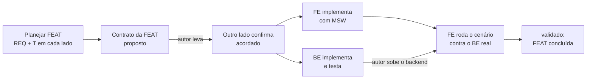

# Misadventures — Roadmap de desenvolvimento

> **Versão:** 0.16 · **Data:** 2026-11-14
>
> **Arquivo compartilhado:** a mesma cópia vive no repositório do frontend e no do backend; o autor copia o arquivo inteiro quando ele muda. Base: README Parte III (III.2 e III.4). As regras estão em [`README.md`](README.md); o que trafega entre os lados, em [`CONTRATO.md`](CONTRATO.md).

## 1. Como a entrega é organizada

- **Três momentos** (README III.4): (1) jogo funcional para **um jogador**; (2) **ajudantes de IA** no grupo; (3) jogo **online** com tempo real. Antes deles, o **momento 0** monta a fundação dos dois projetos.
- **Uma FEAT por vez, nos dois lados.** Toda implementação resolve uma feature ou um bug específico. Uma FEAT só está completa quando foi resolvida nos dois lados (ou no único lado que precisa de alteração) e o cenário do contrato foi **validado** com o backend real (README III.2).
- **O laboratório cresce junto.** Cada FEAT acrescenta ao laboratório (README II.6) os valores do Apêndice A que ela usa, em vez de o laboratório vir inteiro no fim.
- **Ordem sugerida pelo autor, com dois ajustes** (README III.4 permite): o laboratório começa cedo (FEAT-03); recrutar, combate em grupo e negociação vão para o momento 2, porque precisam de mais de um jogador.
- **Planejar uma FEAT** = transformá-la em requisitos (REQ), tarefas (T) e uma seção do contrato, em cada lado, antes de qualquer código.

## 2. Ponte entre os repositórios

O autor faz o controle e leva as informações de um projeto para o outro (README III.2). Para isso funcionar sem perder nada:

**Arquivos compartilhados** (cópias idênticas nos dois repositórios): `docs/README.md`, `docs/ROADMAP.md`, `docs/CONTRATO.md`. Quem altera um deles incrementa a versão, registra no histórico do arquivo e avisa o autor para copiar.

**Fluxo de uma FEAT:**

**Situação de cada seção do contrato:** `proposto (FE)` / `proposto (BE)` → `acordado` → `implementado (BE)` → `validado` (CONTRATO §0).

**Avisos:** sempre que um lado depender do outro, o agente para e mostra um aviso com o que levar, o que rodar lá e o que trazer de volta. No frontend, o formato é o **Aviso de backend** do `CLAUDE.md`. O backend deve ter o equivalente (**Aviso de frontend**) e uma forma de receber o contrato (confirmar, pedir mudança, marcar `implementado (BE)`).

**Conflitos:** só um lado altera o contrato por vez. Se os dois mexerem na mesma seção, vale a versão maior e o autor decide o que juntar.

## 3. Features

Situação por lado: `a fazer` · `em andamento` · `aguardando outro lado` · `pronto` (lado entregue) · `validado` · `—` (lado sem alteração).

### Momento 0 — Fundação

| FEAT | Título | README | FE | BE |
|---|---|---|---|---|
| FEAT-00 | Fundação: agentes, skills, specs, devlog, roadmap e contrato (só documentos) | III.1, III.2, III.4 | pronto | pronto |
| FEAT-01 | Esqueleto técnico. FE: ferramentas, guarda, pastas, MSW. BE: NestJS, Docker Compose (banco + backend), Drizzle, testes. Fecha com um endpoint mínimo que valida a ponte de ponta a ponta. | II.2, II.3 | pronto | pronto |
| FEAT-02 | Base visual: guia visual PSX, tokens, carta com categoria (ícone, imagem e label), termo do jogo com destaque e tooltip | II.4, II.5 | pronto | — |
| FEAT-03 | Esqueleto do laboratório: tela só no dev; BE com os valores ajustáveis numa configuração lida pelas regras | II.6, Apêndice A | validado | validado |

### Momento 1 — Um jogador

| FEAT | Título | README | FE | BE |
|---|---|---|---|---|
| FEAT-04 | Catálogo de cartas e coleções: modelo das cartas, conteúdo de teste, exibição de cada tipo de carta | 3.4, 4.3, 5, 14.1, 18.1, 27 | a fazer | pronto |
| FEAT-05 | Campanha solo: criar grupo de 1, saves, continuar, salvamento automático, encerrar sessão, abandonar a partida | 28.1 | em andamento | a fazer |
| FEAT-06 | Preparação da partida: classe e deck pré-pronto, valores iniciais, montagem do mapa, ordem e cidade inicial | 10.1, 3.5, 4.4, 8, 9 | a fazer | a fazer |
| FEAT-07 | Mapa e Movimentar | 3.5, 12.2 | a fazer | a fazer |
| FEAT-08 | A vez: pontos de ação, ações de zona disponíveis, encerrar a vez, rodadas | 11.1, 11.2, 12 | a fazer | a fazer |
| FEAT-09 | Deck de atributos: mão, Recuperar, Ajustar deck, build e trava | 4, 8.2, 12.5 | a fazer | a fazer |
| FEAT-10 | Recursos e onde ficam: inventário, equipar, Preparar, pasta, cofre, bolsa, limbo, Vasculhar | 5, 6, 9, 12.6 | a fazer | a fazer |
| FEAT-11 | Efeitos e status: exibição de efeitos, buffs e debuffs; catálogo de variações de efeitos validado pelo autor (BE/design) | 13, III.3 | a fazer | a fazer |
| FEAT-12 | Eventos aleatórios: fases, pagamento por partes, desistência, reposição, fuga | 14, 15 | a fazer | a fazer |
| FEAT-13 | Combate 1 jogador × 1 ou mais inimigos: inimigos e IA deles, habilidades, elementos, cálculo de dano | 16, 17, 18, 19.1 a 19.4, 19.6 | a fazer | a fazer |
| FEAT-14 | Nocaute, spawn, respawn e Salvar ponto de respawn (inclui o nocaute no jogo solo) | 20, 12.2 | a fazer | a fazer |
| FEAT-15 | Missões de zona, provação e mentor; especializações e multiclasse | 21, 8.3, 8.4 | a fazer | a fazer |
| FEAT-16 | Mercado: estoque, venda, boosters, singles, serviços | 24 | a fazer | a fazer |
| FEAT-17 | Ferreiro e Oficina do Artífice | 25 | a fazer | a fazer |
| FEAT-18 | Montarias e Estábulo | 26 | a fazer | a fazer |
| FEAT-19 | Conclusão da dimensão, chefe final, passagem para a próxima, save congelado | 3.2, 28.1 | a fazer | a fazer |

### Momento 2 — Ajudantes de IA

| FEAT | Título | README | FE | BE |
|---|---|---|---|---|
| FEAT-20 | Ajudantes de IA na criação do grupo, jogando suas vezes na ordem (BE: IA de jogador heurística com sorteio de classes) | II.7, 28.1, 11.2 | a fazer | a fazer |
| FEAT-21 | Ver as vezes dos outros jogadores "ao vivo" (depende da P-02) | 11.4 | a fazer | a fazer |
| FEAT-22 | Recrutar ajudantes e combate em grupo | 19.5 | a fazer | a fazer |
| FEAT-23 | Negociação | 23 | a fazer | a fazer |
| FEAT-24 | Métricas da IA no laboratório (taxa de nocaute, rodadas até concluir) | II.6, II.7 | a fazer | a fazer |

### Momento 3 — Online

| FEAT | Título | README | FE | BE |
|---|---|---|---|---|
| FEAT-25 | Autenticação por usuário e papel de admin (detalhes decididos pelo autor na hora, F29) | II.1 | a fazer | a fazer |
| FEAT-26 | Tempo real com Socket.IO: grupo com vários humanos, início de sessão, host | II.2, 28.1, 11.4 | a fazer | a fazer |
| FEAT-27 | Relógios da vez e jogador ausente | 11.3 | a fazer | a fazer |
| FEAT-28 | Desconexão e IA que assume o personagem | 28.1 | a fazer | a fazer |
| FEAT-29 | Executável Tauri (cliente do servidor remoto) | II.2 | a fazer | — |

### Depois do jogo funcional

- **Manual de regras para jogadores** (README III.4, Etapa 2): só quando todas as regras estiverem fechadas e validadas.

## 4. Pendências de decisão

| ID | Pendência | Decidir antes de | Proposta |
|---|---|---|---|
| P-01 | Validação dos dados recebidos no frontend: Zod (lib nova) ou validadores à mão | FE T-03 (FEAT-01) | a definir com o autor |
| P-02 | Como o jogador vê as vezes dos outros jogadores antes do tempo real | FEAT-21 | o backend devolve a lista ordenada de `domainEvent`; o frontend anima um por um; no momento 3 muda só o transporte |

## 5. Histórico

| Versão | Data | Mudança |
|---|---|---|
| 0.1 | 2026-11-13 | Versão inicial (FEAT-00 do frontend). |
| 0.2 | 2026-11-13 | FEAT-00 do backend `pronto`: agentes, skills, spec, devlog e Aviso de frontend; contrato v0.2 (§1 e §2 `acordado`). |
| 0.3 | 2026-11-14 | FEAT-01: lado FE das ferramentas pronto (T-01 a T-03); contrato da FEAT-01 proposto pelo FE (CONTRATO v0.3, `GET /health`); FE `aguardando outro lado`. |
| 0.4 | 2026-11-14 | FEAT-01: contrato `acordado` (CONTRATO v0.4, mudanças pedidas pelo BE aceitas pelo FE); FE `em andamento`. |
| 0.5 | 2026-11-14 | FEAT-01: lado BE `pronto` (T-01 a T-03); CONTRATO v0.5 marca a FEAT-01 `implementado (BE)`. |
| 0.6 | 2026-11-14 | FEAT-01: lado FE `pronto` (T-04, consumo do `GET /health` com MSW); falta a validação contra o backend real. FEAT-02: lado FE `pronto`. Mescla das duas versões 0.5 (BE e FE), editadas em paralelo. |
| 0.7 | 2026-11-14 | FEAT-03: contrato proposto pelo BE (CONTRATO v0.6); BE `aguardando outro lado`. |
| 0.8 | 2026-11-14 | FEAT-03: contrato `acordado` pelo FE (CONTRATO v0.7); FE `a fazer` (falta planejar os REQs e as tarefas na spec); o BE pode implementar. |
| 0.9 | 2026-11-14 | FEAT-03: BE sai de `aguardando outro lado` para `a fazer` (tarefas já planejadas na SPEC-BACKEND v0.6). |
| 0.10 | 2026-11-14 | FEAT-03: lado BE `pronto` (T-04 a T-06); CONTRATO v0.8 marca a FEAT-03 `implementado (BE)`. |
| 0.11 | 2026-11-14 | FEAT-03 `validado` (CONTRATO v0.9): lado FE pronto com MSW (T-08 a T-10, SPEC-FRONTEND v0.15) e cenários do contrato passando contra o backend real. FEAT concluída. |
| 0.12 | 2026-11-14 | FEAT-04: planejada no BE (SPEC-BACKEND v0.10, T-07 a T-09); contrato proposto pelo BE (CONTRATO v0.10); BE `aguardando outro lado`. |
| 0.13 | 2026-11-14 | FEAT-04: contrato `acordado` pelo FE (CONTRATO v0.11); planejada no FE (SPEC-FRONTEND v0.18, T-11 a T-15); FE `a fazer`; BE sai de `aguardando outro lado` para `a fazer`. |
| 0.14 | 2026-11-14 | FEAT-04: lado BE `pronto` (T-07 a T-09, SPEC-BACKEND v0.14); CONTRATO v0.12 marca a FEAT-04 `implementado (BE)`. |
| 0.15 | 2026-11-14 | FEAT-05: planejada no BE (SPEC-BACKEND v0.15, T-10 a T-13); contrato proposto pelo BE (CONTRATO v0.13); BE `aguardando outro lado` (a T-10, só core, não depende do contrato). |
| 0.16 | 2026-11-14 | FEAT-05: contrato `acordado` pelo FE (CONTRATO v0.14); planejada no FE (SPEC-FRONTEND v0.23); FE `em andamento`; BE sai de `aguardando outro lado` para `a fazer`. |
