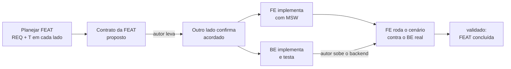

# Misadventures — Roadmap de desenvolvimento

> **Versão:** 0.78 · **Data:** 2026-11-24
>
> **Arquivo compartilhado:** a mesma cópia vive no repositório do frontend e no do backend; o autor copia o arquivo inteiro quando ele muda. Base: README Parte III (III.2 e III.4). As regras estão em [`README.md`](README.md); o que trafega entre os lados, em [`CONTRATO.md`](CONTRATO.md).

## 1. Como a entrega é organizada

- **Três momentos** (README III.4): (1) jogo funcional para **um jogador**; (2) **ajudantes de IA** no grupo; (3) jogo **online** com tempo real. Antes deles, o **momento 0** monta a fundação dos dois projetos.
- **Uma FEAT por vez, nos dois lados.** Toda implementação resolve uma feature ou um bug específico. Uma FEAT só está completa quando foi resolvida nos dois lados (ou no único lado que precisa de alteração) e o cenário do contrato foi **validado** com o backend real (README III.2).
- **O laboratório cresce junto.** Cada FEAT acrescenta ao laboratório (README II.6) os valores do Apêndice A que ela usa, em vez de o laboratório vir inteiro no fim.
- **Ordem sugerida pelo autor, com dois ajustes** (README III.4 permite): o laboratório começa cedo (FEAT-03); recrutar, combate em grupo e negociação vão para o momento 2, porque precisam de mais de um jogador.
- **Planejar uma FEAT** = transformá-la em requisitos (REQ), tarefas (T) e uma seção do contrato, em cada lado, antes de qualquer código.

## 2. Ponte entre os repositórios

O autor faz o controle e leva as informações de um projeto para o outro (README III.2). Para isso funcionar sem perder nada:

**Arquivos compartilhados** (cópias idênticas nos dois repositórios): `docs/README.md`, `docs/ROADMAP.md`, `docs/CONTRATO.md`. Quem altera um deles incrementa a versão, registra no histórico do arquivo e avisa o autor para copiar.

**Fluxo de uma FEAT:**

**Situação de cada seção do contrato:** `proposto (FE)` / `proposto (BE)` → `acordado` → `implementado (BE)` → `validado` (CONTRATO §0).

**Avisos:** sempre que um lado depender do outro, o agente para e mostra um aviso com o que levar, o que rodar lá e o que trazer de volta. No frontend, o formato é o **Aviso de backend** do `CLAUDE.md`. O backend deve ter o equivalente (**Aviso de frontend**) e uma forma de receber o contrato (confirmar, pedir mudança, marcar `implementado (BE)`).

**Conflitos:** só um lado altera o contrato por vez. Se os dois mexerem na mesma seção, vale a versão maior e o autor decide o que juntar.

## 3. Features

Situação por lado: `a fazer` · `em andamento` · `aguardando outro lado` · `pronto` (lado entregue) · `validado` · `—` (lado sem alteração).

### Momento 0 — Fundação

| FEAT | Título | README | FE | BE |
|---|---|---|---|---|
| FEAT-00 | Fundação: agentes, skills, specs, devlog, roadmap e contrato (só documentos) | III.1, III.2, III.4 | pronto | pronto |
| FEAT-01 | Esqueleto técnico. FE: ferramentas, guarda, pastas, MSW. BE: NestJS, Docker Compose (banco + backend), Drizzle, testes. Fecha com um endpoint mínimo que valida a ponte de ponta a ponta. | II.2, II.3 | pronto | pronto |
| FEAT-02 | Base visual: guia visual PSX, tokens, carta com categoria (ícone, imagem e label), termo do jogo com destaque e tooltip | II.4, II.5 | pronto | — |
| FEAT-03 | Esqueleto do laboratório: tela só no dev; BE com os valores ajustáveis numa configuração lida pelas regras | II.6, Apêndice A | validado | validado |

### Momento 1 — Um jogador

| FEAT | Título | README | FE | BE |
|---|---|---|---|---|
| FEAT-04 | Catálogo de cartas e coleções: modelo das cartas, conteúdo de teste, exibição de cada tipo de carta | 3.4, 4.3, 5, 14.1, 18.1, 27 | validado | validado |
| FEAT-05 | Campanha solo: criar grupo de 1, saves, continuar, salvamento automático, encerrar sessão, abandonar a partida | 28.1 | validado | validado |
| FEAT-31 | Editor de conteúdo no laboratório (só dev): coleções e cartas dos 6 tipos, rascunho e publicação, validar coleção como dimensão, exportar e importar; o BE grava em arquivos JSON. Cresce com cada FEAT que trouxer conteúdo novo | 27, II.6, 3.5, Apêndice B (T1) | validado | validado |
| FEAT-06 | Preparação da partida: classe e deck pré-pronto, valores iniciais, montagem do mapa, ordem e cidade inicial | 10.1, 3.5, 4.4, 8, 9 | validado | validado |
| FEAT-07 | Mapa e Movimentar | 3.5, 12.2 | validado | validado |
| FEAT-08 | A vez: pontos de ação, ações de zona disponíveis, encerrar a vez, rodadas | 11.1, 11.2, 12 | validado | validado |
| FEAT-09 | Deck de atributos: mão, Recuperar, Ajustar deck, build e trava | 4, 8.2, 12.5 | validado | validado |
| FEAT-10 | Inventário, equipar e bolsa: inventário e empilhamento, Preparar (trocar equipamentos), modificadores com equipamentos, bolsa de ouro; doação do laboratório para montar o estado | 5, 6.1, 6.2, 9.1, 12.2 | validado | validado |
| FEAT-32 | Cofre e Vasculhar: Usar cofre (slots, slots de decks, ouro, Descartar), limbo, deck de recompensas na Carta de Dimensão, Vasculhar | 3.4, 6.4, 6.5, 12.6 | validado | validado |
| FEAT-11 | Efeitos e status: exibição de efeitos, buffs e debuffs; catálogo de variações de efeitos validado pelo autor (BE/design) | 13, III.3 | validado | validado |
| FEAT-12 | Eventos aleatórios: fases, pagamento por partes, desistência, reposição, fuga | 14, 15 | validado | validado |
| FEAT-13 | Combate 1 jogador × 1 ou mais inimigos: inimigos e IA deles, habilidades, elementos, cálculo de dano | 16, 17, 18, 19.1 a 19.4, 19.6 | validado | validado |
| FEAT-14 | Nocaute, spawn, respawn e Salvar ponto de respawn (inclui o nocaute no jogo solo) | 20, 12.2 | validado | validado |
| FEAT-15 | Missões de zona, provação e mentor; especializações e multiclasse | 21, 8.3, 8.4 | validado | validado |
| FEAT-16 | Mercado: estoque, venda, boosters, singles, serviços | 24 | validado | validado |
| FEAT-17 | Ferreiro e Oficina do Artífice | 25 | aguardando outro lado | a fazer |
| FEAT-18 | Montarias e Estábulo | 26 | a fazer | a fazer |
| FEAT-19 | Conclusão da dimensão, chefe final, passagem para a próxima, save congelado | 3.2, 28.1 | a fazer | a fazer |

### Momento 2 — Ajudantes de IA

| FEAT | Título | README | FE | BE |
|---|---|---|---|---|
| FEAT-20 | Ajudantes de IA na criação do grupo, jogando suas vezes na ordem (BE: IA de jogador heurística com sorteio de classes) | II.7, 28.1, 11.2 | a fazer | a fazer |
| FEAT-21 | Ver as vezes dos outros jogadores "ao vivo" (depende da P-02) | 11.4 | a fazer | a fazer |
| FEAT-22 | Recrutar ajudantes e combate em grupo | 19.5 | a fazer | a fazer |
| FEAT-23 | Negociação | 23 | a fazer | a fazer |
| FEAT-24 | Métricas da IA no laboratório (taxa de nocaute, rodadas até concluir) | II.6, II.7 | a fazer | a fazer |

### Momento 3 — Online

| FEAT | Título | README | FE | BE |
|---|---|---|---|---|
| FEAT-25 | Autenticação por usuário e papel de admin (detalhes decididos pelo autor na hora, F29) | II.1 | a fazer | a fazer |
| FEAT-26 | Tempo real com Socket.IO: grupo com vários humanos, início de sessão, host | II.2, 28.1, 11.4 | a fazer | a fazer |
| FEAT-27 | Relógios da vez e jogador ausente | 11.3 | a fazer | a fazer |
| FEAT-28 | Desconexão e IA que assume o personagem | 28.1 | a fazer | a fazer |
| FEAT-30 | Acabamento visual da interface: layout de jogo para PC em todas as telas, componentes e estados, tratamento PSX, artes e ícones do autor (feita **antes** da FEAT-29) | II.1, II.4, II.5 | a fazer | — |
| FEAT-29 | Executável Tauri (cliente do servidor remoto) | II.2 | a fazer | — |

**FEAT-30 (decisão do autor, 2026-11-15):** até lá, as tarefas cuidam de funcionalidade e comportamento, com a base visual da FEAT-02 (tokens e fontes) e sem passada de layout. A FEAT-30 vem depois de todas as FEATs funcionais e antes do executável (FEAT-29), para que ele já saia com o visual final. O que ela precisa (pesquisa de diretrizes, perguntas ao autor, lista de artes) está em `.claude/skills/guia-visual/SKILL.md` §8, no frontend.

**FEAT-31 (decisão do autor, 2026-11-15):** vem logo depois da FEAT-05, para o autor criar conteúdo de teste desde a FEAT-06. Como o laboratório, o editor cresce junto: cada FEAT que trouxer conteúdo novo (FEAT-06 classes com deck pré-pronto, Carta de Dimensão e forma das setas das zonas; FEAT-11 efeitos estruturados, FEAT-15 missões, FEAT-16 boosters e estoque, FEAT-17 encantamentos, FEAT-18 montarias, FEAT-19 campos de conclusão da Carta de Dimensão) acrescenta os campos dela ao editor.

### Depois do jogo funcional

- **Manual de regras para jogadores** (README III.4, Etapa 2): só quando todas as regras estiverem fechadas e validadas.

## 4. Pendências de decisão

| ID | Pendência | Decidir antes de | Proposta |
|---|---|---|---|
| P-01 | Validação dos dados recebidos no frontend: Zod (lib nova) ou validadores à mão | FE T-03 (FEAT-01) | a definir com o autor |
| P-02 | Como o jogador vê as vezes dos outros jogadores antes do tempo real | FEAT-21 | o backend devolve a lista ordenada de `domainEvent`; o frontend anima um por um; no momento 3 muda só o transporte |

## 5. Histórico

| Versão | Data | Mudança |
|---|---|---|
| 0.1 | 2026-11-13 | Versão inicial (FEAT-00 do frontend). |
| 0.2 | 2026-11-13 | FEAT-00 do backend `pronto`: agentes, skills, spec, devlog e Aviso de frontend; contrato v0.2 (§1 e §2 `acordado`). |
| 0.3 | 2026-11-14 | FEAT-01: lado FE das ferramentas pronto (T-01 a T-03); contrato da FEAT-01 proposto pelo FE (CONTRATO v0.3, `GET /health`); FE `aguardando outro lado`. |
| 0.4 | 2026-11-14 | FEAT-01: contrato `acordado` (CONTRATO v0.4, mudanças pedidas pelo BE aceitas pelo FE); FE `em andamento`. |
| 0.5 | 2026-11-14 | FEAT-01: lado BE `pronto` (T-01 a T-03); CONTRATO v0.5 marca a FEAT-01 `implementado (BE)`. |
| 0.6 | 2026-11-14 | FEAT-01: lado FE `pronto` (T-04, consumo do `GET /health` com MSW); falta a validação contra o backend real. FEAT-02: lado FE `pronto`. Mescla das duas versões 0.5 (BE e FE), editadas em paralelo. |
| 0.7 | 2026-11-14 | FEAT-03: contrato proposto pelo BE (CONTRATO v0.6); BE `aguardando outro lado`. |
| 0.8 | 2026-11-14 | FEAT-03: contrato `acordado` pelo FE (CONTRATO v0.7); FE `a fazer` (falta planejar os REQs e as tarefas na spec); o BE pode implementar. |
| 0.9 | 2026-11-14 | FEAT-03: BE sai de `aguardando outro lado` para `a fazer` (tarefas já planejadas na SPEC-BACKEND v0.6). |
| 0.10 | 2026-11-14 | FEAT-03: lado BE `pronto` (T-04 a T-06); CONTRATO v0.8 marca a FEAT-03 `implementado (BE)`. |
| 0.11 | 2026-11-14 | FEAT-03 `validado` (CONTRATO v0.9): lado FE pronto com MSW (T-08 a T-10, SPEC-FRONTEND v0.15) e cenários do contrato passando contra o backend real. FEAT concluída. |
| 0.12 | 2026-11-14 | FEAT-04: planejada no BE (SPEC-BACKEND v0.10, T-07 a T-09); contrato proposto pelo BE (CONTRATO v0.10); BE `aguardando outro lado`. |
| 0.13 | 2026-11-14 | FEAT-04: contrato `acordado` pelo FE (CONTRATO v0.11); planejada no FE (SPEC-FRONTEND v0.18, T-11 a T-15); FE `a fazer`; BE sai de `aguardando outro lado` para `a fazer`. |
| 0.14 | 2026-11-14 | FEAT-04: lado BE `pronto` (T-07 a T-09, SPEC-BACKEND v0.14); CONTRATO v0.12 marca a FEAT-04 `implementado (BE)`. |
| 0.15 | 2026-11-14 | FEAT-05: planejada no BE (SPEC-BACKEND v0.15, T-10 a T-13); contrato proposto pelo BE (CONTRATO v0.13); BE `aguardando outro lado` (a T-10, só core, não depende do contrato). |
| 0.16 | 2026-11-14 | FEAT-05: contrato `acordado` pelo FE (CONTRATO v0.14); planejada no FE (SPEC-FRONTEND v0.23); FE `em andamento`; BE sai de `aguardando outro lado` para `a fazer`. |
| 0.17 | 2026-11-14 | FEAT-04: lado FE `pronto` com MSW (SPEC-FRONTEND v0.24, T-11 a T-15); falta validar contra o backend real (`/retorno-backend`). |
| 0.18 | 2026-11-14 | FEAT-04 `validado` nas duas colunas (CONTRATO v0.15): cenários e e2e da área `lab` contra o backend real. |
| 0.19 | 2026-11-15 | FEAT-05: lado BE `pronto` (T-10 a T-13, SPEC-BACKEND v0.19); CONTRATO v0.16 marca a FEAT-05 `implementado (BE)`. |
| 0.20 | 2026-11-15 | FEAT-05: lado FE `pronto` com MSW (SPEC-FRONTEND v0.28, T-16 a T-19). Os 7 cenários já passaram com curl contra o backend real; falta conferir as telas contra ele (`/retorno-backend`). |
| 0.21 | 2026-11-15 | FEAT-05 `validado` nas duas colunas (CONTRATO v0.17): cenários com `curl` e as telas da campanha contra o backend real. |
| 0.22 | 2026-11-15 | FEAT-30 (acabamento visual da interface, só FE) criada pelo autor: vem depois de todas as FEATs funcionais e antes da FEAT-29. |
| 0.23 | 2026-11-15 | FEAT-31 (editor de conteúdo no laboratório, só dev) criada pelo autor, logo depois da FEAT-05; planejada no FE (SPEC-FRONTEND v0.29, T-20 a T-27); contrato a propor. |
| 0.24 | 2026-11-15 | FEAT-06: planejada no BE (SPEC-BACKEND v0.20, T-14 a T-18); contrato proposto pelo BE (CONTRATO v0.19), que também altera tipos e cenários das FEAT-03, 04, 05 e 31 e põe no editor as classes e a Carta de Dimensão (decisão do autor); BE `aguardando outro lado`. Nota da FEAT-31: a FEAT-06 acrescenta classes, Carta de Dimensão e forma das setas; a FEAT-19 só acrescenta os campos de conclusão. Mescla com a v0.23 do FE, editada em paralelo. |
| 0.25 | 2026-11-16 | Status corrigidos (aviso do FE): FEAT-06 BE `a fazer` (contrato `acordado` na CONTRATO v0.21; tarefas depois das da FEAT-31, SPEC-BACKEND D-45); FEAT-31 FE `em andamento` (T-20 a T-23 feitas). FEAT-31 BE planejada (SPEC-BACKEND v0.21, T-19 a T-21), `a fazer`. |
| 0.26 | 2026-11-16 | FEAT-31: lado BE `pronto` (T-19 a T-21, SPEC-BACKEND v0.24); CONTRATO v0.23 marca a FEAT-31 `implementado (BE)`. Próximo no BE: FEAT-06 (T-14). |
| 0.27 | 2026-11-16 | FEAT-31: lado FE `aguardando outro lado` (SPEC-FRONTEND v0.37, T-20 a T-27 feitas com MSW); falta validar contra o backend real (`/retorno-backend`). |
| 0.28 | 2026-11-16 | FEAT-31 `validado` nas duas colunas (CONTRATO v0.24): cenários com chamadas HTTP e as telas do editor contra o backend real. |
| 0.29 | 2026-11-16 | FEAT-06: lado FE `aguardando outro lado` (SPEC-FRONTEND v0.45, T-28 a T-34 feitas com MSW); falta validar contra o backend real (`/retorno-backend`) quando o BE estiver `pronto`. |
| 0.30 | 2026-11-17 | FEAT-06: lado BE `pronto` (T-14 a T-18, SPEC-BACKEND v0.29); CONTRATO v0.25 marca a FEAT-06 `implementado (BE)`. Falta o FE validar contra o backend real. |
| 0.31 | 2026-11-17 | FEAT-06 `validado` nas duas colunas (CONTRATO v0.26): cenários com chamadas HTTP e as telas contra o backend real. |
| 0.32 | 2026-11-17 | FEAT-07: lado FE `aguardando outro lado` (pronto com MSW; contrato v0.28); lado BE `em andamento` (T-22 feita, falta a T-23). Mescla com a cópia v0.31 do FE. |
| 0.33 | 2026-11-17 | FEAT-07: lado BE `pronto` (T-22 e T-23, SPEC-BACKEND v0.32); CONTRATO v0.29 marca a FEAT-07 `implementado (BE)`. Falta o FE validar contra o backend real. |
| 0.34 | 2026-11-17 | FEAT-07 `validado` nas duas colunas (CONTRATO v0.30): cenários com chamadas HTTP e a tela do grupo contra o backend real. |
| 0.35 | 2026-11-17 | FEAT-08: lado BE `aguardando outro lado` (spec v0.33 planejada; CONTRATO v0.31 com a seção FEAT-08 `proposto (BE)`). Falta o FE confirmar o contrato. |
| 0.36 | 2026-11-17 | FEAT-08: contrato `acordado` pelo FE (CONTRATO v0.32); FE `a fazer` (falta planejar REQs e tarefas na spec); BE sai de `aguardando outro lado` para `a fazer`. |
| 0.37 | 2026-11-17 | FEAT-08: BE `pronto` (T-24 e T-25; CONTRATO v0.33 `implementado (BE)`). Falta o FE implementar e validar contra o backend real. |
| 0.38 | 2026-11-17 | FEAT-08: FE `pronto` com MSW (T-38 a T-40, spec v0.53). Falta validar contra o backend real (`/retorno-backend`). |
| 0.39 | 2026-11-17 | FEAT-08 `validado` nas duas colunas (CONTRATO v0.34): cenários com chamadas HTTP e a tela do grupo contra o backend real. |
| 0.40 | 2026-11-17 | FEAT-09: lado BE `aguardando outro lado` (spec v0.36 planejada; CONTRATO v0.35 com a seção FEAT-09 `proposto (BE)`). Falta o FE confirmar o contrato. |
| 0.41 | 2026-11-17 | FEAT-09: contrato `acordado` pelo FE (CONTRATO v0.36); FE `a fazer` (falta planejar REQs e tarefas na spec); BE sai de `aguardando outro lado` para `a fazer`. |
| 0.42 | 2026-11-17 | FEAT-09: lado BE `pronto` (spec v0.38, T-26 e T-27; CONTRATO v0.37 `implementado (BE)`). Falta o FE implementar e validar contra o backend real. |
| 0.43 | 2026-11-17 | FEAT-09: FE `pronto` com MSW (T-41 a T-44, spec v0.58). Falta validar contra o backend real (`/retorno-backend`). |
| 0.44 | 2026-11-17 | FEAT-09 `validado` nas duas colunas (CONTRATO v0.38): cenários com chamadas HTTP e a tela do grupo contra o backend real. |
| 0.45 | 2026-11-17 | FEAT-10 dividida (decisão do autor): a FEAT-10 fica com inventário, equipar (Preparar parte a), bolsa e a doação do laboratório; a FEAT-32 nova (logo depois da FEAT-10) fica com Usar cofre, limbo, deck de recompensas e Vasculhar. Decisões para a FEAT-32: deck de recompensas na Carta de Dimensão; Vasculhar numa etapa só. |
| 0.46 | 2026-11-17 | FEAT-10: lado BE `aguardando outro lado` (spec v0.39 planejada; CONTRATO v0.39 com a seção FEAT-10 `proposto (BE)`). Falta o FE confirmar o contrato. |
| 0.47 | 2026-11-17 | FEAT-10: contrato `acordado` pelo FE (CONTRATO v0.40); FE `a fazer` (falta planejar REQs e tarefas na spec); BE sai de `aguardando outro lado` para `a fazer`. |
| 0.48 | 2026-11-17 | FEAT-10: BE `pronto` (CONTRATO v0.41, `implementado (BE)`); falta o FE implementar e validar contra o backend real. |
| 0.49 | 2026-11-18 | FEAT-10: FE `pronto` com MSW (T-45 a T-48); falta validar contra o backend real (`/retorno-backend`). |
| 0.50 | 2026-11-18 | FEAT-10 `validado` nas duas colunas (CONTRATO v0.42): cenários com chamadas HTTP e a tela contra o backend real; 3 recusas sem carta na `base` ficam com os e2e do backend. |
| 0.51 | 2026-11-18 | FEAT-32: coluna BE `pronto` (CONTRATO v0.47, `implementado (BE)`); FE `em andamento` (T-49 a T-53 a fazer). |
| 0.52 | 2026-11-18 | FEAT-32: coluna FE `pronto` (T-49 a T-53 concluídas com MSW); falta validar contra o backend real (`/retorno-backend`). |
| 0.53 | 2026-11-18 | FEAT-32 `validado` nas duas colunas (CONTRATO v0.48): cenários com chamadas HTTP e as telas contra o backend real, com conteúdo temporário desfeito no fim. |
| 0.54 | 2026-11-19 | FEAT-11: coluna BE `pronto` (CONTRATO v0.52, `implementado (BE)`). Falta a validação do frontend contra o backend real. |
| 0.55 | 2026-11-20 | FEAT-11: coluna FE `pronto` com MSW. A T-56 completa a ativação e a exibição de status na partida. A T-57 valida os cenários com o backend real. |
| 0.56 | 2026-11-20 | FEAT-11 `validado` nas duas colunas (CONTRATO v0.53): cenários HTTP e telas contra o backend real, com MSW desligado. |
| 0.57 | 2026-11-20 | FEAT-12: proposta BE no CONTRATO v0.54. FE fecha os critérios e revisa o contrato antes de implementar cliente, fixtures e telas. |
| 0.58 | 2026-11-20 | FEAT-12: aceite do frontend à v0.55 registrado no CONTRATO v0.56 (`acordado`). FE pode implementar cliente, fixtures e telas com MSW. A validação integrada depende de `implementado (BE)`, URL do backend de teste e dados dos cenários. |
| 0.59 | 2026-11-20 | FEAT-12: BE `pronto` (CONTRATO v0.58, `implementado (BE)`). Validação do frontend contra o backend real pendente. |
| 0.60 | 2026-11-20 | FEAT-12 validada na T-62 (CONTRATO v0.59), com MSW desligado. Prazos multiplayer seguem a FEAT-26. |
| 0.61 | 2026-11-20 | FEAT-13 em andamento no backend. T-44 com proposta de contrato BE v0.60 em revisão. |
| 0.62 | 2026-11-20 | FEAT-13 com CONTRATO v0.62 acordado e T-44 concluída. Próxima tarefa BE: T-45, após autorização do autor. |
| 0.63 | 2026-11-20 | FEAT-13 com BE pronto após a T-49 (CONTRATO v0.65). Validação integrada pendente. |
| 0.64 | 2026-11-21 | FEAT-13 validada nos dois lados após a T-67 (CONTRATO v0.66). |
| 0.65 | 2026-11-22 | FEAT-14 validada nos dois lados após a revalidação solo da T-54 (CONTRATO v0.74). |
| 0.66 | 2026-11-22 | FEAT-15 solo passou com MSW no frontend (devlog 091) e tem planejamento no backend (devlog 066). A validação integrada aguarda a implementação do backend e os dados de teste. |
| 0.67 | 2026-11-23 | FEAT-15 pronta no backend (CONTRATO v0.77, T-60, devlog 072). Validação integrada solo com MSW desligado em andamento. |
| 0.68 | 2026-11-23 | FEAT-15 `validado` nos dois lados (CONTRATO v0.78): 13 campanhas da T-60, laboratório e editor contra o backend real, com MSW desligado (devlog FE 093). |
| 0.69 | 2026-11-23 | FEAT-16: planejada no BE (SPEC-BACKEND v0.73, T-61 a T-66); contrato proposto pelo BE (CONTRATO v0.79); BE `aguardando outro lado`. |
| 0.70 | 2026-11-23 | FEAT-16: contrato `acordado` pelo FE (CONTRATO v0.80); FE `a fazer` (falta planejar REQs e tarefas na spec); BE sai de `aguardando outro lado` para `a fazer`. |
| 0.71 | 2026-11-23 | FEAT-16: BE `pronto` (`implementado (BE)` no CONTRATO v0.81, T-61 a T-66); falta a validação integrada do FE. |
| 0.72 | 2026-11-23 | Correção da linha da FEAT-16 na tabela do momento 1: a v0.71 trazia as colunas trocadas (FE `pronto`, BE `a fazer`). O certo é FE `a fazer` (REQs e tarefas ainda não planejados) e BE `pronto`. |
| 0.73 | 2026-11-24 | FEAT-16: FE `aguardando outro lado` (T-70 a T-73 prontas com MSW); falta a validação contra o backend real (T-74). |
| 0.74 | 2026-11-24 | FEAT-16 `validado` nas duas colunas (CONTRATO v0.82): T-74 com as 11 campanhas da T-66 contra o backend real, MSW desligado. |
| 0.75 | 2026-11-24 | FEAT-17: planejada no BE (SPEC-BACKEND v0.81, T-67 a T-73); contrato proposto pelo BE (CONTRATO v0.83); BE `aguardando outro lado`. |
| 0.76 | 2026-11-24 | FEAT-17: FE pede mudanças na seção (CONTRATO v0.84, `proposto (FE)`); FE `aguardando outro lado` (REQs e tarefas só depois do acordo). |
| 0.77 | 2026-11-24 | FEAT-17: contrato `acordado` pelo BE (CONTRATO v0.85, pedidos do FE aceitos); FE `a fazer` (falta planejar REQs e tarefas na spec); BE sai de `aguardando outro lado` para `a fazer` (T-67 liberada). |
| 0.78 | 2026-11-24 | FEAT-17: FE `aguardando outro lado` (T-75 a T-78 prontas com MSW); falta o BE e a validação contra o backend real (T-79). |
